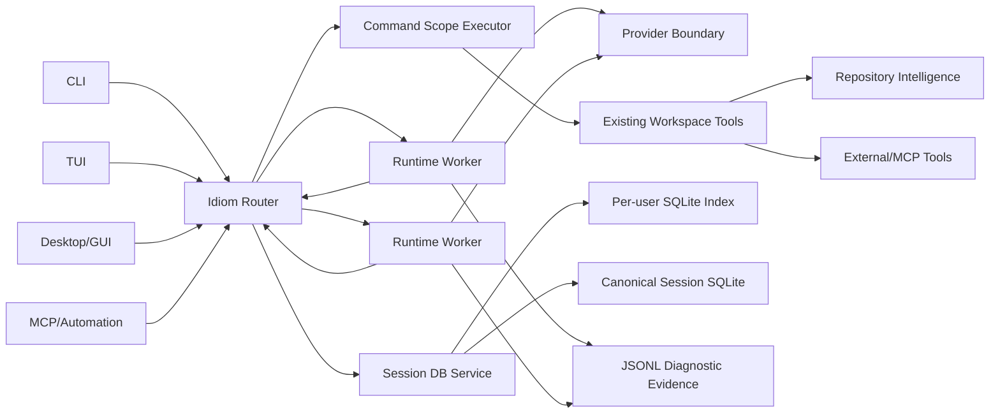

# Idiom-Tura Comparative Architecture and Adoption Design

Status: Proposed

Date: 2026-07-16

Scope: Idiom architecture, runtime, provider boundary, tool execution, session
persistence, process ownership, and user-facing surfaces.

## 1. Executive decision

Idiom should not become a Go translation of Tura. Idiom's defensible advantage is
its evidence-first coding harness: repository comprehension, language-aware
navigation, explicit workflow contracts, verification planning, audit evidence,
and local-model lifecycle support. Tura's defensible advantage is its execution
and product substrate: batched tool execution, normalized provider protocols,
durable concurrent sessions, explicit process ownership, rich media tools, and a
substantially more mature GUI/TUI.

The recommended destination is a staged hybrid:

1. Keep Idiom's repository intelligence, evidence contracts, policy engine,
   workflows, MCP surface, verification gates, and local backend management.
2. Add a strict `command_run` composite tool over Idiom's existing tools. This is
   the highest-value, lowest-topology change.
3. Extract a provider boundary with canonical request, stream, tool-call, usage,
   retry, and capability types. Keep local server launch outside that boundary.
4. Introduce a single-writer SQLite session service when multi-front concurrent
   sessions become a supported product contract.
5. Introduce a router that owns turn admission, runtime-worker lifecycle, and
   command child-process scopes. Move `command_run` process ownership to it only
   after the router is proven.
6. Build rich UI and media/web tools on those backend contracts, not before them.

The full router/session-service topology is included below. It is the proposed
destination for concurrent CLI, TUI, desktop, and automation fronts, not a reason
to ship four daemons in the first patch.

## 2. Decision drivers

The design is optimized for these properties, in order:

1. Preserve Idiom's behavioral and safety contracts.
2. Reduce model round trips without hiding or weakening verification.
3. Make concurrent session behavior durable and recoverable.
4. Give every process, file, database, and protocol one clear owner.
5. Keep provider-specific behavior out of the agent loop.
6. Allow richer user surfaces without making the UI the source of truth.
7. Retain a simple local CLI path and avoid mandatory service topology where it
   produces no user-visible value.
8. Measure improvements against matched tasks rather than relying on feature
   counts or another project's benchmark claims.

## 3. Scope and non-goals

### 3.1 In scope

- Comparative assessment of Idiom and `../tura`.
- A composite batch/step execution contract.
- Provider request and stream normalization.
- Durable SQLite session persistence and migration from JSONL history.
- Router, worker, child-process, cancellation, and recovery ownership.
- Compatibility, security, performance, and rollout gates.
- Integration order for GUI, TUI, web discovery, and media inspection.

### 3.2 Non-goals

- Porting Tura source code.
- Replacing Idiom's context graph with shell search.
- Replacing typed workflow contracts with prompt-only self-reflection.
- Making personas, avatars, media generation, or a planning calendar part of the
  coding runtime's correctness boundary.
- Treating the number of configured providers as proof that every provider works.
- Requiring the router for a one-shot command until measurements justify it.
- Designing a cloud control plane or multi-user hosted service.

## 4. Evidence and comparison method

This assessment uses implementation, tests, architecture documents, manifests,
and runnable checks from both repositories. README claims are treated as claims,
not as independent proof. There is no matched Idiom-versus-Tura benchmark in
either repository, so this document does not claim that either system is
universally the better coding agent.

Useful scale indicators from the inspected working trees:

| Measure | Idiom | Tura | Interpretation |
| --- | ---: | ---: | --- |
| Production Go files | 700 | n/a | Idiom has a broad harness and workflow surface. |
| Go test files | 702 | n/a | Idiom has unusually dense backend contract coverage. |
| Production/test Go lines | about 330k/about 257k | n/a | The harness is deep, but also expensive to change. |
| Rust lines, including tests | n/a | about 162k | Tura's backend is smaller but split across several services/crates. |
| App TypeScript/TSX lines | 751 | about 57k | Tura's user-facing product is much more mature. |
| Tura GUI test files | n/a | 70 | Tura tests UI behavior, rich content, and performance directly. |

Counts describe investment, not quality. The behavior and ownership evidence
below matters more.

## 5. Where Idiom is better

### 5.1 Repository intelligence and localization

Idiom has a persistent context graph, incremental refresh, graph queries, context
packets, ranker state, freshness evidence, and language-aware navigation for Go,
C/C++, Python, TypeScript, Rust, and Java. Its tool catalog distinguishes
capabilities such as symbols, definitions, references, call relationships,
implementations, diagnostics, outlines, and related files.

Evidence:

- `internal/repository/comprehension/graph.go:31-154`
- `internal/repository/comprehension/ranker_learning.go:213-319`
- `internal/repository/semantic/languagetools/tool_catalog.go:218-255`
- `internal/capabilities/workspace/tool_manifest.go:19-98`

Tura mostly gives the model shell-oriented discovery through `command_run`. That
is fast and flexible, but it is not equivalent to a freshness-aware repository
memory and semantic localization layer.

### 5.2 Enforceable evidence and workflow contracts

Idiom separates model strategy from harness authority and has typed contracts
for plan artifacts, task ledgers, autonomy, approvals, recovery, postflight,
verification, and final-answer acceptance. Verification commands are planned
from explicit requests and changed paths, normalized to argv, deduplicated, and
rejected when unsafe or unsupported.

Evidence:

- `docs/architecture.md:1-38`
- `internal/workflows/planexecute/verification_planner.go:13-145`
- `internal/capabilities/workspace/coding_rules_check.go:13-62`
- `internal/evidence/productevidence/`
- `internal/contracts/`

Tura has strong runtime checkpoints and task status, but more of its engineering
discipline is carried in a large system prompt. Idiom more often makes the
invariant a typed harness boundary.

### 5.3 Repository-specific coding rules and auditability

Idiom has project-local coding rules with advisory/blocking levels, structured
findings, suppressions, postflight integration, sidecar envelopes, audit IDs,
freshness metadata, and explicit privacy evidence. This is a stronger substrate
for regulated or review-heavy development than generic lint invocation alone.

Evidence:

- `docs/architecture.md:23-38`
- `docs/security-privacy-posture.md:14-38`
- `internal/capabilities/workspace/coding_rules_check.go:15-62`
- `internal/capabilities/workspace/tool_sidecar_envelope_test.go`

### 5.4 Local model lifecycle and constrained capacity

Idiom detects and manages MLX, llama.cpp, and Ollama-style local backends, has a
backend launcher/proxy, and has a pool-aware queue daemon for scarce model
capacity. Tura supports local-compatible provider routes, but Idiom has the more
developed local model process and admission-control story.

Evidence:

- `internal/platform/autodetect/backends.go:20-64`
- `internal/runtime/backends/launcher.go`
- `internal/runtime/backends/proxy.go`
- `internal/runtime/queueadmission/admission.go`
- `internal/surfaces/cli/queue/`

### 5.5 MCP and external evidence interoperability

Idiom can consume project-defined external tools and MCP tools and can itself
serve a discovery profile over MCP with protected-resource checks and protocol
tests. Tura's built-in media/web commands are richer, but Idiom's generic
interoperability boundary is stronger.

Evidence:

- `internal/capabilities/workspace/external_mcp_dispatch.go:14-109`
- `internal/capabilities/workspace/external_tool_config.go:16-85`
- `internal/surfaces/cli/mcp/mcpcmd_test.go`

## 6. Where Tura is better

### 6.1 Batched model-to-tool execution

Tura exposes one `command_run` tool that carries several commands grouped by
dependency step. Same-step work can execute together; later steps wait. Results
are returned in input order, timeouts are bounded, allowed commands are checked,
and a failed patch prevents later dependent work. Tura also starts execution
from streamed provider arguments and checkpoints the batch lifecycle.

Evidence:

- `../tura/crates/tools/src/command_run/schema.json:1-37`
- `../tura/crates/tools/src/command_run/handler.rs:185-305`
- `../tura/crates/runtime/src/provider_flow/command_run_streaming.rs:272-320`
- `../tura/crates/tools/src/command_run/tests.rs:71-349`

This directly attacks model round-trip overhead. Tura publishes favorable
benchmark results, but the repository itself correctly notes that those results
are concentrated on one model/provider family and do not establish broad
operational superiority.

Evidence:

- `../tura/README.md:13-31`
- `../tura/docs/KNOWN_ISSUES.md:9-34`

### 6.2 Explicit process ownership and concurrent sessions

Tura's router owns runtime workers and `command_run` child processes. A runtime
worker can die without orphaning the shell process tree. The router handles
requests concurrently, correlates responses by request ID, guards active turns,
and starts or adopts the single session database owner.

This is a stronger ownership design, not a claim that the current implementation
is defect-free. During this review, `cargo test --workspace --lib -q` in Tura
failed `tray::tests::tray_kill_all_background_processes_stops_session_processes`
because a child remained alive; a focused rerun reproduced the same failure.
Idiom should adopt the ownership invariant and its OS matrix, not assume Tura's
cleanup implementation is a drop-in oracle.

Evidence:

- `../tura/crates/router/ARCHITECTURE.md:44-100`
- `../tura/crates/router/src/services/command_run.rs:1-64`
- `../tura/tests/os_testing/process_scope_management_e2e.rs`

Idiom has robust cross-platform process-tree primitives, but its normal session
object serializes turns inside one process and does not yet provide Tura's full
multi-front ownership topology.

Evidence:

- `internal/runtime/session/session.go:57-141`
- `internal/platform/commandexec/commandexec.go`

### 6.3 Durable, queryable session state

Tura has one SQLite service owner, a durable write queue, restart replay,
interrupted-session recovery, owner locks, workspace/session indexes, and
concurrency tests. Idiom's current resumable runtime history is JSONL-oriented.
JSONL is excellent diagnostic evidence, but weak as a concurrent query and
state-transition store.

Evidence:

- `../tura/crates/session_log/src/service.rs:1-33`
- `../tura/crates/session_log/src/store/queue.rs:1-111`
- `../tura/crates/session_log/tests/performance/store_concurrency_test.rs`
- `internal/runtime/sessionlog/sessions.go:29-139`

### 6.4 Provider protocol breadth and normalization

Tura has a dedicated provider crate with OpenAI-compatible chat/responses,
Google, Bedrock, Claude Code, Cohere, streaming normalization, usage extraction,
auth refresh, content-type fallback, and live fixtures. Idiom supports several
important hosted and local protocols, but much of that behavior still sits in a
package named `llama`, which is an increasingly misleading owner.

Evidence:

- `../tura/crates/provider/ARCHITECTURE.md:1-112`
- `../tura/crates/provider/src/content_type_fallback.rs:35-107`
- `internal/runtime/llama/client.go`
- `internal/runtime/llama/anthropic_adapter.go`

### 6.5 Product UI, media, and distribution

Tura has a real multi-session GUI/TUI, rich text, transcript virtualization,
attachments, settings, task/plan surfaces, i18n, UI unit/e2e/performance tests,
read-media/web-discovery/generate-media commands, npm distribution, and broader
installer workflows. Idiom's desktop app is currently a compact command bridge
and control surface rather than a mature daily-use product.

Evidence:

- `../tura/apps/gui/app/package.json:1-30`
- `../tura/apps/gui/tests/:1-70`
- `../tura/commands/read_media/`
- `../tura/commands/web_discover/`
- `desktop/src/ui/App.tsx:1-100`

## 7. What Idiom should adopt

| Priority | Adoption | Expected value | Main risk | Decision |
| --- | --- | --- | --- | --- |
| P0 | Matched benchmark and compatibility harness | Prevents architecture-by-anecdote | Test cost | Adopt first |
| P1 | Strict batch/step `command_run` | Fewer model turns; parallel independent reads | Partial effects and policy bypass | Adopt |
| P1 | Canonical provider contracts | Less protocol drift; easier provider tests | Large package migration | Adopt |
| P2 | Single-writer SQLite session service | Durable concurrent sessions and queries | Migration and service lifecycle | Adopt when concurrency is product scope |
| P2 | Router-owned turns, workers, and child scopes | Clean cancellation and multi-front concurrency | Operational complexity | Adopt with SQLite service |
| P3 | Read-media and web-discovery tool packages | Better research and visual work | Dependencies, network policy | Adopt through external-tool boundary |
| P3 | Rich GUI backed by canonical session APIs | Better daily usability | UI can outrun backend contracts | Adopt after P2 |
| P4 | Persona/avatar system | Differentiated experience | No coding-quality benefit | Optional, isolated from runtime |
| Reject | Huge provider catalog without proven adapters | Impressive configuration count | False compatibility claims | Do not adopt |
| Reject | Permissive parser repair as the main contract | Higher malformed-call tolerance | Ambiguity and hidden model defects | Keep strict schema; add narrow telemetry-backed recovery only |
| Reject | Full topology in one migration | Architectural completion theater | Unbounded regression surface | Stage it |

## 8. Target architecture



The target has seven owners:

| Owner | Owns | Explicitly does not own |
| --- | --- | --- |
| Fronts | Input, rendering, user approvals, subscriptions | Session truth, process cleanup, provider formatting |
| Router | Turn admission, worker lifecycle, request correlation, cancellation, process scopes | Agent strategy, provider payloads, database implementation |
| Runtime worker | One active turn, context, tool/provider loop, final answer | Long-lived child processes, direct SQLite writes |
| Command scope executor | Batch scheduling and all spawned command trees | Agent loop and session state transitions |
| Session DB service | Session/message/checkpoint persistence and queries | Provider diagnostics and repository graph storage |
| Provider boundary | Request/response/stream normalization, auth, usage, retries | Agent loop, local server process ownership, tools |
| Evidence/repository layer | Graph, semantic tools, audit, postflight, telemetry | Frontend state and provider routing |

## 9. Protocol and package boundaries

### 9.1 Proposed package layout

The packages below are target owners, not instructions to create empty wrappers.
Each package should be introduced only when it owns implemented behavior and a
tested protocol.

```text
internal/
  contracts/
    batch/
    provider/
    routeripc/
    sessionstore/

  provider/
    adapters/
    auth/
    normalize/
    usage/

  services/
    router/
    sessiondb/

  runtime/
    worker/
    agent/
    backends/        # local server launch remains here

  capabilities/
    workspace/
      batch/         # composite scheduler over existing tools
```

Contract packages may contain wire/data types, validation, and compatibility
code. They must not import service implementations. Service packages implement
contracts; fronts and workers depend on contracts and narrow clients.

### 9.2 Router envelope

All router requests and responses use a versioned, length-bounded local IPC
envelope:

```json
{
  "version": 1,
  "request_id": "01J...",
  "method": "execution.enqueue_turn",
  "session_id": "session-id",
  "deadline_unix_ms": 0,
  "payload": {}
}
```

Responses echo `request_id` and use one typed failure shape:

```json
{
  "version": 1,
  "request_id": "01J...",
  "ok": false,
  "error": {
    "class": "conflict",
    "code": "session_active_turn",
    "message": "session already has an active turn",
    "retryable": true
  }
}
```

Required router methods:

| Method | Purpose |
| --- | --- |
| `health.check` | Version/build handshake and owner identity |
| `execution.enqueue_turn` | Admit and run one session turn |
| `execution.cancel_turn` | Cancel provider work, worker, and child scope |
| `execution.command_run` | Execute a validated batch in a router-owned scope |
| `session.get` | Read canonical session state through the DB client |
| `session.subscribe` | Stream session, tool, progress, and completion events |
| `service.status` | Inspect router, workers, DB, queues, and child scopes |
| `service.shutdown` | Bounded local shutdown with ownership checks |

The router socket must be local-only, permission-restricted, versioned, and
protected against stale endpoint files. Identity includes PID, process start
time, build version, and instance home. A PID alone is not identity because PIDs
are reused.

### 9.3 Runtime worker protocol

The worker should be a complete-and-die process for one active turn. It receives
a normalized turn packet and emits newline-delimited typed events. The packet
contains IDs, workspace, agent/profile selection, provider route, context limits,
tool allowlist, policy snapshot identity, and the current canonical session
revision. It does not contain secrets that can instead be resolved by the
provider owner.

The worker must:

1. Handshake its build/protocol version before accepting work.
2. Refuse a session revision it cannot reconcile.
3. Checkpoint turn start before the first provider call.
4. Request all child-process work from the router.
5. Persist tool and provider milestones through the session service client.
6. Emit exactly one terminal outcome: completed, failed, canceled, interrupted,
   or question.
7. Exit after terminal checkpoint acknowledgment or a bounded failure path.

The router owns termination. Killing a worker must cancel its provider request
and all command scopes associated with the turn.

## 10. `command_run` design

### 10.1 Public schema

Idiom should preserve existing granular tools and add one composite tool over
them. The model-facing shape should be strict and native to Idiom's existing
`ToolRequest` contracts:

```json
{
  "commands": [
    {
      "tool": "context_pack",
      "arguments": {"task": "find parser owner", "limit": 8},
      "step": 1
    },
    {
      "tool": "go_find_symbol",
      "arguments": {"pattern": "Parse"},
      "step": 1
    },
    {
      "tool": "apply_patch",
      "arguments": {"patch": "*** Begin Patch\n..."},
      "step": 2,
      "timeout_ms": 15000
    }
  ],
  "workdir": "."
}
```

Use `command_line` only for adapters whose real input is a command line or
free-form body. Do not stringify every structured tool request and then rebuild
it with ad hoc parsing.

### 10.2 Scheduling rules

1. Validate the complete batch before any item executes.
2. Resolve every tool name, schema, workdir, path, policy decision, required
   approval, expected access, timeout, and output limit during preflight.
3. Reject duplicate or decreasing step groups. Do not silently repair dependency
   order in the first implementation.
4. Commands in one step may run concurrently only when every command reports
   read-only, macro-safe access and no shared mutable owner.
5. Writes, shell commands, provider-spending commands, database mutations, and
   unknown external tools are serialized even when assigned the same step.
6. Finish all started commands in a step. If any command fails, cancel all later
   steps by default.
7. A failed write is always a barrier. Later verification cannot run against a
   partial or unknown edit state.
8. Preserve input order in the result array regardless of completion order.
9. Bound stdout, stderr, structured payload, duration, and total batch output.
10. Record one batch ID and one item ID per command in session checkpoints and
    telemetry.

The first version should not expose `continue_on_error`. It weakens dependency
semantics and encourages batches that are difficult to reason about. Add it only
if real tasks demonstrate a safe, typed need.

### 10.3 Failure and cancellation semantics

Each result contains:

```json
{
  "index": 0,
  "step": 1,
  "tool": "context_pack",
  "status": "succeeded",
  "summary": "...",
  "payload_type": "application/json",
  "payload": {},
  "failure": null,
  "started_at": "...",
  "finished_at": "...",
  "truncated": false
}
```

Status is one of `succeeded`, `failed`, `denied`, `timed_out`, `canceled`, or
`not_started`. A batch failure never erases successful earlier results. The
terminal response includes `canceled_after_step` and a stable reason code.

Cancellation propagates from front to router, router to worker and command
scope, and command scope to the full process tree. A result is not terminal
until process-tree cleanup and output pipe closure are acknowledged or reported
as a cleanup failure.

### 10.4 Streaming

Do not couple initial value to streamed provider argument parsing. Ship a
non-streaming batch first. After it is stable, provider adapters may emit
validated incremental command items. The scheduler may start a streamed item
only after its complete JSON object, tool schema, step, and policy decision are
known. A partial patch body never executes.

### 10.5 Relationship to Idiom evidence

`command_run` is an execution compression primitive, not an evidence bypass.
Every nested tool result must pass through the same sidecar projection,
freshness accounting, protected-path policy, write evidence, verification
ledger, and final-answer acceptance used by a standalone call. Batch-level
telemetry supplements item-level evidence; it does not replace it.

## 11. Provider boundary

### 11.1 Canonical contracts

Create provider-neutral types for:

- messages and multimodal content blocks;
- tool definitions and tool calls;
- reasoning controls and service tier;
- normalized text/tool/reasoning/usage stream events;
- finish reasons;
- retry classification and server-provided retry delay;
- usage, cached tokens, cost metadata, and provider request IDs;
- model capabilities such as tools, parallel tools, images, audio, files,
  structured output, prompt caching, and maximum context.

Provider adapters own wire formats. The runtime must not switch on provider
names to decode a stream or infer a retryable error.

### 11.2 Keep local backend lifecycle separate

Idiom's MLX/llama.cpp/Ollama detection, launch, health, and proxy behavior should
remain under backend lifecycle ownership. A local backend becomes one provider
route after it is healthy; provider code should not start or kill it. This keeps
Idiom's existing local-model advantage and avoids turning `provider` into a
second process supervisor.

### 11.3 Capability-driven fallback

Fallback must be based on declared and observed capabilities, not only parsing
provider error strings. Error-text classifiers may support narrow compatibility
fallbacks, but each must be provider-owned, fixture-tested, observable, and
bounded to one retry. Required media must fail explicitly rather than being
silently omitted.

## 12. Session DB service

### 12.1 Storage decision

Use one service process per Idiom instance home as the only writer to canonical
session SQLite. The default store is per-user:

```text
~/.idiom/state/session-index.sqlite
~/.idiom/state/workspaces/<workspace-id>/sessions.sqlite
```

The per-user index maps canonical workspace identities to stores and contains
the durable write queue. Workspace content stays outside the source tree by
default, avoiding accidental commits of conversation data. A future explicit
workspace-local mode may place the content DB under `.idiom/private/`, but it is
not the default.

Keep JSONL for redacted diagnostic and audit events. SQLite is canonical for
session state and query behavior; JSONL is canonical for append-only diagnostic
evidence. Do not store raw provider request logs in the session database.

### 12.2 Minimum schema

```text
schema_migration
  version, applied_at, checksum

workspace
  id, canonical_path, path_hash, created_at, updated_at

session
  id, workspace_id, parent_session_id, state, revision, title,
  agent_profile, provider_route, created_at, updated_at, terminal_at

message
  session_id, seq, role, content_json, created_at

session_event
  session_id, seq, event_type, payload_json, created_at

turn
  id, session_id, revision, state, worker_id, started_at, terminal_at,
  failure_class, failure_code

command_batch
  id, turn_id, state, started_at, terminal_at, cancel_reason

command_item
  batch_id, item_index, step, tool, state, summary, failure_json,
  started_at, terminal_at

write_queue
  id, workspace_id, operation_id, operation_type, payload_json,
  state, attempts, last_error, created_at, applied_at
```

Large tool bodies and binary media do not belong inline. Store bounded summaries
and content-addressed references governed by retention policy.

### 12.3 Transaction and idempotency rules

- Every write request has an operation ID unique within its session.
- Applying the same operation ID twice returns the original result.
- Session revision uses optimistic concurrency; stale updates fail with a typed
  conflict and never overwrite newer state.
- A terminal transition and its final event commit atomically.
- Queue replay is ordered per session and may proceed concurrently across
  unrelated workspace stores.
- Malformed durable queue records move to a quarantine table with evidence; they
  are not silently deleted.
- WAL, busy timeout, checkpoint policy, integrity checks, backup, and migration
  behavior are explicit configuration with tested defaults.

### 12.4 Service lifecycle

The session service acquires an owner lock containing PID, process start time,
build version, instance home, and socket identity. Router may start or adopt a
compatible healthy owner. It must never start a second writer merely because a
socket probe timed out once.

On startup the service:

1. validates schema and migration checksums;
2. runs bounded integrity checks;
3. replays durable queue entries;
4. marks previously running turns interrupted;
5. binds local IPC;
6. publishes health only after all required stores are usable.

## 13. Router and process ownership

### 13.1 Router responsibilities

The router owns:

- one active turn per session;
- global and per-provider worker limits;
- integration with Idiom's existing backend pool leases;
- runtime worker start, handshake, cancellation, and cleanup;
- command scope creation and process-tree cleanup;
- request correlation and event fan-out;
- session DB service start/adoption;
- idle shutdown policy and status reporting.

The router does not own prompts, context construction, provider wire formats,
workspace tool implementations, or SQLite queries.

### 13.2 Process scopes

Every spawned process belongs to a scope:

```text
instance
  router
    session:<id>
      turn:<id>
        runtime-worker:<id>
        command-batch:<id>
          command-item:<index>
```

Scope cancellation is recursive and idempotent. The process manager records PID
and platform-specific process identity, not PID alone. Existing
`internal/platform/commandexec` remains the low-level cross-platform owner;
router services compose it rather than replacing it.

Detached processes remain an explicit exception. They require a declared owner,
log path, health contract, shutdown command, and adoption policy. A shell command
inside `command_run` cannot detach an unowned background process by accident.

### 13.3 Queue consolidation

Do not immediately delete Idiom's queue daemon. During migration, router turn
admission acquires existing pool leases through the current queue client. After
matched concurrency tests prove parity, the queue protocol may move under the
router service. The invariant is one capacity authority per pool; running both
authorities independently is forbidden.

### 13.4 Simple CLI mode

The one-shot CLI may use an embedded client that starts the same router/service
implementation on demand and shuts it down after an idle grace period. It must
not have a separate behavioral implementation. `--no-daemon` may be retained as
a diagnostic mode only if it executes the same contracts and passes the same
differential suite.

## 14. Frontend and rich-tool adoption

### 14.1 GUI/TUI

The GUI and TUI should subscribe to canonical session events and issue typed
commands. They must not reconstruct state by scraping process output. Initial
product priorities should be:

1. concurrent session list and active-turn state;
2. streamed messages and nested `command_run` inspection;
3. cancellation, question, approval, and recovery attention states;
4. transcript virtualization and bounded rich-text rendering;
5. provider/model and workspace settings;
6. plan/task views over the existing canonical Idiom workflow contracts.

Plan, calendar, and task views must remain projections of one task model. Do not
create UI-only transition vocabularies.

### 14.2 Media and web

Implement `read_media` and `web_discover` first as project-defined external tool
packages or MCP tools. Promote them to built-ins only after policy, output,
installation, and cross-platform contracts stabilize. This uses Idiom's existing
extension boundary and avoids loading PDF/video/browser dependencies into the
core CLI.

`generate_media` is lower priority because it mutates files and spends provider
quota without improving core coding correctness. Keep it external unless a real
product workflow requires it.

### 14.3 Personas

Agent profiles and personas should remain independent. A persona may affect
display name, communication style, and optional media. It must not change tool
permissions, verification gates, provider auth, or workflow transitions. This is
useful product polish, not runtime architecture.

## 15. Compatibility framework

Refactoring begins with a dedicated backward-compatibility harness. Before any
owner moves, freeze the current public surfaces:

- `idiom help` and every subcommand help/exit status;
- tool names, JSON schemas, sidecar envelopes, MCP methods, and typed failures;
- stdout/stderr routing and JSONL event ordering;
- session resume behavior from representative JSONL histories;
- workspace permissions, protected paths, approvals, and write evidence;
- plan-execute, implement, queue, recovery, postflight, and final-answer gates;
- local backend launch/proxy behavior;
- installer and fresh-shell invocation on supported operating systems.

Create a differential verifier that runs a released baseline binary and the
candidate binary against the same fixture workspace and scripted provider. It
normalizes only documented nondeterminism such as timestamps, random IDs, ports,
and temporary roots. It compares:

- files and hashes;
- stdout, stderr, and exit status;
- event types, order, correlation, and payload contracts;
- database/session projections after migration;
- process-tree state after success, timeout, cancellation, and crash;
- tool policy decisions and approval prompts.

The baseline binary and fixtures are immutable test inputs. A mismatch requires
an explicit compatibility decision; the verifier must not learn to ignore it
merely because the new architecture prefers different output.

## 16. Migration plan

### Phase 0: Baseline and measurement

Deliverables:

- compatibility manifest of public CLI, tool, MCP, session, and event surfaces;
- differential verifier and scripted provider;
- matched task corpus for localization, implementation, verification, resume,
  cancellation, and multi-turn workflows;
- baseline provider turns, tokens, wall time, process count, memory, session-log
  size, and success rate;
- architecture dependency and ownership checks.

Exit gate: the baseline is reproducible on macOS, Linux, and Windows for all
non-provider-live behavior.

### Phase 1: In-process `command_run`

Deliverables:

- `internal/contracts/batch`;
- strict schema and complete preflight;
- scheduler over the existing workspace manager;
- read-only parallel execution and serialized mutation barriers;
- nested evidence and telemetry projection;
- batch unit, race, timeout, cancellation, policy, and differential tests.

The agent still runs in the current process. This isolates the economic value of
batching from service-topology changes.

Exit gate: matched workflow success does not regress, policy decisions are
identical, and provider-turn reduction is statistically material on workflows
with independent tool work.

### Phase 2: Provider extraction

Deliverables:

- canonical provider contracts;
- adapters migrated one protocol family at a time;
- golden request/response/stream fixtures;
- retry, usage, cancellation, malformed-stream, and capability tests;
- compatibility adapter for the current runtime engine.

Exit gate: each migrated route passes old and new fixtures plus cost-bounded live
smoke tests where credentials are available. Configuration alone is not a pass.

### Phase 3: SQLite session service

Deliverables:

- session-store contracts and service client;
- versioned schema, migrations, owner lock, socket health, durable queue, and
  quarantine;
- lazy, idempotent JSONL history import;
- dual-read comparison and optional dual-write shadow mode;
- query, concurrency, restart, corruption, migration, and retention tests.

Rollout:

1. Shadow import and compare without changing resume source.
2. Read SQLite and compare to JSONL projection; report mismatch.
3. Make SQLite canonical behind a feature flag while retaining JSONL export.
4. Remove fallback only after released-version migration fixtures pass.

Exit gate: no lost or duplicated messages/checkpoints across crash/restart tests;
old session fixtures resume identically.

### Phase 4: Router and per-turn workers

Deliverables:

- versioned router IPC and client;
- runtime worker entrypoint and handshake;
- active-turn and capacity admission;
- router-owned `command_run` process scopes;
- session service adoption and idle lifecycle;
- front disconnect, worker crash, router crash, stale lock, and orphan cleanup
  tests on supported operating systems.

Rollout:

1. Router proxies current in-process turn execution.
2. Shadow worker execution on deterministic fixtures.
3. Enable workers for headless runs behind a flag.
4. Enable TUI, desktop, and automation fronts.
5. Move command process ownership to router.

Exit gate: a dead front, worker, or router leaves no unowned child process and
does not corrupt or ambiguously complete a turn.

### Phase 5: Rich fronts and tools

Deliverables:

- canonical frontend SDK generated or checked against router/session contracts;
- multi-session GUI/TUI;
- nested batch inspection and attention states;
- transcript virtualization and performance budgets;
- external `read_media` and `web_discover` packages;
- installer and release coverage for optional dependencies.

Exit gate: UI e2e tests use the real router/session service; mock-only rendering
tests are not accepted as backend integration proof.

## 17. Validation and release gates

Every phase runs:

1. syntax, formatting, lint, and architecture dependency checks;
2. focused package tests;
3. `go test ./...`;
4. `go build ./cmd/idiom` and all new service/worker entrypoints;
5. the full differential verifier;
6. scripted end-to-end workflows;
7. race tests for changed concurrent owners;
8. cross-OS process and installer tests when lifecycle code changes;
9. secret/redaction and protected-path tests;
10. matched performance benchmarks with archived raw artifacts.

Proposed release thresholds:

| Gate | Threshold |
| --- | --- |
| Compatibility | No unexplained CLI/tool/event/file/status differential |
| Correctness | No regression in matched verifier success rate |
| Batch efficiency | Material provider-turn reduction on eligible workflows; report median and p95 rather than one aggregate |
| Cancellation | No live child in the canceled scope after the bounded cleanup window |
| Session durability | Zero lost/duplicated committed operations in restart and replay suites |
| Health responsiveness | Router and DB health remain responsive during a long active turn |
| Security | No policy bypass through nested batch, IPC, migration, or external tools |
| Privacy | No new raw prompt/file/provider body in default telemetry or session indexes |
| UI | Explicit startup, interaction, stream, long-history, and memory budgets before release |

Threshold numbers should be set from Phase 0 distributions, not invented before
measurement. A passing aggregate benchmark cannot waive an uncovered gate.

## 18. Observability and privacy

Correlate all events with instance, workspace, session, turn, worker, batch,
command item, provider call, and request IDs where applicable. Record state,
duration, byte counts, queue delay, retry class, cleanup outcome, and bounded
summaries. Do not record raw prompts, source bodies, secrets, private URLs, or
full provider payloads in default telemetry.

Provider diagnostic logs remain opt-in/local and separately retained. Session
content retention is user-configurable. Database indexes contain hashes or
stable local IDs where a full path is not needed. Export, deletion, and retention
must traverse the canonical DB, durable queue, attachments, JSONL diagnostics,
and provider logs explicitly; deleting one projection is not deletion.

## 19. Risks and mitigations

| Risk | Consequence | Mitigation |
| --- | --- | --- |
| Batch partial effects | Later work observes unknown state | Full preflight, step barriers, serialized writes, explicit item results |
| Router becomes a god process | High coupling and fragile releases | Contract-only dependencies and strict ownership matrix |
| SQLite service unavailable | Sessions cannot progress | Owner health, bounded startup, durable queue, clear degraded/read-only states |
| Dual persistence drifts | Resume ambiguity | Revisioned operations, shadow comparison, differential fixtures |
| Provider extraction changes semantics | Tool/stream regressions | Golden fixtures and route-by-route migration |
| UI invents state | Backend/frontend disagreement | Canonical event/session SDK and real-service e2e tests |
| More processes hurt simple CLI | Startup and support cost | Measure; on-demand lifecycle; one implementation with embedded client mode |
| Context batching hides evidence | Safety regression | Nested tools retain existing evidence and policy paths |
| Tura benchmark overgeneralization | Wrong priorities | Matched Idiom corpus and independent gates |
| Licensing contamination | Distribution obligations or blocked reuse | Clean-room implementation or explicit licensing decision |

## 20. Licensing constraint

Tura declares `AGPL-3.0-or-later` in `../tura/package.json:1-7` and ships the
AGPL text in `../tura/LICENSE`. Idiom currently states that no open-source
license has been selected and that its source is not licensed for reuse in
`README.md:449-453`.

Accordingly:

- This document adopts architecture concepts based on observed behavior.
- Implementation should be clean-room against Idiom-owned contracts and tests.
- Do not copy Tura source, prompts, schemas, fixtures, or distinctive text unless
  Idiom deliberately adopts AGPL-compatible distribution terms or obtains
  separate permission and legal review.
- Preserve an evidence log showing Idiom requirements, independent design, and
  independently written tests for adopted behavior.

This is an engineering constraint, not legal advice. It is still cheaper to
address now than after release packaging.

## 21. Rejected alternatives

### 21.1 Copy Tura's topology and APIs directly

Rejected because it discards Idiom's stronger contracts, introduces licensing
risk, and confounds batch efficiency, persistence, process isolation, and UI
changes in one unmeasurable migration.

### 21.2 Add only prompt instructions to batch shell commands

Rejected because it has no schema, policy preflight, ordering contract, nested
evidence, cancellation semantics, or typed partial-failure result.

### 21.3 Put SQLite directly in every front and worker

Rejected because concurrent writers, migrations, recovery, and ownership would
become every caller's problem. An embedded database is not automatically a
single-owner database.

### 21.4 Router without worker isolation

Useful as an intermediate proxy, but rejected as the final design because a
stuck or crashed turn can still retain process and memory ownership inside the
router.

### 21.5 Replace JSONL entirely

Rejected. Queryable session state and append-only diagnostic evidence solve
different problems. Keep each with explicit content and retention boundaries.

### 21.6 Build the rich GUI first

Rejected because it would force the UI to invent session concurrency and
recovery semantics that the backend does not yet own.

## 22. Final recommendation

Proceed with Phase 0 and Phase 1 immediately: establish the matched verifier and
add strict in-process `command_run`. In parallel, define provider contracts but
migrate only one route at a time. Treat the SQLite service plus router/per-turn
workers as the correct full architecture for durable multi-front concurrency,
with implementation starting only after the batch baseline proves value and the
session compatibility corpus exists.

The central rule is simple: adopt Tura's execution economy and ownership clarity
without giving up Idiom's evidence quality. Everything else is optional product
surface.
