# Idiom Architecture Diagrams

This document provides a visual overview of Idiom's system architecture. These
diagrams are meant for engineers evaluating the project — they show the
contract-centered design, the runner loop, workspace tool dispatch, lane
workflows, repository memory, and the eval/audit flywheel.

**North Star**: AI coding agents are becoming common, but teams do not yet trust
their context, decisions, or outputs. Idiom sells the missing substrate: repo
memory, freshness, contracts, audit, and evals. Every diagram below is a view
into that substrate.

---

## Diagram 1: High-Level System Architecture

Idiom follows a **contract-centered architecture**: outer surfaces accept tasks,
inner systems normalize requests into typed contracts, repository evidence,
model interactions, tool execution, verification, and audit records.

The central concept is the **autonomy contract**: a structured, typed description
of what the model may do and what the harness will enforce per lane or phase.
It includes tool capabilities, path roles (editable vs forbidden vs protected),
open obligations, verification expectations, and completion-readiness criteria.
Contracts are compiled from lane configuration before execution and enforced
deterministically — they are not merely prompt hopes.

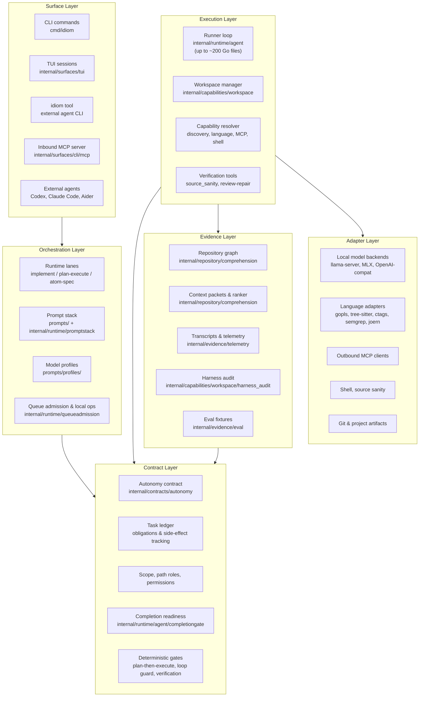

**Dependency rule**: higher-level orchestration depends on contracts and
capabilities, not on low-level implementation details. Arrows show control flow
(top-to-bottom), not Go import direction. A lane asks for a `context_pack`, not
a SQL query; the model asks for a capability, not a specific adapter.

**Deterministic gates** are harness-enforced invariants that do not depend on
model compliance. Examples: the plan-then-execute write guard blocks write tools
during the planner phase; the loop guard (formerly "doom-loop guard") detects
repeated identical tool calls and redirects instead of letting the model cycle;
verification intercept forces post-write proof before the model can declare
completion.

---

## Diagram 2: Literal Harness Flow

How a user request flows through the full system — from CLI/TUI entry through
routing, context, model turns, tools, verification, and output.

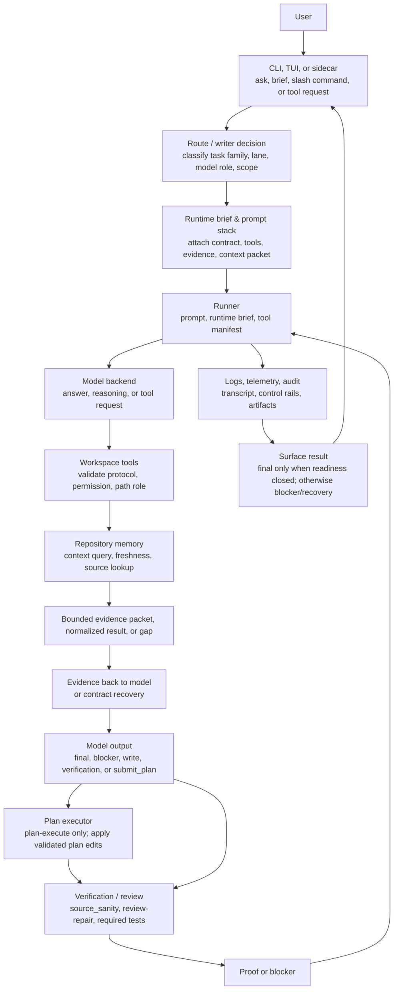

The same components serve all modes: `idiom lane` composes lane prompts and
calls `implement` / `plan-execute`; the TUI dispatches via `RunPromptOnce`;
`idiom tool` exposes the same surfaces to external agents without running the
model loop.

---

## Diagram 3: Runner Loop State Machine

The runner is the control surface between the model, prompt stack, workspace
tools, completion readiness, and telemetry. It lets the model choose strategy
while enforcing deterministic contracts.

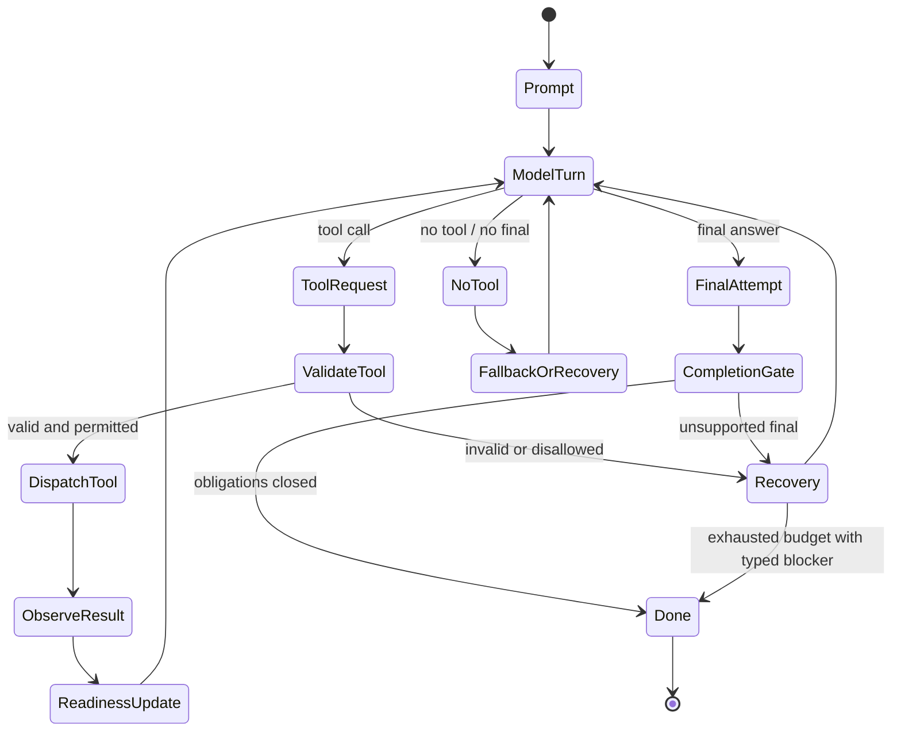

**The runner owns**:
- Runtime briefs & tool manifests
- Tool-call parsing, validation, and dispatch
- Normalized tool results back to the model
- Side-effect tracking, obligations, and readiness
- Redirecting repeated low-value exploration
- Post-write verification requirements
- Unsupported final-answer prevention
- Transcript and telemetry emission

---

## Diagram 4: Lane Architecture

Idiom provides three lane shapes. Each consumes a **brief** (markdown describing
the work) and produces some combination of: changed files, a plan artifact, a
final answer, and structured telemetry events.

### implement lane

Write-capable lane for bounded changes (1–3 files). The model interleaves reads,
edits, verification, and final answer under runtime gates.

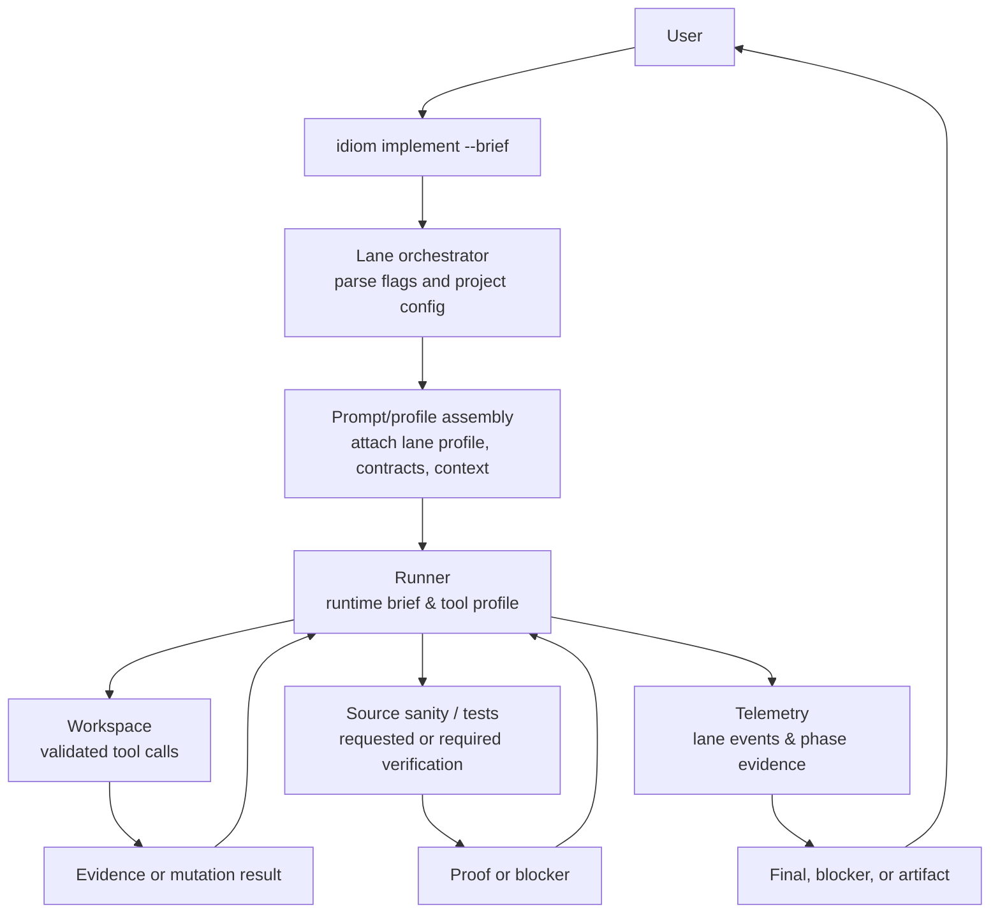

### plan-execute lane

Splits strategy from mutation. The **planner** phase is read-only (discovery +
read tools only, emits `submit_plan`). The **executor** phase applies validated
edits deterministically, then runs post-write verification.

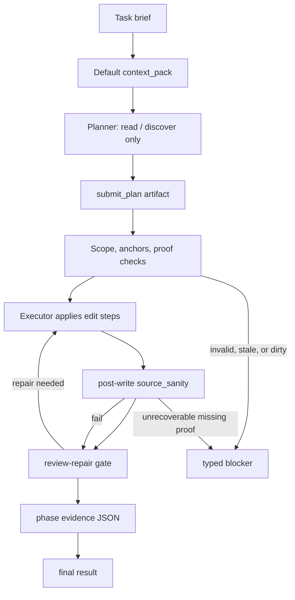

### atom-spec lane

Drafting lane for creating structured work artifacts without mutating the
workspace. The model produces a brief artifact (a planner target packet) with
acceptance criteria, then exits. Used when an orchestrator needs a clean spec
for downstream `implement` or `plan-execute` lanes. Driven by
`idiom artifact --no-tools --mechanical-repair`.

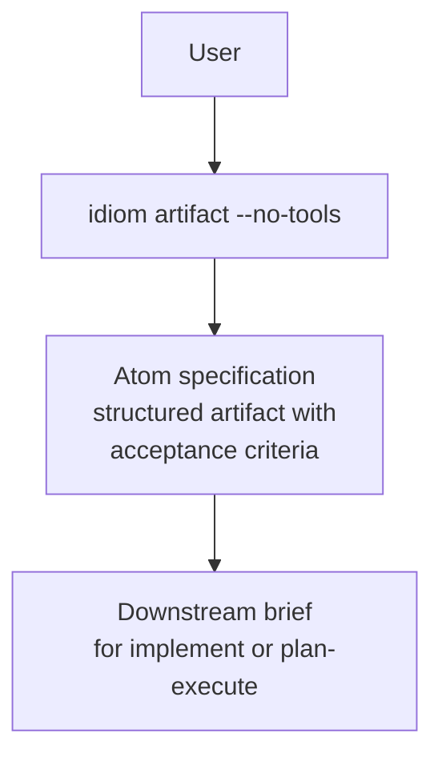

### Deterministic lane guarantees

| Property | Observable in |
|---|---|
| Which phase the session is in | Runtime brief, telemetry |
| Which tools are available per phase | Tool manifest, phase contract |
| Which artifact is required to advance | `submit_plan` for planner phase |
| Which paths are in scope | `required_edit_paths` / path roles |
| Which obligations remain open | Readiness state |
| Which verification was run | Source sanity + review-repair evidence |
| Which result is terminal | Final answer, typed blocker, recovery packet |

---

## Diagram 5: Tool Dispatch & Capability Routing

The workspace layer turns model intent into safe, typed, auditable operations.
The model asks for a capability; the harness resolves the concrete adapter,
enforces permissions, executes, normalizes, and emits telemetry.

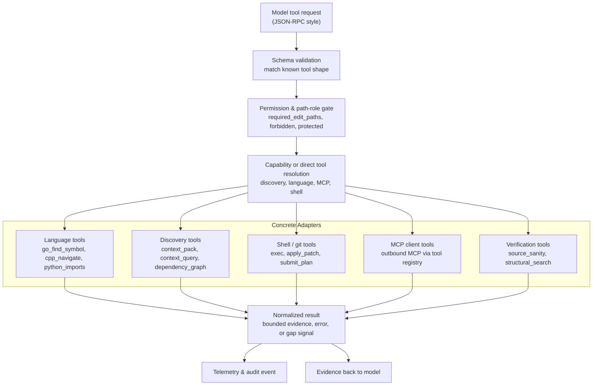

**Pre-dispatch guards** include verification intercept (short-circuits reads
when verification mode is active), plan-then-execute write guard (blocks write
tools in planner phase), `apply_patch` preflight, and permission policy checks.

---

## Diagram 6: Repository Memory & Context Graph

Repository memory is one of Idiom's main differentiators. It separates **index**
(durable facts), **view** (bounded projections), and **packet** (task-specific
evidence envelopes). This prevents agents from rediscovering the repo from
scratch on every task.

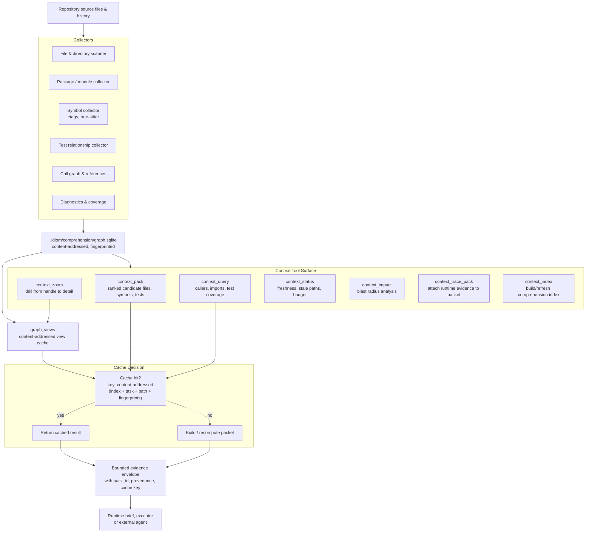

**Freshness & caching**: identical task strings short-circuit via
content-addressed `graph_views` cache. The cache key includes index ID, task,
mode, path, scope, limit, budget, workspace-state fingerprint, ranker-weights
fingerprint, and runtime-traces fingerprint. Stale or invalidated rows are a
cache miss (recomputed), not a stale serve. The `pack_id` round-trips through
`submit_plan` so the executor phase can reference the same evidence the planner
used.

---

## Diagram 7: Eval / Audit / Learning Flywheel

Telemetry, audit, and eval systems turn individual agent sessions into
diagnosable and improvable behavior. The flywheel: run → trace → audit → eval →
diagnose → fix → verify → next run.

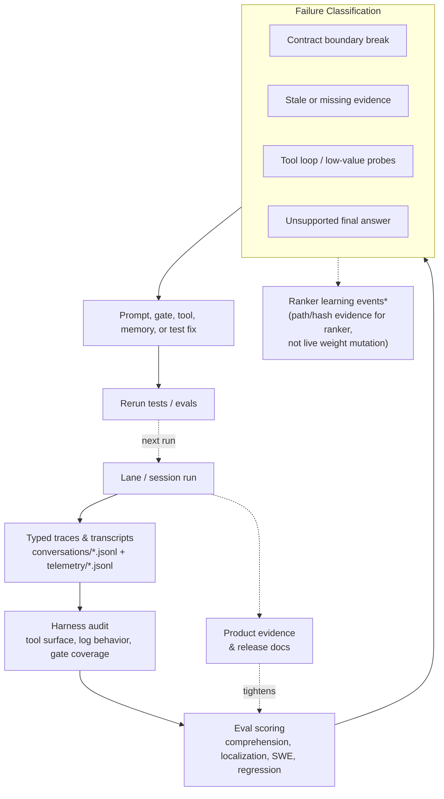

**Evidence sources**: conversation JSONL, command telemetry, lane-history JSONL,
stdout JSONL event streams, harness audit output, contract audit `all_clear`
with gate coverage checks. Audit artifacts are sanitized (no raw prompts,
transcripts, or file bodies) before storage or sharing.

---

## Diagram 8: Local Model Operations

Local inference is treated as an operational system with role routing, queue
admission, context budgets, and readiness checks.

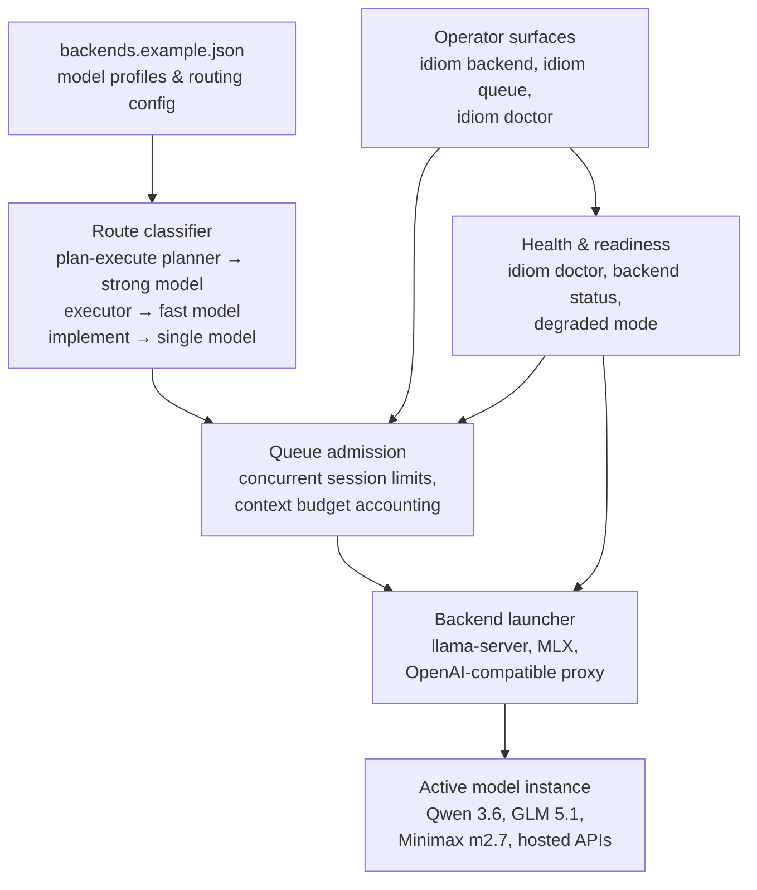

**Key design points**:
- Backend profiles define role routing: planner vs executor vs single-model
- Queue admission prevents context collisions and caps concurrent sessions
- `idiom doctor` and `idiom backend` provide operational health surfaces
- Degraded mode surfaces limited but deterministic behavior when backend is down
- The same harness serves local (GGUF), hosted (OpenAI-compat), and split-role
  configurations

---

## Diagram 9: Sidecar & External Integrations

Idiom exposes repository-aware capabilities to external agents through CLI tool
commands, tool schemas, inbound MCP, outbound MCP client tools, and project
external tools — all sharing the same schemas, permissions, and audit paths as
the local runner.

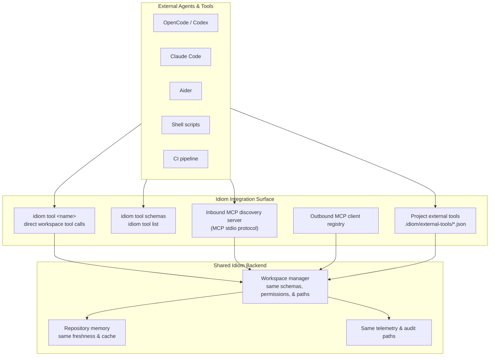

**Key principle**: external surfaces must reuse — not duplicate — existing
schemas, permissions, freshness checks, telemetry, and audit paths. A tool call
from `idiom tool` goes through the same `workspace.Manager` as one from the
runner.

---

## Diagram 10: Product Workflow & Recovery

Upstream product research → PRD/ADR/brief artifacts → dispatch → execution →
failure recovery. These workflows bridge high-level product reasoning and
low-level lane execution.

```mermaid
flowchart LR
    subgraph Product["Product Workflow"]
        Research["Research evidence<br/>web, codebase, architecture"]
        PRD["PRD artifact"]
        ADR["ADR / decision records<br/>with TDD obligations"]
        Brief["Dispatch brief<br/>with required_edit_paths"]
        Gate["Coverage gate<br/>behavioral coverage check"]
    end

    subgraph Dispatch["Lane Execution"]
        Atom["Atom intake<br/>materialize design doc → atoms"]
        Lane["implement / plan-execute<br/>applied edits"]
        Verify["Verification<br/>tests, source_sanity"]
    end

    subgraph Recovery["Recovery System"]
        Failure["Failure record<br/>.idiom/recovery/&lt;id&gt;/failure.json"]
        Decomp["Decomposition packet<br/>classify failure → smaller atoms"]
        Recon["Reconciliation<br/>apply follow-up atoms"]
        Promote["Promote completed<br/>close recovery packet"]
    end

    Research --> PRD --> ADR --> Brief --> Gate --> Atom --> Lane
    Lane --> Verify
    Verify -- failure --> Failure --> Decomp --> Recon --> Promote
    Recon --> Atom

    Verify -- success --> LearnFeedback["Learn & tighten<br/>eval fixtures, audits, prompts"]
    LearnFeedback -. improves .-> Research
    LearnFeedback -. tightens .-> Gate
```

**Recovery system** (docs/design-decompose-on-failure.md):
- Failed sessions produce durable failure records with deterministic
  classification (`scope_too_large`, `verification_failed`, etc.)
- Decomposition packets break failures into smaller gated recovery atoms
- Reconciliation applies recovery atoms and closes packets only after
  packet-digest, atom manifest, and required-test evidence validation
- `idiom recover inspect / status / decompose / promote / reconcile` covers the
  operator loop
- Read-only `recovery_inspect` / `recovery_status` exposed via sidecar/MCP

---

## Summary: Idiom's Differentiators

| Area | What it does | Why it matters |
|---|---|---|
| **Contracts** | Typed, locally enforced, auditable contracts per lane/phase | Faithful behavior: the model can't accidentally write in planner-only mode |
| **Repository memory** | Persistent context graph with freshness, provenance, caching | Agents don't rediscover the repo on every task; prompts don't flood with raw files |
| **Capability routing** | Model asks for what it needs; harness resolves the best adapter | Model stays portable across backends; no memorizing adapter names |
| **Plan artifact handoff** | Structured `submit_plan` → validated scope → deterministic executor | Strategy is auditable; hash-collision proof before mutation |
| **Verification gates** | Post-write source_sanity, review-repair, required tests | Edits must prove they did what was claimed |
| **Local-model operations** | Role routing, queue admission, degraded mode, readiness checks | Treats local LLMs as operational systems, not toys |
| **Eval/audit flywheel** | Runs → traces → audit → eval → diagnosis → fix → verify | Every run makes the next run more reliable |
| **Sidecar** | Same tool surface to external agents via MCP/CLI | Claude Code, Codex, Aider, CI can all use Idiom's memory & tools |
| **Recovery** | Durable failure records → decomposition → reconciliation | Failed lanes are salvageable, not lost work |
| **Repo isolation** | Model weights, caches, harness state, logs live outside the target repo | Zero contamination of the user's source tree |

---

## Repository-Owned State

Idiom keeps all agent state outside the user's source files. The on-disk layout
under a project root:

| Path | Content |
|---|---|
| `.idiom/config.json` | Local project configuration |
| `.idiom/comprehension/graph.sqlite` | Persistent repository memory graph |
| `.idiom/comprehension/views/*.json` | Exported context views (cached packets) |
| `.idiom/plan-execute/sessions/*.json` | Durable plan-execute progress state |
| `.idiom/recovery/<failure-id>/failure.json` | Failure records and decomposition packets |
| `.idiom/atoms/<title>/atom-NNN.md` | Materialized design-doc atoms for dispatch |
| `logs/conversations/*.jsonl` | Session conversation logs |
| `logs/telemetry/*.jsonl` | Request/response telemetry |
| `prompts/` | Static prompt layers and model profiles |
| `docs/product-workflows/efforts/...` | Durable product workflow fixtures |

---

## Security, Privacy & Data Boundaries

Idiom is designed for local, inspectable, auditable operation with clear
boundaries around data flow.

**Boundary principle**: The harness owns protected paths, redaction policy,
local artifact scope, and telemetry minimization. The model owns strategy —
it never sees raw credentials, protected paths, or data outside its allowed
scope.

**Key controls**:
- **Path roles** classify every file as editable, evidence-only, forbidden,
  protected, or out-of-scope. Write tools enforce these roles before execution.
- **Redaction**: audit artifacts are sanitized before storage — no raw prompts,
  raw transcripts, file bodies, or secrets leave the harness boundary.
- **Telemetry minimization**: structured events carry paths, hashes, counts,
  and command IDs — not source content or model output.
- **Local by default**: the harness runs entirely on the local machine.
  Model inference stays local (GGUF, MLX) or goes to a user-configured API.
  No data is sent to Idiom-operated servers.
- **Durable evidence rules**: prefer paths, hashes, and counts over raw content.
  No raw prompts, file bodies, or secrets in audit products, ranker events,
  or recovery records.
- **Sidecar reuse**: external agents (Codex, Claude Code, CI) calling `idiom
  tool` go through the same permission gates, path-role checks, and telemetry
  paths as the local runner.

This is not a compliance certification; it is a documented engineering posture
reviewable by any team evaluating the project for regulated environments.
