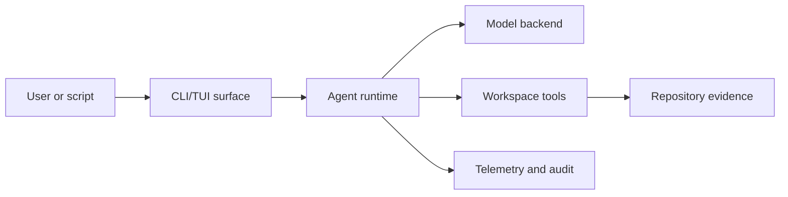

# Architecture

Idiom separates model strategy from harness authority.

The model decides how to reason about the task. The harness enforces the
contracts around that work: tool schemas, permissions, protected paths,
evidence freshness, lane boundaries, verification, and final-answer acceptance.

## Main Components

| Area | Responsibility |
| --- | --- |
| `cmd/idiom` | CLI entrypoint and command wiring. |
| `internal/runtime` | Agent runner, backend routing, readiness, rails, and final-answer handling. |
| `internal/capabilities/workspace` | Workspace tools, sidecar execution, and tool policy. |
| `internal/repository` | Repository comprehension, context packets, and graph-backed memory. |
| `internal/surfaces/cli` | CLI surfaces for run, lanes, audit, queue, MCP, and tools. |
| `internal/surfaces/tui` | Interactive terminal UI. |
| `prompts/` | Baseline prompt stack and mode/profile instructions. |
| `.idiom/` | Project-local harness config with placeholders only. |

## Runtime Flow

The key boundary is that tools and audit evidence inform the model, while the
harness remains responsible for enforcing what the model may do.

## Coding Rule Contracts

Coding rules are project-local harness contracts for recurring source patterns.
The policy file names rules, languages, severities, enforcement levels, and
documented suppressions. The analyzer produces typed findings with paths,
symbols, hashes, and evidence facts instead of source snippets, so the model can
respond to idiom violations without the harness prescribing a next reasoning
step.

The default posture is advisory. A repository can promote a rule to blocking
when the rule represents a genuine invariant; lane postflight then treats
blocking findings as failed verification.

## Design Rules

- Keep prompt guidance, runtime gates, telemetry, and tests aligned.
- Represent real protocols as typed contracts rather than string conventions.
- Prefer reusable predicates and contract checks over scenario-specific prompt
  nudges.
- Keep generated local evidence out of source control unless it is a deliberate
  sanitized fixture.
