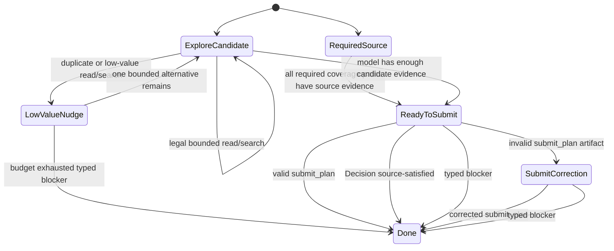

# Plan-Execute Contract Overhaul Proposal

## Status

Implementation in progress. The reviewer bench accepted the typed-state
direction, and the current patch train has implemented the deterministic
contract refactor:

- typed plan-execute planning-state projection for parser-visible tools,
  callable tools, terminal options, selected edit paths, runtime policy, and
  skeleton paths
- typed `ToolResult.Code` usage for candidate-source readiness
- source-grounding levels that distinguish required paths, candidate paths,
  evidence-only paths, exact-anchor contracts, and new-file contracts
- syntax-only tool-request normalization with bounded parser outcome telemetry
- centralized runtime/transport policy for plan-execute model calls
- typed recovery plans for low-value actions, grounding recovery, and
  submit-plan parse correction
- centralized tool-manifest placeholder sanitization and Qwen/XML request
  repairs for prefixed tool tags, split named-tool tags, stringified
  `submit_plan` fields, `action`/`operation` aliases, and explicit
  `<tool_<name>>` JSON argument envelopes
- live/eval oracle fields for executor handoff, no-timeout, low-value-action,
  typed-blocker, and source-satisfied contracts
- product-workflow coverage-gate authority preflight reuse for canonical
  lint/audit findings

The refactor is not ready to commit until final reviewer validation and full
live contract coverage complete. Deterministic tests are the current gate;
expensive live runs are intentionally deferred until the refactor body is
stable.

## Triggering Evidence

The live suite consistently passes:

- `question-does-not-mutate-label`
- `explicit-implement-short-label`
- `plan-execute-short-label`

It remains unstable on
`product-workflow-coverage-gate-authority-reuse`.

Observed failure evidence from current and recent
`testdata/live-contracts/generated-logs/product-workflow-coverage-gate-authority-reuse.jsonl`:

- The planner read source-body evidence for
  `internal/workflows/productworkflow/coverage_gate.go` and
  `internal/workflows/productworkflow/validate.go`.
- Earlier runs rejected additional reads with `Candidate source already ready`.
  Those runner rejections were real failures, but they are now best understood
  as a symptom of split authority rather than the current root cause.
- In the latest run after local patching, the planner did not primarily fail on
  that hard rejection. It reached a permissive open-candidate state and then
  failed to converge: no terminal `submit_plan` artifact, no executor handoff,
  no implementation edits, and no changed files before rollback.
- The readiness nudge said to submit, while later phase state still exposed
  read/search/source-localization as valid actions. The model followed the
  visible affordances instead of crossing an advisory-text-only readiness line.
- The product-workflow case produced no executor handoff events and no file
  changes before rollback, while the fixture requires executor events, changed
  product/test files, passed verification, clean rollback, and no hard runner
  rejections.
- A generated submit-plan skeleton included candidate/evidence paths that were
  not safe required edits in one run, which shows that current skeleton
  construction can confuse evidence, candidate scope, and edit coverage.
- The newest focused live replay got past the earlier malformed unclosed
  Qwen/XML request by executing multiple real `code_navigate` source reads, then
  failed when the model emitted a stale prefixed XML tool envelope inside prose
  instead of a terminal `submit_plan`. The parser now accepts explicit
  `<tool_<name>>` JSON argument envelopes and rejects mismatched tool names, but
  full live validation is intentionally deferred until the refactor body is
  reviewed as a whole.

Git history shows this area has been repeatedly hardened by localized commits,
including `Align submit_plan prompt contracts`, `Clarify plan-execute contract
recovery`, `Checkpoint TUI plan-execute contract fixes`, `Stabilize explicit
plan-execute product workflow`, and `Add live plan-execute contract coverage`.
That history is evidence that the failure is systemic rather than one missing
prompt sentence.

## Root Cause

Plan-execute planner authority is split across too many surfaces:

- prompt lead-ins
- runtime brief fields
- phase-contract derivation
- candidate-source guards
- submit-plan validation
- visible tool salvage
- completion gate recovery
- live-suite oracle expectations

Those surfaces do not currently share one typed planning state. As a result,
the harness sometimes treats ordinary model strategy in an open-ended planning
atom as a hard protocol violation, then uses rejections as control flow. That is
misaligned with the live oracle and the north star: the model should own
strategy, while the harness owns typed contracts.

The specific broken invariant is not "the model read too much." The broken
invariant is that open-ended plan-execute has no durable state machine that can
say: these paths are candidate scope, these source facts are known, these edit
obligations remain, these terminal outcomes are valid, and these repeated reads
are low-value without being harness failures. Readiness is currently advisory
text, not a typed transition consumed consistently by the phase contract, tool
surface, completion gate, telemetry, and live oracle.

For large local-model atoms, that split authority creates two bad outcomes:
strict guards can turn normal exploration into runner rejections, while
permissive guards can leave the model in an exploration loop with no typed
transition to planning closure. Both outcomes are the same architecture failure.

## Design Goals

- Keep lane activation explicit or classifier-owned; do not add heuristics.
- Keep candidate scope distinct from required edit coverage.
- Treat context-pack output as localization evidence, not mandatory edit paths.
- Make `submit_plan`, `Decision: source-satisfied`, and typed blocker the only
  planner terminal outcomes.
- Avoid runner rejections for expected open-ended exploration behavior.
- Keep hard rejections for true invariants: permissions, protected paths,
  invalid tool protocol, invalid submit-plan artifacts, and exhausted budgets.
- Make textual and native tool transport share one normalizer and contract
  event path without weakening native tool semantics.
- Make live contract failures diagnosable from bounded structured logs without
  hand-reconstructing raw transcript prose.

## Proposed Architecture

Introduce a typed `PlanExecutePlanningState` owned by the plan-execute runner
contract, not by prompts. This state must be an immutable per-turn derived
snapshot, produced by a pure reducer such as
`DerivePlanExecutePlanningState(brief, results, transport)`. It must not become
another mutable runner field or broad state bag. The reducer is the authority;
prompts, gates, telemetry, and recovery text are projections of it.

Suggested fields:

- `mode`: `required_path`, `allowed_candidate`, `open_candidate`,
  `submit_correction`, or `review_repair`
- `required_coverage_paths`: paths that every valid plan must cover, satisfy, or
  block
- `allowed_candidate_paths`: safe candidate scope from route metadata,
  context-pack candidates, explicit target refs, and prior evidence
- `evidence_paths`: source-body evidence observed this turn, with ranges and
  evidence level
- `selected_edit_paths`: candidate paths the planner state has enough evidence
  to present as possible edit entries; this is distinct from evidence-only
  paths and context-pack candidates
- `edit_set_obligations`: implementation edit, test edit, verification owner,
  and other run-level obligations
- `terminal_options`: `submit_plan`, `source_satisfied`, `blocker`
- `low_value_actions`: repeated exact reads, duplicate full-file reads, broad
  searches after enough candidates, and other non-progress signals
- `transport_mode`: native tools, textual tools, or textual JSON terminal mode
- `runtime_policy`: response-format support, force-native setting, effective
  max tokens, timeout, and terminal-only capability
- `last_invalid_artifact`: rejected submit-plan details, when correction mode is
  active

The phase contract, runner guard, prompt lead-in, recovery prompt, telemetry,
and live audit should all read this derived state instead of recomputing
readiness from different slices of tool results.

The model-facing prompt should present the state in the same order the harness
enforces it: current typed state, valid terminal actions, then the one-line JSON
shape or textual terminal form. Recovery prompts should do the same and should
never introduce a new authority vocabulary.

## State Machine

## Contract Changes

### Required-Path Plan-Execute

Required paths stay strict. Every required path must have source-body evidence
or exact snippet evidence before `submit_plan`. After readiness, the surface can
be terminal-only because the operator supplied mandatory coverage.

### Open-Ended Plan-Execute

Open-ended plan-execute must not use candidate-source-readiness rejections as
normal control flow. Extra reads can be redirected, nudged, or counted as
low-value, but they should not become live-suite runner rejections unless they
violate a hard invariant.

Once source evidence makes `submit_plan` viable, every later action should be
classified by the reducer as one of:

- terminal action
- named missing-fact exploration
- low-value action
- hard violation

The model may continue bounded exploration only when it names an edit-safety
fact that is still missing. Duplicate or non-progress reads become
`low_value_action` events and nudges, not hard runner rejections, until a loop
fuse or budget produces a typed planner blocker. Budget exhaustion should
produce a typed planner-blocked state, not a misleading implementation-result
answer.

This does not mean the product-workflow live fixture can pass with a blocker.
That fixture is an implementation-acceptance contract: it should pass only when
the planner reaches a usable plan, the executor changes product and test files,
verification passes, and rollback is clean. Typed blockers are diagnostic output
or separate blocker-fixture acceptance criteria.

### Submit-Plan Skeletons

Skeletons should be built from typed state:

- required coverage paths for required-path mode
- `selected_edit_paths` with source-body evidence for open-candidate mode
- required coverage paths for correction mode when the hard coverage gate is
  active; otherwise the invalid artifact paths that need correction

Skeletons must not promote arbitrary path mentions, context-pack candidate
files, or evidence-only paths into required edits. If no selected edit path
exists, the skeleton should present a one-edit candidate placeholder plus a
clear blocker option, not fake required paths.

### Tool Transport

Create one `ToolRequestNormalizer` path for native and textual requests. It
should normalize:

- native tool calls
- fenced JSON tool blocks
- bare JSON tool objects
- safe key-value tool forms

It should emit typed parser events:

- `normalized`
- `missing_tool_inferred`
- `unsupported_shape`
- `unsafe_to_infer`
- `requires_terminal_action`

The runner should consume normalized requests uniformly instead of having
separate salvage paths scattered through completion recovery and normal turns.
Native tool calls should still be treated as first-class structured calls. The
normalizer exists at the boundary so the rest of the runner consumes one typed
request contract; it should not reinterpret native calls through looser textual
rules or infer unsafe actions from narrative prose.

### Runtime And Transport Policy

The planning state must derive `transport_mode` from backend capability,
`ForceNativeTools`, terminal-only state, and response-format support.

For MLX/textual-tool runs:

- ordinary planning turns use textual tool parsing
- terminal `submit_plan` turns should prefer a single canonical JSON object,
  using JSON response format when the backend supports it and Idiom owns parsing
- native tool forcing is reserved for tightly scoped single-tool terminal turns
  on backends that support it or explicitly opt in

Telemetry/live audit should record bounded runtime facts needed to diagnose
transport failures:

- backend kind and safe model alias
- native vs textual transport mode
- response-format mode
- effective max tokens and finish reason
- prompt/completion token counts
- thinking flags
- effective live timeout

Failure classification should distinguish `finish_reason:length`, watchdog
timeout, unsupported parser shape, unsafe inference, hard runner rejection, and
low-value loop exhaustion.

Live timeouts should be treated as part of the runtime policy, not as hidden
test harness trivia. Large plan-execute atoms need enough budget to read source,
form a plan, execute, verify, and roll back; failures should state whether the
model ran out of tokens, wall-clock time, loop budget, or protocol budget.

### Low-Value Action Handling

Replace expected open-ended candidate-source rejections with low-value action
nudges:

- Exact duplicate read of an already-covered range: nudge with the covered
  range and terminal options.
- Range-less read of a large partially covered file: rewrite to next bounded
  range when mechanically knowable.
- Repeated reads after all candidate evidence is sufficient: record
  `low_value_action`, keep terminal options visible, and allow budget handling.

Hard rejection remains appropriate for forbidden tools, invalid write scope,
invalid submit-plan artifacts, protected paths, or repeated exact calls after
the loop fuse is exhausted.

Low-value action events should carry enough bounded evidence for audit: command
name, normalized path, covered range, reason, count, and the terminal options
that were visible. They should not include raw prompts or large file bodies.

## Implementation Slices

1. Add `PlanExecutePlanningState` and tests that derive it from runtime brief
   plus normalized tool/result events and runtime transport state.
2. Move phase-contract derivation to consume that state.
3. Move candidate-source guards to state transitions: hard reject only scoped
   required-path/correction invariants; nudge or redirect open-ended low-value
   actions.
4. Move submit-plan skeleton generation to consume state-selected paths.
5. Extract textual/native request normalization into one component with focused
   tests.
6. Update telemetry/live audit to report planning state, selected mode,
   terminal options, low-value action counts, and invalid artifact state.
7. Rework live contract assertions so hard runner rejections remain failures,
   while expected low-value nudges are observable non-failure events.
8. Add a dedicated blocker/recovery fixture if typed blockers need live
   acceptance coverage, without weakening the product-workflow implementation
   fixture.

## Reviewer Synthesis

The reviewer bench agreed on the overhaul direction with these constraints:

- Incident Root-Cause Reviewer: update the diagnosis from stale hard-rejection
  evidence to the latest terminal non-convergence evidence. The same split
  authority explains both.
- North-Star / Architecture Reviewer: keep the state reducer pure and derived.
  Do not replace scattered prompt authority with a new mutable runner authority.
- Harness / Go Reviewer: begin with `DerivePlanExecutePlanningState(...)` and
  a small transition table before attempting broad runner rewrites.
- Prompt / Protocol Reviewer: expose current typed state, valid terminal
  actions, and canonical terminal shape in harness-enforced order.
- Model Runtime / Config Reviewer: make transport mode explicit and backend
  derived; log finish reason, token budget, timeout, native/textual mode, and
  response-format mode.
- TDD / Acceptance Reviewer: the product-workflow case must remain
  implementation-required. Typed blocker quality belongs in a separate fixture.

## Regression Tests

Focused unit tests:

- Required-path readiness still becomes submit-plan-only.
- Open-ended candidate mode does not reject legal bounded reads.
- Open-ended duplicate reads emit low-value events, not runner rejections.
- Context-pack candidates remain candidate scope, not required coverage.
- Submit skeletons include only typed required paths, selected edit paths, or
  invalid-artifact correction paths.
- Invalid submit-plan correction allows only corrected submit, source refresh
  for invalid anchors, or typed blocker.
- Textual/native normalizer accepts equivalent safe tool requests and rejects
  unsafe narrative text.
- Qwen/XML transport repairs accept explicit prefixed tool envelopes with
  parameter bodies or JSON argument objects, while rejecting envelope/JSON tool
  mismatches.
- Runtime transport selection chooses textual JSON-mode terminal submit for MLX
  where appropriate and logs finish reason, token budget, thinking flags, and
  effective timeout.

Integration/live tests:

- Existing live suite remains green for direct question, explicit implement, and
  plan-execute short label.
- Product-workflow live case reaches executor handoff with real changed product
  and test files, passed verification, clean rollback, and no hard runner
  rejections. A typed planner blocker is useful diagnostic output, but it must
  not count as success for this implementation-acceptance fixture.
- A separate blocker/recovery live fixture may assert typed planner blocker
  quality without weakening the product-workflow implementation case.
- Rollback remains clean for every live contract.

## North-Star Alignment

This moves authority from scattered recovery text into one typed contract. It
does not make the harness choose exact implementation strategy; it clarifies
what the model is allowed to do, what the harness has observed, and which
terminal outcomes satisfy the lane. It avoids scenario-specific product
workflow logic and should make future live failures easier to diagnose without
adding another prompt reminder.

## Open Questions

- Should open-ended plan-execute have a different live oracle than required-path
  plan-execute, or should both require zero hard runner rejections while allowing
  low-value nudges?
- Should `submit_plan` for open-ended mode be allowed to include only one
  implementation edit when the prompt asks for tests too, with review-repair
  enforcing missing test obligations, or should edit-set obligations reject that
  plan immediately?
- Should large local-model TDD atoms use plan-execute by default, or should the
  classifier prefer implementation lane unless the operator explicitly asks for
  planner/executor split?
