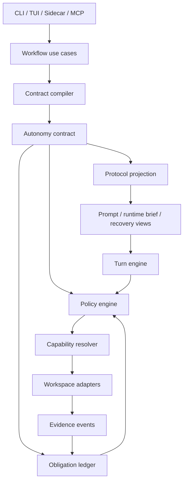

# Complexity Reduction Migration

**North Star: AI coding agents are becoming common, but teams do not yet trust
their context, decisions, or outputs. Idiom sells the missing substrate: repo
memory, freshness, contracts, audit, and evals.**

Status: canonical migration plan, drafted 2026-06-03

## Purpose

This document defines the migration from Idiom's current high-churn harness to a
smaller architecture that preserves functionality while reducing active surface
area. The goal is not to cut features. The goal is to consolidate duplicated
behavior into proper domain and application boundaries so each invariant has one
owner, each workflow has one use-case API, and CLI/TUI/sidecar entrypoints are
thin adapters.

This supersedes broad cleanup-by-file plans when they conflict. Historical
design docs remain evidence, but implementation should use this document as the
coordination plan for complexity reduction.

## Current Evidence

Repository inspection on 2026-06-03 shows the current complexity is
concentrated in a few change magnets:

- `cmd` and `internal` contain 716 Go files.
- Non-test Go code under `cmd` and `internal` is about 223k lines; tests are
  about 171k lines.
- `internal/runtime/agent/runner.go` is about 22.8k lines. Its `Runner.Run` method is
  over 3k lines.
- `internal/runtime/agent/runner_test.go` and
  `internal/runtime/agent/runner_plan_then_execute_guard_test.go` together exceed 34k
  lines.
- `internal/capabilities/workspace/manager.go` is over 6k lines and still owns parsing,
  repair, dispatch, file IO, shell, semantic tools, recovery tools, product
  tools, and path suggestions.
- `internal/surfaces/tui/app/implementation_dispatch.go` is over 5k lines and mixes prompt
  composition, plan-document materialization, dispatch, retries, and recovery.
- The last 30 days of git history show `internal/runtime/agent/runner.go` alone with
  roughly 54k changed lines. `internal/capabilities/workspace/manager.go`,
  `internal/surfaces/tui/app/implementation_dispatch.go`, `internal/workflows/planexecute/helpers.go`,
  and the runner tests are also high-churn.

The strongest architecture smell is not simply file size. The smell is
duplicated authority:

- `internal/contracts/autonomy.AutonomyContract`
- `internal/runtime/workerruntime.WorkerRuntimeBrief`
- `internal/runtime/agent.TurnPhaseContract`
- `internal/workflows/planexecute.PlanScopeContract`
- `internal/surfaces/tui/app.routeContractProjection`
- prompt files and embedded lane assets
- runner gates and recovery nudges
- workspace tool profiles and tool schemas
- plan-execute scope and submit-plan validation
- telemetry and audit reconstruction

Each representation is useful, but the system asks maintainers to reconcile
which one owns a decision. That is the source of churn.

## Non-Negotiable Outcome

Reduce complexity without losing functionality.

That means:

- preserve current CLI, TUI, sidecar, lane, tool, and recovery behavior unless
  an explicit product decision says otherwise;
- remove duplicated ownership, not working features;
- migrate through compatibility facades and characterization tests;
- delete obsolete branches and docs once replacements are active;
- never replace one large bespoke surface with another.

## First Broken Invariant

`contract.active_authority`: before model dispatch, tool execution,
verification, lifecycle closeout, audit, or final-answer acceptance, there must
be exactly one active contract identity. Every consequential decision must cite
that contract plus an invariant or obligation id.

Most current failures are symptoms of this invariant being only partially
implemented. Prompts, runtime briefs, runner booleans, workspace rules,
plan-execute scope, and audit all reconstruct overlapping authority.

## Target Architecture

### Package Ownership

| Area | Target package | Owns | Must not own |
| --- | --- | --- | --- |
| Contract domain | `internal/contracts/autonomy` | contracts, path roles, obligations, action classes, policy decisions, evidence refs | model calls, IO, shell, CLI/TUI |
| Contract compilation | `internal/contracts/contractcompile` | plain input to immutable contract, runtime envelope, protocol projection | runner loop, workspace execution |
| Runtime loop | `internal/runtime` | model-turn lifecycle, action normalization, policy calls, event emission | lane semantics, path authority, prompt prose |
| Workflow use cases | `internal/workflows` | implement, plan-execute, artifact, recovery, product workflow orchestration | TUI state, CLI flag parsing, raw tool adapters |
| Capabilities | `internal/capabilities` | stable capability ids, request/result contracts, adapter selection | concrete language parsing or shell execution |
| Workspace adapters | `internal/capabilities/workspace`, `internal/repository/semantic`, `internal/capabilities/mcp`, `internal/runtime/backends` | concrete file, shell, graph, LSP, MCP, backend operations | lane semantics, completion policy |
| Presenters | `internal/presenters` | prompt/runtime/recovery/final-answer views from contract projections | authority, validation, state transitions |
| Surfaces | `internal/cmd/*`, `internal/surfaces/tui/app` | input translation and output rendering | workflow policy, prompt parsing as authority |
| Audit/eval | `internal/contracts/autonomy`, `internal/evidence/eval`, later focused packages | replay and scoring from structured contract events | transcript-only reconstruction |

These target packages are migration labels. Introduce one only when the same
patch routes production callers through it and deletes or materially shrinks the
active old owner. Do not create pass-through packages.

## Required Consolidations

### 1. Contract Authority

Canonical owner: `internal/contracts/autonomy` plus `internal/contracts/contractcompile`.

Current overlapping surfaces must become contract inputs or projections:

- `WorkerRuntimeBrief`
- `TurnPhaseContract`
- `PlanScopeContract`
- route projections
- prompt-scope extracted required paths
- workspace tool profiles
- completion and verification gates

The migration is complete when prompt text, visible tools, parser mode,
workspace policy, verification, and completion all cite the same contract id and
protocol hash for a covered lane.

### 2. Obligation Ledger

Canonical owner: `internal/contracts/autonomy`.

The ledger must track:

- source-body evidence obligations
- required edit path coverage
- allowed candidate scope
- edit-set obligations
- write evidence
- verification-after-write state
- final-answer grounding
- blocker state
- loop and budget state

Runner code should ask the ledger whether an obligation is open or closed. It
should not infer that state from transcript strings or accumulated booleans.

Phase 2 must also promote candidate-scope and blocker-state distinctions into
canonical obligation/path-role fields before the ledger is wired as runtime
authority. Early migrations may store these as ordinary obligation facts, but
runtime migration is not complete until candidate scope cannot be confused with
required coverage and a typed blocker cannot be confused with an unresolved
evidence obligation.

### 3. Capability Routing

Canonical owner: `internal/capabilities`.

The model-facing read interface should be capability-shaped:

- `localize_change`
- `query_context`
- `inspect_file`
- `inspect_symbol`
- `find_symbol`
- `find_definition`
- `find_references`
- `find_implementations`
- `calls_from`
- `calls_into`
- `related_files`
- `source_sanity`
- `trace_runtime_failure`
- `verify_edit`
- `audit_behavior`

Language-prefixed tools remain compatibility adapters until all call sites have
coverage. Results must report selected adapter, precision, freshness, fallback,
absence confidence, and unresolved gaps.

### 4. Runtime Loop

Canonical owner: `internal/runtime`.

The runtime engine should be small:

1. build the model request from a protocol projection;
2. receive model output;
3. normalize visible/native/tool intent;
4. ask policy for a decision;
5. execute an approved adapter action;
6. record evidence and ledger updates;
7. close, recover, or continue.

It must not compile contracts, parse prompt headings as authority, choose lane
semantics, or format recovery prose directly.

### 5. Workspace Tool Surface

Canonical owner: adapter registry under `internal/capabilities/workspace`.

`workspace.Manager` should become a registry and compatibility facade. Tool
request parsing, Qwen/legacy repair, dispatch, file IO, shell execution,
semantic tools, product tools, and recovery tools should move into focused
adapters behind one registry contract.

### 6. Workflow Use Cases

Canonical owner: `internal/workflows`.

Plan-execute, implement, artifact, recovery, and product workflow orchestration
should be callable from CLI, TUI, and sidecar without duplicating behavior. The
TUI must present workflow state, not implement workflow policy.

### 7. Presenter Generation

Canonical owner: `internal/presenters`.

Runtime briefs, control rails, recovery cards, prompt addenda, final-answer
repair prompts, and tool-manifest summaries must be generated from the active
contract/protocol projection. Prompt assets can explain stable style, but they
must not create authority.

## Migration Phases

### Phase 0: Characterization And Guardrails

Goal: freeze current behavior enough to migrate safely.

Deliverables:

- Scripted contract fixtures covering read-only answer, implementation,
  plan-execute planner, source-satisfied closeout, verification failure,
  recovery-open, and sidecar tool calls.
- Architecture boundary tests for the new packages before broad extraction.
- Complexity budget report for file size and package coupling.
- A migration tracker that maps each old authority surface to its target owner.

Acceptance:

- Existing tests still pass.
- New characterization tests describe current behavior, not desired rewrites.
- No runtime behavior changes unless separately reviewed.

### Phase 1: Active Contract Consolidation

Goal: make every covered lane dispatch through one compiled contract while old
surfaces remain as compatibility projections.

Deliverables:

- Contract ids present before first model/tool action.
- Protocol projection includes visible tools, callable actions, terminal
  outcomes, parser mode, recovery budget, and verification obligations.
- Runner and workspace emit policy decisions that cite contract id and invariant
  id in report-only mode.

Acceptance:

- Covered lanes preserve behavior.
- Audit can group covered tool/final-answer decisions by contract id.
- No prompt or recovery surface claims authority not present in the projection.

### Phase 2: Path Roles And Obligation Ledger

Goal: centralize required paths, allowed paths, evidence paths, and generated
artifacts.

Deliverables:

- Shared path-role resolver in `internal/contracts/autonomy`.
- Required edit coverage and source-body evidence represented as obligations.
- Canonical candidate-scope and blocker-state fields, not inferred from
  transcript text or generic obligation labels.
- Submit-plan validation, workspace writes, recovery, and final-answer gates
  consume the same resolver/ledger.

Acceptance:

- Candidate scope cannot become required coverage without an explicit contract
  field.
- Source-body evidence cannot be satisfied by generated artifacts or broad
  mentioned-path scans.
- Existing source-satisfied and stale-anchor tests pass.

### Phase 3: Capability Resolver

Goal: reduce model-visible read/navigation complexity without losing precision.

Deliverables:

- one active capability metadata/resolver owner for ids, evidence capability
  tags, classification, request/result contracts, adapter selection, precision,
  fallback, freshness, and gaps;
- compatibility adapters for existing graph/context/language/source-sanity
  tools;
- workspace manager routes `read_only_capability` through that owner;
- any later `internal/capabilities` extraction replaces the active workspace
  implementation in the same effort and deletes the old owner.

Acceptance:

- Every read-only adapter is classified as routed, compatibility-only,
  deferred, or intentionally unmapped.
- Results always expose adapter, precision, fallback, freshness, and gaps.
- Legacy direct tools remain callable.

### Phase 4: Runtime Strangler

Goal: replace the large runner loop with a small turn engine.

Deliverables:

- `internal/runtime.TurnEngine` shadow-runs selected lanes and compares emitted
  decisions with the legacy runner.
- Policy and ledger decisions move out of `internal/runtime/agent/runner.go`.
- Final-answer acceptance, recovery, and verification gates consume typed
  decisions instead of transcript-string heuristics.

Acceptance:

- Shadow parity is green for the characterization suite.
- New runtime-owned tests assert event/decision contracts, not prompt strings.
- Legacy runner branches are deleted after parity, not left dormant.

### Phase 5: Workflow Extraction

Goal: make CLI/TUI/sidecar call the same use cases.

Deliverables:

- `internal/workflows/planexecute`, `internal/workflows/implement`,
  `internal/workflows/artifact`, and `internal/workflows/recovery`.
- `internal/surfaces/tui/app/implementation_dispatch.go` becomes a presenter/controller or
  is deleted.
- CLI command packages contain parsing, config loading, and rendering only.

Acceptance:

- CLI and TUI plan-execute paths use the same workflow API.
- Product/recovery status uses the same durable workflow state as CLI.
- Duplicate retry/recovery formatting is removed.

### Phase 6: Workspace Registry

Goal: shrink workspace manager to registry, policy adapter, and compatibility
transport.

Deliverables:

- Built-in tool adapters registered by descriptor.
- Tool parsing/repair moved to transport-specific normalizers.
- Shell, file, graph, semantic, product, recovery, and MCP adapters separated.

Acceptance:

- Adding a tool requires one descriptor and one adapter, not switch edits across
  runner/workspace/prompt/audit.
- Tool schemas, suggestions, profile policy, sidecar envelopes, and dispatch all
  read from the same descriptor.
- Unused legacy dispatch cases are deleted.

### Phase 7: Presenter And Docs Consolidation

Goal: reduce prompt/docs authority drift.

Deliverables:

- Generated runtime brief, control rail, recovery, and final-answer views from
  protocol projections.
- Prompt assets limited to stable working style and examples.
- Docs split into canonical specs, migration docs, archived historical designs,
  and generated evidence.

Acceptance:

- No live prompt or doc is parsed as hard authority unless a compiler accepts it
  as an explicit input.
- Canonical design docs fit on a small index page.
- Historical docs are archived or clearly non-authoritative.

## Parallel Implementation Protocol

Parallel work is allowed only when write scopes are disjoint and the owning
boundary is explicit.

Each effort must include:

- owner package/files;
- invariant being improved;
- compatibility behavior that must remain;
- tests to run;
- reviewer assignment;
- cleanup-agent assignment.

Implementation agents must:

- edit only their assigned scope;
- avoid broad rewrites and unrelated cleanup;
- introduce no duplicate helpers, bespoke string matchers, or dead compatibility
  branches;
- prefer shared domain types over local booleans or string switches;
- list changed files and remaining cleanup risks in their closeout.

Reviewer agents must:

- check invariant ownership, dependency direction, duplicated logic, behavior
  preservation, and test coverage;
- reject changes that add a new local workaround instead of using the shared
  contract/capability/ledger boundary;
- identify deletions that become safe after the effort.

Cleanup agents run after each effort and must:

- remove dead code, unused fixtures, obsolete tests, and redundant docs created
  by that effort;
- run focused searches for duplicate functions/constants/strings introduced by
  the effort;
- avoid changing behavior;
- report anything that could not be cleaned because another effort still
  depends on it.

## First Parallel Efforts

### Effort A: Migration Guardrails

Owner: docs, architecture boundary tests, complexity report.

Scope:

- this migration document;
- boundary tests for target package dependencies;
- optional non-enforcing complexity report script/test.

Do not edit runtime behavior.

### Effort B: Active Capability Consolidation

Owner: current capability resolver files under `internal/capabilities/workspace`; a new
`internal/capabilities` package is allowed only if the same patch routes
production callers through it and deletes/shrinks the old workspace owner.

Scope:

- consolidate capability ids, evidence capability tags, classification, and
  adapter descriptor metadata into one active source;
- preserve `read_only_capability` behavior and legacy direct tool fallback;
- delete any uncalled package shells, compatibility branches, and duplicate
  metadata lists created during the migration.

Do not land a package that is only exercised by tests.

### Effort C: Active Obligation Ledger Migration

Owner: `internal/contracts/autonomy`.

Scope:

- introduce the smallest shared obligation/path-role API that an active runner,
  planner, or gate call site consumes in the same effort;
- delete the replaced local booleans/string helpers from that call site;
- keep characterization tests for the migrated behavior.

Do not land unused ledger APIs.

### Effort D: Workspace Tool Surface Consolidation

Owner: the current workspace manifest/schema/profile/dispatch files.

Scope:

- collapse duplicated tool name, category, side-effect, profile, schema,
  suggestion, and capability-tag metadata into one active descriptor source;
- route at least one production projection through that descriptor source;
- delete the replaced list/switch in the same patch.

Do not create a second registry beside the existing one unless it immediately
becomes the production authority for a projection.

## Implemented Consolidations

These reductions are active production changes, not proposed package shells:

- Workspace built-in tool inventory now lives in active tool-surface descriptors
  that feed manifest defaults, category classification, write-tool names,
  narrowing behavior, evidence capability tags, capability classification,
  schema-export capabilities, schema-export side effects, legacy MCP discovery
  membership, discovery-profile local-artifact restrictions, and stale-context
  error metadata.
- Supplemental language compatibility tools now live in one active descriptor
  source used by manifest projection, language-tool detection, evidence
  capability metadata, and schema-policy classification.
- `internal/capabilities/workspace/tool_manifest.go`, `tool_class.go`, `manager.go`,
  `capabilities.go`, `tool_schema_export.go`, and
  `tool_profile_policy.go` no longer own parallel built-in tool fact tables for
  the migrated fields.
- `internal/runtime/workerruntime/catalog.go` now composes shared
  source-inspection, context-discovery, history, and write groups instead of
  repeating the same names in every capability profile.
- Speculative target-package shells were removed. Future target packages must
  become production authorities in the same effort that introduces them.

Remaining intentional duplicate surface:

- `internal/capabilities/workspace/tool_schemas.go` and the language manifest examples still
  hand-author descriptions and JSON schemas. They are guarded by manifest/schema
  drift tests and should be migrated only with a schema-descriptor generator
  that preserves the tuned per-tool wording.

## Second-Pass Consolidation Backlog

This pass looked for concepts with multiple active authorities, large churn
surfaces, or bespoke branches that should become explicit architecture seams.
These are not small cleanup tasks; each should be its own migration effort with
characterization tests before rewiring.

### Effort E: Tool Surface Compiler

Current shape:

- `internal/capabilities/workspace/tool_manifest.go` owns built-in tool inventory and
  manifest option flags.
- `internal/capabilities/workspace/tool_profile_policy.go` owns profile admission and
  request-level side-effect restrictions.
- `internal/runtime/workerruntime/catalog.go` owns task-family capability
  profiles and a second tool filtering layer.
- CLI, MCP, runtime brief generation, unsupported-tool suggestions, and audit
  each consume overlapping projections of the same tool surface.

Problem:

Tool visibility, side effects, profile admission, suggestions, schema export,
and runtime brief projection are related policy, but they are assembled through
separate lists and switch statements. This makes every new tool or lane a
shotgun-surgery change across workspace, worker runtime, CLI/MCP, and tests.

Target owner:

- expanded descriptor-owned workspace registry first;
- future `internal/toolsurface` only if the same effort replaces the active
  registry authority.

Migration:

1. Promote the active workspace tool-surface descriptors into the single source
   for name, category, side effects, profiles, schema, suggestion visibility,
   and capability tags.
2. Replace `ToolManifestToolOptions` booleans with a typed projection request:
   audience, lane, phase, side-effect budget, language set, and compatibility
   mode.
3. Make worker runtime ask the compiler for visible tools instead of filtering
   hard-coded name sets.
4. Make CLI/MCP/audit/suggestions read descriptor projections.
5. Delete duplicate allow-list helpers only after parity tests cover every
   exported tool.

Acceptance:

- Adding one tool edits one descriptor plus tests, not workspace + worker
  runtime + audit + CLI/MCP.
- A single test proves manifest, schemas, profiles, suggestions, and runtime
  brief projection agree for all built-ins.
- Unknown or mixed side effects cannot default to read-only anywhere.

### Effort F: Final Answer Policy Engine

Current shape:

- `internal/runtime/agent/completion_gate.go` registers ordered checks around
  `workspace.ToolResult`.
- `internal/runtime/agent/final_answer_acceptance.go` independently evaluates
  acceptance, required paths, objective relevance, source grounding, and
  required evidence.
- `internal/runtime/agent/final_answer_decorator.go` rewrites accepted answers into
  blockers, composed evidence answers, or conversation fallbacks.
- `internal/evidence/answergrounding` has a separate evidence/claim grounding model that
  overlaps with agent-local source-body and relevance logic.

Problem:

Completion, acceptance, grounding, blocker synthesis, and final presentation are
one policy boundary but currently split by mechanism. The runner decides both
whether an answer is acceptable and how to rewrite it, using many agent-local
helpers that duplicate source-body and objective relevance concepts.

Target owner:

- current agent answer policy first;
- future `internal/answerpolicy` only if the same effort replaces active
  agent-owned decisioning.

Migration:

1. Define `AnswerPolicyInput`: contract, objective, obligation ledger,
   evidence ledger, tool results, raw model answer, and stop reason.
2. Define `AnswerPolicyDecision`: accept/reject, blocker, required next action,
   evidence refs, user-facing answer, and audit facts.
3. Move source grounding and objective relevance behind one evidence ledger
   adapter, reusing `internal/evidence/answergrounding` rather than maintaining
   agent-local variants.
4. Convert completion gate checks into named policy rules that return typed
   reasons, not `workspace.ToolResult` as the primary domain object.
5. Leave `Runner` as transport glue: collect inputs, call policy, emit result.

Acceptance:

- Final-answer acceptance and decoration are decided by one call.
- The same evidence fact cannot be accepted by the gate and rejected by the
  decorator.
- Tests cover rule ordering and presentation separately.
- `internal/runtime/agent` no longer owns source-body relevance heuristics.

### Effort G: Source Evidence Ledger

Current shape:

- `internal/runtime/agent/source_evidence_state.go` tracks pending source-body
  redirects and allowed follow-ups.
- `internal/runtime/agent/read_only_answerability.go` separately classifies answerable
  read-only evidence.
- `internal/runtime/agent/read_only_evidence_packet.go` transports source-body paths
  from delegated packets.
- `internal/evidence/answergrounding` models evidence kinds such as `source_body`,
  `symbol_body`, `path_seen`, and `packet`.
- Plan-execute required-source logic has its own evidence levels and path
  coverage checks.

Problem:

The same distinction appears many ways: candidate path, generated artifact,
path seen, outline, source body, symbol body, diagnostic evidence, exact anchor,
and delegated packet. Because those concepts are not one ledger, fixes tend to
add another guard in agent code.

Target owner:

- current autonomy/grounding evidence models first, using
  `internal/evidence/answergrounding` evidence kinds as the domain vocabulary;
- future `internal/evidenceledger` only if the same effort replaces active
  ledger/grounding ownership.

Migration:

1. Define canonical evidence receipts with source, target path, range/symbol,
   evidence kind, freshness, generated-vs-source flag, and objective relevance.
2. Add adapters from `workspace.ToolResult`, delegated packets, context packs,
   plan artifacts, and diagnostic results.
3. Replace source-evidence pending redirects and read-only answerability with
   ledger queries.
4. Let the obligation ledger reference evidence receipt ids when closing
   source-body, write, verify, and final-answer obligations.

Acceptance:

- Generated context artifacts can never satisfy source-body obligations because
  the receipt kind forbids it.
- Candidate-path evidence cannot become source-body evidence through string
  matching.
- Read-only answerability, plan-execute source requirements, and answer
  grounding query the same ledger.

### Effort H: Workflow State Machine Kernel

Current shape:

- `internal/workflows/productworkflow.WorkflowState` carries product phase, state,
  coverage, obligations, blockers, context, privacy, and next actions.
- `internal/workflows/featureplanner.FeatureState` carries planning/dispatch atom state
  and derives its own next valid actions.
- `internal/workflows/planexecute.ProgressState` carries plan-execute phase progress and
  review state.
- `internal/surfaces/tui/app/feature_planner_product.go` orchestrates PRD, ADR, TDD,
  featureplanner, and persistence directly.

Problem:

There are multiple durable workflow state machines with similar fields and
rules: status, phase, next actions, blockers, active runs, verification,
coverage, and recovery. The app layer currently coordinates several of them and
contains product-domain transitions, model calls, parsing, file writes, and UI
status formatting in one surface.

Target owner:

- current workflow orchestrators first;
- future `internal/workflowkernel` only if the same effort replaces active
  workflow state-machine ownership;
- product/feature/plan-execute packages provide domain-specific reducers and
  adapters.

Migration:

1. Define common `WorkflowState`, `WorkflowTransition`, `WorkflowBlocker`,
   `NextAction`, and persistence port interfaces.
2. Move transition legality and next-action derivation into reducers.
3. Make product workflow, feature planner, and plan-execute implement the same
   kernel interfaces while preserving their existing durable schemas through
   adapters.
4. Move app product orchestration behind an application service that the TUI
   calls.

Acceptance:

- UI code does not mutate product workflow phases or featureplanner status
  directly.
- Every durable state transition emits a typed transition event.
- Recovery views for product workflow, feature planner, and plan-execute share
  the same blocker/next-action projection.

### Effort I: Runner Turn Engine Split

Current shape:

- `internal/runtime/agent/runner.go` is the largest production file and still owns
  request parsing, runtime calls, tool execution loop, completion handling,
  recovery, apply-patch preflight, and many lane-specific escape paths.
- Several newer files already extract policies, but `Runner` still mediates
  too many domain decisions.

Problem:

The runner remains the integration point where unrelated policies accumulate.
As long as new behavior is wired directly through `Runner`, architecture work
will keep reducing symptoms while churn returns to the same file.

Target owner split:

- current runner-owned turn/answer/recovery decisioning first;
- future `internal/runtime/turnengine`, `internal/runtime/toolcalls`,
  `internal/workflows/recovery`, `internal/runtime/answerpolicy`, and
  `internal/runtime/runneradapter` only if the same effort replaces active
  runner-owned behavior.

Migration:

1. Characterize the turn loop as events: model call, tool request, tool result,
   policy rejection, recovery instruction, final answer, stop reason.
2. Extract a pure `TurnEngine.Step` that consumes state plus an event and
   returns next action.
3. Move tool-call parsing and completion policy behind ports.
4. Keep the existing `Runner` API, but make it delegate into the engine.
5. Delete lane-specific runner branches as the new contract/evidence/tool
   surfaces take ownership.

Acceptance:

- The runner does not inspect source-body, required path, or tool-profile policy
  directly.
- New lane behavior is added through contract/tool/evidence/answer policy
  packages, not `runner.go`.
- The turn engine has fast unit tests without llama or workspace manager.

## Subagent Audit Implementation Tracker

This tracker is the execution control surface for the drift audit. Each row came
from a focused subagent review of one system boundary. The tracker is
authoritative for implementation order, review scope, and verification until an
effort is completed or deliberately split.

Status legend:

- `cataloged`: audited and ready for tracker review.
- `ready`: tracker row reviewed and implementation can start.
- `implementing`: an implementor owns the row.
- `reviewing`: implementation is ready for independent review.
- `verified`: code and tests passed review.
- `blocked`: the row needs a narrower prerequisite or fresh evidence.

Rules:

- No implementation starts from an unreviewed tracker row.
- A row can move from `cataloged` to `ready` only after it has a dispatch spec:
  implementor id, reviewer id, allowed write scope, explicit exclusions, exact
  first caller or table to migrate, tests, residual compatibility code, and
  deletion trigger.
- Every implementation row must record an implementor, reviewer, changed
  authority owner, removed drift surface, tests, residual compatibility code,
  and deletion trigger.
- Work can run in parallel only when the file ownership and domain authority do
  not overlap. If two rows need the same package in the same phase, run the
  smaller prerequisite first and rebase the other row on the new owner.

| ID | System | Current split and drift risk | Target owner | First implementation slice | Dependencies | Review and verification gate | Status |
|----|--------|------------------------------|--------------|----------------------------|--------------|------------------------------|--------|
| WS-00 | Contract active authority | The migration already requires every gate, tool execution, and final-answer decision to cite `contract.active_authority`, but that owner is implicit across the later rows. Drift appears when implementors migrate local gates without one immutable contract id/protocol hash to anchor them. | `internal/contracts/autonomy` plus `internal/contracts/contractcompile` own immutable contracts, policy vocabulary, path roles, obligations, action classes, evidence refs, and protocol projection inputs. | Add a characterization or helper around one active contractcompile/autonomy boundary proving the contract id/protocol projection is available to one runtime caller; do not create a pass-through package. | None. WS-03, WS-06, WS-07, WS-08, WS-14, and WS-15 consume this owner. | Focused autonomy/contractcompile tests plus affected caller tests; reviewer checks the patch removes or shrinks one local authority source instead of only adding labels. Shared runtime changes also require `go test ./...` or a recorded exception. | implemented/reviewed |
| WS-01 | CLI and lanes | Plan-execute orchestration is split between `internal/cmd/planexecute`, `internal/workflows/planexecute`, lane commands, implement queueing, writer-route helpers, and app status parsing. Drift appears as duplicate queue admission, prose-parsed lane state, and terminal status vocabulary repeated across CLI, app, and docs. | `internal/workflows/planexecute` owns orchestration; CLI/lane packages become adapters over typed status and queue decisions. | Replace one prose or duplicate decision path with a typed plan-execute result consumed by one CLI or lane caller; delete the older local interpretation. | WS-06 for handoff vocabulary if the slice touches `submit_plan`; WS-03 if it changes runtime brief generation. | Focused tests for `internal/cmd/planexecute`, `internal/workflows/planexecute`, `internal/cmd/lane`, and affected queue package; reviewer must confirm old CLI semantics are preserved and one duplicate branch is removed. | implemented/reviewed |
| WS-02 | TUI session and implementation dispatch | `internal/surfaces/tui/app` owns route policy, runtime contract text, product phase orchestration, feature-planner dispatch, plan-execute child status interpretation, and resume behavior. Drift appears as UI-local workflow state and prose-derived terminal status. | App calls application services; routing, implementation dispatch, and workflow reducers own decisions outside the TUI. | Extract one typed implementation-dispatch result or workflow transition behind an app-facing service, then convert one app path to consume it. | WS-01 for typed plan-execute terminal status; WS-11 for product handoff state. | TUI-facing tests or focused package tests proving the same user-visible state without prose parsing; reviewer checks UI code stopped mutating the extracted domain field directly. | cataloged |
| WS-03 | Runner turn contracts | Static prompts, `AutonomyContract`, `TurnPhaseContract`, `WorkerRuntimeBrief`, plan-execute planning state, hidden-tool policy, final-answer acceptance, recovery nudges, and telemetry all project overlapping turn protocol. Drift appears when the model sees one protocol while gates enforce another. | One per-call `TurnContractDecision` projects phase, terminal outcomes, tool visibility, chat options, readiness, final-answer criteria, recovery text, and telemetry facts from WS-00. | Introduce the decision shape at the current owner boundary and route one active model-call path through it without changing behavior; delete the corresponding duplicated projection. | WS-00 for active authority, WS-07 for completion criteria, WS-08 for telemetry event projection, WS-14 for obligation/evidence refs if included, and WS-15 for presenter output. | Unit tests comparing generated brief/tool visibility/gate expectations for at least one phase plus `go test ./...` unless the change is contractcompile-only; reviewer checks no new lane-specific prompt branch was added. | cataloged |
| WS-04 | Workspace tool surface | Tool names, schemas, side effects, profiles, categories, suggestions, MCP export, stale-context metadata, language compatibility, and worker-runtime allowlists have been split across workspace, MCP, worker runtime, autonomy, and docs. Some descriptor consolidation is already implemented. | `internal/capabilities/workspace` tool-surface registry descriptors own built-in tool facts and projections; consumers request views instead of carrying tables. | Finish one remaining descriptor-backed projection, such as schema/profile/error-class/export metadata, then delete the old table or hard-coded set. | None for descriptor work; WS-10 if the projection is MCP-facing. | Parity tests for registry projection against old behavior; reviewer confirms adding a tool would not require editing the deleted consumer table. | implemented/reviewed |
| WS-05 | Repository memory and context graph | Language facts, freshness, pack/query/impact projections, graph-view cache keys, runtime traces, referenced-path invalidation, and path filtering are split across comprehension, semantic, discovery, workspace tools, docs, and cache validation. Drift appears as stale or inconsistent context authority. | `internal/repository/comprehension` owns graph freshness, packs, queries, impact, cache, and runtime trace invalidation; `internal/repository/semantic/language` owns language facts; discovery normalizes scope. | Move one workspace context tool projection to consume a comprehension-owned typed result instead of reconstructing ranking, freshness, or impact locally. | WS-07 if evidence receipts are needed by acceptance gates. | Focused context tool tests plus `harness_audit` or context freshness coverage when touched; reviewer checks workspace became an adapter rather than a second graph owner. | cataloged |
| WS-06 | Planning and handoff contracts | Required edit path policy, source-satisfied handling, `submit_plan` semantics, pack id transfer, edit-entry vocabulary, and CLI/in-process plan-execute types are duplicated across `plancontract`, `planexecute`, `cmd/planexecute`, agent gates, lane orchestration, and architect audit. | `internal/contracts/plancontract` owns pure planning and handoff contracts; `internal/workflows/planexecute` is the use case; CLI and agent gates consume shared predicates. | Define or adopt one typed planning terminal outcome or pack reference and convert one CLI or gate path to it; remove prompt-string scraping or duplicate local structs. | WS-01 for CLI migration. | Tests for plan artifact parsing/gating plus affected CLI adapter; reviewer checks contract package does not import outer-layer packages. | implemented/reviewed |
| WS-07 | Verification, readiness, and completion | Runtime launch readiness is separate from task completion readiness, while completion gates, final-answer acceptance, source sanity, read-only answerability, answer grounding, runner verification, and postflight each model proof obligations differently. Drift appears as one layer accepting evidence another layer rejects. | A task completion evaluator owns typed completion decisions; runtime readiness remains separate and named distinctly. Obligation and evidence refs come from WS-14. | Add a pure completion decision input/output around one existing final-answer or source-sanity path, then migrate that path to typed receipts. | WS-00 for contract input, WS-14 for obligation/evidence refs, WS-03 if the runner call path changes. | Rule-ordering tests and at least one regression proving generated context cannot satisfy source-body obligations, plus `go test ./...` for shared gate changes; reviewer checks runtime readiness terminology is not reused. | cataloged |
| WS-08 | Telemetry, audit, eval, and learning | Telemetry events, autonomy event extraction, eval decoders, harness audit interpretation, feedback categories, ranker learning policy, tool-profile vocabulary, and lane history have separate record vocabularies. Drift appears as audit/eval disagreeing with runtime facts. | Current active owner: `internal/contracts/autonomy` event/audit types plus a focused extraction helper in the existing eval/audit consumer packages. A new `internal/observability` package is blocked until it replaces an active consumer in the same patch. | Extract shared event constants/decoder for one autonomy event family and migrate one producer plus one consumer; exclude tool-profile classification unless WS-04 is complete for that projection. | WS-00 if events include contract hashes; WS-04 only if events classify tool profiles. | Producer/consumer round-trip tests and one eval or audit fixture update, plus `go test ./...` for shared event schema changes; reviewer checks no consumer keeps a parallel string decoder. | cataloged |
| WS-09 | Local model operations | Backend kind, provider policy, role aliases, endpoint readiness, degraded mode, queue health, model metadata, llama config, autodetect, and docs have parallel sources. Drift appears when CLI readiness and runtime routing disagree. | Current first-slice owner: `internal/runtime/backends.Profile` role-resolution methods. Future catalog/localmodel extraction is allowed only when a production caller moves and the old owner shrinks in the same patch. | Centralize role alias classification in the active backends profile owner and convert one CLI/localops path to use the typed result; delete the old alias table or wrapper branch. | None if scoped to backend catalog; may affect readiness tests. | Focused tests for alias resolution/readiness plus affected CLI command; reviewer checks transport-specific llama code stays adapter-only. | implemented/reviewed |
| WS-10 | Sidecar and MCP integration | Inbound MCP protocol structs, outbound MCP client structs, command adapters, schema export, resource metadata, freshness reporting, privacy/redaction, sidecar error classes, tool profiles, and external tool manifests are split across `cmd/mcp`, `internal/capabilities/mcp`, `cmd/tool`, workspace, telemetry, and docs. Drift appears at integration boundaries and schema/profile exports. | A workspace integration contract owns sidecar envelopes, protocol structs, schema/profile export, resource metadata, freshness report, privacy policy, telemetry attribution, and error classes; CLI/MCP are adapters. | Move one duplicated protocol or error-class definition into the shared integration contract and convert inbound plus outbound callers. | WS-04 for tool-surface projections; WS-08 for telemetry attribution. | MCP/schema export tests plus one adapter test and `go test ./...` unless the change is isolated to a non-shared presenter; reviewer checks no adapter imports a sibling adapter for domain behavior. | implemented/reviewed |
| WS-11 | Product workflow | PRD/ADR/TDD/research handoff, coverage gates, write scope, next actions, TDD projection, featureplanner handoff, and TUI/lane status are duplicated between productworkflow, featureplanner, `cmd/featureplanner`, and app code. Drift appears when CLI and TUI dispatch different implementation atoms from the same product state. | `internal/workflows/productworkflow` owns product handoff, coverage, dispatch semantics, write-scope authority, and neutral DTOs; CLI/TUI/featureplanner call the same use case. | Introduce a neutral implementation handoff DTO from productworkflow and convert either CLI or TUI feature-planner intake to use it. | WS-02 if app orchestration changes. | Productworkflow and featureplanner tests proving CLI/TUI input parity; reviewer checks no regex/prose extraction remains in the converted path. | implemented/reviewed |
| WS-12 | Recovery and decomposition | Recovery policy, packet lifecycle, promotion status, next valid actions, atom residual matching, answer blockers, live runner recovery cards, and CLI recovery status use overlapping names from separate packages. Drift appears as CLI recovery recommending actions the live runner cannot express. | `internal/workflows/recovery` owns typed failure classes, next actions, packet lifecycle, promotion status, status projection, and reconciliation effects; storage/presentation stay adapters. | Move one `next_valid_action` or promotion-status projection into core recovery and convert `recoverstatus` plus `cmd/recover` to consume it. | WS-08 if telemetry records are part of the slice; WS-03 if live runner recovery is renamed. | Recovery fixture tests plus CLI status test; reviewer checks live turn recovery and durable packet recovery are named distinctly. | implemented/reviewed |
| WS-13 | Capability resolver | Capability ids, evidence capability tags, adapter selection, fallback behavior, language-prefixed compatibility, and result precision/freshness metadata are still partly active inside workspace, semantic language tools, prompts, and audit. Drift appears when the model-facing capability and the executed adapter report different guarantees. | Current active owner: workspace capability resolver files under `internal/capabilities/workspace`. Future `internal/capabilities` is allowed only when that patch routes production callers through it and removes active workspace ownership. | Consolidate one capability id or evidence tag table into the active workspace resolver and convert one caller to request the shared projection. | WS-04 for descriptor-backed tool facts; WS-05 if context graph freshness participates. | Capability resolver tests plus the converted caller test; reviewer checks no new capability package is introduced without replacing active production callers. | implemented/reviewed |
| WS-14 | Obligation and evidence ledger | Source-body obligations, required edit path coverage, candidate scope, edit-set obligations, write evidence, verification state, answer grounding, blockers, and loop/budget state are spread across runner booleans, plan-execute guards, answer grounding, postflight, and audit. Drift appears when a path seen or generated artifact is treated as proof by one layer and rejected by another. | `internal/contracts/autonomy` owns the obligation ledger vocabulary and lifecycle; evidence receipts use the autonomy/answer-grounding vocabulary until a future package replaces active callers. | Add or reuse one typed obligation/evidence receipt query and convert one existing runner or plan-execute guard from string/boolean inference to that query. | WS-00 for active authority; WS-07 consumes completion decisions from it. | Autonomy lifecycle tests plus the converted guard test and a regression that candidate-path evidence does not satisfy source-body evidence; reviewer checks old inferred booleans are deleted or made adapter-only. | implemented/reviewed |
| WS-15 | Presenter and docs authority | Runtime briefs, control rails, recovery cards, prompt addenda, final-answer repair prompts, tool summaries, and docs can encode authority independently from the active contract. Drift appears when prompt prose says one thing and gates enforce another. | Current active presenters remain `internal/runtime/workerruntime`, prompt projection helpers, and agent recovery/final-answer presenters. Future `internal/presenters` is allowed only when one active presenter moves and old authority shrinks. | Convert one runtime brief or recovery/final-answer presenter to consume a contract/protocol projection instead of assembling authority text directly. | WS-00 for contract projection; WS-03 if the runner call path changes. | Golden/presenter tests plus affected runner/app tests; reviewer checks prompt assets remain explanatory and do not introduce new authority. | implemented/reviewed |

### Parallelization Plan

Wave 0 is tracker review only. No production code changes begin until a reviewer
confirms the rows are specific enough to implement independently. After review,
promote only the rows with concrete dispatch specs to `ready`.

Wave 1 can run in parallel only with these scoped dispatch specs:

- WS-09 local model operations catalog. Allowed scope: backend catalog, local
  model readiness, and one CLI/localops adapter. Excludes runner routing and
  telemetry.
- WS-12 recovery status projection. Allowed scope: `internal/workflows/recovery`,
  `internal/workflows/recoverstatus`, and `internal/cmd/recover`. Excludes live runner
  recovery and telemetry.
- WS-04 workspace tool-surface registry projection only if the chosen slice
  excludes MCP/schema export and telemetry classification. Excludes WS-10 and
  WS-08 files.

WS-08 is not parallel with WS-04 unless its dispatch spec explicitly excludes
tool-profile classification. WS-12 is not parallel with WS-08 unless its
dispatch spec explicitly excludes telemetry records.

Wave 2 starts after Wave 1 review, because it consumes shared vocabulary from
the first wave:

- WS-00 contract active authority.
- WS-13 capability resolver.
- WS-14 obligation and evidence ledger.
- WS-15 presenter and docs authority.
- WS-01 plan-execute typed terminal status.
- WS-06 planning/handoff contract.
- WS-10 sidecar/MCP integration contract.
- WS-11 product workflow handoff DTO.

Wave 3 handles the highest-overlap runner/app surfaces after the lower-level
contracts are in place:

- WS-02 TUI session and implementation dispatch.
- WS-03 runner turn contract decision.
- WS-05 repository memory/context graph projection.
- WS-07 task completion evaluator.

### Candidate Dispatch Specs For Wave 1

These are still `cataloged` until tracker review accepts them. After acceptance,
the row status can move to `ready` and implementation workers can start.

#### WS-09-A: Role Alias Resolution

- Implementor: `worker-ws09-a`.
- Reviewer: `reviewer-ws09-a`.
- Status: `verified`; implementation and post-fix review accepted.
- Changed authority owner: `internal/runtime/backends.Profile` role-resolution methods
  remain the active owner for this slice.
- Allowed write scope: `internal/runtime/backends/backends.go`,
  `internal/runtime/backends/*test.go`, one adapter under `internal/cmd/route`,
  `internal/cmd/lane`, `internal/runtime/readiness`, `internal/cmd/backend`, or
  `internal/runtime/localops`.
- Explicit exclusions: no runner routing changes, no telemetry schema changes,
  no llama transport changes, and no queue admission changes.
- First caller/table to migrate: replace the legacy executor-only
  `Profile.CoderAlias` path used by `internal/cmd/backend` with the shared
  role-alias resolver semantics, or make `CoderAlias` a compatibility wrapper
  around a typed role-resolution result.
- Old authority to remove or shrink: duplicate legacy coder alias lookup that
  differs from `AliasForRole(RoleExecutor)`.
- Tests: `go test ./internal/runtime/backends ./internal/cmd/backend ./internal/runtime/readiness`
  plus any converted adapter package.
- Residual compatibility code: `CoderAlias` may remain only as a wrapper for
  callers that still need the legacy no-lone-model behavior; the deletion
  trigger is all callers using typed role-resolution intent.
- Implementation record:
  - Implementor: `worker-ws09-a`.
  - Reviewer: `reviewer-ws09-a` plus final consolidated review.
  - Files changed: `internal/runtime/backends/backends.go`,
    `internal/runtime/backends/backends_test.go`, `internal/runtime/backends/launcher_test.go`,
    `internal/cmd/backend/backend.go`, `internal/cmd/backend/backend_test.go`.
  - Authority moved: `Profile.ResolveRoleAlias` is the active typed role-alias
    resolver; `AliasForRole` delegates to it; `CoderAlias` is compatibility
    only.
  - Drift removed: production `backend list` no longer calls `CoderAlias`
    directly, but preserves the legacy `coder_alias="..."` output contract.
  - Review result: changes requested for CLI output compatibility, then fixed.
  - Verification: `go test ./internal/runtime/backends ./internal/cmd/backend
    ./internal/runtime/readiness -count=1`.
  - Residual compatibility: `CoderAlias` remains for old callers with
    no-lone-model behavior; delete when downstream compatibility is no longer
    required.

#### WS-12-A: Recovery Status Projection

- Implementor: `worker-ws12-a`.
- Reviewer: `reviewer-ws12-a`.
- Status: `verified`; implementation and post-fix review accepted.
- Changed authority owner: `internal/workflows/recovery` status projection.
- Allowed write scope: `internal/workflows/recovery`, `internal/workflows/recoverstatus`, and
  `internal/cmd/recover`.
- Explicit exclusions: no live runner recovery cards, no telemetry event schema,
  no product workflow recovery, and no plan-execute executor behavior changes.
- First caller/table to migrate: move `PacketStatus`, reconciliation-aware packet
  status, and packet blocker derivation from `internal/workflows/recoverstatus/status.go`
  into a typed recovery projection in `internal/workflows/recovery`; make
  `recoverstatus` format that projection.
- Old authority to remove or shrink: `recoverstatus` status/blocker decision
  functions become presenter helpers or disappear.
- Tests: `go test ./internal/workflows/recovery ./internal/workflows/recoverstatus ./internal/cmd/recover`.
- Residual compatibility code: text formatting can remain in `recoverstatus`;
  the deletion trigger is all status and blocker decisions coming from
  `internal/workflows/recovery`.
- Implementation record:
  - Implementor: `worker-ws12-a`.
  - Reviewer: `reviewer-ws12-a` plus final consolidated review.
  - Files changed: `internal/workflows/recovery/status_projection.go`,
    `internal/workflows/recovery/status_projection_test.go`,
    `internal/workflows/recoverstatus/status.go`, `internal/workflows/recoverstatus/status_test.go`,
    `internal/cmd/recover/packet.go`.
  - Authority moved: packet status, reconciliation-aware status, remaining
    atom/residual derivation, and blocker derivation now live in
    `internal/workflows/recovery`.
  - Drift removed: `recoverstatus` formats a recovery projection instead of
    owning status/blocker decisions.
  - Review result: accepted with a caller-level invalid reconciliation test gap;
    the gap was closed in `internal/workflows/recoverstatus/status_test.go`.
  - Verification: `go test ./internal/workflows/recovery ./internal/workflows/recoverstatus
    ./internal/cmd/recover -count=1`.
  - Residual compatibility: `recoverstatus.Report` keeps text/JSON presentation
    fields; delete only when durable recovery consumers use the recovery
    projection directly.

#### WS-04-A: Discovery Profile Local Artifact Projection

- Implementor: `worker-ws04-a`.
- Reviewer: `reviewer-ws04-a`.
- Status: `verified`; implementation and post-fix review accepted.
- Changed authority owner: `internal/capabilities/workspace` tool-surface descriptor
  metadata.
- Allowed write scope: `internal/capabilities/workspace/tool_surface_metadata.go`,
  `internal/capabilities/workspace/tool_profile_policy.go`, and their focused tests.
- Explicit exclusions: no MCP command adapter changes, no telemetry event
  changes, no schema export changes, no `internal/runtime/workerruntime`
  profile changes, and no semantic language adapter changes.
- First caller/table to migrate: keep
  `discoveryProfileToolWritesLocalContextArtifacts` as a profile-policy query
  over tool-surface descriptor metadata, not a profile-local table or special
  case.
- Old authority to remove or shrink: any remaining local-artifact write
  classification outside the descriptor metadata.
- Tests: `go test ./internal/capabilities/workspace`.
- Residual compatibility code: profile-policy helper may remain as a named query
  for readability; the deletion trigger is no separate local-artifact table or
  hard-coded profile classification.
- Implementation record:
  - Implementor: `worker-ws04-a`.
  - Reviewer: `reviewer-ws04-a` plus final consolidated review.
  - Files changed: `internal/capabilities/workspace/tool_surface_metadata.go`,
    `internal/capabilities/workspace/tool_profile_policy_test.go`.
  - Authority moved: descriptor metadata is the single source for discovery
    local-artifact classification.
  - Drift removed: focused tests no longer carry a profile-local table for
    descriptor-declared local artifact tools.
  - Review result: changes requested for an independent oracle, then fixed with
    explicit `context_pack`, `context_impact`, and `discovery_query`
    characterization.
  - Verification: `go test ./internal/capabilities/workspace -count=1`.
  - Residual compatibility: `discoveryProfileToolWritesLocalContextArtifacts`
    remains as a readability query; delete only if profile policy no longer
    benefits from the named helper.

### Candidate Dispatch Specs For Wave 2

These rows are `cataloged` until tracker review accepts the write scopes and
dependency order. Only rows with non-overlapping allowed scopes may run in
parallel.

#### WS-00-A: Plan-Execute Planner Active Authority Binding

- Implementor: `worker-ws00-a`.
- Reviewer: `reviewer-ws00-a`.
- Status: `implemented/reviewed`; Wave 2 re-review accepted the corrected
  implementation.
- Changed authority owner: `internal/contracts/autonomy` plus `internal/contracts/contractcompile`.
- Allowed write scope: `internal/contracts/contractcompile/types.go`,
  `internal/contracts/contractcompile/compile.go`, focused
  `internal/contracts/contractcompile/*test.go`, `internal/runtime/agent/runner_autonomy.go`,
  `internal/runtime/agent/model_protocol_projection.go`, and focused
  `internal/runtime/agent/runner_autonomy_test.go`.
- Explicit exclusions: no `internal/runtime/agent/runner.go` loop rewrites, no
  `internal/surfaces/tui/app/**`, no prompt asset edits, no workspace/tool-surface changes,
  no final-answer policy changes, and no new package shell.
- First caller/table to migrate: `newRunnerAutonomyRecorder` /
  `buildRunnerAutonomyContract` in `internal/runtime/agent/runner_autonomy.go`, using
  `contractcompile.CompileResult` as the first active dispatch-time authority
  value before model dispatch.
- Slice: introduce a small active authority binding from
  `contractcompile.CompileResult` containing contract id, runtime contract id,
  protocol hash, and `contract.active_authority`; make the plan-execute planner
  recorder expose or consume that binding for contract-started,
  contract-presented, model-protocol, and gate events.
- Old authority to remove or shrink: runner-local contract/protocol id
  selection for the covered plan-execute planner path.
- Tests: `go test ./internal/contracts/contractcompile ./internal/contracts/autonomy
  ./internal/runtime/agent -run
  'TestCompilePlanExecutePlanner|TestRunnerAutonomy.*Contract|TestRunnerRunEmitsTurnPhaseContractBeforeModelCallAndPolicyEvents'
  -count=1`.
- Residual compatibility code: legacy non-planner autonomy contract
  construction remains in `runner_autonomy.go`; deletion trigger is a later
  WS-03 runner turn-contract migration covering non-planner lanes.
- Dependencies: prerequisite for WS-14, WS-15, WS-03, WS-07, and WS-08
  consumers that need one immutable contract/protocol identity.

#### WS-13-A: Capability Vocabulary Projection

- Implementor: `worker-ws13-a`.
- Reviewer: `reviewer-ws13-a`.
- Status: `implemented/reviewed`; Wave 2 re-review accepted the corrected
  implementation.
- Changed authority owner: active workspace capability resolver code under
  `internal/capabilities/workspace`.
- Allowed write scope: `internal/capabilities/workspace/capabilities.go`,
  `internal/capabilities/workspace/tool_surface_metadata.go`,
  `internal/capabilities/workspace/capabilities_test.go`, and focused manifest/schema tests
  if expectations need exact updates.
- Explicit exclusions: no new `internal/capabilities` package, no
  `internal/frontier`, no `internal/runtime/agent`, no prompts/docs, no context graph
  freshness work, no `workspace.Manager` dispatch rewiring, and no new
  capability request facade.
- First caller/table to migrate: move `sharedReadOnlyEvidenceCapabilities` from
  `internal/capabilities/workspace/tool_surface_metadata.go` into resolver-owned capability
  code, expose it as a small projection such as
  `ReadOnlyCapabilityEvidenceCapabilities`, and convert the `code_navigate` and
  `read_only_capability` tool-surface entries to request that projection.
- Old authority to remove or shrink: shared read-only evidence capability table
  outside the resolver-owned capability code.
- Tests: `go test ./internal/capabilities/workspace -run
  'Test(ReadOnlyCapability|ToolSchemaExport|DiscoveryManifestToolsHaveEvidenceCapabilitiesOrExplicitExclusion)'
  -count=1`; run full `go test ./internal/capabilities/workspace` if manifest behavior
  changes beyond those entries.
- Residual compatibility code: tool-surface descriptors still own tool facts;
  deletion trigger is no duplicate evidence capability table outside capability
  resolver code.
- Dependencies: consumes WS-04 descriptor-backed tool facts; no WS-05 dependency
  unless freshness metadata is added.

#### WS-06-A: Plan Scope And Edit-Set Vocabulary

- Implementor: `worker-ws06-a`.
- Reviewer: `reviewer-ws06-a`.
- Status: `implemented/reviewed`; Wave 2 re-review accepted the corrected
  implementation.
- Changed authority owner: `internal/contracts/plancontract` owns pure planning scope
  contracts, required coverage paths, allowed candidate paths, edit-set
  obligation kinds, normalization, and contract id calculation.
- Allowed write scope: new focused files under `internal/contracts/plancontract`,
  compatibility aliases/wrappers in `internal/workflows/planexecute/scope_contract.go`
  and `internal/workflows/planexecute/edit_set_obligations.go`, and focused tests in
  `internal/contracts/plancontract` / `internal/workflows/planexecute`.
- Explicit exclusions: no `internal/cmd/**` except compile-only import fixes if
  aliases require it, no `internal/runtime/agent/**`, no `internal/surfaces/tui/app/**`, no
  submit-plan artifact schema migration, and no prompt wording changes.
- First table to migrate: `EditSetObligationKind`, `EditSetObligation`, and
  `EditSetObligations` from `internal/workflows/planexecute/edit_set_obligations.go`,
  then `PlanScopeContract` from `internal/workflows/planexecute/scope_contract.go`.
- First caller to convert: `planExecuteScopeContract`, preserving public
  `planexecute` aliases for existing callers.
- Old authority to remove or shrink: planexecute-local ownership of pure
  planning scope and edit-set vocabulary.
- Tests: `go test ./internal/contracts/plancontract ./internal/workflows/planexecute
  ./internal/cmd/planexecute -count=1`; preserve regressions that allowed paths
  do not become required paths and prompt prose does not create hidden edit-set
  obligations.
- Residual compatibility code: keep `planexecute.NewPlanScopeContract`,
  `planexecute.EditSetObligations`, and constants as aliases for existing
  callers during Wave 2; delete after cmd/runtime and planexecute callers import
  `plancontract` directly.
- Dependencies: should precede WS-01-A if WS-01-A touches scope plumbing.

#### WS-10-A: Shared MCP Resource DTOs

- Implementor: `worker-ws10-a`.
- Reviewer: `reviewer-ws10-a`.
- Status: `implemented/reviewed`; Wave 2 re-review accepted the corrected
  implementation.
- Changed authority owner: `internal/capabilities/mcp` as the first shared MCP
  protocol/integration DTO owner; `internal/cmd/mcp` remains an adapter.
- Allowed write scope: `internal/capabilities/mcp/client.go` or a new small
  `internal/capabilities/mcp/protocol.go`, `internal/cmd/mcp/mcpcmd.go`, and focused tests
  under `internal/capabilities/mcp` and `internal/cmd/mcp`.
- Explicit exclusions: no runner, app, queue, telemetry schema, workspace
  descriptor, schema-export, or tool-profile policy rewiring. Do not touch
  `ResourcePathDenied`, redaction regexes, `BuildMCPDiscoveryToolSchemas`,
  sidecar envelope construction, or JSON-RPC request/response IDs.
- First caller/table to migrate: move `mcpResourceReadParams`,
  `mcpResourceContent`, and `mcpResourceReadResult` from
  `internal/cmd/mcp/mcpcmd.go` into `internal/capabilities/mcp`; convert
  `DiscoveryServer.readResource` to use the shared resource DTOs.
- Old authority to remove or shrink: cmd-local MCP resource DTOs.
- Tests: `go test ./internal/capabilities/mcp ./internal/cmd/mcp -count=1` and
  `go test ./internal/capabilities/workspace -run 'MCP|BuildMCPDiscoveryToolSchemas'
  -count=1`; optionally `go test ./internal/evidence/sidecarvalidation` if public payload
  fields change.
- Residual compatibility code: JSON-RPC request/response envelopes stay local in
  `cmd/mcp`; deletion trigger is a later protocol-envelope slice.
- Dependencies: none if limited to resource DTOs. WS-04 or WS-08 become
  dependencies only if schema/tool profile or telemetry attribution changes.

#### WS-11-A: Product Workflow Implementation Handoff

- Implementor: `worker-ws11-a`.
- Reviewer: `reviewer-ws11-a`.
- Status: `implemented/reviewed`; Wave 2 re-review accepted the corrected
  implementation.
- Changed authority owner: `internal/workflows/productworkflow` owns a neutral
  implementation-handoff DTO and product-derived dispatch semantics.
- Allowed write scope: a new focused
  `internal/workflows/productworkflow/implementation_handoff.go` or
  `internal/workflows/productworkflow/types_reports.go`,
  `internal/workflows/productworkflow/*_test.go`,
  `internal/cmd/featureplanner/feature_planner.go`,
  `internal/cmd/featureplanner/feature_planner_test.go`, and optionally
  `internal/workflows/featureplanner/product_context.go` only for a thin adapter.
- Explicit exclusions: no `internal/surfaces/tui/app/**`, no TUI product continuation, no
  `implementation_dispatch.go`, no featureplanner dispatch state machine, no
  plan-execute behavior, and no product CLI `brief` command rewiring.
- First caller/table to migrate:
  `internal/cmd/featureplanner.loadProductWorkflowBrief`, specifically the
  manual construction of `featureplanner.ProductWorkflowBrief`; introduce
  `productworkflow.ImplementationHandoff` built from existing product artifacts
  and map it into the featureplanner DTO as an adapter.
- Old authority to remove or shrink: copied product-to-featureplanner mapping
  logic in `cmd/featureplanner.loadProductWorkflowBrief`.
- Tests: `go test ./internal/workflows/productworkflow ./internal/cmd/featureplanner
  ./internal/workflows/featureplanner -count=1`; preserve coverage for claim blockers,
  files-to-modify, coverage, requirements, ADR IDs, TDD obligations, tests,
  constraints, and decisions.
- Residual compatibility code: `featureplanner.ProductWorkflowBrief` remains the
  featureplanner intake DTO; delete adapter-only mapping when featureplanner can
  consume productworkflow handoff directly.
- Dependencies: no blocking dependency for headless CLI intake; WS-02 is
  required before converting TUI app-local product brief construction.

#### WS-01-A: Plan-Execute CLI Adapter Uses `internal/workflows/planexecute.Run`

- Implementor: `worker-ws01-a`.
- Reviewer: `reviewer-ws01-a`.
- Status: `implemented/reviewed`; Wave 4 review accepted the corrected shared
  orchestration after deterministic clean-review was moved into the
  `internal/workflows/planexecute` owner.
- Changed authority owner: `internal/workflows/planexecute.Run` is the active
  plan-execute orchestration use case; `internal/cmd/planexecute` becomes
  argument/config/model parsing plus rendering/exit adapter.
- Allowed write scope: `internal/cmd/planexecute/plan_execute.go`,
  `internal/cmd/planexecute/plan_execute_test.go`, and narrowly needed adapter
  glue in `internal/workflows/planexecute/types.go` or `internal/workflows/planexecute/run.go`.
- Explicit exclusions: no `internal/surfaces/tui/app/**`, no `internal/runtime/agent/**`, no lane
  prompt assets, no runner gates, no workspace submit-plan schema, and no broad
  deletion of executor/review helper code unless proven unreferenced.
- First caller to migrate: `RunMainWithTelemetry` in
  `internal/cmd/planexecute/plan_execute.go`, replacing inline orchestration
  with a call to `planexecute.Run` while preserving model override, telemetry,
  JSON events, queue behavior, progress state, recovery records,
  source-satisfied, review-repair, and exit codes.
- Old authority to remove or shrink: cmd-local duplicate plan-execute
  orchestration.
- Tests: `go test ./internal/workflows/planexecute ./internal/cmd/planexecute
  ./internal/cmd/lane -count=1`; add or keep one CLI test proving planner
  `RunOptions` forwarding and one JSON-event parity test.
- Residual compatibility code: lane continues invoking plan-execute through
  `deps.runPlanExecute`; lane history may still derive final state from
  subcommand output.
- Dependencies: WS-06-A should run first unless this slice avoids scope
  plumbing entirely.

#### WS-14-A: Plan Scope Path-Role Obligation Query

- Implementor: `worker-ws14-a`.
- Reviewer: `reviewer-ws14-a`.
- Status: `implemented/reviewed`; Wave 3 review accepted this implementation.
- Changed authority owner: `internal/contracts/autonomy` path-role and obligation
  vocabulary.
- Allowed write scope: `internal/contracts/autonomy/path_roles.go`, focused
  `internal/contracts/autonomy/*test.go`, `internal/workflows/planexecute/scope_contract.go`,
  `internal/workflows/planexecute/helpers.go` only for private preflight call adaptation,
  and focused `internal/workflows/planexecute/*test.go`.
- Explicit exclusions: no `internal/runtime/agent/**`, no `internal/surfaces/tui/app/**`, no
  `internal/cmd/**`, no product workflow ledgers, no answer
  grounding/final-answer policy, no prompt files, and no durable storage/schema
  migration.
- First caller/table to migrate: `planexecute.PlanScopeContract`, specifically
  `RequiredCoveragePaths` and `AllowedCandidatePaths` produced by
  `planExecuteScopeContract` and first consumed by `planexecute.Run` plus
  private plan preflight helpers.
- Slice: add or reuse one autonomy query that resolves required-edit and
  allowed-candidate path roles into typed obligation coverage; convert the
  plan-execute required/allowed preflight path to call that query so candidate
  scope cannot satisfy required coverage.
- Old authority to remove or shrink: planexecute-local required/allowed set
  construction inside preflight logic where it decides coverage from string
  slices.
- Tests: `go test ./internal/contracts/autonomy ./internal/workflows/planexecute -run
  'TestResolvePathRoles|TestPlanScopeContract|TestRequiredEditPathsFromPromptIgnoresAllowedEditPaths|Test.*Allowed.*Required|Test.*Candidate.*Required|Test.*Preflight'
  -count=1`.
- Residual compatibility code: `PlanScopeContract.RequiredCoveragePaths` and
  `AllowedCandidatePaths` remain public compatibility fields; deletion trigger
  is WS-06/WS-01 converting CLI/app callers to typed planning/path-role
  contracts.
- Dependencies: consumes WS-00 active authority for eventual runtime
  enforcement and must run after WS-06-A because both touch
  `internal/workflows/planexecute/scope_contract.go`; must not attempt source-body
  receipts.

#### WS-15-A: Active Protocol Card Presenter

- Implementor: `worker-ws15-a`.
- Reviewer: `reviewer-ws15-a`.
- Status: `implemented/reviewed`; Wave 3 review accepted this implementation.
- Changed authority owner: active presenter code in `internal/runtime/workerruntime`.
- Allowed write scope: `internal/runtime/agent/model_protocol_projection.go`, a new or
  existing focused file under `internal/runtime/workerruntime`,
  `internal/runtime/agent/runner_autonomy_test.go`, and
  `internal/runtime/workerruntime/runtime_test.go`.
- Explicit exclusions: no `internal/surfaces/tui/app`, no `internal/runtime/agent/runner.go` loop
  changes, no recovery-card redesign, no final-answer decorator changes, no
  prompt asset edits, no docs archival/index work, and no new
  `internal/presenters` package.
- First caller/table to migrate: `modelMessagesWithProtocolProjection` in
  `internal/runtime/agent/model_protocol_projection.go`, moving the active protocol
  card rendering into `internal/runtime/workerruntime` as a presenter function
  that consumes `contractcompile.ModelProtocolProjection`.
- Old authority to remove or shrink: agent-local `modelProtocolProjectionCard`,
  `modelProtocolList`, and `modelProtocolDisplayOrder` helpers.
- Tests: `go test ./internal/runtime/workerruntime -run
  'TestRender|TestNormalizeRuntimeBrief' -count=1` and
  `go test ./internal/runtime/agent -run
  'TestRunnerAutonomy.*Protocol|TestPlanExecute.*ModelProtocol' -count=1`.
- Residual compatibility code: prompt assets remain explanatory; deletion
  trigger is no agent-local active protocol card renderer.
- Dependencies: WS-00 for compiled contract/protocol identity; must avoid WS-03
  turn-phase derivation changes.

### Wave 2 Implementation Records

- WS-00-A: Plan-Execute Planner Active Authority Binding.
  - Implementor: `worker-ws00-a`; reviewers: `reviewer-ws00-a`, then
    `reviewer-ws00-a-rereview`.
  - Files changed: `internal/contracts/contractcompile/types.go`,
    `internal/contracts/contractcompile/compile.go`,
    `internal/contracts/contractcompile/compile_test.go`,
    `internal/runtime/agent/runner.go`, `internal/runtime/agent/runner_autonomy.go`,
    `internal/runtime/agent/model_protocol_projection.go`, and
    `internal/runtime/agent/runner_autonomy_test.go`.
  - Old drift surface removed or shrunk: `ParentID` is correlation-only;
    active authority now uses the compiled contract id/runtime id/protocol hash,
    and planner runner projection no longer adopts stale phase/protocol ids while
    a compiled planner binding is active.
  - Review result: first review requested changes for parent id promotion,
    protocol hash drift, and runner-local active-id override. Corrected
    implementation re-review found no findings.
  - Tests: `go test ./internal/contracts/contractcompile ./internal/contracts/autonomy
    ./internal/runtime/agent -run
    'TestCompilePlanExecutePlanner|TestRunnerAutonomy.*Contract|TestRunnerRunEmitsTurnPhaseContractBeforeModelCallAndPolicyEvents|TestRunnerAutonomyPlannerAuthorityIgnoresStalePhaseContractID'
    -count=1`; included in `go test ./...`.
  - Residual compatibility code: legacy non-planner autonomy contract
    construction remains in `runner_autonomy.go`; deletion trigger remains WS-03
    covering non-planner lanes.

- WS-13-A: Capability Vocabulary Projection.
  - Implementor: `worker-ws13-a`; reviewers: `reviewer-ws13-a`, then
    `reviewer-ws13-a-rereview`.
  - Files changed: `internal/capabilities/workspace/capabilities.go`,
    `internal/capabilities/workspace/tool_surface_metadata.go`,
    `internal/capabilities/workspace/harness_audit.go`, and
    `internal/capabilities/workspace/capabilities_test.go`.
  - Old drift surface removed or shrunk: read-only evidence capability
    projection moved into resolver-owned capability code; harness audit now
    normalizes `read_only_capability` requests through that projection, so
    `symbol-lookup` maps to `find_symbol`.
  - Review result: first review requested changes for audit-local normalization
    drift. Corrected implementation re-review found no findings.
  - Tests: `go test ./internal/capabilities/workspace -run
    'Test(ReadOnlyCapability|ToolCapabilityMetadata|ToolSchemaExport|DiscoveryManifestToolsHaveEvidenceCapabilitiesOrExplicitExclusion)'
    -count=1`; included in `go test ./...`.
  - Residual compatibility code: tool-surface descriptors still own tool facts;
    deletion trigger is no duplicate evidence capability table outside resolver
    code.

- WS-06-A: Plan Scope And Edit-Set Vocabulary.
  - Implementor: `worker-ws06-a`; reviewers: `reviewer-ws06-a`, then
    `reviewer-ws06-a-rereview`.
  - Files changed: `internal/contracts/plancontract/edit_set_obligations.go`,
    `internal/contracts/plancontract/edit_set_obligations_test.go`,
    `internal/contracts/plancontract/scope_contract.go`,
    `internal/contracts/plancontract/scope_contract_test.go`,
    `internal/workflows/planexecute/edit_set_obligations.go`,
    `internal/workflows/planexecute/scope_contract.go`,
    `internal/workflows/planexecute/helpers.go`, and
    `internal/workflows/planexecute/prompt_scope_wrapper_test.go`.
  - Old drift surface removed or shrunk: pure scope normalization and
    test/implementation path classification are owned by `plancontract`;
    `planexecute` keeps compatibility wrapper names that delegate inward.
  - Review result: first review requested changes for remaining
    `planexecute`-local normalization/classification. Corrected implementation
    re-review found no findings.
  - Tests: `go test ./internal/contracts/plancontract ./internal/workflows/planexecute
    ./internal/cmd/planexecute -count=1`; included in `go test ./...`.
  - Residual compatibility code: `planexecute.NewPlanScopeContract`,
    `planexecute.EditSetObligations`, constants, and private wrapper names remain
    for existing callers; deletion trigger is WS-01/caller migration to
    `plancontract`.

- WS-10-A: Shared MCP Resource DTOs.
  - Implementor: `worker-ws10-a`; reviewers: `reviewer-ws10-a`, then
    `reviewer-ws10-a-rereview`.
  - Files changed: `internal/capabilities/mcp/protocol.go`,
    `internal/capabilities/mcp/protocol_test.go`, `internal/capabilities/mcp/client.go`, and
    `internal/cmd/mcp/mcpcmd.go`.
  - Old drift surface removed or shrunk: MCP resource/read DTOs moved from
    cmd-local definitions into `internal/capabilities/mcp`; the cmd MCP server and MCP client
    use the shared DTOs.
  - Review result: first review accepted with a non-blocking `Resource` JSON
    shape test gap. Corrected implementation re-review found no findings.
  - Tests: `go test ./internal/capabilities/mcp ./internal/cmd/mcp -count=1`; included in
    `go test ./...`.
  - Residual compatibility code: JSON-RPC request/response envelopes remain
    cmd-local; deletion trigger is a later protocol-envelope slice.

- WS-11-A: Product Workflow Implementation Handoff.
  - Implementor: `worker-ws11-a`; reviewers: `reviewer-ws11-a`, then
    `reviewer-ws11-a-rereview`.
  - Files changed: `internal/workflows/productworkflow/implementation_handoff.go`,
    `internal/workflows/productworkflow/implementation_handoff_test.go`,
    `internal/workflows/productworkflow/brief_generation.go`,
    `internal/cmd/featureplanner/feature_planner.go`, and
    `internal/cmd/featureplanner/feature_planner_test.go`.
  - Old drift surface removed or shrunk: product-derived implementation handoff
    semantics are owned by `productworkflow`; `cmd/featureplanner` loads the
    handoff and maps it through a thin adapter.
  - Review result: first review requested changes for lost ADR decision bodies
    and PRD testability/metric acceptance facts. Corrected implementation
    re-review found no findings and confirmed no CLI-local PRD/ADR parsing was
    reintroduced.
  - Tests: `go test ./internal/workflows/productworkflow ./internal/cmd/featureplanner
    ./internal/workflows/featureplanner -count=1`; included in `go test ./...`.
  - Residual compatibility code: `featureplanner.ProductWorkflowBrief` remains
    the featureplanner intake DTO; deletion trigger is featureplanner consuming
    `productworkflow.ImplementationHandoff` directly.

- Wave 2 final verification: `git diff --check` passed, all focused tests above
  passed, all re-reviews reported no findings, and `go test ./...` passed.

### Wave 3 Implementation Records

- WS-14-A: Plan Scope Path-Role Obligation Query.
  - Implementor: `worker-ws14-a`; reviewer: `reviewer-ws14-a`.
  - Files changed: `internal/contracts/autonomy/path_roles.go`,
    `internal/contracts/autonomy/path_roles_test.go`,
    `internal/workflows/planexecute/scope_contract.go`,
    `internal/workflows/planexecute/helpers.go`, `internal/workflows/planexecute/run_test.go`, and
    focused planexecute compatibility tests.
  - Old drift surface removed or shrunk: required-edit and allowed-candidate
    coverage resolution now goes through autonomy-owned typed path-role
    coverage; plan-execute scope construction and preflight call that query
    instead of deciding coverage from local raw string sets.
  - Review result: accepted with no findings. Reviewer confirmed allowed
    candidate paths do not satisfy required coverage, invalid scope paths are
    normalized out, and missing/default cases reject instead of passing.
  - Tests: `go test ./internal/contracts/autonomy ./internal/workflows/planexecute -run
    'TestResolvePathRoles|TestPlanScopeContract|TestRequiredEditPathsFromPromptIgnoresAllowedEditPaths|Test.*Allowed.*Required|Test.*Candidate.*Required|Test.*Preflight'
    -count=1`; `go test ./internal/contracts/autonomy ./internal/workflows/planexecute
    ./internal/runtime/workerruntime ./internal/runtime/agent -count=1`.
  - Residual compatibility code: public `PlanScopeContract` path-list fields and
    planexecute wrapper names remain for existing callers; deletion trigger is
    WS-01/caller migration to `plancontract`/autonomy path-role coverage.

- WS-15-A: Active Protocol Card Presenter.
  - Implementor: `worker-ws15-a`; reviewer: `reviewer-ws15-a`.
  - Files changed: `internal/runtime/workerruntime/protocol_card.go`,
    `internal/runtime/workerruntime/runtime_test.go`, and
    `internal/runtime/agent/model_protocol_projection.go`.
  - Old drift surface removed or shrunk: active protocol card rendering moved out
    of agent-local helpers into `workerruntime.RenderActiveProtocolCard`, which
    consumes `contractcompile.ModelProtocolProjection`; the agent retains only
    message insertion placement.
  - Review result: accepted with no findings. Reviewer confirmed prior card
    labels/order are preserved and no excluded app/runner-loop/prompt areas were
    touched.
  - Tests: `go test ./internal/runtime/workerruntime -run
    'TestRender|TestNormalizeRuntimeBrief' -count=1`; `go test ./internal/runtime/agent
    -run 'TestRunnerAutonomy.*Protocol|TestPlanExecute.*ModelProtocol'
    -count=1`; extra `go test ./internal/runtime/agent -run
    'TestRunnerInjectsPlanExecuteModelProtocolProjectionCard' -count=1`;
    `go test ./internal/contracts/autonomy ./internal/workflows/planexecute
    ./internal/runtime/workerruntime ./internal/runtime/agent -count=1`.
  - Residual compatibility code: `modelMessagesWithProtocolProjection` remains in
    the agent as the model-message insertion adapter; deletion trigger is a later
    WS-03 turn-contract call path that owns insertion placement.

### Wave 4 Implementation Records

- WS-01-A: Plan-Execute CLI Adapter Uses `internal/workflows/planexecute.Run`.
  - Implementor: `worker-ws01-a`; reviewers: `reviewer-ws01-a` and final
    targeted WS-01 reviewer.
  - Files changed: `internal/cmd/planexecute/plan_execute.go`,
    `internal/cmd/planexecute/plan_execute_test.go`,
    `internal/workflows/planexecute/run.go`, `internal/workflows/planexecute/run_test.go`,
    `internal/workflows/planexecute/helpers.go`, and
    `internal/workflows/planexecute/writer_route.go`.
  - Old drift surface removed or shrunk: `RunMainWithTelemetry` now delegates
    orchestration to `internal/workflows/planexecute.Run`; cmd-local review/resume wrappers
    delegate to shared planexecute APIs; backend role-alias writer-route
    decisions and deterministic clean-review behavior live in the shared owner.
  - Review result: initial review found lost backend role aliases and retained
    cmd-local review/resume authority; follow-up review found deterministic
    clean-review left behind in cmd. Both were fixed by moving role-resolution,
    review/resume orchestration, deterministic clean-review, and synthetic
    zero-call summary emission into `internal/workflows/planexecute`.
  - Tests: `go test ./internal/workflows/planexecute ./internal/cmd/planexecute
    ./internal/cmd/lane -count=1`; final verification also runs `go test ./...`.
  - Residual compatibility code: cmd package still has adapter/conversion
    wrappers for legacy tests and package-private helper names; deletion trigger
    is migrating remaining cmd-local tests to the shared `internal/workflows/planexecute`
    exported APIs.

### Implementation Record Template

Each workstream implementation must add an entry under the relevant row or an
adjacent implementation note with:

- implementor id and reviewer id;
- files changed;
- old authority surface deleted or made adapter-only;
- tests run and relevant output summary;
- residual compatibility code and deletion trigger;
- reviewer disposition: accepted, changes requested, or blocked.

## Deletion Policy

Compatibility code is allowed only with an owner, removal condition, and test.

Architecture-shell packages are not deliverables by themselves. A new package
may land only when the same effort either:

- wires at least one production caller through it and deletes or shrinks the old
  authority surface; or
- replaces an existing package outright.

If an effort only proves a future seam in tests, keep that work in this document
or a design branch, not in mainline code. The migration reduces complexity only
when active responsibility moves and old responsibility is removed.

Every temporary branch must carry:

- reason it exists;
- old behavior it preserves;
- contract or workflow that will replace it;
- deletion trigger.

Dead code is not allowed. If an effort leaves a compatibility branch unused by
tests or production paths, the cleanup agent must delete it in the same effort.

## Review Checklist

Before accepting an effort:

1. Which invariant got a clearer owner?
2. Which active surface got smaller or less authoritative?
3. Which behavior was preserved by characterization tests?
4. Which duplicate branch, helper, string constant, or prompt line was removed?
5. Which old code remains, and what exact trigger deletes it?
6. Did the cleanup agent run after implementation and review?
7. Are docs updated only where they are canonical?

## Success Metrics

The migration is succeeding when:

- new behavior lands behind contract/capability/workflow boundaries;
- `internal/runtime/agent/runner.go`, `internal/capabilities/workspace/manager.go`, and
  `internal/surfaces/tui/app/implementation_dispatch.go` churn trends downward;
- architecture tests prevent core packages from importing outer layers;
- broad rediscovery and turn-phase contradiction findings decline on the replay
  suite;
- prompt text shrinks because protocol views are generated;
- compatibility code is deleted on schedule.

The migration is done when the legacy runner and workspace manager are
compatibility shells or removed, and adding a new lane/tool/gate no longer
requires edits across runner, workspace, app, prompts, plan-execute, audit, and
tests.
