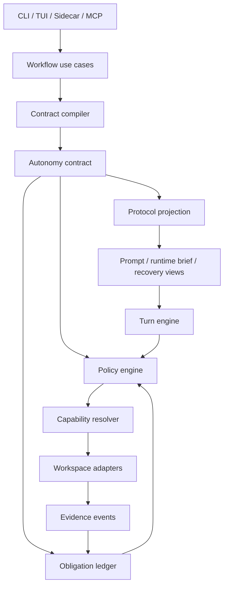

# Complexity Reduction Migration

**North Star: AI coding agents are becoming common, but teams do not yet trust
their context, decisions, or outputs. Idiom sells the missing substrate: repo
memory, freshness, contracts, audit, and evals.**

Status: canonical migration plan, drafted 2026-06-03

## Purpose

This document defines the migration from Idiom's current high-churn harness to a
smaller architecture that preserves functionality while reducing active surface
area. The goal is not to cut features. The goal is to consolidate duplicated
behavior into proper domain and application boundaries so each invariant has one
owner, each workflow has one use-case API, and CLI/TUI/sidecar entrypoints are
thin adapters.

This supersedes broad cleanup-by-file plans when they conflict. Historical
design docs remain evidence, but implementation should use this document as the
coordination plan for complexity reduction.

## Current Evidence

Repository inspection on 2026-06-03 shows the current complexity is
concentrated in a few change magnets:

- `cmd` and `internal` contain 716 Go files.
- Non-test Go code under `cmd` and `internal` is about 223k lines; tests are
  about 171k lines.
- `internal/agent/runner.go` is about 22.8k lines. Its `Runner.Run` method is
  over 3k lines.
- `internal/agent/runner_test.go` and
  `internal/agent/runner_plan_then_execute_guard_test.go` together exceed 34k
  lines.
- `internal/workspace/manager.go` is over 6k lines and still owns parsing,
  repair, dispatch, file IO, shell, semantic tools, recovery tools, product
  tools, and path suggestions.
- `internal/app/implementation_dispatch.go` is over 5k lines and mixes prompt
  composition, plan-document materialization, dispatch, retries, and recovery.
- The last 30 days of git history show `internal/agent/runner.go` alone with
  roughly 54k changed lines. `internal/workspace/manager.go`,
  `internal/app/implementation_dispatch.go`, `internal/planexecute/helpers.go`,
  and the runner tests are also high-churn.

The strongest architecture smell is not simply file size. The smell is
duplicated authority:

- `internal/autonomy.AutonomyContract`
- `internal/frontier/workerruntime.WorkerRuntimeBrief`
- `internal/agent.TurnPhaseContract`
- `internal/planexecute.PlanScopeContract`
- `internal/app.routeContractProjection`
- prompt files and embedded lane assets
- runner gates and recovery nudges
- workspace tool profiles and tool schemas
- plan-execute scope and submit-plan validation
- telemetry and audit reconstruction

Each representation is useful, but the system asks maintainers to reconcile
which one owns a decision. That is the source of churn.

## Non-Negotiable Outcome

Reduce complexity without losing functionality.

That means:

- preserve current CLI, TUI, sidecar, lane, tool, and recovery behavior unless
  an explicit product decision says otherwise;
- remove duplicated ownership, not working features;
- migrate through compatibility facades and characterization tests;
- delete obsolete branches and docs once replacements are active;
- never replace one large bespoke surface with another.

## First Broken Invariant

`contract.active_authority`: before model dispatch, tool execution,
verification, lifecycle closeout, audit, or final-answer acceptance, there must
be exactly one active contract identity. Every consequential decision must cite
that contract plus an invariant or obligation id.

Most current failures are symptoms of this invariant being only partially
implemented. Prompts, runtime briefs, runner booleans, workspace rules,
plan-execute scope, and audit all reconstruct overlapping authority.

## Target Architecture

### Package Ownership

| Area | Target package | Owns | Must not own |
| --- | --- | --- | --- |
| Contract domain | `internal/autonomy` | contracts, path roles, obligations, action classes, policy decisions, evidence refs | model calls, IO, shell, CLI/TUI |
| Contract compilation | `internal/contractcompile` | plain input to immutable contract, runtime envelope, protocol projection | runner loop, workspace execution |
| Runtime loop | `internal/runtime` | model-turn lifecycle, action normalization, policy calls, event emission | lane semantics, path authority, prompt prose |
| Workflow use cases | `internal/workflows` | implement, plan-execute, artifact, recovery, product workflow orchestration | TUI state, CLI flag parsing, raw tool adapters |
| Capabilities | `internal/capabilities` | stable capability ids, request/result contracts, adapter selection | concrete language parsing or shell execution |
| Workspace adapters | `internal/workspace`, `internal/semantic`, `internal/mcp`, `internal/backends` | concrete file, shell, graph, LSP, MCP, backend operations | lane semantics, completion policy |
| Presenters | `internal/presenters` | prompt/runtime/recovery/final-answer views from contract projections | authority, validation, state transitions |
| Surfaces | `internal/cmd/*`, `internal/app` | input translation and output rendering | workflow policy, prompt parsing as authority |
| Audit/eval | `internal/autonomy`, `internal/eval`, later focused packages | replay and scoring from structured contract events | transcript-only reconstruction |

These target packages are migration labels. Introduce one only when the same
patch routes production callers through it and deletes or materially shrinks the
active old owner. Do not create pass-through packages.

## Required Consolidations

### 1. Contract Authority

Canonical owner: `internal/autonomy` plus `internal/contractcompile`.

Current overlapping surfaces must become contract inputs or projections:

- `WorkerRuntimeBrief`
- `TurnPhaseContract`
- `PlanScopeContract`
- route projections
- prompt-scope extracted required paths
- workspace tool profiles
- completion and verification gates

The migration is complete when prompt text, visible tools, parser mode,
workspace policy, verification, and completion all cite the same contract id and
protocol hash for a covered lane.

### 2. Obligation Ledger

Canonical owner: `internal/autonomy`.

The ledger must track:

- source-body evidence obligations
- required edit path coverage
- allowed candidate scope
- edit-set obligations
- write evidence
- verification-after-write state
- final-answer grounding
- blocker state
- loop and budget state

Runner code should ask the ledger whether an obligation is open or closed. It
should not infer that state from transcript strings or accumulated booleans.

Phase 2 must also promote candidate-scope and blocker-state distinctions into
canonical obligation/path-role fields before the ledger is wired as runtime
authority. Early migrations may store these as ordinary obligation facts, but
runtime migration is not complete until candidate scope cannot be confused with
required coverage and a typed blocker cannot be confused with an unresolved
evidence obligation.

### 3. Capability Routing

Canonical owner: `internal/capabilities`.

The model-facing read interface should be capability-shaped:

- `localize_change`
- `query_context`
- `inspect_file`
- `inspect_symbol`
- `find_symbol`
- `find_definition`
- `find_references`
- `find_implementations`
- `calls_from`
- `calls_into`
- `related_files`
- `source_sanity`
- `trace_runtime_failure`
- `verify_edit`
- `audit_behavior`

Language-prefixed tools remain compatibility adapters until all call sites have
coverage. Results must report selected adapter, precision, freshness, fallback,
absence confidence, and unresolved gaps.

### 4. Runtime Loop

Canonical owner: `internal/runtime`.

The runtime engine should be small:

1. build the model request from a protocol projection;
2. receive model output;
3. normalize visible/native/tool intent;
4. ask policy for a decision;
5. execute an approved adapter action;
6. record evidence and ledger updates;
7. close, recover, or continue.

It must not compile contracts, parse prompt headings as authority, choose lane
semantics, or format recovery prose directly.

### 5. Workspace Tool Surface

Canonical owner: adapter registry under `internal/workspace`.

`workspace.Manager` should become a registry and compatibility facade. Tool
request parsing, Qwen/legacy repair, dispatch, file IO, shell execution,
semantic tools, product tools, and recovery tools should move into focused
adapters behind one registry contract.

### 6. Workflow Use Cases

Canonical owner: `internal/workflows`.

Plan-execute, implement, artifact, recovery, and product workflow orchestration
should be callable from CLI, TUI, and sidecar without duplicating behavior. The
TUI must present workflow state, not implement workflow policy.

### 7. Presenter Generation

Canonical owner: `internal/presenters`.

Runtime briefs, control rails, recovery cards, prompt addenda, final-answer
repair prompts, and tool-manifest summaries must be generated from the active
contract/protocol projection. Prompt assets can explain stable style, but they
must not create authority.

## Migration Phases

### Phase 0: Characterization And Guardrails

Goal: freeze current behavior enough to migrate safely.

Deliverables:

- Scripted contract fixtures covering read-only answer, implementation,
  plan-execute planner, source-satisfied closeout, verification failure,
  recovery-open, and sidecar tool calls.
- Architecture boundary tests for the new packages before broad extraction.
- Complexity budget report for file size and package coupling.
- A migration tracker that maps each old authority surface to its target owner.

Acceptance:

- Existing tests still pass.
- New characterization tests describe current behavior, not desired rewrites.
- No runtime behavior changes unless separately reviewed.

### Phase 1: Active Contract Consolidation

Goal: make every covered lane dispatch through one compiled contract while old
surfaces remain as compatibility projections.

Deliverables:

- Contract ids present before first model/tool action.
- Protocol projection includes visible tools, callable actions, terminal
  outcomes, parser mode, recovery budget, and verification obligations.
- Runner and workspace emit policy decisions that cite contract id and invariant
  id in report-only mode.

Acceptance:

- Covered lanes preserve behavior.
- Audit can group covered tool/final-answer decisions by contract id.
- No prompt or recovery surface claims authority not present in the projection.

### Phase 2: Path Roles And Obligation Ledger

Goal: centralize required paths, allowed paths, evidence paths, and generated
artifacts.

Deliverables:

- Shared path-role resolver in `internal/autonomy`.
- Required edit coverage and source-body evidence represented as obligations.
- Canonical candidate-scope and blocker-state fields, not inferred from
  transcript text or generic obligation labels.
- Submit-plan validation, workspace writes, recovery, and final-answer gates
  consume the same resolver/ledger.

Acceptance:

- Candidate scope cannot become required coverage without an explicit contract
  field.
- Source-body evidence cannot be satisfied by generated artifacts or broad
  mentioned-path scans.
- Existing source-satisfied and stale-anchor tests pass.

### Phase 3: Capability Resolver

Goal: reduce model-visible read/navigation complexity without losing precision.

Deliverables:

- one active capability metadata/resolver owner for ids, evidence capability
  tags, classification, request/result contracts, adapter selection, precision,
  fallback, freshness, and gaps;
- compatibility adapters for existing graph/context/language/source-sanity
  tools;
- workspace manager routes `read_only_capability` through that owner;
- any later `internal/capabilities` extraction replaces the active workspace
  implementation in the same effort and deletes the old owner.

Acceptance:

- Every read-only adapter is classified as routed, compatibility-only,
  deferred, or intentionally unmapped.
- Results always expose adapter, precision, fallback, freshness, and gaps.
- Legacy direct tools remain callable.

### Phase 4: Runtime Strangler

Goal: replace the large runner loop with a small turn engine.

Deliverables:

- `internal/runtime.TurnEngine` shadow-runs selected lanes and compares emitted
  decisions with the legacy runner.
- Policy and ledger decisions move out of `internal/agent/runner.go`.
- Final-answer acceptance, recovery, and verification gates consume typed
  decisions instead of transcript-string heuristics.

Acceptance:

- Shadow parity is green for the characterization suite.
- New runtime-owned tests assert event/decision contracts, not prompt strings.
- Legacy runner branches are deleted after parity, not left dormant.

### Phase 5: Workflow Extraction

Goal: make CLI/TUI/sidecar call the same use cases.

Deliverables:

- `internal/workflows/planexecute`, `internal/workflows/implement`,
  `internal/workflows/artifact`, and `internal/workflows/recovery`.
- `internal/app/implementation_dispatch.go` becomes a presenter/controller or
  is deleted.
- CLI command packages contain parsing, config loading, and rendering only.

Acceptance:

- CLI and TUI plan-execute paths use the same workflow API.
- Product/recovery status uses the same durable workflow state as CLI.
- Duplicate retry/recovery formatting is removed.

### Phase 6: Workspace Registry

Goal: shrink workspace manager to registry, policy adapter, and compatibility
transport.

Deliverables:

- Built-in tool adapters registered by descriptor.
- Tool parsing/repair moved to transport-specific normalizers.
- Shell, file, graph, semantic, product, recovery, and MCP adapters separated.

Acceptance:

- Adding a tool requires one descriptor and one adapter, not switch edits across
  runner/workspace/prompt/audit.
- Tool schemas, suggestions, profile policy, sidecar envelopes, and dispatch all
  read from the same descriptor.
- Unused legacy dispatch cases are deleted.

### Phase 7: Presenter And Docs Consolidation

Goal: reduce prompt/docs authority drift.

Deliverables:

- Generated runtime brief, control rail, recovery, and final-answer views from
  protocol projections.
- Prompt assets limited to stable working style and examples.
- Docs split into canonical specs, migration docs, archived historical designs,
  and generated evidence.

Acceptance:

- No live prompt or doc is parsed as hard authority unless a compiler accepts it
  as an explicit input.
- Canonical design docs fit on a small index page.
- Historical docs are archived or clearly non-authoritative.

## Parallel Implementation Protocol

Parallel work is allowed only when write scopes are disjoint and the owning
boundary is explicit.

Each effort must include:

- owner package/files;
- invariant being improved;
- compatibility behavior that must remain;
- tests to run;
- reviewer assignment;
- cleanup-agent assignment.

Implementation agents must:

- edit only their assigned scope;
- avoid broad rewrites and unrelated cleanup;
- introduce no duplicate helpers, bespoke string matchers, or dead compatibility
  branches;
- prefer shared domain types over local booleans or string switches;
- list changed files and remaining cleanup risks in their closeout.

Reviewer agents must:

- check invariant ownership, dependency direction, duplicated logic, behavior
  preservation, and test coverage;
- reject changes that add a new local workaround instead of using the shared
  contract/capability/ledger boundary;
- identify deletions that become safe after the effort.

Cleanup agents run after each effort and must:

- remove dead code, unused fixtures, obsolete tests, and redundant docs created
  by that effort;
- run focused searches for duplicate functions/constants/strings introduced by
  the effort;
- avoid changing behavior;
- report anything that could not be cleaned because another effort still
  depends on it.

## First Parallel Efforts

### Effort A: Migration Guardrails

Owner: docs, architecture boundary tests, complexity report.

Scope:

- this migration document;
- boundary tests for target package dependencies;
- optional non-enforcing complexity report script/test.

Do not edit runtime behavior.

### Effort B: Active Capability Consolidation

Owner: current capability resolver files under `internal/workspace`; a new
`internal/capabilities` package is allowed only if the same patch routes
production callers through it and deletes/shrinks the old workspace owner.

Scope:

- consolidate capability ids, evidence capability tags, classification, and
  adapter descriptor metadata into one active source;
- preserve `read_only_capability` behavior and legacy direct tool fallback;
- delete any uncalled package shells, compatibility branches, and duplicate
  metadata lists created during the migration.

Do not land a package that is only exercised by tests.

### Effort C: Active Obligation Ledger Migration

Owner: `internal/autonomy`.

Scope:

- introduce the smallest shared obligation/path-role API that an active runner,
  planner, or gate call site consumes in the same effort;
- delete the replaced local booleans/string helpers from that call site;
- keep characterization tests for the migrated behavior.

Do not land unused ledger APIs.

### Effort D: Workspace Tool Surface Consolidation

Owner: the current workspace manifest/schema/profile/dispatch files.

Scope:

- collapse duplicated tool name, category, side-effect, profile, schema,
  suggestion, and capability-tag metadata into one active descriptor source;
- route at least one production projection through that descriptor source;
- delete the replaced list/switch in the same patch.

Do not create a second registry beside the existing one unless it immediately
becomes the production authority for a projection.

## Implemented Consolidations

These reductions are active production changes, not proposed package shells:

- Workspace built-in tool inventory now lives in active tool-surface descriptors
  that feed manifest defaults, category classification, write-tool names,
  narrowing behavior, evidence capability tags, capability classification,
  schema-export capabilities, schema-export side effects, legacy MCP discovery
  membership, discovery-profile local-artifact restrictions, and stale-context
  error metadata.
- Supplemental language compatibility tools now live in one active descriptor
  source used by manifest projection, language-tool detection, evidence
  capability metadata, and schema-policy classification.
- `internal/workspace/tool_manifest.go`, `tool_class.go`, `manager.go`,
  `capabilities.go`, `tool_schema_export.go`, and
  `tool_profile_policy.go` no longer own parallel built-in tool fact tables for
  the migrated fields.
- `internal/frontier/workerruntime/catalog.go` now composes shared
  source-inspection, context-discovery, history, and write groups instead of
  repeating the same names in every capability profile.
- Speculative target-package shells were removed. Future target packages must
  become production authorities in the same effort that introduces them.

Remaining intentional duplicate surface:

- `internal/workspace/tool_schemas.go` and the language manifest examples still
  hand-author descriptions and JSON schemas. They are guarded by manifest/schema
  drift tests and should be migrated only with a schema-descriptor generator
  that preserves the tuned per-tool wording.

## Second-Pass Consolidation Backlog

This pass looked for concepts with multiple active authorities, large churn
surfaces, or bespoke branches that should become explicit architecture seams.
These are not small cleanup tasks; each should be its own migration effort with
characterization tests before rewiring.

### Effort E: Tool Surface Compiler

Current shape:

- `internal/workspace/tool_manifest.go` owns built-in tool inventory and
  manifest option flags.
- `internal/workspace/tool_profile_policy.go` owns profile admission and
  request-level side-effect restrictions.
- `internal/frontier/workerruntime/catalog.go` owns task-family capability
  profiles and a second tool filtering layer.
- CLI, MCP, runtime brief generation, unsupported-tool suggestions, and audit
  each consume overlapping projections of the same tool surface.

Problem:

Tool visibility, side effects, profile admission, suggestions, schema export,
and runtime brief projection are related policy, but they are assembled through
separate lists and switch statements. This makes every new tool or lane a
shotgun-surgery change across workspace, worker runtime, CLI/MCP, and tests.

Target owner:

- expanded descriptor-owned workspace registry first;
- future `internal/toolsurface` only if the same effort replaces the active
  registry authority.

Migration:

1. Promote the active workspace tool-surface descriptors into the single source
   for name, category, side effects, profiles, schema, suggestion visibility,
   and capability tags.
2. Replace `ToolManifestToolOptions` booleans with a typed projection request:
   audience, lane, phase, side-effect budget, language set, and compatibility
   mode.
3. Make worker runtime ask the compiler for visible tools instead of filtering
   hard-coded name sets.
4. Make CLI/MCP/audit/suggestions read descriptor projections.
5. Delete duplicate allow-list helpers only after parity tests cover every
   exported tool.

Acceptance:

- Adding one tool edits one descriptor plus tests, not workspace + worker
  runtime + audit + CLI/MCP.
- A single test proves manifest, schemas, profiles, suggestions, and runtime
  brief projection agree for all built-ins.
- Unknown or mixed side effects cannot default to read-only anywhere.

### Effort F: Final Answer Policy Engine

Current shape:

- `internal/agent/completion_gate.go` registers ordered checks around
  `workspace.ToolResult`.
- `internal/agent/final_answer_acceptance.go` independently evaluates
  acceptance, required paths, objective relevance, source grounding, and
  required evidence.
- `internal/agent/final_answer_decorator.go` rewrites accepted answers into
  blockers, composed evidence answers, or conversation fallbacks.
- `internal/answergrounding` has a separate evidence/claim grounding model that
  overlaps with agent-local source-body and relevance logic.

Problem:

Completion, acceptance, grounding, blocker synthesis, and final presentation are
one policy boundary but currently split by mechanism. The runner decides both
whether an answer is acceptable and how to rewrite it, using many agent-local
helpers that duplicate source-body and objective relevance concepts.

Target owner:

- current agent answer policy first;
- future `internal/answerpolicy` only if the same effort replaces active
  agent-owned decisioning.

Migration:

1. Define `AnswerPolicyInput`: contract, objective, obligation ledger,
   evidence ledger, tool results, raw model answer, and stop reason.
2. Define `AnswerPolicyDecision`: accept/reject, blocker, required next action,
   evidence refs, user-facing answer, and audit facts.
3. Move source grounding and objective relevance behind one evidence ledger
   adapter, reusing `internal/answergrounding` rather than maintaining
   agent-local variants.
4. Convert completion gate checks into named policy rules that return typed
   reasons, not `workspace.ToolResult` as the primary domain object.
5. Leave `Runner` as transport glue: collect inputs, call policy, emit result.

Acceptance:

- Final-answer acceptance and decoration are decided by one call.
- The same evidence fact cannot be accepted by the gate and rejected by the
  decorator.
- Tests cover rule ordering and presentation separately.
- `internal/agent` no longer owns source-body relevance heuristics.

### Effort G: Source Evidence Ledger

Current shape:

- `internal/agent/source_evidence_state.go` tracks pending source-body
  redirects and allowed follow-ups.
- `internal/agent/read_only_answerability.go` separately classifies answerable
  read-only evidence.
- `internal/agent/read_only_evidence_packet.go` transports source-body paths
  from delegated packets.
- `internal/answergrounding` models evidence kinds such as `source_body`,
  `symbol_body`, `path_seen`, and `packet`.
- Plan-execute required-source logic has its own evidence levels and path
  coverage checks.

Problem:

The same distinction appears many ways: candidate path, generated artifact,
path seen, outline, source body, symbol body, diagnostic evidence, exact anchor,
and delegated packet. Because those concepts are not one ledger, fixes tend to
add another guard in agent code.

Target owner:

- current autonomy/grounding evidence models first, using
  `internal/answergrounding` evidence kinds as the domain vocabulary;
- future `internal/evidenceledger` only if the same effort replaces active
  ledger/grounding ownership.

Migration:

1. Define canonical evidence receipts with source, target path, range/symbol,
   evidence kind, freshness, generated-vs-source flag, and objective relevance.
2. Add adapters from `workspace.ToolResult`, delegated packets, context packs,
   plan artifacts, and diagnostic results.
3. Replace source-evidence pending redirects and read-only answerability with
   ledger queries.
4. Let the obligation ledger reference evidence receipt ids when closing
   source-body, write, verify, and final-answer obligations.

Acceptance:

- Generated context artifacts can never satisfy source-body obligations because
  the receipt kind forbids it.
- Candidate-path evidence cannot become source-body evidence through string
  matching.
- Read-only answerability, plan-execute source requirements, and answer
  grounding query the same ledger.

### Effort H: Workflow State Machine Kernel

Current shape:

- `internal/productworkflow.WorkflowState` carries product phase, state,
  coverage, obligations, blockers, context, privacy, and next actions.
- `internal/featureplanner.FeatureState` carries planning/dispatch atom state
  and derives its own next valid actions.
- `internal/planexecute.ProgressState` carries plan-execute phase progress and
  review state.
- `internal/app/feature_planner_product.go` orchestrates PRD, ADR, TDD,
  featureplanner, and persistence directly.

Problem:

There are multiple durable workflow state machines with similar fields and
rules: status, phase, next actions, blockers, active runs, verification,
coverage, and recovery. The app layer currently coordinates several of them and
contains product-domain transitions, model calls, parsing, file writes, and UI
status formatting in one surface.

Target owner:

- current workflow orchestrators first;
- future `internal/workflowkernel` only if the same effort replaces active
  workflow state-machine ownership;
- product/feature/plan-execute packages provide domain-specific reducers and
  adapters.

Migration:

1. Define common `WorkflowState`, `WorkflowTransition`, `WorkflowBlocker`,
   `NextAction`, and persistence port interfaces.
2. Move transition legality and next-action derivation into reducers.
3. Make product workflow, feature planner, and plan-execute implement the same
   kernel interfaces while preserving their existing durable schemas through
   adapters.
4. Move app product orchestration behind an application service that the TUI
   calls.

Acceptance:

- UI code does not mutate product workflow phases or featureplanner status
  directly.
- Every durable state transition emits a typed transition event.
- Recovery views for product workflow, feature planner, and plan-execute share
  the same blocker/next-action projection.

### Effort I: Runner Turn Engine Split

Current shape:

- `internal/agent/runner.go` is the largest production file and still owns
  request parsing, runtime calls, tool execution loop, completion handling,
  recovery, apply-patch preflight, and many lane-specific escape paths.
- Several newer files already extract policies, but `Runner` still mediates
  too many domain decisions.

Problem:

The runner remains the integration point where unrelated policies accumulate.
As long as new behavior is wired directly through `Runner`, architecture work
will keep reducing symptoms while churn returns to the same file.

Target owner split:

- current runner-owned turn/answer/recovery decisioning first;
- future `internal/turnengine`, `internal/toolcalls`, `internal/recovery`,
  `internal/answerpolicy`, and `internal/runneradapter` only if the same effort
  replaces active runner-owned behavior.

Migration:

1. Characterize the turn loop as events: model call, tool request, tool result,
   policy rejection, recovery instruction, final answer, stop reason.
2. Extract a pure `TurnEngine.Step` that consumes state plus an event and
   returns next action.
3. Move tool-call parsing and completion policy behind ports.
4. Keep the existing `Runner` API, but make it delegate into the engine.
5. Delete lane-specific runner branches as the new contract/evidence/tool
   surfaces take ownership.

Acceptance:

- The runner does not inspect source-body, required path, or tool-profile policy
  directly.
- New lane behavior is added through contract/tool/evidence/answer policy
  packages, not `runner.go`.
- The turn engine has fast unit tests without llama or workspace manager.

## Deletion Policy

Compatibility code is allowed only with an owner, removal condition, and test.

Architecture-shell packages are not deliverables by themselves. A new package
may land only when the same effort either:

- wires at least one production caller through it and deletes or shrinks the old
  authority surface; or
- replaces an existing package outright.

If an effort only proves a future seam in tests, keep that work in this document
or a design branch, not in mainline code. The migration reduces complexity only
when active responsibility moves and old responsibility is removed.

Every temporary branch must carry:

- reason it exists;
- old behavior it preserves;
- contract or workflow that will replace it;
- deletion trigger.

Dead code is not allowed. If an effort leaves a compatibility branch unused by
tests or production paths, the cleanup agent must delete it in the same effort.

## Review Checklist

Before accepting an effort:

1. Which invariant got a clearer owner?
2. Which active surface got smaller or less authoritative?
3. Which behavior was preserved by characterization tests?
4. Which duplicate branch, helper, string constant, or prompt line was removed?
5. Which old code remains, and what exact trigger deletes it?
6. Did the cleanup agent run after implementation and review?
7. Are docs updated only where they are canonical?

## Success Metrics

The migration is succeeding when:

- new behavior lands behind contract/capability/workflow boundaries;
- `internal/agent/runner.go`, `internal/workspace/manager.go`, and
  `internal/app/implementation_dispatch.go` churn trends downward;
- architecture tests prevent core packages from importing outer layers;
- broad rediscovery and turn-phase contradiction findings decline on the replay
  suite;
- prompt text shrinks because protocol views are generated;
- compatibility code is deleted on schedule.

The migration is done when the legacy runner and workspace manager are
compatibility shells or removed, and adding a new lane/tool/gate no longer
requires edits across runner, workspace, app, prompts, plan-execute, audit, and
tests.
