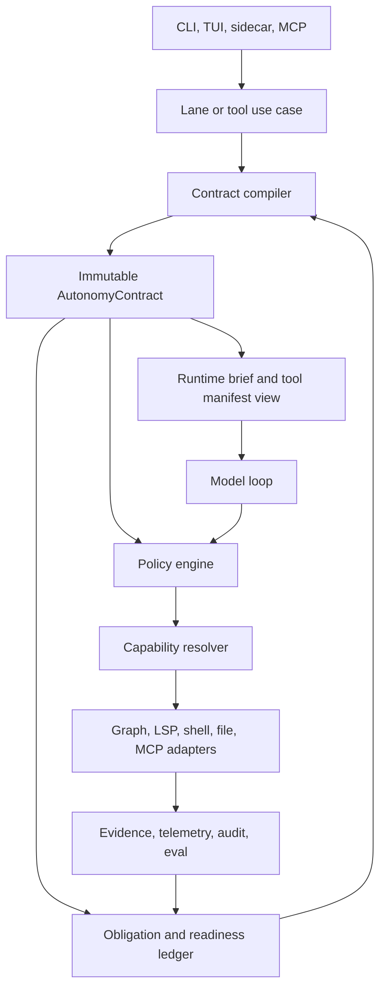

# Contract And Capability Architecture Overhaul

**North Star: AI coding agents are becoming common, but teams do not yet trust
their context, decisions, or outputs. Idiom sells the missing substrate: repo
memory, freshness, contracts, audit, and evals.**

Status: accepted design with phase 1 report-only planner authority pilot
started, created 2026-05-24, updated 2026-06-02

## Purpose

This document defines the architecture overhaul needed to make Idiom easier to
trust, read, and maintain while preserving the product thesis:

- the model owns strategy
- the harness owns contracts

The effort is not a rewrite. It is a staged consolidation of authority,
capability routing, runner state, verification, and audit around one durable
contract lifecycle. The goal is to reduce change amplification in the current
runner/workspace/app surfaces without weakening local-model autonomy.

## Current Evidence Snapshot

This design is based on repository docs, source inspection, `context_pack`, and
local audit/status output on 2026-05-24.

Verified facts:

- `README.md` says Idiom is currently used primarily as a headless runner; the
  TUI is not yet authoritative for complex product-workflow continuation.
- `docs/idiom-design-roadmap.md` defines seven pillars that are meant to form
  one architecture: contract-first autonomy, persistent memory,
  capability-oriented tooling, auditable handoff, local-model operations,
  eval/audit/learning, and sidecar substrate.
- `docs/design-contract-first-local-autonomy.md` states the central gap: Idiom
  has runtime briefs, permissions, task families, control rails, hidden tools,
  write checks, readiness, gates, audit, evals, packets, and graph memory, but
  not yet one canonical contract lifecycle.
- `idiom tool context_status --input '{"refresh":false,"limit":50}'` reported
  a fresh graph index with 580 files, 14,728 symbols, and 83,557 edges.
- `idiom tool harness_audit --input '{"purpose":"architecture_state"}'`
  reported 135 manifest/schema/exported tools with zero drift, 4,360 contract
  events, 17 findings, and 13 questions.
- The same audit reported only 5 routed read-only capabilities, 37 mapped
  read-only adapters out of 112, 75 unmapped adapters, 118 turn phase contract
  contradictions, and 19 implementation-backed sessions missing lifecycle
  closeout.
- File-size inspection shows high responsibility concentration in
  `internal/agent/runner.go`, `internal/workspace/manager.go`,
  `internal/app/implementation_dispatch.go`, and `cmd/idiom/plan_execute.go`.
- The 2026-06-02 implementation batch added prompt-scope parser consolidation
  in `internal/plancontract`, shared planner tool metadata in
  `internal/autonomy`, a typed report-only runtime readiness projection,
  a plan-execute planner recorder pilot that consumes compiled contract
  identity, and readiness/completion audit coverage.

Inferences:

- The project has mature primitives but weak ownership boundaries. Most
  failures are symptoms of duplicated authority, not missing concepts.
- Maintenance cost is now dominated by needing to understand interactions
  across runner policy, runtime brief construction, workspace tool policy,
  prompt/protocol text, audit, and lane wrappers.
- Stability and readability require the same fix: make contract authority
  explicit, versioned, and consumed by every layer instead of reconstructed in
  each layer.

Evidence gaps:

- The audit evidence is aggregate. It proves the class of failure, but not one
  ordered session timeline for the first invalid transition. The first
  implementation slice should therefore make the violated decision replayable
  before it changes enforcement behavior.
- Command-output facts in this document are reproducible locally but should be
  copied into durable evidence artifacts when they become release or product
  claims.
- Reviewer output for this draft is summarized in
  `docs/evidence/contract-capability-architecture-overhaul-review.md`; that
  report is review evidence for the design, not implementation proof.
- Implementation evidence for the first atoms is summarized in
  `docs/evidence/contract-capability-architecture-overhaul-implementation.md`.
  Phase 1 now has a report-only compiler foundation plus a covered
  plan-execute planner pilot where the runner autonomy recorder consumes the
  compiled contract identity. Enforcement has not been graduated beyond
  report-only, and non-planner runner paths still use the legacy contract
  construction path.

## Problem Statement

Idiom currently has several partial sources of truth:

- `internal/autonomy.AutonomyContract`
- `internal/frontier/workerruntime.WorkerRuntimeBrief`
- runner control rails and phase contracts
- workspace tool manifests and profile policy
- lane-specific CLI wrappers
- prompt lead-ins and recovery nudges
- plan-execute scope contracts
- completion and verification gates
- telemetry and audit reconstruction

Each source is useful, but the system asks maintainers to mentally reconcile
which one owns authority for a given decision. That creates:

- duplicated checks
- prompt text that can quietly become authority
- tool results that carry evidence and sometimes strategy pressure
- audit events that see symptoms but not always the owning invariant
- broad files where unrelated policies accumulate
- CLI/TUI/sidecar parity risk because each surface can reconstruct state
  differently

The architecture should make invalid states hard to represent. A lane or
sidecar call should not be able to expose a tool, accept a write, waive
verification, or close a task through a path that is not traceable to the active
contract.

## First Broken Invariant

`contract.active_authority`: before model dispatch, adapter execution, tool
policy, verification, lifecycle closeout, or audit interpretation, the harness
must have exactly one active contract identity. Every consequential decision
must cite `{contract_id, invariant_id, decision}` and, when applicable,
`obligation_id`.

Current failures are symptoms of this invariant not being authoritative enough:
runner gates, runtime briefs, workspace policy, prompts, plan-execute scope,
readiness, verification, and audit can reconstruct overlapping authority rather
than consuming one compiled contract.

This invariant governs authority, not strategy. It must not decide whether the
model should inspect, edit, verify, or answer. It decides which actions are
legal, what evidence is required, and whether a claimed terminal state is valid.

## Design Decision

Make a compiled, immutable `AutonomyContract` the source of truth for each lane,
phase, and sidecar call. Every model-visible affordance, tool-policy decision,
readiness update, verification gate, lifecycle event, and audit finding should
derive from that contract or from a typed state transition that creates the next
contract version.

The contract is the domain object. The runner is an execution loop. Workspace
tools are adapters. Prompts explain the contract to the model; prompts are not
the contract.

## Target Architecture



The target dependency rule:

- Surface and orchestration depend on contract and use-case APIs.
- Contract packages do not depend on runner, TUI, CLI, database, shell, LSP, or
  model backends.
- Runner depends on contract decisions and adapter ports.
- Workspace executes concrete tools but does not own lane semantics.
- Audit and eval consume structured contract events rather than reconstructing
  behavior from prose.

## Core Domain Objects

### Autonomy Contract

The contract owns:

- invocation identity: lane, phase, sidecar call, task family, model role
- authority: permission profile, approval mode, trust level, tool side effects
- runtime envelope: backend kind, model alias, role, parser/transport mode,
  response format, native-tool policy, thinking policy, effective max tokens,
  context budget, queue lease, readiness profile, degraded state, authorized
  fallback, and paired degradation decisions
- path roles: required edit, allowed edit, evidence read-only, generated
  artifact, protected, forbidden, verification output, external effect
- capability policy: allowed capabilities, hidden capabilities, fallback policy,
  required precision where applicable
- obligations: source evidence, write, verification, final answer, approval,
  budget, loop protection
- readiness: ready to answer, write, verify, or block
- verification: required checks, acceptable substitutes, post-write freshness
- completion: valid terminal outcomes and required evidence
- audit identity: contract id, parent id, invariant ids, decision ids

Contracts should be immutable inside a phase. A write, verification result,
approval result, context freshness change, route transition, or user instruction
update creates a new version with a parent id.

### Policy Decision

Every consequential decision should have a small, replayable shape:

```text
contract_id
invariant_id
subject: tool_call | final_answer | route_transition | verification | sidecar_call
decision: allow | ask | nudge | reject | stop | observe
reason
safe_alternatives
obligation_updates
telemetry_event_id
```

This is the bridge between runtime enforcement and audit.

Subjects must include malformed output and parser failures, not only successful
tool calls:

```text
tool_call
malformed_tool_call
final_answer
route_transition
verification
model_call
sidecar_call
lifecycle_closeout
```

### Model-Facing Protocol Contract

The contract must compile to a model-facing protocol projection. This is the
only model-readable source for the current executable protocol.

The projection should include:

- `contract_id`, `contract_version`, `protocol_hash`, and `phase_id`
- parser/transport mode and expected visible output shape
- visible tools and callable action classes
- invalid action classes
- terminal response shapes
- structured schema names
- malformed-output policy and recovery budget
- stale-anchor policy
- source-body obligations
- required path-role distinctions
- verification obligations
- safe alternatives when an action is rejected

Runtime briefs, control rails, recovery nudges, visible tool manifests, parser
configuration, and completion gates must cite the same `protocol_hash`. A prompt
change that does not update the protocol projection is explanatory only; it does
not change authority.

### Capability Request

The model-facing read interface should be capability-shaped, not
language-tool-shaped. The canonical request vocabulary should cover:

- `localize_change`
- `query_context`
- `inspect_file`
- `inspect_symbol`
- `find_definition`
- `find_references`
- `calls_from`
- `calls_into`
- `related_files`
- `source_sanity`
- `trace_runtime_failure`
- `verify_edit`
- `audit_behavior`

Language-prefixed tools remain adapters during rollout. The model may still
call them for compatibility, but prompts and runtime briefs should teach the
capability vocabulary.

### Obligation Ledger

Readiness should be a ledger, not scattered booleans and prose:

- open obligations
- closed obligations
- evidence refs
- source-body evidence status
- required edit coverage
- verification-after-write status
- final-answer readiness
- blocker status

The final-answer gate should consume this ledger directly.

## Package Boundary Plan

The desired steady-state ownership is:

| Area | Package | Responsibility |
| --- | --- | --- |
| Contract domain | `internal/autonomy` | contract schema, path roles, invariant ids, policy decisions, obligation ledger |
| Contract compilation | `internal/contractcompile` | compile route, runtime brief, workspace config, tool rules, packet, runtime envelope, and run state into a contract from plain input models |
| Runner loop | `internal/agent` | model loop, state transitions, policy calls, lifecycle events |
| Capability contracts | `internal/capabilities` | capability ids, request/result envelopes, precision/fallback vocabulary |
| Capability adapters | `internal/workspace` initially | map capability requests to concrete graph/language/shell adapters while compatibility tools remain available |
| Repository memory | `internal/comprehension` | graph, freshness, views, packets, traces |
| Workspace adapters | `internal/workspace`, `internal/semantic`, `internal/mcp`, `internal/backends` | execute concrete tools and report normalized results |
| Surfaces | `cmd/idiom`, `internal/app` | translate CLI/TUI/sidecar input into use-case requests and render outcomes |
| Audit/eval | `internal/workspace/harness_audit.go`, `internal/eval`, later smaller packages | replay contract events and score invariants |

The compiler must not live under `internal/agent` long term. The runner consumes
contract decisions; it does not own compilation. A temporary anti-corruption
mapper may translate `WorkerRuntimeBrief`, workspace manifest data, and current
run state into compiler input models, but that mapper should be measurable and
retired as callers move to native contract inputs.

The first extraction should avoid shallow pass-through packages. Extract only
when the new package hides a real decision: contract compilation, policy
evaluation, capability routing, runtime-envelope normalization, or
obligation/readiness state.

Boundary tests should enforce that `internal/autonomy` and
`internal/contractcompile` do not import `internal/agent`, `internal/app`,
`cmd/idiom`, concrete LSP packages, shell execution, MCP clients, or workspace
manager internals.

## Acceptance And Atomization Plan

This design is not dispatchable as one implementation task. Each phase must be
split into small implementation atoms before coding starts.

First covered lane: plan-execute planner in CLI/headless mode. It is the pilot
because it exercises required edit paths, allowed candidate paths,
`submit_plan` coverage, source-satisfied terminal state, malformed-output
recovery, final-answer gating, and executor handoff without requiring TUI write
authority.

Each implementation atom must define:

- `task_id`
- complexity tier
- expected files
- forbidden files
- context pack id or replacement evidence packet
- TDD obligations
- required tests and replay fixtures
- audit signal expected to move
- rollback note
- implementor evidence artifact
- reviewer evidence artifact
- post-effort investigation requirement

No-go gates:

- Missing expected files, forbidden files, TDD obligations, or required tests
  makes the atom non-dispatchable.
- Stale context, stale anchors, or dirty scoped paths become tracker/spec
  maintenance, not implementation work.
- Any atom that would weaken an existing gate must include a blocked-case and
  allowed-case regression test before dispatch.

Traceability matrix for each atom:

| Design invariant | Contract event | Package owner | Test fixture | Audit metric | Product evidence |
| --- | --- | --- | --- | --- | --- |
| `contract.active_authority` | `contract_compiled`, `contract_decision` | `internal/autonomy`, `internal/contractcompile` | contract compiler golden | missing contract ids | atom report |
| protocol parity | `contract_presented`, `tool_policy_decision` | `internal/agent` | protocol hash fixture | turn-phase contradictions | review report |
| path-role authority | `path_role_decision` | `internal/autonomy` | path-role table | out-of-scope rejections | atom report |
| runtime envelope | `runtime_contract_bound`, `model_call` | `internal/contractcompile`, `internal/agent` | runtime envelope fixture | degraded-mode grouping | investigation report |
| lifecycle closeout | `contract_closed`, `session_summary` | `internal/agent` | closeout matrix | incomplete lifecycle count | audit report |

## Migration Sequence

### Phase 1: Stabilize Contract Compilation

Goal: make the active contract observable before changing behavior.

Work:

- Define the minimal stable contract event schema:
  `contract_compiled`, `contract_decision`, `obligation_updated`,
  `contract_presented`, `runtime_contract_bound`, and `contract_closed`.
- Ensure every lane and sidecar call has a contract id before the model or
  adapter acts.
- Map existing `WorkerRuntimeBrief` fields into the contract without removing
  the brief yet.
- Bind a minimal runtime envelope before first model dispatch: backend kind,
  model alias/role, parser/transport mode, native-tool policy, response format,
  thinking policy, effective max tokens, context budget, queue state, readiness
  profile, enforcement mode, degraded invariants, authorized fallback, and
  paired degradation decisions.
- Compile a model-facing protocol projection and add parity checks that runtime
  brief text, control rails, visible tools, parser mode, and final gates all cite
  the same `contract_id` and `protocol_hash`.
- In the pilot lane, covered runner gates must consume contract
  `PolicyDecision` and obligation-ledger outputs rather than re-reading
  `WorkerRuntimeBrief` directly for the same invariant.

Acceptance:

- `harness_audit` can report contract coverage by lane/phase.
- No final-answer or tool-policy event lacks a contract id in covered lanes.
- No model-call event lacks a runtime contract id in covered lanes.
- Prompt/control-rail text, parser-visible tools, callable tools, and completion
  gate all cite the same protocol id in the pilot lane.
- Existing lane behavior is preserved.

### Phase 2: Centralize Path Roles And Scope Checks

Goal: remove duplicated path authority.

Work:

- Move required edit, allowed edit, evidence, generated artifact, protected,
  forbidden, and verification-output classification into one resolver.
- Route submit-plan validation, workspace writes, recovery, TUI dispatch, and
  sidecar tools through that resolver.
- Add tests for candidate scope not becoming required coverage.

Acceptance:

- A path-role decision can be replayed from telemetry.
- Required edit paths, evidence paths, and allowed paths have distinct event
  fields.
- Submit-plan validation, workspace write preflight, recovery prompts, sidecar
  status, and audit replay consume the same path-role resolver.
- Existing dirty/stale/source-satisfied preflight behavior remains intact.

### Phase 3: Promote Capability Routing

Goal: reduce model-visible tool-menu complexity without losing precision.

Work:

- Expand the read-only capability registry to cover repository memory, source
  inspection, call graph, dependency, history, and audit tools.
- Normalize capability results around selected adapter, precision tier,
  fallback state, absence confidence, freshness, and unresolved gaps.
- Treat language-prefixed tools as compatibility adapters in prompts.

Acceptance:

- Every read-only adapter is either routed, direct-compatible, or explicitly
  deferred with a stable reason. The first implementation slice must classify
  all graph/context/source-navigation adapters that currently appear in the
  unmapped audit list.
- Broad `read_file` and `search_content` loops decrease in harness audit
  behavior findings on a named replay corpus with a recorded baseline.
- Direct language tools remain callable through sidecar compatibility.

### Phase 4: Simplify Runner Responsibilities

Goal: make `internal/agent` readable as a model execution loop, not the owner of
every policy.

Work:

- Extract policy evaluation behind a small interface consumed by runner.
- Extract lifecycle closeout and session summary emission into one owner.
- Move phase-specific protocol correction into typed phase contracts and
  recovery state.
- Keep runner tests focused on loop behavior and integration contracts; move
  pure policy tests to the policy package.

Acceptance:

- `harness_audit` no longer reports implementation-backed sessions missing
  lifecycle closeout for newly generated runs.
- Runner tests can assert policy decisions through contract events, not only
  transcript strings.
- Large-file reduction is a side effect, not the metric; the metric is fewer
  responsibilities per module.

### Phase 5: Enforce Local-Model Readiness At Lane Start

Goal: graduate runtime-envelope fields from observable/report-only state to lane
start enforcement where appropriate.

Work:

- Move suitable `doctor` readiness gates from report-only to lane-start
  enforcement where a blocked state means the lane cannot honestly run.
- Define degradation semantics for queue unavailable, backend role unresolved,
  parser unsupported, output budget too small, thinking controls
  unsupported/ignored, source-aware verification unavailable, and review-repair
  backend unavailable.
- Split runtime readiness into `report_only`, `allowed_degraded`, and
  `launch_blocked`, each with invariant ids and reason classes.
- Emit degraded-mode decisions and allowed fallbacks from the active runtime
  contract.

Acceptance:

- A lane blocked by missing runtime prerequisites fails before model dispatch.
- A degraded lane records exactly which invariant is degraded and which
  fallback is authorized.
- Migration tests preserve current report-only behavior until each gate is
  explicitly graduated.

### Phase 6: Contract-Replay Audit And Eval

Goal: make audit/eval a first-class feedback loop.

Work:

- Teach `harness_audit` to group findings by contract id, invariant id, lane,
  phase, and adapter route.
- Convert recurring behavior findings into regression fixtures.
- Wire verified edit, recovery reconciliation, audit-watch, and eval outcomes
  into the ranker-learning evidence path without mutating weights silently.

Acceptance:

- Audit can answer: which contract was active, which invariant failed, what
  safe alternatives were offered, and whether the final state was valid.
- Ranker learning is no longer idle when verified evidence-producing triggers
  run.

## Non-Goals

- Do not replace the current graph store or language adapters.
- Do not remove language-prefixed tools in the first rollout.
- Do not make the harness choose the model's next strategy step.
- Do not hide write operations behind a generic capability facade.
- Do not turn the TUI into a write-authoritative surface before CLI contracts
  are stable.
- Do not measure success by line-count reduction alone.

## Risks And Mitigations

| Risk | Mitigation |
| --- | --- |
| Contract compiler becomes a new god object | Keep it pure, input/output oriented, and tested by contract fixtures. Put execution in adapters. |
| Capability facade hides precision loss | Require selected adapter, precision tier, fallback state, freshness, and unresolved gaps in every result. |
| Migration breaks sidecar compatibility | Keep direct tools callable and route sidecar through the same schema/profile policy. |
| Prompt guidance drifts from gates | Generate runtime brief/control rail views from the active contract. |
| Audit adds noise without improving fixes | Require findings to cite contract id and invariant id before treating them as new gates. |
| Refactor churn outruns behavior protection | Move one lane at a time and preserve current tests before broadening. |

## Acceptance Metrics

The effort should be considered successful only when these are true for covered
lanes:

- Contract events cover model dispatch, tool decisions, writes, verification,
  final answers, and lifecycle closeout.
- `harness_audit` can group behavior findings by contract and invariant.
- Turn-phase contract contradictions trend toward zero for new runs.
- Implementation-backed runs consistently emit process/session lifecycle
  closeout.
- Capability coverage is explicitly measured and grows by planned slices.
- CLI, TUI read-only presenters, and sidecar status surfaces report the same
  contract and recovery state.
- Broad rediscovery behavior decreases without blocking legitimate targeted
  follow-up evidence gathering.
- New invariants have regression tests for both blocked and allowed cases.

Initial required regression families:

- contract compiler golden tests
- event coverage tests for model dispatch, tool decision, write, verification,
  final answer, and lifecycle closeout
- protocol hash parity tests
- runtime-envelope tests for backend/parser/thinking/token/queue state
- path-role resolver table tests
- no prompt-magic route-selection tests
- strategy-boundary tests for capability routing
- workspace backstop tests proving protected-path and read-only safeguards
  remain after policy migration
- audit replay tests that do not depend on transcript string matching
- product-workflow atom intake tests for required implementation evidence

## Review Checklist

Before implementing each phase:

1. Which invariant becomes clearer or stronger?
2. Which package owns the invariant after the change?
3. Which prompt or tool surface stops carrying authority?
4. Which structured event proves the decision happened?
5. Which valid lane behavior could be falsely blocked?
6. Which test proves the bad behavior is blocked?
7. Which test proves the valid behavior remains allowed?
8. Which audit/eval signal should move?

## Reviewer Status

This design was reviewed by the full reviewer bench because it proposes a broad
architecture change. The draft was revised to address the shared findings.
Reviewer output is recorded in
`docs/evidence/contract-capability-architecture-overhaul-review.md`.
