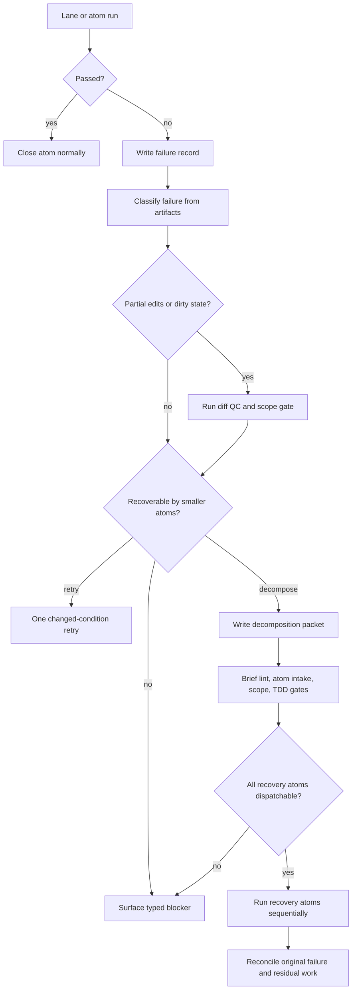

# Decompose On Failure

**North Star: AI coding agents are becoming common, but teams do not yet trust
their context, decisions, or outputs. Idiom sells the missing substrate: repo
memory, freshness, contracts, audit, and evals.**

Status: cross-pillar target design, drafted 2026-05-18; reviewed for
north-star/tool parity 2026-05-18

Implementation state as of 2026-05-18: Idiom has adjacent recovery behavior,
but not a complete decompose-on-failure workflow. Current behavior can atomize a
broad referenced design document before dispatch, refine a non-dispatchable
brief before dispatch, skip source-satisfied atoms, and make one
planner-blocked retry-or-surface decision. The first implementation slice also
persists failed `plan-execute` sessions as recovery failure records and exposes
read-only `idiom recover inspect` / `idiom recover status` inspection. It does
not yet synthesize smaller follow-up atoms from the failure evidence, gate those
atoms, or resume through the new atoms.

Verified adjacent implementation:

- `internal/app/implementation_dispatch.go` can pre-atomize design docs when
  they have many atom candidates or when brief lint reports single-purpose
  decomposition blockers.
- `internal/app/implementation_dispatch.go` can refine non-dispatchable plan
  documents before running `plan-execute`.
- `internal/app/implementation_dispatch.go` can make a one-shot
  planner-blocked recovery decision: retry once with an addendum or surface the
  blocker.
- `cmd/idiom/plan_execute.go` records planner failures such as
  `planner_blocked`, `planner_failed`, and `plan_artifact_missing` into durable
  progress state.
- `cmd/idiom/plan_execute.go` and `internal/planexecute/run.go` now write
  `.idiom/recovery/<failure-id>/failure.json` automatically whenever a
  `plan-execute` progress state is saved with `status:"failed"`.
- `cmd/idiom/recover.go` exposes read-only inspection for those records, with a
  legacy fallback that can derive the same report from failed progress state
  without mutating the workspace.

Those pieces are useful, but only the failure-record layer has landed. The
remaining decompose-on-failure layer must still turn a failed run into smaller,
auditable work without hiding the failure or letting the model loop.

## Problem

When an implementation lane fails, the current safe outcomes are mostly:

- retry the same brief once with a tightened instruction
- run pre-dispatch refine/atomization if the brief was already known to be too
  broad
- report a typed blocker to the user
- leave the human to manually split the work into smaller atoms

That is safe, but it wastes the best evidence the failed run produced: which
paths changed, which edit failed, which tests failed, which anchors were stale,
which budget was exhausted, which step had no plan artifact, and which required
paths remain untouched.

The target behavior is not "try harder." It is "make the failure smaller and
more reviewable." A failed broad atom should produce a durable decomposition
packet that says:

- what failed, with source-linked evidence
- what completed, if anything
- what remains unsafe or unknown
- which smaller atoms are proposed
- which gates each proposed atom must pass before dispatch
- whether retry, decomposition, or human escalation is the only valid next
  action

## Design Goals

1. Convert failed implementation runs into durable, reviewable recovery work.
2. Classify failure causes from structured artifacts before asking a model to
   reason about recovery.
3. Prefer smaller atoms when the failure was caused by scope, budget,
   localization, stale anchors, verification blast radius, or partial execution.
4. Preserve the original failure as evidence; never overwrite it with a
   successful follow-up.
5. Keep retry bounded. A same-scope retry is allowed only when the next attempt
   has changed evidence, scope, or instructions in a material way.
6. Require generated follow-up atoms to pass the same brief lint, atom intake,
   scope, TDD, and verification gates as human-authored atoms.
7. Make decomposition usable from CLI, TUI, sidecar, and product workflow
   contexts through the same underlying contracts.
8. Feed recurring failure shapes into audit, eval, ranker learning, and future
   context-packet generation.
9. Preserve model-harness parity: expose a recovery capability menu and
   observable state, not language-specific tool advice or hidden rerouting.

## Non-Goals

- Do not auto-approve generated atoms.
- Do not silently revert partial edits.
- Do not infer product strategy from a failed implementation transcript.
- Do not let failure decomposition bypass human acceptance, product workflow
  gates, protected-path policy, or lane permissions.
- Do not treat every failure as decomposable. Missing human information,
  permission denial, unsafe dirty state, secrets, or contradictory requirements
  should surface as blockers.
- Do not use raw transcripts as durable state. Store bounded excerpts, event
  IDs, paths, hashes, command outputs, test names, and redacted summaries.

## Core Vocabulary

- **Failure record**: a durable, privacy-safe artifact describing a failed lane,
  phase, command, gate, or atom.
- **Failure class**: the host-owned classification, such as `scope_too_large`,
  `planner_blocked`, `plan_missing`, `executor_edit_failed`,
  `verification_failed`, `review_repair_failed`, `stale_context`,
  `budget_exhausted`, `dirty_workspace`, or `needs_human_answer`.
- **Decomposition packet**: a proposed recovery artifact that maps the failure
  record to smaller candidate atoms, required evidence, forbidden edits, and
  gates.
- **Residual work**: the part of the original objective not proven complete by
  source state, tests, or accepted source-satisfied evidence.
- **Partial state**: the changed workspace after a failed run. It is not trusted
  until diff QC, scope checks, and verification classify it.
- **Recovery atom**: a follow-up atom generated or accepted from a decomposition
  packet.

## Target Lifecycle

This diagram answers when decomposition is allowed and how it differs from a
retry.



## Failure Classes

The classifier should be deterministic first. Model synthesis may summarize or
draft candidate atoms only after the host has classified the failure shape.

| Failure class | Decompose? | Evidence source |
| --- | --- | --- |
| `scope_too_large` | Yes | brief lint atom-size or single-purpose blockers, required path count, context budget |
| `planner_blocked` | Maybe | plan-execute progress state, planner answer, required paths |
| `plan_missing` | Maybe | missing plan artifact event, planner stdout/stderr |
| `executor_edit_failed` | Yes, after diff QC | plan artifact, failed edit path, changed paths, old/new text mismatch |
| `verification_failed` | Yes | test command, failing package/test, changed paths, impacted symbols |
| `review_repair_failed` | Yes | review-repair report, allowed repair paths, residual findings |
| `stale_context` | Retry or decompose | context freshness, stale anchors, required edit paths |
| `budget_exhausted` | Yes | model budget, output size estimate, heaviest inlined blocks |
| `dirty_workspace` | No until classified | git status, changed paths, ownership metadata |
| `needs_human_answer` | No | explicit question blocker, missing requirement, permission denial |
| `unsafe_policy_block` | No | protected path, permission, secret/privacy finding |

## Decomposition Packet Schema

The first durable schema can be small and JSON-first:

```json
{
  "schema_version": "idiom.failure_decomposition.v1",
  "failure_id": "fail-20260518-001",
  "source_run": {
    "lane": "plan-execute",
    "session_id": "plan-...",
    "atom_id": "impl-0042",
    "progress_state_path": ".idiom/plan-execute/.../state.json"
  },
  "failure": {
    "class": "verification_failed",
    "summary": "go test ./internal/app failed in TestX",
    "evidence_refs": [
      {"kind": "test_output", "path": ".idiom/failures/fail-20260518-001/test.txt"},
      {"kind": "changed_path", "path": "internal/app/foo.go"}
    ]
  },
  "partial_state": {
    "dirty": true,
    "changed_paths": ["internal/app/foo.go", "internal/app/foo_test.go"],
    "scope_status": "in_scope"
  },
  "residual_work": [
    {
      "id": "residual-001",
      "required_paths": ["internal/app/foo.go"],
      "reason": "failing assertion points at parser branch not isolated by original atom"
    }
  ],
  "candidate_atoms": [
    {
      "id": "recovery-001",
      "title": "Repair parser branch after verification failure",
      "complexity": "C1",
      "required_paths": ["internal/app/foo.go", "internal/app/foo_test.go"],
      "forbidden_paths": [],
      "required_tests": ["go test ./internal/app"],
      "gates": ["brief_lint", "atom_intake", "scope_gate"]
    }
  ],
  "next_valid_action": "review_decomposition"
}
```

The packet is not dispatch authority. It is a recovery proposal that must be
accepted or promoted into normal atom/brief artifacts.

## Command Surfaces

Use `idiom recover` as the operator-facing namespace. This keeps the user
experience action-oriented and cross-lane without overloading `audit`,
`product`, or `lane` with a feature that spans all of them.

```bash
idiom recover inspect --session <id> --json
idiom recover decompose --session <id> --output .idiom/recovery/<id>/packet.json --json
idiom recover promote --packet .idiom/recovery/<id>/packet.json --atom recovery-001 --output briefs/recovery-001.md
idiom recover status --packet .idiom/recovery/<id>/packet.json --json
```

Required behavior:

- `inspect` reads only durable logs, progress state, plan artifacts, telemetry,
  and git status. It does not run models or mutate files.
- `decompose` writes a decomposition packet and optional candidate brief drafts.
  It may use `context_pack`, `context_trace_pack`, `context_impact`, and test
  output adapters to localize residual work.
- `promote` converts one candidate atom into a normal dispatchable brief only
  after required gates pass.
- Product workflow integrations should link decomposition packets back to PRD
  requirements, ADR decisions, TDD obligations, and implementation ledger
  records.
- Every subcommand must support JSON and human-readable output, include a
  `next_valid_action`, and keep usage errors structured when `--json` is set.

## Tool And Command Parity Contract

Decompose-on-failure should not create a parallel workflow. It should reuse the
existing surfaces as evidence sources, gates, or presenters. Each surface below
must either participate through a typed adapter or be explicitly marked
not-applicable for a given failure class.

| Surface | Parity requirement |
| --- | --- |
| `idiom plan-execute` | Read progress state, plan artifacts, required/allowed paths, changed paths, source-sanity evidence, review-repair status, and failure kinds such as `planner_blocked` or `plan_artifact_missing`. |
| `idiom implement` and `idiom lane` | Capture lane history, command lifecycle, queue/backend readiness, stdout JSONL events, changed-path evidence, and stop reasons. |
| `idiom architect` | Reuse packet, budget, plan-audit, prompt, and brief artifacts when a failure came from planning/handoff quality rather than execution. |
| `idiom artifact` | Use only as an optional schema-bound drafting mechanism for candidate recovery prose; artifact output is not authority until recovery gates promote it. |
| `idiom atom intake` | Reuse dispatchability, terminal, source-satisfied, stale, dirty, invalid-scope, and missing-scope classifications for promoted recovery atoms. |
| `idiom brief lint` | Reuse single-purpose, atom-size, anchor, exact-edit, and acceptance-command checks before any recovery atom can dispatch. |
| `idiom lane postflight` | Reuse diff QC for partial edits, out-of-scope changes, and reviewable patch evidence. |
| `task` and `task_ledger` tools | Publish recovery state as operator-visible work items when the caller uses task-ledger workflows; do not let task prose override failure classes or gates. |
| `idiom context *` and graph tools | Use `context_pack`, `context_trace_pack`, `context_impact`, `context_query`, and `context_status` as residual-work evidence and freshness gates. |
| Language-aware tools | Treat Go/C++/Python/TypeScript/Rust/Java symbol, diagnostic, call, and reference tools as adapters behind capabilities such as `source_sanity`, `find_callers`, `diagnose_path`, or `impact`. Do not make recovery packets tell the model to choose a language-specific strategy. |
| Workspace read/search tools | Use `read_file`, `search_content`, `file_stats`, `source_sanity`, and related tools for bounded evidence only; copied file bodies must not be stored in durable recovery artifacts. |
| Workspace mutation/delegation tools | Treat `edit_file`, `write_file`, `append_file`, `apply_patch`, `mkdir`, and `delegate_edit` as lane-owned execution capabilities. Recovery may cite their failures, but promotion does not grant direct write authority outside the selected lane contract. |
| `git_status` and `git_diff` | Classify partial state, changed paths, dirty ownership, and scope before retry, promotion, or dispatch. |
| Shell and verification commands | Store command, exit code, bounded output refs, failing test names, and timestamps; do not store raw private output by default. |
| `harness_audit` and `harness_feedback` | Report recovery coverage, repeated failure classes, malformed recovery packets, loop risk, and gaps in tool/event correlation. |
| `idiom audit watch` | Treat repeated failure classes and recovery-packet creation as audit triggers; write review packets without raw transcripts. |
| Product workflow commands | Link recovery packets to effort ID, PRD requirement IDs, ADR IDs, TDD obligations, implementation ledger records, status buckets, and product lint/audit/status next actions. |
| Product-evidence and release-evidence | Summarize recovery counts, failure classes, redaction status, unresolved blockers, and release-impact evidence without file bodies or prompts. |
| `idiom ranker` | Accept only deterministic, verified recovery outcomes as learning input; record whether recovery improved localization or packet quality. |
| Queue/backend/local-ops/doctor | Classify readiness, queue, backend, timeout, or capacity failures separately from implementation failures so decomposition does not hide environment problems. |
| TUI/prompt dispatch | Render the same status and next-action model as CLI; do not infer recovery state from transcript prose. |
| `idiom tool` and MCP | Expose read-only recovery inspection with the same sidecar envelope and profile rules as other tools; keep write/promote actions outside discovery profile. |

The initial sidecar/tool shape should be:

- `recovery_inspect`: read-only, allowed in the `discovery` profile, returns a
  failure record and sidecar envelope.
- `recovery_status`: read-only, allowed in the `discovery` profile, returns
  packet status, gates, blockers, and next valid actions.
- `recovery_decompose`: default profile only, writes local `.idiom/recovery`
  artifacts and returns a sidecar envelope with artifact paths and hashes.
- `recovery_promote`: CLI-only until a write-authorization contract exists for
  sidecar/MCP callers.

This mirrors the current sidecar rule: read-only evidence is available through
the discovery profile, while artifact-writing and promotion stay behind a
stronger local contract.

## North-Star Alignment Review

The design aligns with the decisioning north star only if these invariants hold:

- The model owns recovery strategy inside a bounded candidate atom, but the
  harness owns failure classification, retry budget, promotion gates, and
  completion claims.
- Recovery packets describe capabilities and evidence gaps. They do not tell
  the model which language-specific tool to call next unless a hard invariant
  requires a specific host action.
- A same-scope retry requires changed conditions: refreshed evidence, narrower
  scope, repaired brief shape, changed backend readiness, or an explicit human
  answer.
- Decomposition is not a success claim. The original failed run remains visible
  after all recovery atoms pass.
- Every failure path ends in one observable next action: inspect partial diff,
  refresh stale evidence, review decomposition, promote one recovery atom,
  retry once, or ask a human.

## Clean Architecture Ownership

Implement this as a use-case boundary, not as CLI glue:

| Layer | Ownership |
| --- | --- |
| Domain | Failure classes, failure records, residual-work records, decomposition packets, recovery atom references, retry-budget invariants, privacy invariants. |
| Application | `InspectFailure`, `ClassifyFailure`, `BuildDecompositionPacket`, `PromoteRecoveryAtom`, `ReconcileRecovery`, and `RenderRecoveryStatus` use cases. |
| Interface adapters | CLI presenters, TUI view models, `idiom tool`/MCP presenters, product workflow adapters, audit-watch adapters, JSON/text mappers. |
| Infrastructure | Filesystem readers/writers, telemetry/log readers, plan-execute progress readers, git adapters, shell/test-output capture, context graph adapters, queue/backend/local-ops adapters. |

Inner recovery policy must not import CLI flags, Bubble Tea types, MCP transport
types, raw filesystem paths outside request models, or product workflow storage
details. Outer adapters translate those details into plain request/response
models.

## TUI And Sidecar Contract

The TUI should render failure decomposition as an operator decision, not as a
hidden background loop:

- "Retry same atom once" when the classifier says the next attempt has changed
  conditions.
- "Review proposed smaller atoms" when decomposition produced gated candidates.
- "Ask human" when missing information or unsafe state blocks decomposition.
- "Inspect partial diff" when partial edits exist and need classification.

Sidecar consumers should get the same read-only failure record and
decomposition packet through `idiom tool`/MCP before any write-capable recovery
surface is exposed.

The user-visible experience should match existing product workflow status
surfaces: a concise status header, typed blockers, gates, evidence links,
dispatchability, and a single next valid action. A failed lane should feel like
it moved into a recovery state, not like it vanished into a separate tool.

## Authority Boundaries

- The harness owns failure classification, retry budgets, packet schemas, gate
  enforcement, privacy redaction, and durable event linking.
- The model may propose recovery atom titles, residual-work summaries, and
  implementation notes inside a host-owned schema.
- The model does not decide that a failed atom is complete.
- The model does not decide to overwrite, revert, or ignore partial edits.
- Human acceptance remains required for ambiguous product intent, protected
  paths, cross-boundary migrations, and any recovery packet that changes the
  original scope.

## Implementation Phases

### Phase 0: Evidence Inventory

- Status: partially landed for `plan-execute` failure records and read-only
  inspection.
- Inventory plan-execute progress state, lane postflight reports, debug logs,
  telemetry events, plan artifacts, brief lint output, atom intake output, and
  product workflow reports.
- Define a privacy-safe `FailureRecord` struct. Landed for
  `idiom.recovery.failure_record.v1`.
- Add tests for redaction of prompts, raw transcripts, secrets, and file bodies.

### Phase 1: Deterministic Failure Classifier

- Status: partially landed for plan-execute failure kinds.
- Classify `planner_blocked`, `plan_missing`, `executor_edit_failed`,
  `verification_failed`, `review_repair_failed`, `scope_too_large`,
  `stale_context`, `budget_exhausted`, and `needs_human_answer`.
- Emit one root failure class plus secondary evidence tags.
- Add JSON and human-readable output tests. Landed for `recover inspect`.

### Phase 2: Decomposition Packet Builder

- Build residual-work records from required paths, changed paths, failed edits,
  failing tests, and context graph impact.
- Generate candidate atom boundaries from file ownership, test affinity,
  failure locality, and remaining required paths.
- Keep model drafting optional and schema-bound.

### Phase 3: Gating And Promotion

- Run candidate briefs through `idiom brief lint`, `idiom atom intake`, scope
  gates, and product workflow gates when applicable.
- Block promotion when the workspace is dirty and unclassified.
- Persist promotion links back to the source failure record.

### Phase 4: Execution And Reconciliation

- Run recovery atoms sequentially by default.
- Reconcile completed recovery atoms against the original failure and residual
  work.
- Preserve the original failed run and every generated atom in audit output.

### Phase 5: TUI, Sidecar, And Learning

- Render decomposition actions in the TUI operator view.
- Expose read-only failure records and packets through `idiom tool` and MCP.
- Feed recurring failure classes into eval fixtures, harness audit, and ranker
  learning only through deterministic evidence adapters.

## Risks And Mitigations

| Risk | Mitigation |
| --- | --- |
| Retry loop disguised as decomposition | Require a durable failure record, one retry budget, changed-condition proof, and gated follow-up atoms. |
| Hiding partial edits | Run diff QC and scope gates before decomposition; surface dirty-state blockers when ownership is unclear. |
| Over-splitting work | Cap candidate atoms, rank by residual risk, and require each atom to have a single testable outcome. |
| Model invents recovery work | Candidate atoms must cite failure evidence, required paths, and source anchors; unsupported atoms fail promotion. |
| Product intent drift | Product workflow recovery atoms must cite PRD/ADR/TDD IDs or request human clarification. |
| Privacy leaks | Store paths, hashes, counts, test names, command IDs, and redacted excerpts only. |
| User loses failure context | Original failure remains immutable and linked to every recovery atom. |

## Open Questions

1. Which failure classes should allow one same-scope retry before decomposition?
2. Should decomposition packet promotion require human approval by default, or
   only for scope-changing packets?
3. How should recovery atoms interact with product workflow implementation
   ledgers and status buckets?
4. What is the minimum test evidence needed before a verification failure can be
   split by failing package or symbol?
5. Should failed runs in ignored `.idiom/` storage be promotable to durable
   source-controlled evidence, and who decides that?

## Acceptance Criteria

The feature is useful when a team can:

- run a broad implementation atom and get a typed failure record when it fails
- distinguish retryable planner failure from decomposable scope or verification
  failure
- inspect changed paths, failed tests, failed edits, and residual work without
  reading a raw transcript
- generate smaller recovery atoms that cite the original failure evidence
- block recovery atom promotion until brief lint, atom intake, scope, and
  product workflow gates pass
- resume recovery across sessions from durable artifacts
- preserve the original failed run in audit output after recovery succeeds
- expose the same read-only failure/decomposition state to CLI, TUI, and
  sidecar consumers
- prove read-only parity for `idiom tool` and MCP through sidecar-envelope
  fixtures, while keeping write/promote actions out of the discovery profile
- report recovery evidence in harness audit, audit watch, product evidence,
  release evidence, and ranker-learning summaries without raw prompt,
  transcript, or file-body leakage
- keep CLI/TUI/product workflow status output consistent: typed blockers, gates,
  evidence links, dispatchability, and one next valid action
- convert repeated failure classes into eval/audit fixtures instead of adding
  another prompt reminder
