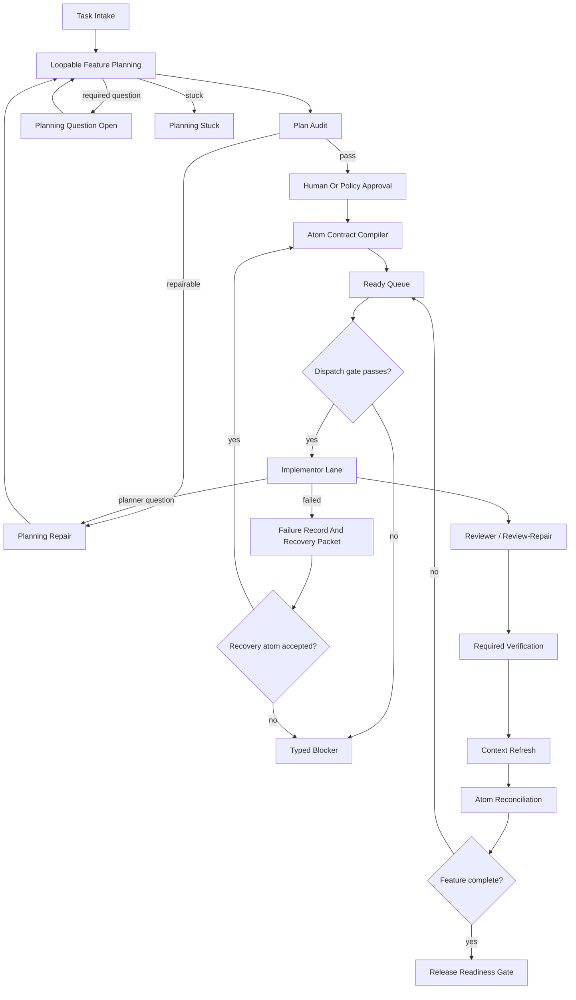

# Feature Planner Orchestration

**North Star: AI coding agents are becoming common, but teams do not yet trust
their context, decisions, or outputs. Idiom sells the missing substrate: repo
memory, freshness, contracts, audit, and evals.**

Status: accepted design candidate with durability/TDD addendum, created
2026-05-24

## Purpose

This document defines the headless feature-planner orchestration workflow Idiom
needs before it can reliably turn a complex deliverable into atomic work,
dispatch small implementor models, refresh context between atoms, recover from
failed work, and close a release with auditable evidence.

The target is not a bigger prompt. The target is a host-owned state machine. The
model owns planning and implementation strategy inside bounded phases. The
harness owns durable contracts, state transitions, context freshness, dispatch
gates, repair states, recovery, verification, audit, and release readiness.

This design is the headless contract. The existing
[Feature Planner TUI Orchestration](design-feature-planner-tui-orchestration.md)
document remains a UI/controller design and must consume the same durable
contracts rather than becoming a second authority surface.

## Research Basis

This revision is grounded in:

- `context_pack` result `4bc4f5991a03a214`, which localized plan-execute
  planning state, progress state, product workflow coverage, and relevant tests.
- `internal/planexecute/progress.go`, which persists phase/status, prompt hash,
  plan path/id, pack id, edit progress, executor evidence, review-repair state,
  failure kind/reason, and resume readiness.
- `internal/agent/plan_execute_planning_state.go`, which derives loopable
  planner modes, terminal response shapes, runtime transport projection, and
  submit correction states.
- `internal/productworkflow/types.go`, `coverage_gate.go`, and
  `brief_generation.go`, which define TDD obligations, coverage evaluation,
  implementation ledger records, required verification, report paths, and
  `verification_completed.tdd_obligations_satisfied`.
- [Behavioral TDD Coverage](design-tdd-coverage.md), which defines the target
  ADR to EARS, examples, BDD, Design by Contract, FMEA/HAZOP/FTA, state model,
  test generation, mutation, and dispatch-gate pipeline.
- [PRD To ADR To Brief Research Workflow](design-prd-adr-brief-research-workflow.md),
  which defines spec-first orchestration, proactive TDD obligations, traceability,
  brief linting, and atom intake as dispatch preconditions.

Verified facts:

- Idiom has strong lane primitives and durable `plan-execute` progress, but no
  first-class durable coordinator that owns a multi-atom feature end to end.
- Product workflow coverage already fails closed when TDD obligations have no
  verification evidence.
- Product brief generation already blocks when coverage is blocked, planned
  scope is missing, or TDD/verification commands are absent.
- Plan-execute already distinguishes planner modes, correction states,
  transport-specific terminal response shapes, and source-satisfied/blocker
  outcomes.

Inference:

- Feature planning should reuse those mechanics at a higher level: durable
  progress state, loopable planning, typed questions, precise repair states,
  atom-level progress, and pre-execution test contracts.

## First Broken Invariant

`feature.dispatch_authority`: no feature atom may dispatch unless a
feature-owned state machine authorizes that transition from durable state with:

- approved atom scope
- fresh context evidence
- satisfied dependencies
- no open unreconciled recovery packet for normal dispatch, except when the atom
  is an explicitly promoted recovery atom tied to the active packet and recovery
  gates pass
- no unresolved required planner question for the atom
- dirty-scope classification
- required SDD, TDD, reviewer, verification, rollback, and audit fields
- pre-execution test evidence for required TDD obligations
- runtime envelope for model role, queue admission, budget, and tool transport
- non-overlapping path lease for concurrent work
- expected feature revision compare-and-swap
- privacy-safe audit event

This invariant governs dispatch authority, not implementation strategy. The
orchestrator may choose which atom is eligible to run next; it must not choose
how the implementor solves that atom beyond enforcing the atom contract.

## Design Decision

Introduce a headless **feature-planner orchestration lifecycle** as a first-class
Idiom workflow. The lifecycle is a durable, versioned state machine with
schema-checked artifacts and replayable contract events.

The feature planner does not implement code. It produces and maintains a
`FeaturePlan` with atom contracts. The feature orchestrator dispatches only
eligible atoms, one at a time by default and in parallel only when write scopes,
queue leases, and dependencies are disjoint. Each atom is executed by an
existing implementor lane under its own compiled contract. Review,
verification, context refresh, recovery, replan, and reconciliation update
durable state before the next atom can run.

Prompt text, model summaries, context packets, and reviewer prose may explain or
localize work. They are not dispatch authority unless compiled into typed
feature artifacts.

## Vocabulary

- `feature_plan`: durable plan for one complex deliverable.
- `feature_atom`: one bounded work unit with explicit scope, tests, SDD refs,
  context evidence, reviewer assignment, harness recovery policy ref, runtime
  envelope, and release impact.
- `feature_orchestrator`: host-owned coordinator that evaluates current durable
  state and dispatches eligible atoms.
- `implementor`: model/lane actor that implements exactly one atom.
- `planner_question`: typed artifact created when an implementor cannot safely
  proceed because the top-level plan/spec/test contract is incomplete or
  contradictory.
- `SDD`: spec-driven development. Accepted specs, ADRs, requirements, examples,
  contracts, and state models are durable inputs to plan/test contracts.
- `TDD`: test-driven development. Required tests are planned and established
  before implementation atoms dispatch, then checked against implementation
  results after writes.
- `risk_acceptance`: typed owner-approved waiver for allowlisted residual
  non-safety obligations. It cannot replace required verification or review.

Canonical durable identifiers use hyphenated spellings such as
`source-satisfied`, `stale-needs-rebase`, and `recovery-open`. Existing pre-v1
TUI identifiers such as `source_satisfied`, `needs_rebase`,
`closed_with_residual_work`, and `cancelled` are legacy aliases accepted only
through a versioned migration adapter that records
`idiom.feature.legacy_state_migrated`. Unmapped legacy states fail with
`unsupported_schema`.

## Top-Level Plan Scope

The top-level feature plan is an orchestration artifact, not a mega-brief. Its
scope is the smallest durable atom graph that satisfies the accepted spec and
test contract.

It owns:

- feature objective, non-goals, and source artifact references
- accepted PRD/ADR/spec links and SDD traceability
- TDD obligation inventory, coverage tier, test artifacts, and test commands
- atom DAG, dependency ordering, split/merge hints, and dispatch eligibility
- question, replan, recovery, continuation, and release-readiness policy refs
  chosen from harness-owned policy catalogs

It does not own:

- edit bodies for implementation atoms
- implementor-local algorithm or refactoring strategy
- self-approval for scope expansion
- model-memory-only summaries of in-progress work

The feature plan may include exact test/spec atom edits when those are the
deliverable of a test/spec atom. It should not pre-author implementation edit
bodies unless the accepted spec already contains a path-labeled body for a new
file and the atom contract explicitly marks that body as source evidence.

## Lifecycle



## State Machine

Feature state is stored in a versioned JSON artifact, not in chat memory.

Feature states:

- `drafting-plan`
- `planning`
- `planning-repair`
- `planning-question-open`
- `planning-stuck`
- `plan-review`
- `awaiting-approval`
- `atomizing`
- `replanning`
- `ready`
- `dispatching`
- `reviewing`
- `verifying`
- `reconciling`
- `needs-context-refresh`
- `recovery-open`
- `blocked`
- `release-review`
- `released`
- `closed-with-risk`
- `canceled`
- `interrupted`

Atom states:

- `planned`
- `dispatchable`
- `dispatching`
- `question-for-planner`
- `question-for-operator`
- `reviewing`
- `verifying`
- `needs-context-refresh`
- `complete`
- `source-satisfied`
- `stale-needs-rebase`
- `blocked-dirty-files`
- `missing-scope`
- `invalid-scope`
- `failed-refine-draft`
- `malformed-structured-output`
- `recovery-open`
- `blocked`
- `skipped`
- `failed`
- `canceled`
- `interrupted`
- `stale-edit-anchor`

### Canonical Transition Tables

Feature and atom states are separate durable enums. A transition may update one
or both, but the event payload must name `feature_from`, `feature_to`,
`atom_id`, `atom_from`, and `atom_to` separately. A Go validator must reject any
event that places an atom-only state in the feature state field or a
feature-only state in the atom state field.

Feature transitions:

| Feature From | Action | Actor | Preconditions | Feature To | Atom Delta | Event |
| --- | --- | --- | --- | --- | --- | --- |
| none | `create-feature` | operator or CLI | source artifact in workspace; privacy classification set | `drafting-plan` | none | `idiom.feature.created` |
| `drafting-plan` | `start-planning` | harness | fresh planning packet; context budget accepted; planning budget initialized | `planning` | none | `idiom.feature.planning_started` |
| `planning` | `plan-iteration` | feature planner | planning budget remains; exact evidence gap or plan artifact supplied | `planning`, `plan-review`, `planning-question-open`, or `planning-stuck` | none | `idiom.feature.plan_iteration_recorded` |
| `planning-question-open` | `answer-planning-question` | operator, planner, or evidence tool | answer cites approved source/evidence or marks external blocker | `planning-repair`, `planning-stuck`, or `blocked` | optional question atom update | `idiom.feature.planning_question_answered` |
| `planning-repair` | `repair-plan` | feature planner | audit findings, implementor questions, stale context, or reviewer findings are attached | `planning`, `plan-review`, `planning-question-open`, or `planning-stuck` | optional affected atom updates | `idiom.feature.plan_repaired` |
| `planning-stuck` | `escalate-planning` | operator or explicit policy | stuck reason, repeated question ids, exhausted budget, or missing external answer recorded | `planning-repair`, `blocked`, or `canceled` | none | `idiom.feature.planning_escalated` |
| `planning` or `planning-repair` | `submit-feature-plan` | feature planner | plan covers source scope, SDD/TDD obligations, atom DAG, dependencies, tests, and open questions | `plan-review` | none | `idiom.feature.plan_created` |
| `plan-review` | `audit-plan` | harness | feature plan exists; schema valid; no required planning questions open | `awaiting-approval`, `planning-repair`, or `blocked` | optional atom audit state updates | `idiom.feature.plan_audited` |
| `awaiting-approval` | `approve` | operator or explicit policy | audit passed; approver authorized | `atomizing` | none | `idiom.feature.approval_created` |
| `atomizing` | `compile-atoms` | harness | approval scope current; atom schemas valid | `ready` or `blocked` | create/update atom contracts | `idiom.feature.atom_contracts_created` |
| `ready` | `dispatch-atom` | orchestrator | dispatch gate passes; feature CAS, path lease, queue lease, event append, state write, and active-run insert commit as one fenced transition | `dispatching` | selected atom `dispatchable` -> `dispatching` | `idiom.feature.atom_started` |
| `ready` | `record-pre-dispatch-source-satisfied` | harness | pre-execution characterization proves behavior already exists; no implementation-required artifact is present; current-state evidence covers SDD/TDD refs | `ready` or `release-review` | selected atom `planned`/`dispatchable` -> `source-satisfied` | `idiom.feature.atom_source_satisfied` |
| `dispatching` | `record-lane-result` | lane runner | active run terminal result folded from durable progress path | `reviewing`, `recovery-open`, `blocked`, `ready`, or `release-review` | selected atom moves to `reviewing`, `source-satisfied`, `failed`, `recovery-open`, or `blocked` | `idiom.feature.atom_progressed` |
| `dispatching` | `ask-planner` | lane runner or host conversion | typed planner question created from textual `<<QUESTION>>:` or native required-tool rejection | `planning-repair` | selected atom `dispatching` -> `question-for-planner` | `idiom.feature.planner_question_opened` |
| `planning-repair` or `replanning` | `route-planner-answer` | feature planner or harness | answer authority matrix passes; answer resolves, narrows, splits, or rejects the question with evidence | `plan-review`, `ready`, `planning-stuck`, or `blocked` | question atom -> `planned`, `dispatchable`, or `blocked` | `idiom.feature.planner_question_resolved` |
| `dispatching` | `record-parser-failure` | lane runner | parser contract, transport mode, response format, and bounded failure class recorded | `dispatching`, `recovery-open`, or `blocked` | selected atom -> `malformed-structured-output`, `dispatching`, `recovery-open`, or `blocked` | `idiom.feature.atom_output_rejected` |
| `dispatching` | `record-stale-anchor` | lane runner | rejected edit cites stale `old_text` or anchor; bounded source refresh available | `needs-context-refresh`, `dispatching`, or `recovery-open` | selected atom -> `stale-edit-anchor`, `needs-context-refresh`, or `recovery-open` | `idiom.feature.stale_anchor_rejected` |
| `reviewing` | `record-review` | reviewer or harness | review report schema valid | `verifying`, `recovery-open`, or `blocked` | selected atom `reviewing` -> `verifying`, `recovery-open`, or `blocked` | `idiom.feature.atom_reviewed` |
| `verifying` | `record-verification` | harness | required commands ran after writes and planned TDD snapshot matches | `reconciling`, `recovery-open`, or `blocked` | selected atom `verifying` -> `complete`, `recovery-open`, or `blocked` | `idiom.feature.atom_verified` |
| `reconciling` | `refresh-context` | harness | changed paths known; graph refresh complete or gap recorded | `ready`, `needs-context-refresh`, or `release-review` | dependent atoms may become `needs-context-refresh` | `idiom.feature.context_refreshed` |
| `needs-context-refresh` | `refresh-context` | harness | stale packets refreshed or blocker recorded | `ready` or `blocked` | stale atoms refreshed or blocked | `idiom.feature.context_refreshed` |
| `recovery-open` | `promote-recovery` | operator or policy | recovery gates pass; no scope widening without approval | `atomizing` | create recovery atom contracts | `idiom.feature.recovery_promoted` |
| `recovery-open` | `reconcile-recovery` | harness | packet digest, atom manifest, required tests pass | `ready` or `release-review` | original atom blocker closed or updated | `idiom.feature.recovery_reconciled` |
| any non-terminal feature state | `replan` | orchestrator or operator | implementor question, context invalidation, recovery packet, reviewer finding, or release-check finding cites impacted plan sections | `replanning` | affected atoms marked stale or blocked | `idiom.feature.replan_requested` |
| `replanning` | `submit-feature-plan-revision` | feature planner | revision preserves completed atom evidence or explicitly supersedes it with migration notes | `plan-review` | affected atom contracts revised | `idiom.feature.plan_revised` |
| any non-terminal feature state | `skip-atom` | operator | skip reason, operator event, and obligation disposition recorded | same feature state or `release-review` | selected atom -> `skipped` | `idiom.feature.atom_skipped` |
| any non-terminal feature state | `classify-terminal-atom` | harness | failed atom has recovery/blocker path, or skipped atom has reassigned/satisfied/allowlisted residual obligations | `recovery-open`, `blocked`, same feature state, or `release-review` | selected atom -> `recovery-open`, `blocked`, `skipped`, or `source-satisfied` | `idiom.feature.atom_terminal_classified` |
| any non-terminal feature state | `release-dispatch-leases` | harness | lane terminal result, blocked result, verification failure, cancel, interrupt, or release path recorded | current feature state or next row target | lease deltas only | `idiom.feature.lease_released` |
| any non-terminal feature state | `expire-stale-lease` | harness | lease expired; no active lane heartbeat; owning session absent or terminal | `blocked` or prior resumable state | active run marked orphaned or terminal | `idiom.feature.lease_expired` |
| `blocked` | `repair-state` | operator or harness | repair only metadata, scope classification, context refresh, legacy state, lease, or ledger state | prior resumable feature state | optional atom metadata repair | `idiom.feature.state_repaired` |
| any non-terminal feature state | `cancel` | operator | cancellation reason recorded | `canceled` | active atoms -> `canceled` | `idiom.feature.canceled` |
| any non-terminal feature state | `interrupt` | operator or harness | interruption reason and lane session refs recorded | `interrupted` | active atoms -> `interrupted` | `idiom.feature.interrupted` |
| `interrupted` | `resume` | operator or harness | active-run resume protocol passes; leases expired or re-acquired; feature revision current | prior resumable state or `blocked` | active atoms restored, terminal-folded, or orphaned | `idiom.feature.resumed` |
| `release-review` | `release-check` | harness | all release contracts evaluated | `released`, `closed-with-risk`, or `blocked` | none | `idiom.feature.release_checked` and terminal `idiom.feature.closed` |

Atom-only transitions are valid only as atom deltas inside feature events:

| Atom From | Action | Preconditions | Atom To |
| --- | --- | --- | --- |
| `dispatchable` | `dispatch-atom` | feature dispatch gate passes | `dispatching` |
| `planned` or `dispatchable` | `record-pre-dispatch-source-satisfied` | characterization and current-state evidence satisfy all SDD/TDD refs before dispatch | `source-satisfied` |
| `dispatching` | `record-source-satisfied` | lane explicitly reports source-satisfied with current-state evidence for all required SDD/TDD refs | `source-satisfied` |
| `dispatching` | `record-parser-failure` | parser failure is durable or retry budget remains | `malformed-structured-output` or `dispatching` |
| `dispatching` | `record-stale-anchor` | stale anchor event recorded | `stale-edit-anchor`, `needs-context-refresh`, or `recovery-open` |
| `dispatching` | `ask-planner` | typed planner question created | `question-for-planner` |
| `question-for-planner` | `route-planner-answer` | authority matrix passes | `planned`, `dispatchable`, or `blocked` |
| any non-terminal atom state | `skip-atom` | skip reason, operator event, and obligation disposition recorded | `skipped` |
| `failed` or `skipped` | `classify-terminal-atom` | failed atom has recovery/blocker path, or skipped atom has reassigned/satisfied/allowlisted residual obligations | `recovery-open`, `blocked`, `skipped`, or `source-satisfied` |

Every mutating transition requires expected `feature_revision`. Stale revisions
fail with `stale-feature-revision` and do not mutate artifacts. Rows targeting
`prior resumable state` must store that prior canonical enum and the event id
that entered `blocked` or `interrupted`.

Planning is intentionally loopable. A planning loop may continue only while it
records a new evidence probe, new atomization decision, resolved question, or
schema/audit repair. It is done when `feature.plan.audit_ready`,
`feature.sdd.spec_contract_ready`, and `feature.tdd.pre_execution_ready` pass
and the plan has no required open question. It is stuck when the same required
question recurs without new evidence, the planning iteration budget is
exhausted, no valid next probe is named, or the remaining blocker requires
operator input. Stuck planning is a state, not a silent retry.

`skipped` and `failed` are canonical atom states for replay compatibility, not
successful terminal outcomes. A skipped atom requires an operator event plus
obligation disposition. A failed atom is release-blocking until recovery or
blocker classification is recorded. Neither state is model-emittable as a lane
terminal outcome.

## Core Artifacts

### Feature State

```json
{
  "schema_version": "idiom.feature_state.v1",
  "feature_id": "feature-slug",
  "title": "Complex deliverable title",
  "state": "ready",
  "revision": 7,
  "workspace_fingerprint": "sha256...",
  "git_head": "sha",
  "context_index_id": "551a98d5f632fac0",
  "context_freshness": "fresh",
  "plan_path": ".idiom/features/feature-slug/feature_plan.json",
  "atom_ledger_path": ".idiom/features/feature-slug/atoms.jsonl",
  "events_path": ".idiom/features/feature-slug/events.jsonl",
  "release_contract_path": ".idiom/features/feature-slug/release_contract.json",
  "planner_revision": 3,
  "planning_loop": {
    "state": "planning|planning-repair|planning-question-open|planning-stuck",
    "iteration": 4,
    "max_iterations": 8,
    "last_plan_revision": 3,
    "open_question_ids": [],
    "stuck_reason": "",
    "last_progress_event_id": "evt-123"
  },
  "active_runs": [
    {
      "atom_id": "unit-001",
      "lane_session_id": "plan-execute-session",
      "lane_family": "plan-execute|implement",
      "invocation_contract_id": "feature/unit-001/handoff",
      "runtime_envelope_id": "feature/unit-001/runtime",
      "plan_execute_progress_path": ".idiom/plan-execute/sessions/session.json",
      "progress_revision": 4,
      "progress_sha256": "sha256...",
      "result_source": "progress_state|lane_event|recovery_packet",
      "state": "dispatching",
      "started_at": "",
      "heartbeat_at": "",
      "heartbeat_source": "queue_daemon|process_probe|progress_file_mtime",
      "evidence_delta_since_event": [],
      "owned_leases": [
        {
          "lease_id": "lease-001",
          "lease_kind": "path|queue",
          "scope": "internal/example",
          "owner_session": "plan-execute-session",
          "fencing_revision": 7,
          "acquired_at": "",
          "expires_at": ""
        }
      ]
    }
  ],
  "continuation": {
    "resume_action": "record-lane-result|refresh-context|repair-plan|run-next|release-check",
    "resume_atom_id": "unit-001",
    "resume_event_id": "evt-123",
    "resume_reason": "in-progress lane session or open planner question"
  },
  "open_recovery_packets": [],
  "open_obligations": [],
  "blocked_by": [],
  "derived_next_valid_actions": {
    "feature_revision": 7,
    "generated_from_event_id": "evt-123",
    "actions": ["run-next"],
    "authoritative": false
  }
}
```

### Feature Plan

```json
{
  "schema_version": "idiom.feature_plan.v1",
  "feature_id": "feature-slug",
  "source_task": {
    "kind": "user_request|design_doc|prd|issue|recovery_packet",
    "path": "docs/design-example.md",
    "summary": "bounded summary without raw transcript"
  },
  "context": {
    "pack_id": "context-pack-id",
    "index_id": "context-index-id",
    "freshness": "fresh",
    "unresolved_gaps": []
  },
  "top_level_scope": {
    "owns": [
      "feature objective and non-goals",
      "source spec and ADR references",
      "SDD/TDD obligation inventory",
      "atom DAG and dependencies",
      "dispatch/replan/recovery policy refs",
      "release readiness contract"
    ],
    "does_not_own": [
      "per-file implementation strategy inside an atom",
      "edit bodies for implementation atoms",
      "self-approval of broad scope changes"
    ],
    "scope_boundary": "plan the smallest atom graph that satisfies the accepted spec and tests"
  },
  "sdd_contract": {
    "spec_sources": [],
    "accepted_adrs": [],
    "requirements": [],
    "examples": [],
    "contract_invariants": [],
    "state_models": [],
    "decision_tables": [],
    "open_spec_questions": []
  },
  "tdd_contract": {
    "coverage_tier": "documentation|local_low|unit|behavior_standard|contract_high|formal_optional",
    "pre_execution_status": "pending|red-confirmed|characterized-existing|blocked",
    "obligation_ids": [],
    "test_artifact_paths": [],
    "test_commands": [],
    "baseline_events": [],
    "coverage_gate_event_id": ""
  },
  "approval": {
    "required": true,
    "status": "pending|approved|rejected",
    "approved_by": "",
    "approved_at": ""
  },
  "atoms": []
}
```

### Feature Atom Contract

Each atom extends the design-doc implementation atom schema and maps to the
existing product workflow ledger/report vocabulary.

```json
{
  "schema_version": "idiom.feature_atom.v1",
  "feature_id": "feature-slug",
  "atom_id": "unit-001",
  "state": "planned",
  "complexity_tier": "C1|C2|C3|C4",
  "dependencies": [],
  "context_evidence": [
    {
      "kind": "context_pack",
      "pack_id": "pack-id",
      "freshness": "fresh",
      "referenced_paths": []
    }
  ],
  "scope": {
    "required_edit_paths": [],
    "allowed_edit_paths": [],
    "evidence_paths": [],
    "forbidden_paths": [],
    "forbidden_patterns": []
  },
  "sdd_refs": {
    "requirements": [],
    "adrs": [],
    "examples": [],
    "contract_invariants": [],
    "state_model_refs": []
  },
  "edit_set_obligations": [],
  "tdd_obligations": [],
  "required_tests": [],
  "test_first": {
    "required": true,
    "test_atom_ids": [],
    "test_artifact_paths": [],
    "pre_execution_event_ids": [],
    "expected_pre_execution_result": "red-fail|characterization-pass|blocked",
    "coverage_gate_event_id": "",
    "must_precede_atom_ids": []
  },
  "planned_tdd_snapshot": {
    "snapshot_id": "tdd-snap-unit-001",
    "snapshot_digest": "sha256...",
    "obligation_ids": [],
    "test_commands": [],
    "test_artifact_paths": [],
    "expected_pre_execution_results": [],
    "created_before_dispatch_event_id": "evt-tdd-baseline"
  },
  "implementation_required_after_characterization": {
    "required": false,
    "sdd_refs": [],
    "changed_obligation_ids": [],
    "explicit_blocked_test": "",
    "reason": ""
  },
  "audit_signal_expected_to_move": [],
  "rollback_note": "how to back out this atom safely",
  "lane_terminal_outcomes": ["lane-specific"],
  "atom_status_transitions": ["complete", "source-satisfied", "blocked"],
  "runtime_envelope": {},
  "review": {
    "required": true,
    "reviewer_role": "harness_go|prompt_protocol|tdd_acceptance|north_star",
    "independent_of_implementor": true
  },
  "release_impact": {
    "docs": [],
    "audit_signals": [],
    "operator_surfaces": [],
    "migration_required": false
  },
  "recovery_policy_ref": "harness.recovery.default.v1",
  "recovery_hints": {
    "preferred_split_axes": [],
    "known_escalation_classes": ["needs_human_answer", "unsafe_policy_block"]
  },
  "reports": {
    "implementation": "reports/unit-001-implementation.json",
    "review": "reports/unit-001-review.json",
    "investigation": "reports/unit-001-investigation.json"
  },
  "productworkflow_mapping": {
    "planned_record_types": ["atom_planned", "test_obligation_planned"],
    "completion_record_types": ["verification_completed"],
    "tdd_ledger_path": "tdd.json",
    "implementation_report_path": "reports/unit-001-implementation.json",
    "review_report_path": "reports/unit-001-review.json",
    "investigation_report_path": "reports/unit-001-investigation.json"
  }
}
```

### Planner Question

```json
{
  "schema_version": "idiom.feature_planner_question.v1",
  "question_id": "q-001",
  "feature_id": "feature-slug",
  "atom_id": "unit-001",
  "lane_session_id": "session-id",
  "planner_revision_seen": 3,
  "question_kind": "missing_spec|conflicting_spec|scope_split_needed|test_gap|stale_context|unsafe_scope|external_answer_required",
  "question_summary": "bounded non-raw summary of the missing decision",
  "blocking_claim": "the exact claim that cannot be safely decided",
  "requested_decision": "what must be decided before progress can continue",
  "authority_required": "accepted_source|operator_approval|harness_policy|fresh_context|atom_local_evidence",
  "answer_source_kind": "",
  "raw_question_ref": "",
  "blocking_contract_ids": [],
  "affected_paths": [],
  "evidence_refs": [],
  "asked_at": "",
  "required_before": "plan_approval|atom_dispatch|atom_close|release"
}
```

`raw_question_ref` may point to a redacted transcript/event span when needed for
debugging, but durable state and audit decisions use the structured fields
above.

Authority matrix:

| Question Kind | Required Authority | Planner May Decide Alone? |
| --- | --- | --- |
| `missing_spec` | accepted source or operator approval | no |
| `conflicting_spec` | accepted source or operator approval | no |
| `scope_split_needed` | harness policy plus plan audit | yes, if scope narrows; no if scope widens |
| `test_gap` | TDD/productworkflow evidence or operator-approved test scope | no for obligation removal; yes for adding stricter tests |
| `stale_context` | fresh context evidence | yes |
| `unsafe_scope` | harness policy or operator approval | no for widening or protected paths |
| `external_answer_required` | operator approval | no |

Allowed planner responses:

- answer with cited evidence and return the atom to `dispatchable`
- revise the feature plan and preserve or supersede prior atom evidence
- split the atom into smaller atoms
- mark the question operator-owned and move to `planning-question-open`
- reject the question as atom-local with evidence and return a typed blocker

The planner may not answer by changing implementation strategy inside an active
atom. If the answer changes scope, tests, dependencies, or release impact, it is
a plan revision and must pass plan audit again.

### Runtime Envelope

Each atom has an `AtomRuntimeEnvelope` with `contract_id`, `protocol_hash`,
backend profile, model role/alias, tool transport mode, parser contract,
response format, tool choice, thinking policy, context budget, queue mode/pool,
lease identity, visible/callable tools, telemetry refs, and audit event ids.

Rules:

- `required_but_missing` queue mode blocks dispatch.
- `ungated` is allowed only when the atom/runtime profile declares queue optional
  and emits degraded evidence.
- Parallel atoms require `gated`.
- Release-check blocks when any executed atom lacks runtime envelope telemetry or
  queue admission evidence.
- The implementor handoff prompt and runtime projection must cite the same
  `contract_id` and `protocol_hash`.
- Context-budget admission must reserve output and thinking tokens before the
  model call starts. Over-budget atoms must be split or receive a smaller packet.

For `plan-execute`, logical lane outcomes are:

- `submit_plan`
- `Decision: source-satisfied`
- `<<QUESTION>>:`

Literal runtime response shapes are transport-specific:

| Runtime Transport | Literal Terminal Response Shapes |
| --- | --- |
| `textual_tools` / `textual_json_terminal` | `submit_plan`, `Decision: source-satisfied`, `<<QUESTION>>:` |
| native tools with `tool_choice=required` | `submit_plan` only; source-satisfied and blocker outcomes require host-side preflight, recovery, or a non-required-tool turn |

Native required-tool planner questions are deterministic host conversions, not
literal model prose. If native `submit_plan` is rejected for a plan-scope reason
such as missing spec, test gap, unsafe scope, or stale context, the harness may
create `PlannerQuestion` from the structured rejection class, selected paths,
contract ids, and bounded rejection summary. If the missing decision cannot be
derived from structured rejection data, the runtime must open a non-required-tool
question turn or block; it must not pretend native required-tool mode emitted
`<<QUESTION>>:`.

Stale edit anchors are separate from stale context. A rejected `submit_plan` with
stale `old_text` or missing edit anchor records `stale-edit-anchor`, disables
further submit attempts for that lane turn, runs bounded source refresh, and then
permits only a corrected `submit_plan`, accepted `Decision: source-satisfied`, or
`<<QUESTION>>:` blocker.

## Durable Repair And Continuation

Feature orchestration borrows the lower-level `plan-execute` progress pattern:
progress is durable, resumable, privacy-safe, and explicit about phase, status,
failure class, and evidence. Feature-level state adds orchestration over
multiple plan-execute or implement sessions.

Repair states:

- `planning-repair`: plan schema, audit, SDD/TDD, stale context, implementor
  question, reviewer finding, or release-check finding needs a plan revision.
- `planning-question-open`: a required planning fact is missing and not safe to
  infer.
- `planning-stuck`: no new evidence/schema progress, repeated required question,
  exhausted iteration budget, or operator input required.
- `replanning`: existing completed atom evidence must be preserved or explicitly
  superseded before more atoms dispatch.
- `blocked`: repair cannot proceed under current scope, policy, or available
  evidence.

`repair-state` may repair metadata, stale context markers, leases, legacy state
migration, ledger projection, or planning-loop bookkeeping. It must not widen
scope, skip SDD/TDD gates, mark tests satisfied, or convert an open question into
approval.

Continuation state must answer:

- Which atom or planner iteration was active?
- Which lane session owns the work?
- Which progress file, lease, and heartbeat prove it is in progress?
- Which transition is safe to resume next?
- Which evidence changed since the last successful transition?

A terminal feature with an open lease, active run, unresolved required question,
or unreconciled recovery packet is invalid.

`derived_next_valid_actions` is a cached read projection for UI/sidecar
rendering. It is revision-bound, recomputable from state plus events, and never
authorizes mutation by itself.

### Event And Replay Contract

Every feature event uses one replay schema:

```json
{
  "schema_version": "idiom.feature_event.v1",
  "event_id": "evt-123",
  "idempotency_key": "feature-slug/rev-7/action",
  "feature_id": "feature-slug",
  "feature_revision_before": 7,
  "feature_revision_after": 8,
  "feature_from": "ready",
  "feature_to": "dispatching",
  "atom_id": "unit-001",
  "atom_from": "dispatchable",
  "atom_to": "dispatching",
  "atom_deltas": [
    {
      "atom_id": "unit-001",
      "atom_from": "dispatchable",
      "atom_to": "dispatching",
      "op": "create|update|remove"
    }
  ],
  "action": "dispatch-atom",
  "actor": "orchestrator",
  "contract_id": "feature/unit-001/dispatch",
  "invariant_id": "feature.dispatch_authority",
  "lease_deltas": [],
  "active_run_deltas": [],
  "artifact_deltas": [],
  "created_at": ""
}
```

Replay rules:

- `feature_revision_before` must match the folded state revision.
- `feature_revision_after` must increment exactly once for mutating events.
- `idempotency_key` deduplicates retries after process crashes.
- `atom_id`, `atom_from`, and `atom_to` are the primary atom delta for
  single-atom events. Multi-atom events must fill `atom_deltas[]`; replay folds
  `atom_deltas[]` when present and rejects mismatches with the singular atom
  fields.
- Lease and active-run deltas must fold to the same `active_runs` and lease state
  stored in `FeatureState`.
- Replay rejects unknown enum values, missing before/after revisions, open
  terminal leases, and atom-only states stored as feature states.

Delta schemas:

```json
{
  "lease_deltas": [
    {
      "op": "acquire|release|expire",
      "lease_id": "lease-001",
      "before_fencing_revision": 0,
      "after_fencing_revision": 8,
      "resulting_state": "held|released|expired",
      "lease_kind": "path|queue",
      "scope": "internal/example",
      "owner_feature_id": "feature-slug",
      "owner_atom_id": "unit-001",
      "owner_session": "plan-execute-session",
      "acquired_at": "",
      "expires_at": "",
      "released_at": "",
      "release_reason": ""
    }
  ],
  "active_run_deltas": [
    {
      "op": "insert|heartbeat|fold_terminal|classify|remove",
      "atom_id": "unit-001",
      "lane_session_id": "plan-execute-session",
      "lane_family": "plan-execute|implement",
      "invocation_contract_id": "feature/unit-001/handoff",
      "runtime_envelope_id": "feature/unit-001/runtime",
      "progress_path": ".idiom/plan-execute/sessions/session.json",
      "before_progress_revision": 3,
      "after_progress_revision": 4,
      "before_progress_sha256": "",
      "after_progress_sha256": "sha256...",
      "before_state": "",
      "after_state": "dispatching|terminal-unfolded|orphaned|removed",
      "result_source": "progress_state|lane_event|recovery_packet",
      "started_at": "",
      "heartbeat_at": "",
      "heartbeat_source": "queue_daemon|process_probe|progress_file_mtime",
      "evidence_delta_since_event": [],
      "owned_lease_ids": []
    }
  ],
  "artifact_deltas": [
    {
      "op": "write|update|supersede",
      "path": ".idiom/features/feature-slug/atoms.jsonl",
      "before_sha256": "",
      "after_sha256": "sha256...",
      "artifact_kind": "feature_state|feature_plan|atom|report|baseline|risk"
    }
  ]
}
```

Replay folds deltas in event order and verifies every resulting digest/fence
against the materialized artifact. Missing ids, unknown ops, digest mismatch, or
non-monotonic fencing revisions are hard replay failures.
Allowed `atom_deltas[].op` values are `create`, `update`, and `remove`.

### Fenced Dispatch And Lease Records

`dispatch-atom` is one fenced transition. The orchestrator must acquire path and
queue leases, write lease records, insert the active run, append the event, and
advance feature/atom state under one expected feature revision. If any step
fails, acquired external leases are released and no feature event is committed.

Lease record:

```json
{
  "lease_id": "lease-001",
  "lease_kind": "path|queue",
  "scope": "internal/example",
  "owner_feature_id": "feature-slug",
  "owner_atom_id": "unit-001",
  "owner_session": "plan-execute-session",
  "fencing_revision": 8,
  "acquired_at": "",
  "expires_at": "",
  "released_at": "",
  "release_reason": ""
}
```

The fencing revision is checked by lane result folding. A lane result with a
stale or missing fencing revision cannot close an atom; it becomes
`blocked`/orphaned recovery evidence.

### Active-Run Resume Protocol

Resume classifies every active run before mutating feature state:

| Active Run Class | Evidence | Allowed Fold |
| --- | --- | --- |
| `running` | fresh heartbeat and unchanged progress hash | keep active; report next poll/action |
| `terminal-unfolded` | durable progress or lane event shows terminal result not yet folded | fold through `record-lane-result` |
| `crashed-after-write` | progress changed paths exist but no terminal event | move to `blocked` or `recovery-open` with required verification evidence |
| `orphaned` | no heartbeat, expired lease, missing process/session | compare workspace/git fingerprint and dirty scope since dispatch; move only clean scopes to prior resumable state, otherwise `blocked` or `recovery-open` |
| `unknown` | progress path missing or schema unsupported | block with `feature.continuation.resumable` failure |

The feature orchestrator does not claim it can resume an interrupted executor in
the middle of model generation. It can resume by folding durable lane progress,
re-dispatching an eligible atom after leases expire, or routing the atom to
recovery/replan with evidence.

## SDD And TDD Dispatch Contract

SDD is the upstream spec contract; TDD is the executable proof plan derived from
that spec. The feature planner must make both dispatch-blocking before any
implementation atom runs.

SDD requirements:

- Accepted spec sources, PRD requirements, ADRs, examples, contract invariants,
  state models, and decision tables are referenced by id and path.
- Every atom cites the SDD refs it implements or verifies.
- Open spec questions block plan approval unless explicitly marked advisory and
  non-dispatching.
- Spec changes after atom dispatch create `replanning` and context refresh for
  affected atoms.

TDD requirements:

- Test/spec atoms precede implementation atoms in the atom DAG when new behavior
  requires new tests.
- Test/spec atoms may mutate only test, fixture, or spec/contract files unless
  approved scope says otherwise.
- Implementation atoms cannot dispatch until their required test artifacts exist,
  commands are named, and a pre-execution event records either `red-confirmed` or
  `characterized-existing`.
- `red-confirmed` means the pre-execution command ran before implementation and
  failed for the expected missing behavior or violated invariant.
- `characterized-existing` means the behavior already exists and the atom must
  close as `source-satisfied` before dispatch unless the atom carries a typed
  `implementation_required_after_characterization` artifact with SDD refs,
  changed obligation ids, and an explicit still-blocked test.
- Environment/tool failures are `blocked`, not a substitute for pre-execution
  TDD evidence.
- After writes, the same required commands plus affected focused tests must pass,
  and `verification_completed.tdd_obligations_satisfied` must cite the same
  obligation ids from the immutable pre-dispatch TDD snapshot.

Pre-execution baseline evidence is productworkflow-visible:

```json
{
  "record_type": "tdd_pre_execution_baseline",
  "task_id": "unit-001",
  "effort_id": "feature-slug",
  "feature_id": "feature-slug",
  "atom_id": "unit-001",
  "obligation_id": "TDD-1",
  "command": "go test ./internal/example -run TestNewBehavior",
  "result_class": "red-confirmed|characterized-existing|blocked",
  "exit_code": 1,
  "expected_failure_kind": "missing_behavior|violated_invariant|characterization_pass",
  "workspace_fingerprint": "sha256...",
  "git_head": "sha",
  "artifact_paths": [],
  "created_before_dispatch_event_id": "",
  "timestamp": ""
}
```

Dispatch compares `created_before_dispatch_event_id` ordering against
`idiom.feature.atom_started`. Reconcile compares post-write verification against
`planned_tdd_snapshot.snapshot_digest`, which covers obligation ids, commands,
artifact paths, expected pre-execution result classes, and coverage tier.
`record-pre-dispatch-source-satisfied` must emit the same productworkflow-visible
closeout evidence as an implementation atom: a `verification_completed` record
with satisfied obligation ids, snapshot digests, command set, artifact paths, and
the source-satisfied event id. Alternatively, the coverage gate must explicitly
treat `tdd_pre_execution_baseline` with `characterized-existing` as a satisfaction
source for the same obligation ids. The first implementation should prefer the
`verification_completed` path to reuse current coverage-gate authority.

Feature-planner release requires productworkflow to add typed optional fields to
`ImplementationLedgerRecord` rather than storing these values in an untyped
`Extra` map:

- `FeatureID`
- `AtomID`
- `TDDBaseline` with the fields in `tdd_pre_execution_baseline`
- `PlannedTDDSnapshotDigest`
- `VerificationSnapshotDigest`
- `VerificationArtifactPaths`
- `FeatureEventRefs`

`verification_completed` records must include `task_id`, `effort_id`,
`commands`, `verification_commands_run`, `tdd_obligations_satisfied`,
`planned_tdd_snapshot_digest`, `verification_snapshot_digest`, and
`verification_artifact_paths`. Pre-dispatch source-satisfied closeout records
also include `source_satisfied_event_id` and `source_satisfied_evidence_refs`.
Reconcile rejects records whose snapshot digest, obligation ids, command set, or
artifact paths differ from the pre-dispatch
snapshot unless a plan revision superseded the snapshot before dispatch.

Coverage tiers follow the existing product workflow target:

- `documentation`: docs-only proof with deterministic lint/audit where product
  workflow accepts that tier.
- `local_low`: localized low-risk behavior with focused tests or explicit
  deterministic checks.
- `unit`: direct tests and required verification commands.
- `behavior_standard`: EARS, concrete examples or BDD scenarios, contract
  assertions, regression/acceptance tests, and focused verification.
- `contract_high`: behavior standard plus FMEA/HAZOP for high-risk failures,
  state/PBT obligations for invariants, decision/boundary coverage where
  applicable, and mutation or an explicit unavailable-tool blocker.
- `formal_optional`: protocol-critical additions may include formal models or
  model-checking obligations.

## Product Workflow Integration

Feature orchestration must reuse existing product workflow evidence shapes
instead of creating a parallel acceptance model.

Required mappings:

- `FeatureAtom.tdd_obligations` maps to `TDDLedger.Obligations`.
- `FeatureAtom.required_tests` maps to
  `ImplementationLedgerRecord.RequiredVerification`.
- `FeatureAtom.scope.required_edit_paths` maps to
  `ImplementationLedgerRecord.Scope.ExpectedFiles`.
- `FeatureAtom.scope.allowed_edit_paths` maps to
  `ImplementationLedgerRecord.Scope.AllowedFiles`.
- Test/spec planning emits `test_obligation_planned` or equivalent records before
  implementation dispatch.
- Pre-execution baseline runs emit `tdd_pre_execution_baseline` records with
  obligation id, atom id, command, result class, workspace fingerprint, git head,
  artifact paths, ordering event id, and timestamp.
- Implementation planning emits `atom_planned` before dispatch.
- `atom_planned` carries the immutable `planned_tdd_snapshot.snapshot_digest`.
- Atom close emits `verification_completed` with
  `tdd_obligations_satisfied`.
- Reconcile rejects `verification_completed` records whose obligation ids,
  commands, or artifact paths do not match the pre-dispatch snapshot unless a
  plan revision explicitly superseded that snapshot before dispatch.
- Report paths map to implementation, review, and investigation reports when
  those reports are required.
- Coverage-gate event refs are stored before release.

The release invariant is `feature.tdd.productworkflow_evidence`: feature
orchestration must project atom state into product workflow ledgers and coverage
events deterministically enough that the existing coverage gate can evaluate
`verification_completed.tdd_obligations_satisfied` without reading model prose.

## Required Contracts For Release

The release boundary includes deterministic validation, telemetry, audit
coverage, and at least one allowed-case plus blocked-case regression for each
contract:

1. Intake contract
2. Planning packet contract
3. Loopable planning and repair contract
4. SDD spec contract
5. Feature plan contract
6. Pre-execution TDD contract
7. Atom dispatch contract
8. Implementor handoff contract
9. Runtime envelope contract
10. TDD and product workflow evidence contract
11. Verification contract
12. Reviewer contract
13. Recovery contract
14. Context refresh contract
15. Queue and concurrency contract
16. Audit and privacy contract
17. Learning and feedback contract
18. Risk acceptance contract
19. Release readiness contract

### Acceptance Traceability Table

| Contract | Invariant ID | Artifact Field | Validator / Command | Allowed Test | Blocked Test | Audit Event | Release Impact |
| --- | --- | --- | --- | --- | --- | --- | --- |
| Intake | `feature.intake.source_scope` | `source_task.path` | `feature plan` preflight | workspace source accepted | outside-root source rejected | `idiom.feature.created` | blocks plan |
| Planning packet | `feature.context.fresh` | `context.pack_id`, `context.freshness` | `context_status`, `context_pack` | fresh packet accepted | stale/missing packet blocked | `idiom.feature.plan_created` | blocks approval |
| Planning loop | `feature.planning.progress_or_stuck` | `planning_loop`, `open_question_ids`, `stuck_reason` | `feature audit` | new evidence/repair advances | repeated no-progress loop blocks | `idiom.feature.plan_iteration_recorded` | blocks approval |
| SDD | `feature.sdd.spec_contract_ready` | `sdd_contract`, atom `sdd_refs` | `feature audit` plus product workflow traceability | all atoms cite accepted spec refs | open required spec question blocks | `idiom.feature.sdd_checked` | blocks approval/dispatch |
| Feature plan | `feature.plan.audit_ready` | `atoms[]`, `approval`, `top_level_scope` | `feature audit` | complete plan passes | missing scope/test/reviewer fails | `idiom.feature.plan_audited` | blocks approval |
| Pre-execution TDD | `feature.tdd.pre_execution_ready` | `test_first`, `tdd_contract.baseline_events`, `tdd_pre_execution_baseline`, `planned_tdd_snapshot.snapshot_digest` | `feature audit` plus coverage validation | red baseline or source-satisfied characterization accepted | missing baseline, missing digest, or characterization without blocked-test artifact blocks | `idiom.feature.tdd_pre_execution_checked` | blocks implementation dispatch |
| Atom dispatch | `feature.dispatch_authority` | atom state/scope/deps/questions | `feature run-next` | eligible atom starts | terminal/stale/dirty/question atom blocked | `idiom.feature.atom_started` | blocks dispatch |
| Planner question | `feature.question.resolved_before_dispatch` | `PlannerQuestion.authority_required`, `answer_source_kind`, `requested_decision` | `feature audit` | resolved with required authority or operator-owned question routed | planner self-resolves product/spec/scope question without authority blocks | `idiom.feature.planner_question_resolved` | blocks approval/dispatch/release |
| Handoff | `feature.handoff.protocol_match` | `contract_id`, `protocol_hash` | runtime compiler | prompt/runtime hash match | mismatch blocked | `idiom.feature.atom_started` | blocks dispatch |
| Runtime | `feature.runtime.admitted` | `runtime_envelope` | runtime preflight | gated or allowed ungated | required queue missing blocked | `idiom.feature.runtime_admitted` | blocks dispatch/release |
| TDD/product workflow | `feature.tdd.productworkflow_evidence` | `tdd_obligations`, `productworkflow_mapping`, `ReportPaths`, `tdd_pre_execution_baseline`, `verification_completed.tdd_obligations_satisfied`, `verification_completed.planned_tdd_snapshot_digest`, `verification_completed.verification_artifact_paths` | `feature audit` plus product workflow coverage validation | ledger/report/baseline projection passes coverage gate | missing `atom_planned`, baseline, report path, `verification_completed`, TDD satisfaction, or snapshot digest blocks | `idiom.feature.productworkflow_projected` and coverage-gate event refs | blocks atom close/release |
| Verification | `feature.verify.after_write` | `required_tests`, evidence refs, `planned_tdd_snapshot.snapshot_digest`, `verification_completed.planned_tdd_snapshot_digest`, `verification_completed.verification_snapshot_digest`, `verification_completed.verification_artifact_paths` | `feature reconcile` | post-write tests pass against immutable snapshot | missing/failed tests, missing artifact identity, or snapshot mismatch block | `idiom.feature.atom_verified` | blocks atom close |
| Reviewer | `feature.review.independent` | `review` | `feature reconcile` | independent pass accepted | same actor C2+ blocked | `idiom.feature.atom_reviewed` | blocks atom close |
| Recovery | `feature.recovery.closed` | `open_recovery_packets` | `feature recover` | packet reconciled | open unreconciled packet blocks normal dispatch/release | `idiom.feature.recovery_reconciled` | blocks normal dispatch/release |
| Continuation | `feature.continuation.resumable` | `active_runs`, `continuation`, progress hash, heartbeat, result source, leases | `feature status` | resume class folds deterministically | missing progress, stale fence, orphaned lease, or unsupported schema blocks | `idiom.feature.resumed` | blocks resume/release |
| Context refresh | `feature.context.after_write` | changed paths, packet ids | `feature refresh-context` | dependents refreshed | stale dependent blocked | `idiom.feature.context_refreshed` | blocks dependent dispatch |
| Queue/concurrency | `feature.concurrent.scope_lease` | path lease, queue lease, fencing revision | `feature run-next --parallel` | disjoint scopes commit in fenced dispatch | overlap, stale fence, or partial lease commit blocks | `idiom.feature.lease_acquired` | blocks parallel dispatch |
| Audit/privacy | `feature.audit.privacy_safe` | events path | `feature audit` | redacted replay passes | raw prompt/file body fails | `idiom.feature.audit_checked` | blocks release |
| Learning | `feature.learning.verified_only` | learning evidence refs | `feature reconcile` | verified event recorded | unverified learning rejected | `idiom.feature.learning_recorded` | non-blocking unless expected |
| Risk | `feature.risk.valid_waiver` | owner, authority source, residual class, allowlist id, obligation/evidence refs, expiry, non-waivable check | `feature release-check` | valid allowlisted residual accepted | unsafe or under-specified waiver rejected | `idiom.feature.risk_accepted` | controls `closed-with-risk` |
| Release | `feature.release.ready` | release contract | `feature closeout` | all contracts pass | any open blocker fails | `idiom.feature.release_checked` and terminal `idiom.feature.closed` | releases feature |

## Risk Acceptance

Accepted risk is a typed release artifact, not prose. It can cover only
allowlisted residuals such as low-severity docs freshness, unrelated advisory
audit findings, learning-signal gaps after core contracts pass, or reviewed
non-blocking residual findings.

```json
{
  "schema_version": "idiom.risk_acceptance.v1",
  "risk_id": "risk-001",
  "feature_id": "feature-slug",
  "affected_atoms": ["unit-003"],
  "owner": "operator-id",
  "authority_source": "human|non_interactive_policy",
  "residual_class": "docs_freshness|advisory_audit|learning_gap|reviewed_non_blocking",
  "severity": "low|medium|high",
  "allowlist_id": "risk.allowlist.docs_freshness.v1",
  "waived_obligation_refs": [],
  "evidence_refs": [],
  "expires_at": "",
  "review_condition": "before public release",
  "non_waivable_check": {
    "status": "pass|fail",
    "checked_invariants": []
  },
  "release_note_required": true,
  "audit_event_id": "evt-risk-001"
}
```

Risk acceptance cannot waive:

- dispatch authority
- SDD required spec closure
- pre-execution TDD evidence
- post-write verification identity, execution, or result evidence
- required reviewer reports
- independent review when required
- workspace-root safety
- forbidden or protected paths
- raw-secret, raw-transcript, raw-prompt, file-body, or customer-identifying
  privacy leaks
- release artifact identity
- audit event emission
- new write scope

## CLI, TUI, And Sidecar Contract

Headless CLI:

```text
idiom feature plan --prompt <text>|--prompt-file <path> [--json]
idiom feature audit --ledger <path> [--json]
idiom feature approve --ledger <path> --atom <id>|--all [--json]
idiom feature run-next --ledger <path> [--parallel N] [--json]
idiom feature status --ledger <path> [--json]
idiom feature closeout --ledger <path> [--json]
```

Additional helpers are aliases over the same transition API:

```text
idiom feature recover --ledger <path> --packet <path> --atom <id> [--json]
idiom feature refresh-context --ledger <path> [--atom <id>] [--json]
idiom feature answer-question --ledger <path> --question <id> [--json]
idiom feature replan --ledger <path> --reason <id> [--json]
```

Sidecar tools start read-only:

- `feature_status`
- `feature_plan_audit`
- `feature_next_actions`
- `feature_release_check`

Write-capable sidecar/TUI actions wait until the headless CLI transition API is
stable.

## Concurrency And Lease Contract

Feature dispatch uses two locks:

1. Feature revision CAS: prevents stale orchestrators from mutating the same
   feature state.
2. Path-scope lease: prevents overlapping write scopes across atoms, features,
   and direct `idiom lane --slot` use.

Rules:

- `run-next` without `--parallel` dispatches at most one atom.
- `--parallel N` requires every selected atom to have disjoint required and
  allowed write scopes.
- Atoms sharing a queue pool whose capacity is one cannot run concurrently even
  when write scopes are disjoint.
- Cancellation writes `canceled`; interruption writes `interrupted`; both record
  lane session refs and release owned leases.
- Replay must prove each acquired path or queue lease is released, expired, or
  carried by an active nonterminal lane session.

## Implementation Phases

### Phase 1: Passive State And Audit

- Add feature state, plan, atom, runtime envelope, planner question, risk, and
  release schemas.
- Add feature event, lease record, active-run, and TDD baseline schemas.
- Add read-only `feature status` and `feature audit`.
- Emit passive events for manually dispatched atoms.
- Add audit checks for missing planning loop state, missing SDD refs, missing
  pre-execution TDD evidence, open questions, stale fences, open recovery
  packets, runtime envelope gaps, and missing reviewer evidence.

Exit criteria:

- Existing lane behavior is unchanged.
- `harness_audit` can report feature orchestration state without raw
  transcripts.

### Phase 2: Loopable Planning And Pre-Execution TDD

- Add `feature plan` loop state and `planning-stuck` detection.
- Compile SDD/TDD contracts into atom DAG.
- Require test/spec atoms and pre-execution baseline events before implementation
  dispatch.

Exit criteria:

- A feature plan can loop through repair, questions, and audit to approval.
- Implementation atoms are blocked until required test-first evidence exists.

### Phase 3: Headless Dispatch Gate

- Add `feature run-next`.
- Compile one atom into existing `idiom lane implement` or `plan-execute`.
- Commit dispatch as one fenced transition covering CAS, lease acquisition,
  active-run insert, event append, and state write.
- Block stale, dirty, terminal, invalid, question-open, missing-reviewer,
  missing-test, missing-runtime-envelope, and overlapping-scope atoms.
- Record atom lifecycle events and reports.

Exit criteria:

- One atom can be dispatched and reconciled headlessly.
- Invalid atoms are blocked by deterministic tests.

### Phase 4: Planner Questions, Context Refresh, And Dependency Replanning

- Convert implementor `<<QUESTION>>:` into typed planner questions.
- Refresh affected `context_pack` views after writes.
- Mark dependent atoms stale when source fingerprints invalidate packets.
- Replan while preserving or explicitly superseding completed atom evidence.

Exit criteria:

- An implementor question can send a feature back to planning repair and resume
  the correct atom after answer/replan.

### Phase 5: Recovery Integration

- Link atom failures to recovery packets.
- Allow recovery packet promotion into feature atoms only after all recovery
  gates pass.
- Reconcile completed recovery atoms into original feature state.

Exit criteria:

- A failed atom produces a recovery packet, promotes a smaller atom, completes
  it, and closes the original blocker with validated reconciliation evidence.

### Phase 6: Parallel Dispatch

- Add explicit `--parallel N`.
- Enforce disjoint write scopes, dependency ordering, queue pool capacity, path
  leases, CAS revision checks, and cancellation semantics.

Exit criteria:

- Independent atoms run concurrently without shared write paths; overlapping
  atoms are blocked.

### Phase 7: Release Check And TUI Parity

- Add `feature closeout`.
- Surface the same status and next actions through TUI read-only presenters.
- Enable TUI write actions only through the same headless transition APIs.

Exit criteria:

- A complete feature moves to `released` or `closed-with-risk` only through the
  release readiness contract.
- CLI, sidecar, and TUI report the same state for the same feature artifact.

## Regression Test Matrix

Before release, add table-driven tests for every row in the acceptance
traceability table. Minimum additional named scenarios:

- planning loop advances only on new evidence, repaired schema, resolved
  question, or atomization decision
- repeated no-progress planning loop becomes `planning-stuck`
- required planning question blocks approval and dispatch
- implementor `<<QUESTION>>:` creates a typed planner question
- native required-tool rejection can create a planner question only from
  structured rejection data or a non-required-tool question turn
- planner question preserves `question_summary`, `blocking_claim`, and
  `requested_decision`
- planner cannot self-resolve product/spec/scope questions without the required
  authority source
- planner answer can return atom to `dispatchable`, split it, replan it, or block
  it with evidence
- feature events reject atom-only states in feature fields and feature-only
  states in atom fields
- `source-satisfied` has an explicit atom transition and cannot be inferred from
  prose
- top-level plan rejects implementation edit bodies outside approved test/spec
  atoms or source-evidence new-file bodies
- missing SDD requirement/ADR/example/contract/state-model refs block approval
- spec change after dispatch creates `replanning` for affected atoms
- missing pre-execution TDD event blocks implementation dispatch
- pre-execution command passing unexpectedly forces `source-satisfied` or a typed
  `implementation_required_after_characterization` artifact before dispatch
- pre-execution environment failure blocks instead of satisfying TDD
- pre-execution baseline records are projected into productworkflow with
  obligation id, command, result class, fingerprint, git head, and ordering event
- post-write verification with a changed TDD snapshot digest blocks unless a plan
  revision superseded the snapshot before dispatch
- test/spec atom must precede dependent implementation atom
- implementation atom cannot mutate tests unless explicitly allowed
- post-write verification must satisfy the same TDD obligation ids planned before
  dispatch
- missing `verification_completed.tdd_obligations_satisfied` blocks atom close
- event replay rebuilds planning loop, active runs, continuation cursor, leases,
  and atom progress
- feature event replay rejects missing before/after revisions, missing
  idempotency key, unknown enums, and malformed atom/feature deltas
- interrupted active run resumes only from a current progress path and valid next
  transition
- crashed, terminal-unfolded, orphaned, and unknown active runs classify
  deterministically
- fenced dispatch rolls back acquired leases if event append or state write fails
- stale fencing revision prevents a lane result from closing an atom
- terminal feature with open lease, active run, planner question, or recovery
  packet is invalid
- invalid transition/action/actor/state blocks mutation
- stale feature revision CAS blocks mutation
- stale or missing context blocks dispatch
- overlapping parallel write scopes block dispatch
- disjoint parallel scopes pass dispatch gate
- missing runtime envelope blocks dispatch
- prompt/runtime protocol hash mismatch blocks dispatch
- over-budget small-model handoff blocks dispatch or forces split
- malformed `submit_plan` records `malformed-structured-output`
- stale `submit_plan` anchor rejection disables submit until bounded source
  refresh and corrected outcome
- release-check rejects risk records used in place of SDD, TDD, verification, or
  review evidence
- release-check rejects risk records missing owner, authority source, residual
  class, allowlist id, obligation/evidence refs, expiry/review window, or
  non-waivable check
- feature audit redacts raw prompt, transcript, and file-body content
- CLI/TUI/sidecar parity golden tests render the same next actions

## Release Metrics

Track:

- planning iterations per accepted plan
- planning-stuck count and reason classes
- implementor question count by question kind
- replan count and completed-evidence preservation rate
- atoms planned, dispatched, completed, blocked, recovered
- average context packet age at dispatch
- pre-execution TDD baseline outcomes
- post-write verification pass/fail rate by atom tier
- product workflow coverage-gate pass/fail rate
- runtime-envelope degradation count
- queue wait time, queue missing, and cancellation count
- recovery packet count and closure rate
- reviewer finding rate
- audit findings by invariant
- accepted-risk count by severity
- feature release-check pass/fail rate

## Acceptance Criteria

The feature planner orchestration workflow is release-ready only when:

1. Headless CLI artifacts are versioned and documented.
2. Every release contract above has deterministic validation.
3. Planning is loopable, resumable, and bounded by explicit done/stuck triggers.
4. Implementor questions route through typed planner-question artifacts.
5. In-progress work can be resumed from durable active run, lease, and progress
   state.
6. The top-level plan owns the atom graph and SDD/TDD contract, not atom-local
   implementation strategy.
7. SDD refs and open spec questions are dispatch-blocking.
8. Test/spec atoms and pre-execution TDD evidence are required before
   implementation atoms dispatch.
9. Post-write verification checks the same TDD obligations established before
   dispatch.
10. Runtime envelope, queue admission, context budget, and protocol hash are
    release-blocking for every dispatched atom.
11. Context refresh after writes is enforced for dependent atoms.
12. Recovery promotion and reconciliation reuse existing recovery gates.
13. A complete feature can be replayed from artifacts and event logs.
14. Audit output is privacy-safe and cites contract/invariant ids.
15. TUI is either read-only for feature workflows or uses the same transition APIs
    as the CLI.
16. Accepted risk is typed, owner-approved, scoped, allowlisted, and unable to
    waive SDD, TDD, verification, required review, dispatch authority,
    safety/privacy/audit/path-boundary, or release-identity invariants.
17. The regression matrix has allowed-case and blocked-case coverage for each
    release invariant.

## Open Questions

- Should Phase 1 expose `idiom feature` as hidden/experimental until Phase 3 can
  dispatch one atom, or should schema/audit ship first under `idiom product`?
- Which model role should own initial atomization: the current planner role, an
  artifact-only planner, or a no-write feature-planner role?
- Should C0 documentation atoms allow same-actor review when tests and audit are
  deterministic, or should all feature atoms require independent review?
- What is the first release target: Idiom's own design-doc implementation
  workflow, a product workflow effort, or a synthetic eval fixture?
