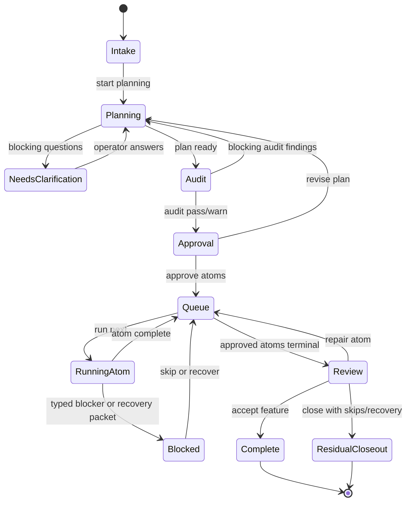

# TUI Feature Planner Orchestration

**North Star: AI coding agents are becoming common, but teams do not yet trust
their context, decisions, or outputs. Idiom sells the missing substrate: repo
memory, freshness, contracts, audit, and evals.**

Status: partially implemented, 2026-05-25

This document specifies the UX and boundary contracts for a TUI feature planner
that can accept a full feature request, plan all work, and then dispatch a
bounded sequence of implementation atoms through existing lanes such as
`plan-execute`.

The controlling policy remains:

- The model owns strategy.
- The harness owns contracts.

The TUI should feel like one feature-delivery workflow to the operator. Under
the hood it must stay a durable orchestrator over bounded, auditable phases
instead of turning one model turn or one `plan-execute` run into an unbounded
loop.

## Current Implementation Snapshot

As of 2026-05-25, the first delivery slice is implemented for scripted and live
TUI regression coverage:

- `/feature-planner` in the TUI enters the shared feature-planner orchestration
  path and records durable feature-plan events.
- Accepted implementor atoms dispatch through nested `plan-execute` rather than
  relying on unobserved completion claims.
- The nested executor emits `internal_idiom.plan_execute.completed`; the
  feature planner folds the result into atom completion with plan-execute
  progress and verification evidence.
- Required atom tests are carried into the executor prompt and are visible in
  the plan-execute verification phase.
- Scripted contract coverage includes a small delivery probe and a retained
  Redis-clone fixture used as a larger TUI feature-planner testbed.

The retained Redis-clone fixture lives at
`testdata/scripted-contracts/fixtures/redis-clone-repo`. It was created through
the live TUI with a `/feature-planner` request and nested `plan-execute` atom
delivery. The reusable regression
`scripted-feature-planner-tui-redis-clone-mget` copies that fixture, drives the
TUI, and requires plan-execute to add `MGET` plus tests while the live runner
scores changed files and rollback.

Open work from the original design remains: dedicated feature-planner screens,
operator approval UI, restart-oriented TUI rendering, parallel atom scheduling,
and richer feature-ledger status panels.

## Problem

The current TUI can route implementation requests into existing lanes, but the
operator experience is fragile for larger work:

- a single prompt can carry product intent, architecture choices, evidence
  gathering, edit scope, TDD expectations, and execution instructions at once
- route selection and executor behavior can diverge from the user-visible
  request
- recovery messages can stack in the UI and make internal prompting visible
- required-path and completion gates fire late, after token-heavy model turns
- the operator cannot clearly see which phase owns planning, approval,
  execution, verification, or recovery
- plan-execute is a bounded atom runner, but users naturally ask the TUI for
  complete features

The feature planner is the missing UX layer between "describe a feature" and
"run one implementation atom."

## Goals

1. Let an operator submit an entire feature request in the TUI.
2. Produce one durable feature plan covering all known work before execution
   starts.
3. Require human approval at the right boundary: the feature contract and the
   first execution batch, not every mechanical sub-step.
4. Dispatch a sequence of bounded atoms through existing lanes, with fresh
   source evidence gathered per atom.
5. Keep the operator informed through stable state, not transcript noise.
6. Prevent the failures seen in current TUI testing: hidden authority in prompt
   prose, route/role misalignment, repeated recovery chatter, stale anchors,
   and late required-path surprises.
7. Preserve CLI/TUI parity by reusing the same typed contracts and lane
   artifacts the CLI consumes.

"All known work" means evidence-backed work discovered within the approved
planning budget. It does not mean the planner can keep researching forever.
Unknowns outside the budget must be captured as assumptions, open questions, or
follow-up atoms with explicit uncertainty.

## Non-Goals

- Do not make one `plan-execute` run infinite.
- Do not ask the feature planner to precompute exact `old_text`/`new_text`
  anchors for the whole feature. Those anchors go stale and belong inside each
  atom execution.
- Do not let a feature plan authorize writes by prose alone.
- Do not let the model self-approve human gates.
- Do not build a generic product manager. The feature planner organizes and
  validates work; it does not own product strategy.
- Do not parse magic phrases from generated docs as contract authority.

## UX Shape

The TUI should expose a small number of durable screens or panels. Each panel
maps to a typed state object, not to raw model transcript text.

### 1. Intake

Operator sees:

- feature title
- raw user request
- detected constraints
- suspected risk tier
- requested approval mode
- initial evidence status
- whether writes are disabled, degraded, or available

Valid operator actions:

- `Refine request`
- `Start planning`
- `Cancel`

Contract boundary:

- The intake record captures user intent and constraints.
- It does not grant edit authority.
- It does not choose exact atom paths except when the user supplied explicit
  required paths.

### 2. Discovery And Planning

Operator sees:

- current phase: `collecting evidence`, `planning`, `needs clarification`, or
  `plan ready`
- compact evidence cards with paths, symbols, test candidates, confidence, and
  freshness
- open questions grouped by blocker severity
- planning budget used and remaining
- generated feature plan outline

Valid operator actions:

- `Answer question`
- `Submit for audit`
- `Request revision`
- `Cancel`

Contract boundary:

- Discovery output is evidence, not authority.
- Candidate paths are candidate scope unless a human, command mode, durable
  atom, or explicit structured field marks them required.
- The planner can propose all atoms and dependencies, but execution scope is
  compiled by the harness into typed atom contracts.

### 3. Approval

Operator sees a diff-like approval packet:

- feature objective
- non-goals
- atom list and order
- dependencies between atoms
- expected user-visible outcomes
- TDD obligations and verification commands by atom
- write authority summary: required paths, allowed paths, forbidden paths
- risk and rollback notes
- known uncertainty

Valid operator actions:

- `Review audited approval packet`
- `Approve all`
- `Approve selected atoms`
- `Revise plan`
- `Hold`
- `Cancel`

Contract boundary:

- Approval creates an immutable `feature_approval_id`.
- Approval records exactly which atom ids and write scopes may dispatch.
- Approval does not freeze exact source anchors for all atoms.
- If workspace state changes under approved scope, affected atoms return to
  `needs_rebase` before dispatch.

### 4. Execution Queue

Operator sees:

- queue of atoms with status: `pending`, `running`, `blocked`, `needs_rebase`,
  `reviewing`, `complete`, `source_satisfied`, `skipped`, `recovery_open`, or
  `failed`
- current atom lane: `implement`, `plan-execute`, or `atom-spec`
- selected planner/executor/reviewer model aliases
- current tool-surface summary
- compact per-atom events: reads, writes, tests, blockers, recovery packet

Valid operator actions:

- `Run next`
- `Pause after current`
- `Skip blocked atom`
- `Open recovery packet`
- `Stop feature`

Contract boundary:

- The TUI runs one bounded atom at a time.
- Each atom gets its own runtime brief and lane contract.
- Each atom gathers fresh current-state source evidence before writes unless
  the atom is a new-file/full-body artifact with explicit body authority.
- Completion of one atom updates the feature ledger before the next atom starts.

### 5. Review And Closeout

Operator sees:

- completed atoms
- changed paths
- verification evidence
- unresolved obligations
- generated release/product evidence summary
- follow-up atoms, if any

Valid operator actions:

- `Accept feature`
- `Request repair`
- `Promote follow-up atom`
- `Export evidence`

Contract boundary:

- Feature closeout requires every approved atom to be complete,
  source-satisfied, explicitly skipped by the operator, or represented by a
  residual-work status.
- Verification evidence must be post-write for the atom it proves.
- The feature final answer is generated from the ledger, not from raw
  transcript memory.
- `Accept feature` is only available when every approved atom is `complete` or
  `source_satisfied`.
- Features with skipped atoms or open recovery packets close as
  `closed_with_residual_work`, not `accepted_complete`.

## Glossary

- `required_edit_paths`: paths that must be edited, proven source-satisfied, or
  explicitly blocked for the atom to close.
- `allowed_candidate_paths`: paths that may be read or edited if the model
  determines they are needed; they are not mandatory coverage.
- `evidence_paths`: paths or handles that localize context and may be read for
  support; they do not grant write authority.
- `edit_set_obligations`: run-level edit requirements such as "at least one
  test edit" or "at least one implementation-shaped edit."
- `verification_obligations`: post-write checks or evidence requirements that
  must prove the atom's behavior.
- `source_satisfied`: terminal outcome meaning current source already satisfies
  the atom objective. It requires current source evidence for every required
  path and is distinct from `complete`, which means edits were applied.
- `skipped`: operator-owned terminal atom state with a required reason.
- `recovery_open`: residual atom state backed by a recovery packet. It blocks
  `accepted_complete` and can only close as residual work unless recovered.
- `needs_refresh`: non-terminal freshness flag for stale evidence. It does not
  replace `needs_rebase`, which applies to changed approved write scope.

## Contract Objects

### FeatureIntent

Owned by intake.

Required fields:

- `contract_schema_version`
- `feature_id`
- `title`
- `raw_request`
- `normalized_objectives`
- `non_goals`
- `operator_constraints`
- `requested_tdd_depth`
- `planning_budget`
- `created_at`
- `workspace_fingerprint`

Rules:

- This object is append-only except for operator-authored refinements.
- It is not execution authority.
- `planning_budget` is operator- or policy-owned and includes max planner turns,
  max discovery probes, max context budget, and whether budget exhaustion should
  block approval or create follow-up atoms.

### FeaturePlanningProgress

Owned by the harness while planning is active.

Required fields:

- `contract_schema_version`
- `feature_id`
- `plan_id`
- `planning_budget`
- `budget_used`
- `budget_status`: `within_budget`, `exhausted_with_plan`,
  `exhausted_with_questions`, or `exhausted_blocked`
- `discovery_probe_refs`
- `budget_exhausted_open_questions`
- `planner_session_id`
- `updated_at`

Rules:

- Planning stops when the budget is exhausted.
- Budget exhaustion is not hidden inside a model answer.
- If budget exhaustion leaves blocking questions, audit status is `block`.
- If budget exhaustion leaves non-blocking uncertainty, the plan must capture
  follow-up atoms or assumptions before approval.

### FeaturePlan

Owned by the feature planner model, validated by the harness.

Required fields:

- `contract_schema_version`
- `feature_id`
- `plan_id`
- `objectives`
- `assumptions`
- `atoms`
- `dependencies`
- `tdd_obligations`
- `verification_strategy`
- `risks`
- `open_questions`
- `budget_status`
- `budget_exhausted_open_questions`
- `evidence_refs`

Rules:

- The plan covers all known work.
- Atoms describe behavior, scope, and verification expectations.
- Atom scope is proposed scope until compiled into `AtomContract`.
- The planner must distinguish facts from inference.
- The plan must carry planning budget status so "all known work" is auditable.

### FeaturePlanAudit

Owned by the harness.

Required fields:

- `contract_schema_version`
- `plan_id`
- `status`: `pass`, `warn`, or `block`
- `missing_objectives`
- `unmapped_tdd_obligations`
- `scope_conflicts`
- `stale_evidence_refs`
- `atom_freshness_flags`
- `unresolved_questions`
- `approval_recommendation`

Rules:

- Blocking audit findings prevent approval.
- Warnings are visible but do not force a strategy.
- Audit checks invariant coverage, freshness, scope, and traceability; it does
  not choose implementation strategy.
- `atom_freshness_flags` records per-atom non-terminal freshness states such as
  `needs_refresh_before_dispatch`. These flags may allow approval but block
  atom dispatch until a deterministic refresh clears them.

### FeatureApproval

Owned by the operator and harness.

Required fields:

- `contract_schema_version`
- `feature_approval_id`
- `plan_id`
- `approved_atom_ids`
- `approved_write_authority`
- `approved_tdd_obligations`
- `approved_verification_strategy`
- `approved_by`
- `approved_at`
- `workspace_fingerprint`

Rules:

- Approval is required before any atom writes.
- Approval can be partial.
- Approval can only be created by an operator event or an explicit
  non-interactive CLI approval policy. No model output can create approval,
  including a reviewer model or a different model from the planner.
- If approved scope changes materially, a new approval is required.

### AtomContract

Owned by the harness, compiled from approved plan state.

Required fields:

- `contract_schema_version`
- `atom_id`
- `feature_id`
- `approval_id`
- `lane`
- `objective`
- `required_edit_paths`
- `allowed_candidate_paths`
- `forbidden_paths`
- `evidence_paths`
- `edit_set_obligations`
- `verification_obligations`
- `freshness_requirements`
- `freshness_flags`
- `terminal_outcomes`

Rules:

- This is the only object that authorizes an atom lane.
- Required paths mean coverage obligations.
- Allowed paths mean candidate scope, not mandatory coverage.
- Evidence paths are read authority, not write authority.
- `freshness_flags` is copied from `FeaturePlanAudit.atom_freshness_flags` and
  updated by pre-dispatch freshness checks.
- Terminal outcomes are: `complete`, `source_satisfied`, `blocked`,
  `needs_rebase`, `skipped`, `recovery_open`, `failed`.
- `skipped` requires an operator event and reason.
- `recovery_open` requires a recovery packet path.

### AtomProgress

Owned by the executor/orchestrator.

Required fields:

- `contract_schema_version`
- `atom_id`
- `status`
- `current_lane_session_id`
- `changed_paths`
- `source_evidence_refs`
- `verification_evidence_refs`
- `freshness_flags`
- `blockers`
- `skip_reason`
- `recovery_packet_path`
- `started_at`
- `updated_at`

Rules:

- Progress is updated after every atom event.
- The TUI renders progress from this object, not from internal recovery prompts.
- A failed atom must produce either a typed blocker or a recovery packet before
  the orchestrator continues.
- A skipped atom must cite the operator event that skipped it.
- `needs_refresh` lives in `freshness_flags` when evidence changed but approved
  write scope has not changed. At runtime this mirrors the atom contract's
  freshness flag and blocks dispatch until evidence is refreshed.

### FeatureLedger

Owned by the harness.

Required fields:

- `contract_schema_version`
- `feature_id`
- `intent`
- `planning_progress`
- `plans`
- `audits`
- `approvals`
- `atom_contracts`
- `atom_progress`
- `operator_events`
- `final_status`

Rules:

- The ledger is the source of truth for resume, closeout, and TUI rendering.
- Raw prompts and long transcripts are not required to render feature state.
- Privacy-sensitive file bodies and raw transcript excerpts stay out of the
  default ledger.

`final_status` enum:

- `planning`
- `awaiting_approval`
- `running`
- `blocked`
- `accepted_complete`
- `closed_with_residual_work`
- `cancelled`

Only `accepted_complete` means every approved atom reached `complete` or
`source_satisfied`. `closed_with_residual_work` means at least one approved atom
was skipped, recovery-open, failed, or otherwise not accepted complete.

Default path:

- `.idiom/features/<feature_id>/ledger.json`

The product-workflow effort tree may reference the ledger, but the feature
orchestrator should not fork a product-workflow-specific ledger format.

## Ledger In The Overall System

`FeatureLedger` is an orchestration index, not a replacement for lane-owned
artifacts.

It references:

- context graph views and packet ids for planning evidence
- feature plan and audit records
- operator approval events
- compiled atom contracts
- plan-execute session ids for atoms that use plan-execute
- implement lane session ids for atoms that use direct implementation
- recovery packet paths for failed atoms
- telemetry session ids and compact evidence refs

It does not copy:

- raw model prompts
- full transcripts
- file bodies
- plan-execute internal progress bodies
- recovery packet internals beyond path, digest, status, and summary

System readers should treat the ledger as the join table for feature-level UX,
resume, audit, and closeout. Lane artifacts remain authoritative for their own
phase details. The ledger stores enough identifiers, digests, and summarized
status to prove which lane artifact it consumed and whether that artifact still
matches the current workspace state.

The TUI renders from a view model derived from `FeatureLedger` plus compact
referenced lane summaries. The CLI reads and writes the same ledger directly.
Telemetry and `harness_audit` should be able to answer feature-level questions
without replaying raw conversations.

## Boundary Contracts

| Boundary | Input | Output | Harness invariant |
| --- | --- | --- | --- |
| User to intake | Raw request | `FeatureIntent` | No write authority is inferred from prose. |
| Intake to planner | Intent + evidence packet refs | `FeaturePlan` | Planner sees evidence and constraints, not hidden execution authority. |
| Planner to audit | Feature plan | `FeaturePlanAudit` | Audit blocks missing traceability, stale evidence, unresolved blocking questions, and scope conflicts. |
| Audit to approval | Plan + audit | `FeatureApproval` | Human approval is required before writes. |
| Approval to atom compiler | Approval + plan | `AtomContract[]` | Required, allowed, evidence, and forbidden paths stay separate. |
| Atom compiler to lane | Atom contract | Runtime brief / lane invocation | TUI and CLI use the same lane contract shape. |
| Lane to ledger | Tool results + status | `AtomProgress` | Progress records typed evidence, not raw internal prompting. |
| Ledger to TUI | Feature ledger | Operator view model | UI never stacks recovery prompts as user messages. |
| Ledger to closeout | Completed progress | Feature final answer | Final answer cites ledger evidence and open blockers. |

## Plan-Execute Correction Loop Boundary

Plan-execute correction loops should be reduced by clarifying ownership at the
workflow boundary, not by adding more late recovery prose. The feature planner
may decide work order, split the feature into atoms, identify dependencies, and
choose which approved atom should run next. It does not author concrete source
edits for the whole feature and does not choose a lane's next parser action once
that lane has started.

Concrete edit authorship belongs to the atom executor or writer lane. For a
`plan-execute` atom, the planner phase produces one valid `submit_plan` artifact,
`Decision: source-satisfied`, or a typed blocker; the executor/writer applies or
reviews concrete edits from that artifact. A rejected `submit_plan` is an
invalid attempt in the lane's correction state, not proof that the feature
planner should rewrite the plan or micro-manage the next source read.

Prompt and runtime templates must expose contracts without authoring plans. They
may describe the valid terminal outcomes, typed obligations, source-evidence
requirements, and JSON/tool shapes. They must not synthesize atom strategy,
invent edit bodies, promote candidate paths to required coverage, or encode
topic-specific repair recipes. If a template needs to carry authority, that
authority must first exist as a typed field on `FeaturePlanAudit`,
`FeatureApproval`, `AtomContract`, `AtomProgress`, or the lane runtime brief.

Native and textual tool surfaces are separate contracts. Native-tool backends
may use native tool definitions and `tool_choice` to require `submit_plan` or a
bounded source read. Textual-tool backends must receive text-native transcript
history and must emit one visible parser-readable JSON object; they cannot rely
on stripped native `tool_choice` semantics. Recovery design must choose the
surface from backend capability and record that choice in the lane/session
evidence so TUI and CLI behavior stay explainable.

Any non-trivial fix to plan-execute correction behavior needs the standard
north-star decision record before implementation: verified root cause,
north-star alignment, why the change protects a harness invariant instead of
choosing model strategy, why it does not create a new correction loop, and the
reviewer approval that checked those claims. This keeps loop reduction grounded
in typed contracts and evidence rather than accumulating prompt nudges.

## Deterministic MVP Audit Gates

Reviewer-model critique is optional and cannot run before deterministic audit
has produced a typed status. The first implementation must block approval when
any of these checks fail:

1. **Objective coverage:** every normalized objective maps to at least one atom
   or explicit non-goal.
2. **Atom traceability:** every atom cites feature objective refs and evidence
   refs or marks itself as a new exploratory/follow-up atom.
3. **Scope separation:** required edit paths, allowed candidate paths, evidence
   paths, and forbidden paths are separate typed fields.
4. **Write authority:** no atom can write outside approved required or allowed
   scope; evidence-only paths never become write scope by implication.
5. **TDD mapping:** every user-requested or risk-required TDD obligation maps
   to at least one atom verification obligation or blocks approval.
6. **Freshness:** plan evidence refs carry freshness metadata. Stale required
   evidence either blocks approval or is recorded in
   `FeaturePlanAudit.atom_freshness_flags` as `needs_refresh_before_dispatch`,
   which the atom compiler copies into `AtomContract.freshness_flags`.
7. **Planning budget:** budget status is present and terminal. Approval blocks
   on `exhausted_blocked` or unresolved budget-exhausted open questions.
8. **Approval authority:** no approval exists before an operator event or an
   explicit non-interactive CLI policy.
9. **Role route:** each phase records the intended actor role and configured
   model alias; unavailable roles produce degraded state, not silent fallback.
10. **Terminal state:** source-satisfied, skipped, recovery-open, and complete
   are distinct terminal or residual states.
11. **CLI parity:** the feature plan, approval, atom contract, progress, and
    ledger can be serialized and consumed without TUI-only state.

## State Machine



## TUI Rendering Rules

1. The chat transcript shows operator-facing milestones and questions only.
2. Internal recovery prompts, completion-gate nudges, and retry addenda render
   in a collapsible diagnostics panel, not as assistant messages.
3. Duplicate internal messages are coalesced by `event_kind`, `atom_id`, and
   `obligation_ref`.
4. The primary screen always shows the current phase, next valid operator
   actions, and the exact blocker when blocked.
5. The TUI never presents "the model is thinking" as progress unless a typed
   event changed the ledger.
6. Every "Approve" action shows the typed authority it creates.
7. Every "Run next" action shows which atom contract and lane will run.
8. Every failure view shows whether the failure is model output, harness
   contract, tool/runtime, verification, stale workspace, or human information.

Negative rendering rules:

- No internal recovery prompt may be appended to the main chat transcript.
- No duplicate recovery card may render for the same `event_kind`, `atom_id`,
  and `obligation_ref`; update the existing card instead.
- No approval button may render without showing the exact typed authority that
  will be persisted.
- No "accepted" closeout state may render while an approved atom is skipped,
  failed, or represented by an open recovery packet.

## Recovery UX

Recovery should feel like a state transition, not a scolding loop.

When an atom fails:

1. The lane writes a failure record or typed blocker.
2. The orchestrator updates `AtomProgress`.
3. The TUI shows one blocker card with:
   - failure class
   - affected atom
   - paths involved
   - whether any files changed
   - next valid actions
   - recovery packet path when present
4. The TUI suppresses repeated internal recovery messages for the same
   `obligation_ref`.
5. The operator can promote recovery atoms or skip the atom with an explicit
   reason.

The orchestrator should not keep retrying the same atom after two harness
contract failures unless a typed recovery decision explains what changed.

## Freshness And Rebase Rules

Feature plans intentionally last longer than source anchors. The UX must make
that explicit.

- Feature plan objectives and atom ordering can remain valid across workspace
  changes.
- Exact edit anchors are per-atom and must be gathered fresh inside the atom
  lane.
- If a file in an approved atom's write scope changes before dispatch, that
  atom becomes `needs_rebase`.
- If an evidence path changes, the atom may require evidence refresh without
  invalidating the whole feature plan.
- If objectives, dependencies, or approval scope change, the feature plan needs
  revision and reapproval.

Material workspace change is detected from the approved atom's scoped path
fingerprints plus the workspace git/index fingerprint captured in
`FeatureApproval`. A changed evidence path may require evidence refresh. A
changed required or allowed write path requires rebase before dispatch.

## Model And Role Alignment

The TUI must show and log the selected role for every phase:

| Phase | Preferred actor | Writes? | Thinking posture |
| --- | --- | --- | --- |
| Intake normalization | active/default or classifier | no | concise JSON |
| Feature planning | planner model | no | synthesis allowed |
| Plan audit | harness deterministic first, reviewer model optional | no | critique allowed |
| Atom execution | executor/plan-execute lane | yes, scoped | lane-specific |
| Atom review | reviewer model or deterministic checks | no or corrective plan only | critique allowed |
| Closeout | active/default over ledger | no | concise synthesis |

If a configured role is unavailable, fallback must be explicit in the ledger and
TUI. Silent fallback is treated as degraded mode.

## CLI/TUI Parity

The TUI must be a presenter/controller over the same durable contracts that a
headless CLI can use.

Required command shape for the eventual CLI surface:

```text
idiom feature plan --prompt <text>|--prompt-file <path> [--json]
idiom feature audit --ledger <path> [--json]
idiom feature approve --ledger <path> --atom <id>|--all [--json]
idiom feature run-next --ledger <path> [--json]
idiom feature status --ledger <path> [--json]
idiom feature closeout --ledger <path> [--json]
```

Required event names:

- `idiom.feature.intent_created`
- `idiom.feature.plan_created`
- `idiom.feature.plan_audited`
- `idiom.feature.approval_created`
- `idiom.feature.atom_contract_created`
- `idiom.feature.atom_started`
- `idiom.feature.atom_progressed`
- `idiom.feature.atom_blocked`
- `idiom.feature.atom_completed`
- `idiom.feature.closed`

Relationship to existing plan-execute state:

- `FeatureLedger.atom_progress[].current_lane_session_id` points to the
  existing plan-execute session id when an atom uses plan-execute.
- `FeatureLedger.atom_progress[].recovery_packet_path` points to existing
  recovery artifacts when a lane fails.
- `.idiom/plan-execute/sessions/*.json` remains lane-owned progress. The
  feature ledger references it; it does not duplicate its raw prompt or file
  body content.
- A TUI resume rebuilds its screen model from `FeatureLedger` plus referenced
  lane session summaries.

All durable feature objects must carry `contract_schema_version`. Old ledgers
are either migrated by a versioned migrator or rejected with a typed
`unsupported_schema` status before any execution resumes.

## Statefulness Model

The feature planner should be stateful at the workflow boundary and stateless at
model-call boundaries.

Durable state:

- feature intent
- planning progress and budget use
- feature plan versions
- deterministic audit results
- operator approvals
- atom contracts
- atom progress
- referenced lane session ids
- recovery packet references
- closeout status

Ephemeral state:

- active TUI selection, scroll position, expanded diagnostics panels
- current spinner/progress animation
- transient model request buffers
- raw internal recovery prompts

The model should receive the smallest current contract packet needed for its
phase. It should not rely on hidden chat history to remember feature state.
After context compaction or process restart, the TUI should be able to recover
the same next valid actions from durable ledger state.

## MVP Slice

The first shippable version should be intentionally narrow:

1. One active feature ledger at a time.
2. One generated feature plan per intake revision.
3. One human approval event, either all atoms or a selected prefix.
4. Sequential atom dispatch only; no parallel execution.
5. Existing `plan-execute` and `implement` lanes are reused without changing
   their core loop.
6. Resume from `.idiom/features/<feature_id>/ledger.json`.
7. One failure path: blocked atom writes a recovery packet or typed blocker and
   pauses the queue.
8. One CLI parity test proving headless `plan -> audit -> approve -> run-next
   -> status` uses the same ledger and events as the TUI.
9. One TUI rendering test proving internal recovery prompts do not appear as
   stacked chat messages.

Everything else, including multiple concurrent features, batch approval
policies, reviewer-model plan critique, recovery promotion from inside the TUI,
and product-workflow-specific integration, is follow-up work.

## Comprehensive Test Plan

Testing should start with contract units and end with stress scenarios that
simulate the failures this design is meant to prevent.

### Contract Unit Tests

- `FeatureIntent` serialization rejects missing schema version, missing budget,
  and invalid workspace fingerprint.
- `FeaturePlanningProgress` transitions from `within_budget` to each terminal
  budget status and blocks approval when budget-exhausted questions are open.
- `FeaturePlanAudit` blocks missing objective coverage, missing TDD mapping,
  stale evidence, mixed required/allowed/evidence authority, and missing role
  route.
- `FeatureApproval` can only be created from operator or non-interactive CLI
  policy events.
- `AtomContract` preserves required, allowed, evidence, and forbidden paths as
  distinct fields.
- `AtomProgress` supports `complete`, `source_satisfied`, `skipped`,
  `recovery_open`, `blocked`, `needs_rebase`, and `failed`.
- `FeatureLedger` round-trips without raw transcript or file body content.

### CLI Parity Tests

- Headless `feature plan -> audit -> approve -> run-next -> status` writes the
  same ledger fields consumed by the TUI.
- CLI resume rejects unsupported schema versions before execution.
- CLI `run-next` refuses to dispatch without approval.
- CLI `run-next` refuses stale approved write scope and marks the atom
  `needs_rebase`.
- CLI closeout distinguishes `accepted_complete` from
  `closed_with_residual_work`.

### TUI UX Tests

- Planning screen shows budget used/remaining and never exposes internal prompt
  text as a user message.
- Approval screen renders exact typed authority before enabling approval.
- Execution queue updates from ledger events, not transcript parsing.
- Duplicate recovery events coalesce into one blocker card.
- "Accept feature" is disabled when any atom is skipped, recovery-open,
  blocked, failed, or needs rebase.
- Restarting the TUI reconstructs the same phase, queue, blockers, and next
  actions from the ledger.

### Lane Integration Tests

- A feature atom dispatched through plan-execute records the existing
  plan-execute session id in `AtomProgress`.
- A plan-execute failure writes a recovery packet and updates the atom to
  `recovery_open` without advancing the queue.
- An implement-lane atom uses the same `AtomContract` fields as CLI.
- Source-satisfied atom closeout requires current evidence for every required
  path and does not count as edited completion.

### Stress Scenarios

- **Large feature:** 20 atoms, 60 candidate paths, mixed implement and
  plan-execute lanes. Expected: planning budget terminates deterministically,
  queue remains sequential, ledger remains compact.
- **Compaction/restart:** kill and restart the TUI during planning, approval,
  atom execution, recovery, and closeout. Expected: next valid actions are
  recovered from durable state.
- **Workspace drift:** modify approved source scope between approval and
  dispatch. Expected: affected atom becomes `needs_rebase`; unaffected atoms
  remain dispatchable.
- **Role outage:** planner, executor, reviewer, or classifier role unavailable.
  Expected: degraded state is visible and logged; no silent actor fallback.
- **Recovery loop pressure:** model repeatedly misses required path completion.
  Expected: one blocker card, bounded retries, recovery packet or typed blocker.
- **No-self-approval:** planner and reviewer both emit approval-like prose.
  Expected: no approval record exists without operator or CLI policy event.
- **Prompt authority injection:** plan prose says "required path X" while typed
  contract says X is evidence-only. Expected: typed contract wins.
- **TDD gate miss:** feature plan omits requested test obligation. Expected:
  audit blocks approval.
- **Residual closeout:** one atom skipped and one recovery packet open.
  Expected: closeout can only be `closed_with_residual_work`.
- **Ledger compaction:** many completed feature ledgers and one large active
  feature. Expected: TUI status reads compact summaries by default, full lane
  artifacts remain referenced by id/path, and a ledger exceeding the configured
  compact-view budget reports `summary_truncated` without dropping authority
  fields.

### Audit And Observability Tests

- `harness_audit` can report feature ledger counts, blocked atom counts, open
  recovery refs, schema versions, stale approvals, and unsupported ledgers
  without raw prompts or file bodies.
- Conversation and telemetry logs include feature id, atom id, approval id,
  lane session id, role alias, budget status, terminal status, and blocker
  class.
- Product/release evidence export can include sanitized feature rollups by
  status, changed paths, tests, recovery refs, and residual work.

## Acceptance Criteria

- A user can enter one feature request and see a feature plan before any write
  occurs.
- No workspace write can occur before a persisted `FeatureApproval`.
- No model output can create or modify `FeatureApproval`.
- The approval screen clearly separates objectives, atom order, required write
  authority, candidate scope, evidence, TDD obligations, and verification.
- Approved atoms can execute one at a time through the same lane contracts used
  by CLI.
- TUI resume can reconstruct the feature state from `FeatureLedger` without raw
  transcript replay.
- Repeated internal recovery prompts do not appear as stacked assistant
  messages.
- Stale approved write scope cannot dispatch; the atom enters `needs_rebase`.
- Planning budget exhaustion is represented in durable state and cannot be
  hidden inside planner prose.
- Plan prose, context packet prose, and recovery prose are never parsed as
  authority for required paths or approval.
- A failed atom produces a typed blocker or recovery packet before the queue
  advances.
- Feature closeout cites ledger evidence for changed paths, tests, skipped
  atoms, and open blockers.

## Open Design Questions

1. Should the first implementation expose this as a command palette action in
   the existing chat TUI, or as a separate `/feature` mode with dedicated
   screens?
2. Should `FeatureLedger` live under `.idiom/features/<feature_id>/ledger.json`
   or inside the product-workflow effort tree when the request is product
   workflow related?
3. Which additional deterministic audit checks should ship after the MVP gates?
4. What approval policy should exist after MVP for low-risk features: approve all atoms,
   approve first batch, or approve each atom?
5. Which stress scenarios should become permanent eval fixtures after MVP?

## Iteration Log

### Iteration 0

Initial draft. Focused on UX screens, typed contracts, state transitions, TUI
rendering rules, recovery UX, freshness boundaries, and model/role alignment.

### Iteration 1

Addressed reviewer blocking feedback:

- Replaced premature `Approve plan` action in planning with `Submit for audit`
  and reserved approval review for the audited approval phase.
- Added bounded definition of "all known work."
- Added glossary for path and obligation terms.
- Added `contract_schema_version` to durable objects.
- Strengthened approval so only operator events or explicit non-interactive CLI
  policy can create approval.
- Split `accepted_complete` from residual closeout states.
- Added deterministic MVP audit gates before reviewer-model critique.
- Added material workspace-change detection.
- Added CLI/TUI parity command shape, event names, and plan-execute session
  mapping.
- Added a narrow MVP slice and negative acceptance criteria.

### Iteration 2

Addressed second-review blockers and added system stress-test coverage:

- Added `FeaturePlanningProgress` and typed planning budget fields/status.
- Added budget audit gate and acceptance criterion.
- Made `skipped` and `recovery_open` canonical atom states.
- Added skip reason and recovery packet requirements to atom progress.
- Clarified the ledger's role as the feature-level join table over existing
  lane artifacts.
- Added a statefulness model separating durable workflow state from ephemeral
  TUI/model-call state.
- Added comprehensive unit, CLI parity, TUI UX, lane integration, stress, and
  observability test plans.
- Reframed skipped/residual closeout as an explicit residual status and removed
  the conflicting open question.

### Iteration 3

Addressed final non-blocking review consistency points:

- Added explicit `FeatureLedger.final_status` enum.
- Clarified `needs_refresh` as a non-terminal freshness flag distinct from
  `needs_rebase`.
- Added a residual closeout edge to the state machine.
- Added a ledger compaction stress scenario.

### Iteration 4

Addressed final narrow-review criticism by storing `needs_refresh` in
`AtomProgress.freshness_flags` and tying the audit gate to that field.

### Iteration 5

Corrected freshness timing:

- Added `FeaturePlanAudit.atom_freshness_flags` as the pre-approval freshness
  owner.
- Added `AtomContract.freshness_flags` as the pre-dispatch contract field.
- Kept `AtomProgress.freshness_flags` as runtime mirror state instead of the
  pre-approval audit source.

### Iteration 6

Added the plan-execute correction-loop boundary:

- Clarified that the feature planner owns strategy, atom ordering, and work
  decomposition, while executor/writer lanes own concrete edit production.
- Required prompt and runtime templates to expose typed contracts without
  authoring plans or promoting prose into authority.
- Kept native and textual tool surfaces separate so backend capability, not
  prompt text, determines the terminal `submit_plan` contract.
- Recorded that non-trivial correction-loop fixes need a north-star decision
  record and reviewer approval before implementation.
