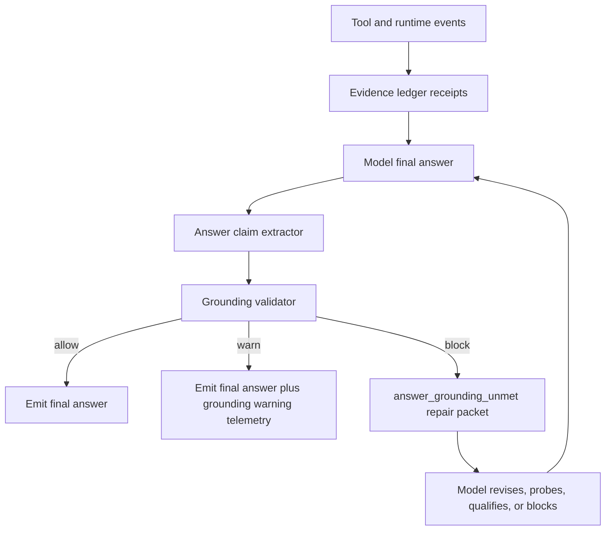

# Final Answer Grounding Contract

## Purpose

Idiom should mechanically prevent unsupported factual references in final
answers without turning answer writing into a brittle citation game. This plan
defines a generic final-answer grounding contract that validates evidence
claims against the run's observed evidence, while preserving the model's
authority to gather evidence, synthesize conclusions, express uncertainty, and
choose the final wording.

This is a harness contract, not a new answer lane.

## North-Star Boundary

The model owns:

- which evidence to gather
- which evidence matters
- how to synthesize across evidence
- when to qualify a conclusion as inferred or uncertain
- the final prose structure and wording

The harness owns:

- evidence receipts from tools, writes, logs, and verification
- deterministic citation and claim checks
- final-answer grounding state
- repair packets when an answer exceeds the evidence
- telemetry, audit, evals, and rollout gates

The validator must not decide broad semantic truth. It should enforce only
whether factual answer claims are mechanically grounded in receipts the harness
already observed.

## Decision On Backticks

Do not treat every backticked span as a citation.

Backticks are presentation. They commonly wrap commands, flags, tool names,
config keys, literals, future file names, JSON fields, symbols, examples, and
status labels. Validating every span between backticks against read evidence
would create false blocks and would train the model to avoid useful precision.

Instead:

- classify reference-shaped spans anywhere in prose, whether backticked or not
- validate only evidence-sensitive claim classes
- treat backticks as one extraction hint among others
- block only deterministic grounding failures

Example: `go test ./...` is a command reference. It needs command-result
evidence only if the answer claims the command was run or passed.

## New Contract

Add a reusable runtime contract:

```text
AnswerGroundingContract
  schema_version: idiom.answer_grounding_contract.v1
  enforcement_mode: observe_only | warn | enforce
  required_claim_kinds: [...]
  blocked_claim_kinds: [...]
  allowed_uncertainty: true | false
  receipt_policy:
    require_source_body_for_source_detail: true
    require_log_window_for_log_claim: true
    require_command_result_for_verification_claim: true
    require_diff_write_for_change_claim: true
  repair_budget:
    max_repair_attempts: N
    allow_exact_probe: true | false
```

Emit one event for every user-visible final answer:

```text
final_answer_grounding.v1
  decision: allow | warn | block
  enforcement_mode: observe_only | warn | enforce
  claim_counts: map[kind]count
  supported_claim_ids: [...]
  warning_claim_ids: [...]
  unsupported_claim_ids: [...]
  accepted_receipts: [...]
  evidence_paths: [...]
  warnings: [...]
  blocking_reasons: [...]
  repair_menu: [...]
```

The contract should compile from the runtime brief, active lane, tool results,
write results, verification events, log evidence, and final answer.

## Evidence Ledger

Maintain an evidence ledger for the current run. Receipts should be compact,
stable, redaction-safe, and replayable.

```text
EvidenceReceipt
  id: S1 | L1 | C1 | D1 | P1
  kind: source_body | symbol_body | log_window | command_result | diff_write | path_seen | packet
  tool_call_id: optional
  target:
    path: optional
    symbol: optional
    command: optional
    log_path: optional
    session_id: optional
    packet_id: optional
  range:
    start_line: optional
    end_line: optional
    event_ids: optional
    turn_range: optional
  freshness: current | pre_write | stale | historical
  supports:
    - path_exists
    - source_detail
    - symbol_detail
    - log_event
    - verification_status
    - changed_path
    - localization
  fingerprint:
    source_digest: optional
    command_digest: optional
    log_digest: optional
  summary: bounded redacted summary
  raw_pointer: local-only pointer for replay
```

Receipt prefixes:

- `S#`: source body or symbol body. Supports current code details, line
  citations, symbol behavior, and code root-cause claims.
- `L#`: log window. Supports runtime, transcript, session, telemetry, and
  diagnostic claims.
- `C#`: command result. Supports verification and command-status claims.
- `D#`: diff or write result. Supports changed-path and write-success claims.
- `P#`: packet, search hit, context view, or path-seen evidence. Supports
  localization and path relevance only. It does not prove source behavior.

Support tiers must stay separate. Search hits, context packets, outlines, and
path inventories can localize evidence but cannot satisfy current source-body
claims.

## Claim Classes

The validator should extract and classify claims from the final answer.

```text
AnswerClaim
  id: claim_...
  kind:
    path_reference
    source_detail
    symbol_reference
    log_claim
    change_claim
    verification_claim
    command_reference
    literal
    proposal
    uncertainty_qualified
  text_span: redacted or hashed span in durable telemetry
  normalized_target: optional
  citation_refs: [...]
  confidence_label: verified | inferred | uncertain | unverified | proposed
  support_status: supported | warning | unsupported
  required_receipt_kind: optional
```

Claim classification should inspect full prose, not only markdown formatting.
Examples:

- `internal/runtime/agent/runner.go` alone can be a `path_reference`.
- `internal/runtime/agent/runner.go:1619` is a `source_detail` line citation.
- "The root cause is in runner.go" is a `source_detail` or
  `symbol_reference` claim and needs source-body support.
- "The log shows model_error" is a `log_claim` and needs log-window support.
- "I changed X" is a `change_claim` and needs diff/write support.
- "Tests passed" is a `verification_claim` and needs command-result support.
- "`go test ./...` should be run" is a command proposal, not a verification
  claim.

## Citation Forms

Accept two canonical citation forms:

```text
path/to/file.go:42
path/to/file.go:42-57
[S1]
[L2]
[C1]
[D1]
[P3]
```

Rules:

- `path:line` and `path:line-range` must resolve to source-body coverage for
  the same canonical path.
- Ledger refs must exist in the current run ledger.
- Ledger refs must be used within their support domain.
- Basename-only citations are allowed only when exactly one matching current
  source-body receipt exists. Otherwise they are ambiguous.
- Historical or log-only paths must be labeled as historical, log-only,
  transcript-only, or not verified in the current checkout.

Model-facing prompt text should be concise:

```text
The final-answer grounding gate rejects unsupported source, log, write, and
verification claims. Cite current source claims with path:line or [S#]. Cite
logs, commands, and writes with [L#], [C#], or [D#]. You may synthesize across
evidence, but label unsupported conclusions as inference or uncertainty.
```

## Validation Rules

### Hard Blocks

Block only deterministic failures:

- nonexistent current-workspace path presented as a real current file
- ambiguous basename presented as a citation without a disambiguating path
- `path:line` or `path:line-range` outside accepted source-body coverage
- current source behavior, line content, symbol behavior, implementation
  detail, or code root-cause claim without `source_body` or `symbol_body`
  evidence
- log, telemetry, transcript, or session claim without `log_window` evidence
- changed, implemented, edited, fixed, or updated claim without `diff_write` or
  changed-path evidence
- tested, verified, passed, failed, or not-run claim that contradicts or lacks
  `command_result` evidence
- receipt domain mismatch, such as using `P1` packet evidence to prove source
  behavior
- stale pre-write source evidence used as a current-state citation after a
  write to the same path
- answer says a file changed when it was only read or discovered

### Warnings

Warn but do not block by default:

- qualified inference with supporting receipts
- explicitly unverified or uncertain statements
- path-only inventories supported only by path-seen evidence
- proposed future changes, future file names, or example identifiers
- commands not claimed as run
- literals, flags, env vars, config keys, tool names, and status labels
- low-confidence classifier or extractor matches

### Allowed Synthesis

Allow synthesis when the answer preserves evidence boundaries:

- "The logs show X; source inspection was not sufficient to prove Y."
- "Based on [S1] and [L2], the failure appears to be..."
- "I did not verify this with tests."
- "The likely cause is..." with supporting receipts and inference language.

The validator should not require every sentence to have a citation. It should
require evidence for claims that present factual workspace, log, write, or
verification state.

## Backtick Classification

Backticks should be parsed as hints:

- Path-like or `path:line`: validate as a path or source-detail claim.
- Symbol-like near words such as "in", "calls", "function", "method",
  "handler", "root cause", or "line": require source or symbol evidence, or
  inference/uncertainty wording.
- Command-like: require command evidence only when the answer claims the command
  was run, passed, failed, or produced output.
- Literal, flag, env var, config key, tool name, JSON field, status label:
  no evidence required unless the answer claims it was observed in a current
  file or log.
- Proposed or future names: no evidence required, but the answer must not
  phrase them as observed facts.

Unbackticked references must be checked too. Formatting cannot be the authority
boundary.

## Repair Loop

On block, emit a structured repair result:

```text
answer_grounding_unmet
  unsupported_claims:
    - claim_id: claim_...
      kind: source_detail
      span_summary: "internal/surfaces/tui/app/foo.go:42"
      missing_evidence: source_body
      reason: cited line was not covered by any source-body receipt
  accepted_receipts:
    - S1 internal/runtime/agent/runner.go:1600-1645
    - L1 .idiom/logs/conversations/session.jsonl events 31-46
  valid_repair:
    - cite an accepted receipt
    - remove the unsupported claim
    - qualify the claim as inference or unverified
    - gather one exact missing source/log/command probe if tools remain
    - return <<QUESTION>> with the exact blocker
```

Repair text must remain generic. It should enforce the invariant without
hardcoding a topic or dictating broad discovery. It should not create a
dedicated citation lane.

After bounded repeated grounding failures, the runner should stop with a typed
blocker instead of synthesizing an answer on the model's behalf.

## Runtime Integration

### Collection Points

Create receipts when:

- `read_file` returns source lines
- `code_navigate` returns source or symbol bodies
- language-aware tools return symbol bodies, references, or outlines
- `context_pack`, search, or index tools identify candidate paths
- `history_range` or `history_symbol` returns git history
- log, telemetry, recovery, or audit tools return bounded records
- shell, test, build, or source sanity commands complete
- write tools, apply-patch flows, executor edits, or plan-execute diffs change
  files

### Runner Flow

The final-answer path should be:



### Contract Placement

Integrate with the same contract surfaces that already handle permissions,
completion gates, readiness, and audit:

- runtime brief: advertise final-answer grounding expectations
- runner final-answer gate: evaluate answer before user-visible completion
- autonomy events: emit `final_answer_grounding.v1`
- harness audit: aggregate coverage and failure classes
- recovery cards: include grounding repair information
- scripted contracts and SWE evals: assert grounding outcomes

This should extend existing source-grounding and completion-gate behavior
rather than create a parallel system.

## Privacy And Redaction

Durable telemetry should avoid raw answer, source, prompt, and log bodies.
Store:

- claim IDs
- claim kinds
- normalized paths
- line ranges
- receipt IDs
- redacted summaries
- hashes or digests
- decision and reason codes

Raw pointers may remain local-only for replay, but should not be committed or
exported in audit artifacts by default.

## Rollout Plan

### Phase 0: Observe Only

- Build ledger receipts and claim extraction.
- Emit `final_answer_grounding.v1` for all finals.
- Do not block.
- Add harness audit metrics.
- Inspect false positives and false negatives.

Exit criteria:

- event coverage for nearly all user-visible finals
- no material increase in run failures
- known false-positive classes documented

### Phase 1: High-Confidence Reference Safety

Block:

- nonexistent current paths
- invalid `path:line`
- ambiguous basenames
- source-detail claims without source-body receipts
- ledger domain mismatches

Keep warnings for inference and uncertainty.

Exit criteria:

- scripted fixtures pass
- false-block fixture rate is zero for known backtick-noise cases
- repair packets are clear enough for model recovery

### Phase 2: Change And Verification Grounding

Block:

- changed/fixed/implemented claims without write or diff receipts
- tested/verified/passed claims without command-result receipts
- contradictions between final answer and verification telemetry

Exit criteria:

- implementation closeout fixtures pass
- no increase in repeated completion-gate rejection
- audit coverage reports changed-path and verification claim classes

### Phase 3: Read-Only And Debug Enforcement

Enable enforcement for:

- direct answers that cite current source
- behavior-debugging answers using logs
- architecture and review answers with source-detail claims

Exit criteria:

- CLI read-only smoke passes
- log-debugging scripted contract passes
- live canary shows acceptable repair rate

### Phase 4: Default Enforcement

Enable by default after:

- `harness_audit` shows high final-answer grounding coverage
- scripted contracts cover allow, warn, block, and repair
- live CLI/TUI canaries are stable
- rollout flag and emergency disable remain available

## Test Strategy

### Unit Tests

Add focused tests for:

- receipt creation from source reads, symbol reads, logs, commands, writes, and
  packets
- stable receipt IDs within a run
- path normalization and workspace-root safety
- basename ambiguity
- `path:line` coverage checks
- source-detail claim without source-body evidence
- log claim without log evidence
- change claim without diff/write evidence
- verification claim without command-result evidence
- receipt domain mismatch
- stale pre-write source receipt after write
- backticked commands, literals, env vars, tool names, and proposed names not
  creating false blocks

### Property And Fuzz Tests

Add generated tests for:

- markdown formatting around paths and citations
- backtick and no-backtick equivalence
- random punctuation around `path:line`
- ambiguous basenames
- citation references with wrong receipt kinds
- removing source-body evidence flips allow to block
- moving cited line ranges outside read ranges flips allow to block
- qualified uncertainty remains non-blocking

### Scripted Contracts

Add deterministic fake-model scenarios:

- read-only grounded answer passes
- hallucinated source citation triggers `answer_grounding_unmet`
- model repairs by reading exact source and final answer passes
- backtick-noise answer with commands, literals, and config keys passes
- implementation premature final claims changed and verified, then is blocked
- implementation closeout after write and verification passes
- log-debug answer with bounded log evidence passes
- log-debug answer with invented file path blocks or warns if historical-only
- packet-only source behavior claim blocks
- mixed answer produces allow, warn, and block claim classifications

### SWE Eval Assertions

Extend scenario/oracle support:

```text
require_final_answer_grounding:
  decision: allow | warn | block
  unsupported_kinds: [...]
  min_supported_claims: N
  require_receipt_kinds: [...]
  forbid_receipt_kinds: [...]
```

### Live CLI And TUI E2E

Run small canaries:

- CLI read-only source answer
- CLI implementation closeout
- CLI behavior-debugging log answer
- TUI read-only/debug prompt
- TUI implementation closeout
- `harness_audit behavior` after a grounded run

Live tests should be canary/nightly until observe-only metrics prove low false
positive risk. Scripted contracts should be the merge gate.

## Audit Metrics

Extend `harness_audit behavior` with:

- `final_answer_grounding_coverage`
- `grounding_decision_counts`
- `unsupported_claim_rate`
- `unsupported_claims_by_kind`
- `warning_claims_by_kind`
- `source_detail_without_body_blocks`
- `nonexistent_current_path_blocks`
- `verification_claim_without_command_blocks`
- `change_claim_without_write_blocks`
- `grounding_gate_repair_success_rate`
- `grounding_repeated_repair_failures`
- `false_block_fixture_failures`
- `false_accept_fixture_failures`
- `receipt_domain_mismatch_blocks`

Audit output should include paths, claim kinds, receipt IDs, counts, and
decision codes, not raw prompt or source bodies.

## Integration Checklist

Before implementing:

- Identify existing source-grounding and final-answer gates.
- Identify where final user-visible answers are emitted.
- Identify all tool result shapes that can create receipts.
- Identify existing autonomy/audit event schemas for extension.
- Decide the config flag names for observe-only and enforcement modes.

Implementation must:

- keep claim extraction deterministic and testable
- keep evidence support tiers explicit
- avoid model-specific or topic-specific rules
- avoid treating prompt-provided paths as source truth
- avoid treating context packets or search hits as source-body proof
- avoid blocking normal commands, literals, and proposals
- preserve user-visible answer quality
- provide bounded repair instead of forced broad rewrites

Review must verify:

- hard-block rules align with deterministic invariants
- uncertainty and inference remain allowed
- receipt domain mismatches are caught
- final-answer grounding events are emitted for all final paths
- audit redaction is safe
- scripted contracts cover known false positives and false negatives

Validation must include:

```sh
go test ./internal/runtime/agent
go test ./internal/surfaces/tui/app
go test ./internal/cmd/sweeval
go test ./internal/contracts/contractcompile
go test ./...
```

If scripted contracts change, also run the focused scripted suite slice and the
suite lint. If final-answer transport, completion gates, or audit output change,
run a live CLI or TUI canary before default enforcement.

## Non-Goals

This plan does not:

- prove arbitrary semantic truth
- require citations on every sentence
- require all backticks to match read evidence
- prohibit synthesis or inference
- create a dedicated citation lane
- force the model to use a specific evidence strategy
- replace verification after writes

It does mechanically prevent unsupported factual references from being
presented as verified evidence.

## Definition Of Done

The feature is complete when:

- every user-visible final answer emits `final_answer_grounding.v1`
- report-only audit metrics are available
- high-confidence enforcement blocks unsupported current paths, source details,
  change claims, and verification claims
- repair packets are structured, bounded, and generic
- false-positive fixtures for backticked commands/literals/proposals pass
- false-negative fixtures for hallucinated files, line citations, changed-path
  claims, and verification claims block
- scripted contract coverage includes allow, warn, block, and repair outcomes
- live CLI/TUI canaries produce grounded, usable answers
- reviewers confirm the design preserves the model/harness boundary
