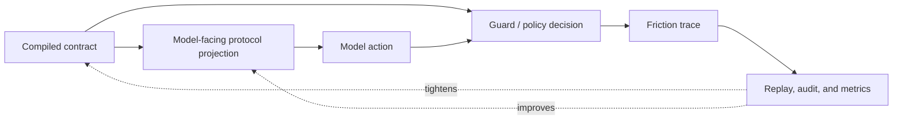

# Harness Optimization Program

**North Star: AI coding agents are becoming common, but teams do not yet trust
their context, decisions, or outputs. Idiom sells the missing substrate: repo
memory, freshness, contracts, audit, and evals.**

Status: first implementation wave verified 2026-05-24; replay-baseline and
later migration waves remain staged

## Purpose

This document defines the follow-up effort for reducing friction between models
and Idiom's contracts. The goal is not to weaken guards. The goal is
model-harness parity: the model should see the same executable contract the
harness enforces, early enough and compactly enough that deterministic guards
rarely need to correct avoidable behavior.

This program connects five existing pillar directions:

- contract-first local autonomy
- capability-oriented tooling
- local-model operations
- auditable planning and handoff
- eval, audit, feedback, and ranker learning

The program is a sequencing layer over existing design docs, especially
[decisioning-north-star.md](decisioning-north-star.md),
[design-turn-phase-contract.md](design-turn-phase-contract.md), and
[design-contract-capability-architecture-overhaul.md](design-contract-capability-architecture-overhaul.md).

## Current Evidence Snapshot

This design is based on repo docs, recent commit history, `context_pack`, and a
local behavior audit run on 2026-05-24.

Verified facts:

- Recent commits are concentrated around plan-execute contract coverage,
  prompt/runtime contract alignment, explicit lane stability, malformed output
  distillation, contract compiler foundations, tool-surface enforcement, and
  recovery behavior.
- `harness_audit` with `purpose:"behavior"` scanned 251 logs and reported 16
  findings.
- The same audit reported high-severity findings for 180 turn-phase contract
  contradictions and 19 implementation-backed sessions missing lifecycle
  closeout.
- Medium behavior findings included truncated search content, same-tool
  repeats, named-gap read walks, rejection retries, zero-hit searches, and
  redirect storms.
- The audit's tool mix was still dominated by broad reads and navigation:
  `read_file` at 508 calls, `code_navigate` at 226 calls, and
  `completion_gate` at 97 calls across the selected logs.
- Existing roadmap docs already say the ideal state is not a clever harness
  constantly correcting the model. The target is parity between the
  model-visible contract and the harness-enforced contract.

Inferences:

- The current friction is mostly an alignment and observability problem, not
  proof that guards are too strict.
- Repeated guard hits should be treated as feedback that a contract was
  duplicated, late, contradictory, hidden, or expressed through an unnatural
  model interface.
- The highest-leverage starting point is to make guard friction measurable by
  contract id, phase, obligation, and first invalid transition.

Evidence gaps:

- The audit gives aggregate findings, not a complete ordered timeline for each
  first invalid transition.
- Some current findings are historical and may already be partially mitigated by
  recent commits. Follow-up work must establish a fresh baseline replay corpus
  before claiming improvement.

## Program Thesis

Optimize the harness by moving from corrective guards to contract parity:

The harness should still enforce real invariants:

- permissions and protected paths
- path scope and source-satisfied classifications
- parser and tool-call protocol correctness
- verification after writes
- final-answer readiness and completion contracts
- loop, budget, and repeated-dead-end fuses

The optimization target is avoidable correction. A guard hit is acceptable when
the model violates a visible invariant. It is a harness gap when the guard
enforces a contract the model could not see, could not express through the
visible tool surface, or saw contradicted by another prompt/tool/recovery
surface.

## Follow-Up Efforts

### 1. Guard Friction Observability

Design doc: [design-guard-friction-observability.md](design-guard-friction-observability.md)

Capture every significant nudge, rejection, stop, retry, recovery card, and
completion-gate failure as a friction event tied to contract id, phase,
obligation id, visible protocol hash, and first invalid action.

Success means `harness_audit` can answer:

- which contract and invariant fired
- whether the model had seen the same contract
- which safe alternatives were visible
- whether retry succeeded
- whether the event was avoidable contract friction or a real invariant block

### 2. Contract Protocol Projection Rollout

Design doc: [design-contract-protocol-projection.md](design-contract-protocol-projection.md)

Compile the active contract into the one model-readable protocol card for the
current phase. Runtime briefs, visible tools, parser settings, recovery cards,
and completion gates should cite the same `protocol_hash`.

Success means prompts explain the active contract without becoming authority,
and changing prompt prose cannot silently change enforcement.

### 3. Turn-Phase Contract Reconciliation

Design doc: [design-turn-phase-contract-reconciliation.md](design-turn-phase-contract-reconciliation.md)

Use the existing turn-phase contract design to remove contradictions across
next-action state, failure feedback, recovery cards, visible tools, parser
mode, and terminal outcomes.

Success means the audit finding for turn-phase contract contradictions moves
down on a named fresh replay corpus, without weakening valid lane behavior.

### 4. Capability-First Model Interface

Design doc: [design-capability-first-model-interface.md](design-capability-first-model-interface.md)

Make the model-visible read/navigation surface capability-shaped. The model
asks for `inspect_symbol`, `find_references`, `verify_edit`, or
`localize_change`; the harness resolves Go, C++, Python, TypeScript, Rust, Java,
graph, shell, or fallback adapters.

Success means fewer broad read/search loops and fewer wrong-tool retries while
language-specific precision remains available and auditable.

### 5. Lifecycle Closeout And Contract Replay

This effort is intentionally not split into a separate design doc yet because
it is already covered by
[design-contract-capability-architecture-overhaul.md](design-contract-capability-architecture-overhaul.md)
and [design-eval-audit-learning-flywheel.md](design-eval-audit-learning-flywheel.md).
It should become an implementation atom only after guard friction events can
identify whether missing closeout is caused by runner lifecycle, TUI process
termination, telemetry gaps, or audit reconstruction.

## Sequencing

1. Establish the friction baseline and replay corpus.
2. Emit friction events and teach `harness_audit` to group them by contract,
   phase, obligation, safe alternatives, retry outcome, and avoidability.
3. Roll out model-facing protocol projection in report-only mode for the pilot
   plan-execute planner lane.
4. Reconcile turn-phase surfaces against that projection.
5. Move one read-only capability family through the capability resolver.
6. Re-run the baseline corpus and compare guard hit rate, retry success,
   repeated reads/searches, contradiction count, and successful closeouts.

Current implementation status:

- Step 1 is partially satisfied by behavior-audit historical grouping; a named
  fresh replay corpus is still required.
- Step 2 is implemented for passive guard-friction events and audit grouping.
- Step 3 is implemented for plan-execute planner model calls in report-only
  mode.
- Step 4 is implemented as report-only reconciliation for covered surfaces.
- Step 5 is implemented for the read-only capability interface and runtime
  capability summaries; write capabilities remain explicit.
- Step 6 remains staged until the fresh replay corpus is selected.

## Metrics

Primary metrics:

- guard hit rate per lane and phase
- avoidable guard hit rate
- first-retry success rate after nudge/rejection
- repeated rejection rate
- turn-phase contradiction count
- post-readiness discovery attempts
- same-tool repeat count
- broad `read_file` / `search_content` share after context packet readiness
- missing lifecycle closeout count

Secondary metrics:

- prompt token budget for contract/protocol text
- tool-call count to first write or terminal answer
- source-satisfied short-circuit rate
- malformed-output recovery success
- replay pass rate on the live-contract suite

## Non-Goals

- Do not relax safety, permission, protected-path, verification, or completion
  gates to improve metrics.
- Do not make prompts the source of authority.
- Do not add project-specific recovery recipes to reusable prompt layers.
- Do not hide write operations behind a generic capability facade.
- Do not treat one model family as the contract. The model-facing interface
  should be generic enough for Qwen, GLM, Minimax, hosted OpenAI-compatible
  models, and external sidecar agents.

## Open Questions

- Which 10 to 20 logs should become the first fresh friction replay corpus?
- Should avoidability be inferred deterministically from event fields first, or
  should the first pass be human-labeled audit packets?
- Which lane should follow plan-execute planner as the second pilot:
  lane-implement, review-repair, or conversation evidence-ready closeout?
- How much protocol text can be safely removed from static prompts once the
  dynamic protocol projection is stable?
