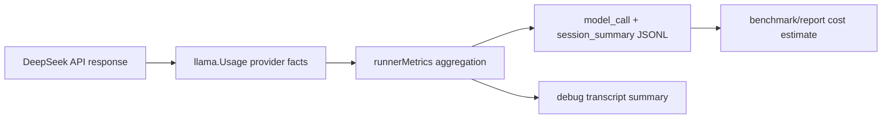

# Hosted Cache and Cost Metrics

Status: draft for review
Date: 2026-06-11
Related effort: `idiom-efficiency-optimization` A5
Context pack: `13e63a3732f08436`

## Problem

The Reasonix-vs-Idiom DeepSeek Flash benchmark can compare raw wall time and
raw token volume, but it cannot yet compare provider-adjusted cost or cache
behavior fairly. Reasonix exposes DeepSeek cache hit/miss fields. Idiom only
emits `prompt_tokens`, `completion_tokens`, and `total_tokens`, so benchmark
reports cannot distinguish:

- raw prompt tokens sent to the provider
- prompt tokens served from DeepSeek context cache
- prompt tokens billed at non-cache input rates
- generated/reasoning tokens
- estimated provider cost under a stated pricing snapshot

The broken invariant is telemetry authority: `llama.Usage` and the JSONL
summary contract do not currently require cache-breakdown facts, so the runtime
cannot distinguish provider-known cached input from unknown cache accounting.
That makes Idiom look opaque in repeated trials and hides whether its prompt
layout is cache-friendly.

## Goals

- Parse provider usage facts from hosted DeepSeek chat responses:
  `prompt_cache_hit_tokens`, `prompt_cache_miss_tokens`, and
  `completion_tokens_details.reasoning_tokens`.
- Preserve whether cache accounting is known separately from the numeric hit
  and miss counts so a legitimate `0/0` provider report is not confused with
  omitted fields.
- Aggregate those facts into runner and TUI session summaries.
- Emit per-call and session-level JSONL fields so benchmark scripts can report
  raw tokens, cache hit/miss tokens, hit rate, and estimated cost.
- Keep pricing policy outside the provider client. The client owns provider
  facts; benchmark/reporting code owns estimates and must label the pricing
  snapshot.
- Preserve existing token fields and readers for backwards compatibility.

## Non-Goals

- Do not hardcode current DeepSeek pricing into `internal/runtime/llama`.
- Do not make cache metrics mandatory for non-DeepSeek backends.
- Do not infer cache hit/miss values when the provider omits them.
- Do not change route selection, prompts, or direct-answer behavior.
- Do not resume the reverted A1/A2 work.

## Source Facts

- DeepSeek chat-completion usage includes `prompt_cache_hit_tokens` and
  `prompt_cache_miss_tokens`; `prompt_tokens` equals their sum when present.
- DeepSeek completion usage may include
  `completion_tokens_details.reasoning_tokens`.
- Idiom currently parses usage at `internal/runtime/llama/client.go` into
  `llama.Usage`.
- Runner aggregation is centralized in
  `internal/runtime/agent/runner_state.go` `runnerMetrics.addUsage`.
- Per-call runner telemetry is emitted from
  `internal/runtime/agent/runner.go` `emitModelCallTraceWithOptions`.
- TUI session aggregation consumes runner `model_call` events in
  `internal/surfaces/tui/app/model_state.go`.
- Debug transcript session summaries are emitted by
  `internal/evidence/transcript/debuglog.go`.

## Design

The design separates three concerns:



### 1. Provider Usage Contract

Extend `llama.Usage` with additive fields:

- `PromptCacheHitTokens`
- `PromptCacheMissTokens`
- `PromptCacheAccountingKnown`
- `ReasoningTokens`

These fields are provider facts. Numeric fields should remain zero when absent;
`PromptCacheAccountingKnown` is true only when the provider response explicitly
contains both cache hit and cache miss accounting fields. Add a small query
method or helper only if needed by aggregators; do not add pricing or policy
logic here.

Parsing changes:

- Hosted chat-completions response struct accepts:
  - `usage.prompt_cache_hit_tokens`
  - `usage.prompt_cache_miss_tokens`
  - `usage.completion_tokens_details.reasoning_tokens`
- The response parser records cache accounting as known based on both JSON
  cache field presences, not on the numeric values. A known `0/0` response is
  different from omitted fields.
- OpenAI Responses parsing remains compatible and zeroes cache fields unless
  that backend later exposes equivalent fields.
- Existing tests for normal usage continue to pass unchanged.
- Runner calls currently use non-streaming `CompleteChatMessage`; streaming
  paths may need a later pass if a provider reports usage only on the final
  stream chunk. This implementation should not claim streaming coverage.

Validation:

- Tests assert DeepSeek cache fields parse.
- Tests assert `completion_tokens_details.reasoning_tokens` parses.
- Tests assert known-zero cache fields set `PromptCacheAccountingKnown=true`.
- Tests assert omitted fields stay zero.
- Tests assert existing `prompt_tokens`, `completion_tokens`, `total_tokens`
  behavior is unchanged.

### 2. Runner Aggregation and Events

Extend `runnerMetrics` and `runnerBudgetLedger` with the same field names:

- `PromptCacheHitTokens`
- `PromptCacheMissTokens`
- `PromptCacheAccountingKnown`
- `ReasoningTokens`

`addUsage` should sum non-negative values and OR the accounting-known boolean.
It must not synthesize hit/miss values from prompt tokens. That keeps "unknown"
distinct from "known zero". If a future benchmark can exceed platform `int`
limits, overflow handling should be added at the aggregation boundary; current
session-scale counters follow existing token-counter behavior.

Per-call `model_call` JSONL should include cache fields only when non-zero or
known-present. Session summaries should include stable numeric fields and a
known/unknown boolean so benchmark parsers can rely on a single shape:

- `prompt_cache_hit_tokens`
- `prompt_cache_miss_tokens`
- `reasoning_tokens`
- `prompt_cache_accounting_known`
- `prompt_cache_hit_rate`

`prompt_cache_hit_rate` should be emitted only when cache accounting is known
and `hit + miss > 0`, rounded consistently with existing percentage helpers or
as a plain float. Derived values such as "cache-adjusted prompt tokens" or
currency estimates belong in benchmark/reporting scripts, not runtime JSONL,
because they are interpretations of provider facts.

### 3. TUI and Transcript Propagation

TUI aggregation currently reconstructs session counters from `model_call`
events. Extend the event payload and `sessionAgg` to carry the same additive
fields.

Debug transcript `ModelCall`, `TurnSummary`/budget ledger payloads, and
`SessionSummary` should log the provider facts when present. This keeps
persisted evidence aligned with stdout JSONL.

Non-runner model calls, background compaction, and any streaming-only call path
are out of scope for this atom unless they already pass through the same
`llama.Usage` -> `model_call` event path. The implementation should document
this limitation in tests or comments if encountered.

### 4. Downstream Readers

Backwards-compatible readers should accept the new fields but not require them:

- `internal/surfaces/cli/lane/post_analyze.go`
- `internal/surfaces/cli/lane/explain.go`
- `internal/evidence/eval/perf.go`
- `internal/evidence/lanehistory/history.go` only if lane history needs the
  new fields for summaries; otherwise leave lane history unchanged in the first
  implementation.

The first implementation should prioritize benchmark artifacts over every UI
surface. Existing readers must not fail on added fields.

### 5. Benchmark Cost Estimation

Add or update benchmark parsing scripts/artifacts to compute an estimated
provider cost from emitted facts:

```text
input_cost =
  prompt_cache_miss_tokens * input_miss_rate +
  prompt_cache_hit_tokens  * input_hit_rate

output_cost =
  completion_tokens * output_rate

estimated_total_cost = input_cost + output_cost
```

The report must include:

- provider
- requested model
- pricing snapshot date
- rates used
- whether cache fields were known
- raw tokens and cache-adjusted cost side by side

If no pricing table is configured, print cache hit/miss and hit rate without a
currency estimate.

## JSON Field Contract

Additive fields:

| Event | Field | Meaning |
| --- | --- | --- |
| `model_call` | `prompt_cache_hit_tokens` | Provider-reported cached prompt tokens for this call |
| `model_call` | `prompt_cache_miss_tokens` | Provider-reported uncached prompt tokens for this call |
| `model_call` | `prompt_cache_accounting_known` | Provider explicitly reported cache hit/miss accounting for this call |
| `model_call` | `reasoning_tokens` | Provider-reported hidden reasoning completion tokens |
| `session_summary` | `prompt_cache_hit_tokens` | Sum across model calls |
| `session_summary` | `prompt_cache_miss_tokens` | Sum across model calls |
| `session_summary` | `prompt_cache_accounting_known` | At least one model call reported cache hit/miss accounting |
| `session_summary` | `reasoning_tokens` | Sum across model calls |
| `session_summary` | `prompt_cache_hit_rate` | `hit / (hit + miss)` when known |

Existing fields remain authoritative for raw token volume.

## Risks and Mitigations

- Provider fields absent on some backends:
  Keep fields zero/omitted at per-call level; session summary can emit zeros.
- Confusing "adjusted tokens" with billable currency:
  Name currency fields only in benchmark/reporting artifacts, not in
  `llama.Usage`.
- Cache fields do not sum to prompt tokens due provider drift:
  Preserve raw facts and emit `prompt_cache_accounting_known=true`; optionally
  add a separate diagnostic later if a future provider violates its own usage
  contract.
- TUI/debug transcript divergence:
  Use the same `model_call` payload fields as the aggregation source and add
  focused tests for both runner and TUI summary output.
- Benchmark overfitting:
  Keep metrics generic provider facts. Do not reference Reasonix in runtime
  code.
- Future provider-specific usage fields:
  Prefer additive optional fields or a typed extension map at the runtime edge;
  do not overload DeepSeek fields for different provider semantics.

## Implementation Atoms

### A5.1 Provider Usage Parsing

Files:

- `internal/runtime/llama/client.go`
- `internal/runtime/llama/client_test.go`
- `internal/runtime/llama/deepseek_test.go`

Tests:

- `go test ./internal/runtime/llama -run 'Usage|DeepSeek|Cache|Reasoning' -count=1`

Acceptance:

- DeepSeek usage parses cache hit/miss and reasoning tokens.
- Known-zero cache accounting is represented as known.
- Omitted fields stay zero.
- Existing usage tests still pass.

### A5.2 Runner Metrics and JSONL

Files:

- `internal/runtime/agent/runner_state.go`
- `internal/runtime/agent/runner.go`
- focused runner tests in `internal/runtime/agent/*test.go`

Tests:

- `go test ./internal/runtime/agent -run 'Usage|BudgetLedger|SessionSummary|ModelCall|Cache' -count=1`

Acceptance:

- `model_call` events include provider cache fields when returned.
- `budget_ledger` and final `session_summary` aggregate cache fields.
- A runner-level test feeds a DeepSeek-shaped response through the full path and
  asserts cache fields survive into final JSONL summary output.
- Existing raw token counters remain unchanged.

### A5.3 TUI, Transcript, and Reader Propagation

Files:

- `internal/surfaces/tui/app/model_state.go`
- `internal/evidence/transcript/debuglog.go`
- `internal/surfaces/cli/lane/post_analyze.go`
- `internal/surfaces/cli/lane/explain.go`
- focused tests beside those packages

Tests:

- `go test ./internal/surfaces/tui/app ./internal/evidence/transcript ./internal/surfaces/cli/lane -run 'SessionSummary|ModelCall|Cache|Explain|PostAnalyze' -count=1`

Acceptance:

- TUI `session_summary` mirrors runner cache fields.
- Debug transcript summaries include the same cache facts.
- Lane explain/post-analyze parses new fields without breaking old summaries.

### A5.4 Benchmark Report Adapter

Files:

- benchmark artifact scripts/docs under `docs/evidence/idiom-efficiency-optimization/`
- no runtime package changes unless an existing local benchmark helper is
  already used

Tests:

- Use captured JSONL fixtures or rerun the DeepSeek Flash benchmark after
  A5.1-A5.3 pass.

Acceptance:

- Benchmark report prints raw tokens, cache hit/miss, hit rate, and estimated
  cost when a pricing snapshot is supplied.
- Report labels pricing date and model.
- Report clearly says when provider cache fields are unknown.
- Fixture coverage includes one legacy summary without cache fields and one new
  summary with `prompt_cache_accounting_known=true`.

## Verification Plan

1. Focused package tests per atom.
2. Combined focused run:

   ```sh
   go test ./internal/runtime/llama ./internal/runtime/agent ./internal/surfaces/tui/app ./internal/evidence/transcript ./internal/surfaces/cli/lane -run 'Usage|Cache|Reasoning|SessionSummary|ModelCall|BudgetLedger|Explain|PostAnalyze' -count=1
   ```

3. `go build ./cmd/idiom`
4. Final DeepSeek Flash benchmark rerun with `reasonix run --model deepseek-flash`
   and rebuilt local Idiom binary.

## Review Questions

- Confirm that provider facts and pricing estimates are separated cleanly enough.
- Confirm that `prompt_cache_accounting_known` resolves known-zero versus
  unknown cache accounting.
- Confirm that downstream propagation scope is sufficient for the benchmark
  rerun without broad UI or lane-history expansion.
