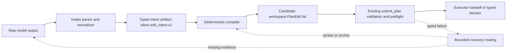

# Malformed Output Distillation

Status: implemented deterministic lifecycle, 2026-05-24

This is a cross-pillar design for
[idiom-design-roadmap.md](idiom-design-roadmap.md). It connects
contract-first autonomy, auditable planning and handoff, local-model
operations, and the eval/audit learning loop.

Implemented status:

- The deterministic handoff slice is implemented in `internal/planintent`.
  It defines `idiom.edit_intent.v1`, validation, typed error codes, and a
  deterministic compiler MVP for `replace_exact_text`,
  `insert_after_line_anchor`, and `add_new_file`.
- Deterministic malformed-output regression fixtures cover safe stringified
  `submit_plan.edits`, exact fenced JSON, nested read-only arguments,
  unsafe missing-tool write/shell/task shapes, wrapper prose, malformed
  evidence refs, missing source evidence, stale/missing anchors, and
  blocker-only artifacts.
- The plan-execute runner accepts exact JSON or exact fenced JSON
  `idiom.edit_intent.v1` artifacts only as non-executable handoff input. It
  validates scope against the active runtime brief, compiles candidate
  `workspace.PlanEdit` values, emits bounded stage events, then routes the
  candidate through the existing `submit_plan` validation/preflight path.
- The `artifact_distiller` runtime family exists as a separate
  conversation-only, no-tool, no-`submit_plan`, no-write-authority contract.
  It is a role/config boundary for future model-based distillation, not an
  executor.
- Backend structured-output capability reporting is explicit and conservative:
  current backends may advertise native tools, JSON-object mode, and verified
  thinking controls, but strict JSON Schema, grammar, and request-timeout
  telemetry remain false until a backend adapter actually enforces them.
- `harness_audit` summarizes malformed-output stage counts from behavior logs
  without exposing raw transcripts, prompts, or file bodies.

The controlling rule is unchanged:

- The model owns strategy.
- The harness owns contracts.

For malformed model output, that means the model may express intent in an
imperfect shape, but the harness must never execute that output until it has
passed typed parsing, source validation, authority checks, and preflight.

## Decision

Idiom should treat malformed structured output as an intake and handoff problem,
not as a reason to weaken executable gates.

The durable policy is:

- **Permissive intake**: accept that local models sometimes emit repairable
  transport shapes, JSON mistakes, wrapper prose, wrong field encodings, or
  semantic edit intent that is not yet an executable patch.
- **Strict acceptance**: executable artifacts such as `submit_plan`, edit
  requests, shell commands, final readiness claims, and workflow state
  transitions remain host-validated and fail closed.
- **No silent authority transfer**: a normalizer, classifier, or repair model
  may propose a typed artifact, but it cannot authorize a write, widen scope,
  satisfy source evidence, or override a gate.
- **Separate strategy from serialization**: strategic planners should not be
  forced to act as perfect JSON and patch serializers when the task is
  semantic, multi-file, or open-ended. The harness should provide a typed bridge
  from strategy to executable handoff.

Read-only tool salvage follows the same rule. If the parser recovers a visible
or reasoning-text `ToolRequest` for `discovery_query`, `context_*`,
`harness_audit`, language navigation, or raw read/search, that request is still
only intake. It is not dispatchable until the active phase validator accepts the
tool class, tool-specific enum values such as `discovery_query.purpose`, target
shape, post-readiness action policy, and recovery budget. Non-mutating tools can
still consume budget, hide terminal readiness, and prevent a final answer, so
they must not get a softer acceptance path than write-shaped artifacts.

This design intentionally does not loosen `submit_plan` validation. It moves
the brittle part earlier and makes it explicit: raw model output can be
distilled into a smaller, typed intermediate artifact, then compiled and
validated before execution.

## Problem

Recent plan-execute failures show a recurring shape:

- The model gathers enough repository evidence to understand the task.
- The planner reaches a terminal or near-terminal planning state.
- The run then fails in `submit_plan` serialization or preflight:
  malformed JSON, stringified edits, stale anchors, duplicate-line edits,
  `old_text` misses, syntactically invalid replacement bodies, or repeated
  recovery loops.
- The harness correctly rejects the unsafe artifact, but recovery often asks
  the same actor to emit a better executable artifact through the same brittle
  channel.

This is not simply "the model is weak." It is also a contract mismatch. A
planner is good at strategy, evidence synthesis, and naming intended changes.
An executable patch serializer needs precise current-source anchors, schema
discipline, source syntax preservation, and deterministic path coverage.

Treating those as one job creates avoidable failure pressure, especially for
local models.

## Existing Idiom Capabilities

Idiom already has partial malformed-output handling:

- `internal/agent/tool_request_normalizer.go` normalizes native tool calls,
  textual JSON, fenced JSON, key/value requests, function-call-shaped requests,
  nested `arguments`, missing read-tool aliases, and stringified
  `submit_plan.edits`.
- Parser failures are classified into machine-readable classes such as
  `submit_plan_edits_string`, `malformed_json`, `schema_type_mismatch`,
  `missing_tool`, and `nested_tool_mismatch`.
- `internal/llama/client.go` exposes `ResponseFormatJSON`, which requests a
  single JSON object for textual terminal turns when native tool transport is
  not reliable.
- Plan-execute runtime policy logs parser contracts, response format, tool
  transport, temperature, token budget, thinking policy, and exposed tools.
- `submit_plan` validation and executor preflight enforce required paths,
  edit shape, current-source anchors, syntax sanity, and protected boundaries
  before execution.

These are useful, but they sit close to the final tool-call boundary. They
repair common transport shapes. They do not yet distill malformed strategic
intent into a safer intermediate handoff artifact.

## External Basis

The research and production direction favor preventing malformed structured
outputs where possible, then validating strictly at the boundary.

- PICARD constrains autoregressive decoding through incremental parsing,
  rejecting tokens that cannot produce a valid parse for formal outputs:
  <https://arxiv.org/abs/2109.05093>
- Efficient Guided Generation reformulates constrained generation as finite
  state machine transitions over regular expressions and context-free
  grammars, guaranteeing output structure with low overhead:
  <https://arxiv.org/abs/2307.09702>
- XGrammar treats structured generation for tool calls, code, and agent
  commands as a runtime grammar problem and optimizes context-free grammar
  execution for LLM serving:
  <https://arxiv.org/abs/2411.15100>
- JSONSchemaBench describes constrained decoding as the dominant technology for
  enforcing structured output and evaluates Guidance, Outlines, llama.cpp,
  XGrammar, OpenAI, and Gemini over real JSON schemas:
  <https://arxiv.org/abs/2501.10868>
- OpenAI's Structured Outputs documentation distinguishes JSON mode from
  schema adherence. JSON mode only guarantees valid JSON in normal cases;
  schema-constrained structured outputs are the stricter contract, and
  validation plus retries remain necessary when strict schemas are unavailable:
  <https://developers.openai.com/api/docs/guides/structured-outputs>

The design implication for Idiom is direct:

1. Use constrained decoding or schema-constrained native tools where the active
   backend supports them.
2. When the backend only offers JSON mode or textual tool calls, treat JSON as a
   transport aid, not an authority boundary.
3. Keep deterministic validation after every model or normalizer step.

## Non-Goals

This design does not:

- weaken `submit_plan`, edit, or completion gates
- accept "close enough" patches
- infer lane activation from heuristics
- let the route classifier select mutation authority
- make a repair model a trusted executor
- add project-specific malformed-output recipes to generic prompts
- hide malformed output by silently changing the user's requested lane or task

## Target Architecture

The target architecture has five stages.



The lifecycle must keep authority and executability explicit:

| Stage | Artifact | Executable | Authority owner |
| --- | --- | --- | --- |
| Raw output | Model text or native tool payload | No | Model expression only |
| Normalized request | Parsed/normalized `ToolRequest` or parse failure | No by itself; it may proceed only through the normal tool gates | Intake parser plus active phase contract |
| Intent artifact | `idiom.edit_intent.v1` | No | Planner or distiller proposes; harness validates schema, scope, and provenance |
| Compiler candidate | Candidate `workspace.PlanEdit` list or typed compiler blocker | No | Compiler resolves current source and emits a candidate only |
| Validated plan artifact | Accepted current `idiom.plan.*` artifact from `submit_plan` validation/preflight | Yes, for executor handoff | Harness gates and workspace validation |
| Executor result | Applied edits, verification state, or blocker | Yes | Executor under the active run contract |

No stage may treat a previous stage as executable by convention. A candidate
edit list is still untrusted until the same validation and preflight path used
by normal `submit_plan` accepts it.

### 1. Intake Parser And Normalizer

This stage handles syntax and transport only.

Allowed responsibilities:

- unwrap exact fenced JSON
- decode native tool arguments
- repair known safe wrappers such as nested `arguments`
- convert stringified `edits` into JSON arrays when the decoded value itself is
  valid JSON and matches the expected shape
- classify parse failures into stable error classes
- emit telemetry with raw-output size, parse class, transport mode, repair
  type, parser contract, response format, and model runtime state

Forbidden responsibilities:

- invent a tool
- infer an edit from prose
- widen required or allowed paths
- convert unsafe edit-shaped missing-tool payloads into write actions
- infer mutation-capable tools such as shell, task, edit, declaration moves, or
  plan submission from missing-tool payload shape unless the active typed phase
  contract explicitly authorizes missing-tool inference for that exact tool;
  merely exposing the tool is not enough
- claim source evidence
- suppress a failed gate

### 2. Typed Intent Artifact

This is the missing bridge. A typed intent artifact captures the model's
strategic editing intent without requiring perfect executable anchors.

Proposed initial schema family:

```json
{
  "schema_version": "idiom.edit_intent.v1",
  "source": "planner",
  "task_summary": "short task-local summary",
  "scope": {
    "required_edit_paths": [],
    "candidate_edit_paths": [],
    "evidence_refs": []
  },
  "intents": [
    {
      "path": "internal/example/foo.go",
      "operation": "replace_symbol_body",
      "symbol": "EvaluateCoverageGate",
      "desired_behavior": "reuse existing authority classification",
      "constraints": ["preserve current public API"],
      "candidate_code_ref": "",
      "evidence_refs": []
    }
  ],
  "blockers": []
}
```

The exact operation vocabulary should start small:

- `replace_symbol_body`
- `insert_after_symbol`
- `insert_after_line_anchor`
- `replace_exact_text`
- `add_new_file`
- `add_test_case`
- `delete_exact_text`

The artifact must be easy for a local model to produce and easy for the harness
to validate. It is not executable. It is an auditable handoff from planner
strategy to compiler work.

Scope fields in `edit_intent.v1` are not authority sources. They are a
projection of the active typed contract:

- `required_edit_paths` must be copied from the active run contract, not
  invented by the planner, distiller, or compiler.
- `candidate_edit_paths` must either come from the active candidate scope or
  carry evidence provenance that the harness can validate before use.
- `evidence_refs` identify already-gathered evidence; they do not satisfy
  source-body obligations by themselves.
- `candidate_code_ref` may point to an ephemeral bounded artifact or in-memory
  candidate body. Raw code bodies must not be logged in telemetry, recovery
  packets, or audit artifacts unless a separate artifact policy explicitly
  allows it.

### 3. Optional Artifact Distiller

When deterministic parsing fails but the output contains useful intent, Idiom
may run a separate artifact distiller. The runtime role and no-tool contract
are implemented; automatic model-based distiller invocation remains disabled
until a caller explicitly wires the role into a recovery controller.

The distiller is not the lane classifier. It is a low-temperature, narrow-context
transducer with no write authority.

Inputs:

- raw malformed output
- parser failure class and error message
- active phase contract
- allowed schema
- current required/candidate path lists
- bounded evidence refs, not broad source dumps by default

Outputs:

- a valid `edit_intent.v1`
- a typed `unrecoverable` classification
- a typed `needs_source_evidence` classification
- a typed `ambiguous_intent` classification

The distiller must not output `submit_plan` directly. It should output intent,
because intent is easier to validate and less likely to smuggle executable
authority.

If the existing route-classifier model is reused as the physical model, it must
run under a separate role name such as `artifact_distiller`. The logical role
matters: lane classification, artifact repair, and mutation authority are
different contracts.

### 4. Patch Or Action Compiler

The compiler turns validated intent into candidate plan edits or artifacts. This
stage should be deterministic in the MVP. Model-assisted code-body synthesis is
a later, explicitly named actor boundary, not part of the first compiler slice.

Responsibilities:

- resolve paths against typed required and candidate scope
- load current source for each intended edit
- resolve symbols, line anchors, or exact text through language-aware tools
- generate the smallest candidate `PlanEdit` shape
- preserve source truth by using current file contents, not stale model memory
- classify failures as `missing_source_evidence`, `ambiguous_anchor`,
  `non_unique_anchor`, `syntax_preflight_failed`, `scope_rejected`, or
  `compiler_bug`

For Go and other supported languages, the compiler should prefer
language-aware symbol anchors over broad string manipulation when available.
For unsupported languages, it can fall back to exact text, bounded line ranges,
or typed blockers.

The compiler must not synthesize required coverage, promote candidate paths to
required paths, or claim that a candidate edit is executable. It outputs a
candidate artifact that must still pass the strict `submit_plan` validation and
preflight path.

### 5. Strict Validation And Execution

The existing strict boundary remains:

- schema validation
- required path coverage
- allowed scope checks
- protected path rejection
- source-body obligation checks
- exact anchor checks
- source syntax sanity
- sequential edit application validation
- verification and completion gates

Only this stage may accept a `submit_plan` into a validated `PlanArtifact` or
dispatch an executor. A normalized or distilled artifact that fails validation
is evidence, not success.

## Failure Routing

Malformed output recovery should route by failure class, not by another generic
"try again carefully" prompt.

| Failure class | Owner | Next action |
| --- | --- | --- |
| JSON syntax or wrapper error | Intake normalizer | Repair if deterministic and safe; otherwise distiller or typed parse blocker. |
| Schema type mismatch | Intake normalizer or distiller | Convert only if the conversion is typed and lossless; otherwise produce schema blocker. |
| Semantic intent present but patch invalid | Distiller then compiler | Extract `edit_intent.v1`, compile against current source, then validate. |
| `old_text` miss | Compiler | Refresh current anchor from source; compile a new edit or return stale/ambiguous anchor. |
| Syntax preflight failure | Compiler | Rebuild replacement body from current source plus intent; if still failing, return typed blocker. |
| Missing source-body evidence | Planner | Return to planner for one named evidence gap, not to serializer recovery. |
| Required path uncovered | Planner or compiler | Planner fixes missing intent; compiler cannot invent required coverage. |
| Scope rejected | Harness gate | Fail closed unless a typed contract update comes from the caller. |
| Repeated same-class failure | Recovery controller | Stop and write a failure record or decomposition packet. |

This table keeps strategy with the model and contracts with the harness. The
harness decides which actor owns the failed invariant; it does not choose the
implementation strategy.

## Runtime Configuration

Artifact roles need distinct runtime defaults:

| Role | Temperature | Thinking | Output contract |
| --- | --- | --- | --- |
| Lane classifier | low | off or minimal | route classification only |
| Strategic planner | moderate when exploring; low when terminal | allowed when synthesis-heavy | `edit_intent`, source-satisfied, or blocker |
| Artifact distiller | 0 | off | one typed artifact or typed blocker |
| Patch compiler | 0, deterministic MVP | off | candidate artifact or typed blocker |
| Executor | low | task-dependent | actual writes through gates |
| Reviewer | low to moderate | allowed when reasoning-heavy | findings, repair, pass, or blocker |

Every transition that changes these values must log model alias, backend, tool
transport, parser contract, response format, tool choice, exposed tools,
temperature, `top_p`, `top_k`, `min_p`, penalties, thinking policy, max tokens,
and timeout when configured or known.

## Backends And Constrained Decoding

Preferred order:

1. Native tool calling or strict schema-constrained decoding when the backend
   can enforce the schema.
2. Backend grammar support, such as JSON Schema, GBNF, or a context-free
   grammar, when available through llama.cpp or another local serving layer.
3. JSON mode for a single object, followed by local schema validation and
   bounded retry.
4. Plain textual tool parsing only when the lane contract is tolerant of that
   mode and the normalizer can classify failures.

JSON mode should not be described as "strict." It improves syntax reliability
but does not prove schema adherence or source correctness.

Current Idiom support is conservative and explicit. The local client exposes
JSON-object response format, not a general strict JSON Schema, GBNF, or
grammar-constrained request surface. `model_call` telemetry reports:

- `native_tools`
- `json_object`
- `strict_json_schema`
- `grammar`
- `thinking_controls`
- `request_timeout_telemetry`

Strict schema, grammar, and timeout telemetry are logged as unavailable until a
backend adapter actually enforces them. Capabilities must be detected,
configured, and logged. They must not be assumed from model family alone.

## Telemetry And Audit

Malformed-output handling should be auditable without reading raw transcripts.

Add or preserve bounded events for:

- `malformed_output_detected`
- `tool_request_normalizer`
- `artifact_distillation_started`
- `artifact_distillation_result`
- `edit_intent_validated`
- `patch_compile_started`
- `patch_compile_result`
- `executable_artifact_validated`
- `malformed_output_recovery_exhausted`

Current deterministic implementation emits and audits:

- `tool_request_normalizer` for syntax normalization, parser failure class, and
  transport/outcome.
- `edit_intent_validated` for accepted or rejected `idiom.edit_intent.v1`
  handoff artifacts.
- `patch_compile_started` before deterministic compilation from validated
  intent.
- `patch_compile_result` for accepted candidate edit lists or typed compiler
  blockers.
- `model_call` fields for backend structured-output capabilities:
  `backend_capability_native_tools`, `backend_capability_json_object`,
  `backend_capability_strict_json_schema`, `backend_capability_grammar`,
  `backend_capability_thinking_controls`, and
  `backend_capability_request_timeout_telemetry`.
- `harness_audit` `log_behavior.malformed_output` count summaries for tracked
  parse, distill, compile, validate, and recovery-exhaustion stage roles.

`artifact_distillation_*`, `malformed_output_detected`,
`executable_artifact_validated`, and `malformed_output_recovery_exhausted`
remain target events for later slices that add a model distiller, explicit
malformed-output recovery controller, and plan-artifact validation telemetry.

Events should include:

- session and phase IDs
- model role and alias
- backend and transport mode
- parser contract and response format
- failure class
- repair strategy
- schema version
- path counts and normalized path lists
- evidence ref counts
- validation result
- privacy-safe artifact IDs

Events should not include:

- raw prompts
- full model transcripts
- file bodies
- secrets
- customer-identifying strings
- unbounded malformed output text

## Eval And Regression Strategy

The first test layer is deterministic and frozen:

- malformed textual tool-call fixtures
- stringified `submit_plan.edits`
- wrapper prose around otherwise valid JSON
- unsafe missing-tool edit payloads that must stay rejected
- semantic intent that compiles to a valid plan and still routes through
  `submit_plan`
- semantic intent that blocks because source evidence is missing
- stale, missing, and duplicate anchor fixtures that must route to typed
  compiler blockers
- typed blocker-only artifacts that must not become empty plans

The second layer should replay real failure logs after redaction:

- repeated `submit_plan` rejection loops
- syntax preflight failure loops
- required path uncovered loops
- terminal-readiness recovery failures

The live suite should prove the end-to-end contract only after deterministic
fixtures pass. Live tests should assert:

- no accidental lane activation
- no scope widening
- no direct execution of distilled artifacts
- parser/runtime configuration logged at every transition
- failure records written after repeated same-class recovery failures

## Implementation Slices

### Slice 1: Distillation Design And Fixtures

- Done. Frozen malformed-output fixtures cover safe normalization and unsafe
  boundary cases.
- Done. Existing normalizer tests cover `submit_plan` parser repair boundaries.
- Done. `harness_audit` aggregates parse, distill, compile, validate, and
  recovery-exhaustion stage roles when logs contain those events.
- Done. Mutation-capable missing-tool inference fails closed unless a future
  typed phase explicitly authorizes it for the exact tool.

### Slice 2: `edit_intent.v1`

- Done. The schema and Go types live in a pure handoff package, not in
  `internal/agent` and not as the primary domain model of `internal/workspace`.
  `internal/planintent` is usable by agent
  orchestration, CLI fixtures, compiler code, and tests without importing model
  runtime concerns.
- Done. Deterministic validation covers scope, operation enum, evidence refs, and
  blockers.
- Done. Required paths are validated as a copy of the active contract and
  candidate paths have accepted provenance.

### Slice 3: Deterministic Compiler MVP

- Done. `replace_exact_text`, `insert_after_line_anchor`, and `add_new_file`
  compile into `PlanEdit`.
- Done. Candidate edits are validated with current `submit_plan` preflight.
- Done. Compiler failures are typed.
- Done. Code-body synthesis stays out of the compiler MVP. If later needed, add a
  separate actor and contract for candidate body synthesis.

### Slice 4: Artifact Distiller Role

- Done. A distinct `artifact_distiller` runtime family and capability profile
  define the no-tool/no-write contract.
- Not auto-invoked. The role is available for a future recovery controller, but
  this implementation keeps the first lifecycle deterministic.
- Done at the bridge boundary: every `edit_intent.v1` artifact is validated
  before compilation.

### Slice 5: Constrained Decoding

- Done. Backend structured-output capability reporting is explicit and logged.
- No current backend claims strict schema or grammar enforcement, so no caller
  prefers those modes yet.
- Done. JSON-object mode remains a transport aid followed by local validation.

### Slice 6: Plan-Execute Integration

- Done. Plan-execute terminal readiness accepts either a valid `submit_plan`,
  source-satisfied closeout, blocker, or valid `edit_intent.v1` as
  non-executable input routed to the compiler.
- Done. The executor still receives only a valid `PlanArtifact`; compiled
  intent first becomes candidate `PlanEdit` values and then goes through the
  existing `submit_plan` path.
- Done for deterministic tests and telemetry naming. Live recovery-controller
  routing remains a future use of the new stage events.

### Slice 7: Documentation And Architecture Diagrams

- Done. Roadmap and operator docs describe plan-execute, auditable handoff,
  local-model operations, recovery, evals, and tool-call transport so they
  reflect the final implemented lifecycle.
- Done. Architecture diagrams show planner-to-executor handoff,
  `submit_plan` flow, recovery routing, runtime roles, or malformed-output
  handling.
- Done. Operator-facing docs cover the artifact name, failure states,
  telemetry events, and recovery behavior.
- Done. Examples are schema-accurate with the implemented `edit_intent.v1`,
  compiler candidate, and validated `PlanArtifact` shapes.
- Done. Documentation drift is treated as an implementation blocker: the
  feature is not complete until docs, diagrams, tests, telemetry names, and
  code terminology agree.

## North-Star Fit

This design strengthens the model/harness boundary:

- The model keeps strategy and semantic intent.
- The harness owns parsing, contracts, source truth, validation, telemetry, and
  execution authority.
- The repair path is generic and evidence-based rather than scenario-specific.
- Local model limitations are handled by smaller typed artifacts, not by
  lowering safety.
- Evals can prove the absence of malformed-output regressions without relying
  on a live model for every case.

The main risk is building an overcomplicated mini-agent around every malformed
artifact. The guardrail is to keep the first implementation deterministic:
normalizer, schema, intent validation, compiler, and fixtures before adding a
model-based distiller.

## Remaining Boundaries

- No current backend adapter claims strict JSON Schema or grammar-constrained
  enforcement. Adding one requires a capability-backed transport change and
  tests that prove schema adherence.
- The v1 operation vocabulary is intentionally larger than the deterministic
  compiler MVP. Unsupported operations validate as vocabulary but compile to a
  typed `unsupported_operation` blocker until the compiler owns them.
- Any future model-based code-body synthesis actor must be separate from the
  deterministic compiler and still produce candidate artifacts only.
- Recovery packets should continue to represent distilled intent through
  bounded schema fields, path counts, evidence refs, and artifact IDs, not raw
  transcript or file-body content.
