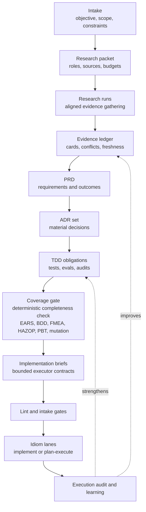
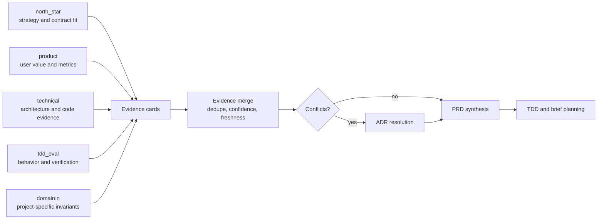
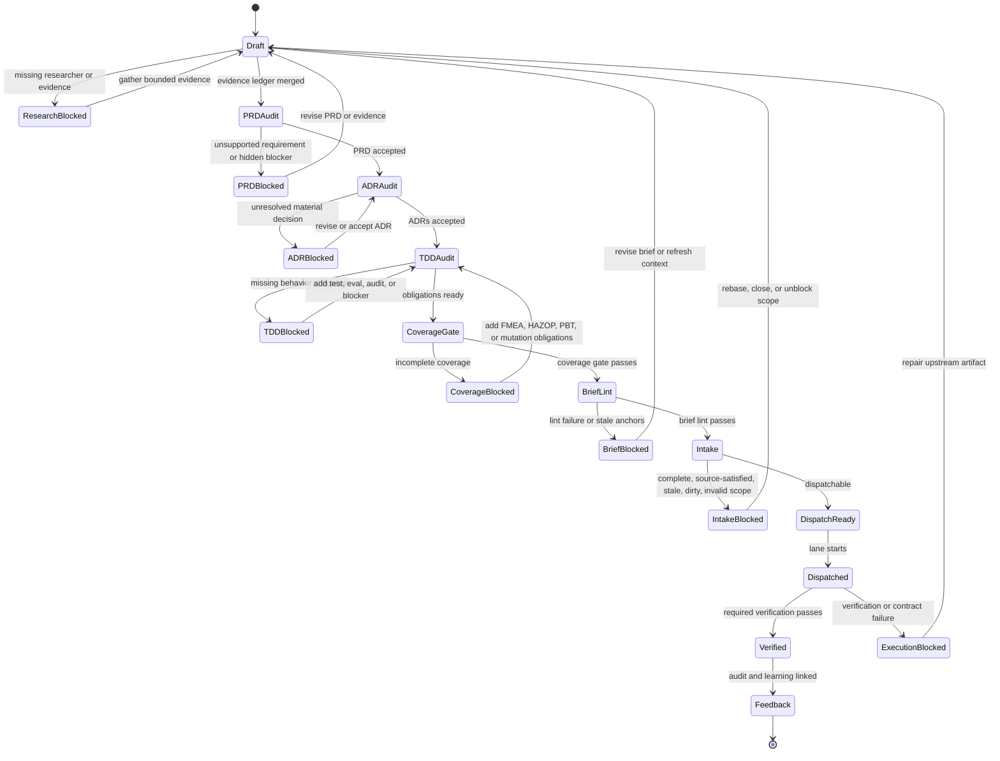

# PRD To ADR To Brief Research Workflow

**North Star: AI coding agents are becoming common, but teams do not yet trust
their context, decisions, or outputs. Idiom sells the missing substrate: repo
memory, freshness, contracts, audit, and evals.**

Status: cross-pillar design proposal, drafted 2026-05-15

This document designs the upstream product and architecture workflow that turns
research-backed product intent into dispatchable Idiom implementation briefs:

```text
research evidence -> PRD -> ADR set -> TDD obligations -> Idiom brief
```

The goal is not to make the harness decide product strategy. The goal is to let
one or more aligned researchers gather and compress evidence, then let Idiom
enforce the traceability, freshness, TDD, and dispatch contracts needed before a
local model starts implementation.

The controlling policy remains:

- The model owns strategy.
- The harness owns contracts.

In this workflow, researchers and planner models may argue for a requirement,
decision, decomposition, or implementation shape. Idiom owns the artifact
schemas, source links, researcher role boundaries, evidence freshness, conflict
tracking, TDD readiness, brief linting, intake classification, and audit trail.

## Executive Summary

Idiom already has the lower half of the workflow:

- `context_pack`, `context_query`, `context_zoom`, `context_impact`, and
  `context_trace_pack` can provide local codebase evidence with freshness and
  provenance.
- `idiom architect packet --schema planning_v2` can package evidence into a
  planning packet with contracts, candidate scope, freshness, language
  capabilities, handoff, and context budget.
- `idiom architect plan`, `critique`, `brief`, and `plan-audit` can render and
  audit planning artifacts.
- `idiom brief lint` checks dispatch brief structure, scope, anchors, test
  commands, prompt-magic triggers, and stale or vague implementation shapes.
- `idiom atom intake` classifies non-dispatchable work before a model spends
  tokens.
- `plan-execute` and `implement` consume briefs as Idiom's execution entrypoint.
- `harness_audit`, telemetry, replay evals, SWE evals, and localization
  benchmarks already create the behavioral feedback surface needed to improve
  future packets and briefs.

The missing layer is a first-class product-decision pipeline above those tools.
That pipeline should:

1. Run one or more bounded researchers with explicit alignments.
2. Store research as evidence cards, not prompt prose.
3. Synthesize a PRD with traceable requirements and measurable outcomes.
4. Produce ADRs for material technical/product choices.
5. Convert desired behavior into test obligations before implementation.
6. Generate one or more dispatchable briefs that satisfy existing Idiom lint and
   intake gates.
7. Feed execution and audit outcomes back into future research, PRDs, ADRs, and
   ranking.

Colony/Faultline is the useful reference project because it already shows the
shape Idiom should generalize: spec-first orchestration, project-specific
research topics, guard-driven discovery discipline, Qwen brief preloads, atom
intake before dispatch, exact brief allowlists, and explicit acceptance/review
boundaries. Idiom should adopt the generic engineering pattern, not Colony's
game-specific vocabulary.

## Problem

Implementation briefs are currently the practical entrypoint for Idiom lanes,
but high-quality briefs often require upstream work that is not represented as a
durable product workflow:

- market, customer, domain, and technical evidence may live in ad hoc notes
- local repository behavior may be rediscovered during implementation instead
  of analyzed once and cited
- architectural decisions may be implied inside a brief instead of captured as
  ADRs
- tests may be selected after implementation rather than used to shape it
- researcher disagreements may be collapsed into a confident summary
- product intent may not be traceable to code, logs, tests, or user-visible
  behavior
- stale or already-satisfied artifacts may reach an implementation lane
- project-specific workflow scripts may encode reusable harness behavior

The result is a weak handoff. A local model receives an implementation brief,
but the brief may be doing too much hidden work: product framing, architecture
selection, repository localization, test design, risk analysis, and exact edit
instruction. That overload is especially costly for local/smaller models.

The target workflow should make upstream decisions explicit enough that the
brief is a bounded executor contract, not a miniature product process.

## Design Goals

1. Support multiple researchers with explicit alignments such as north-star,
   product, technical, UX, security, ops, and domain-specific roles.
2. Keep researcher output evidence-shaped: findings, sources, local handles,
   confidence, uncertainty, conflicts, and recommended follow-up probes.
3. Produce PRDs whose requirements are traceable to evidence or clearly labeled
   inference.
4. Produce ADRs for decisions that materially affect architecture, contracts,
   data ownership, tests, operations, or user experience.
5. Make TDD proactive: desired behavior becomes test obligations before a brief
   is dispatchable.
6. Use Idiom's local contextual capabilities as the default evidence source for
   repository facts and behavior.
7. Preserve existing brief lint and atom intake as the hard dispatch gates.
8. Keep project-specific research profiles and domain rules outside Idiom core
   while keeping generic schemas, gates, and telemetry inside Idiom.
9. Make the workflow usable manually with today's commands before adding new
   orchestration commands.
10. Feed execution outcomes, harness behavior, localization quality, and test
   results back into future planning and ranker learning.

## Non-Goals

- Do not build a generic autonomous product manager that approves its own PRDs.
- Do not require web research for repository-local work. External research is
  optional and should be profile-controlled.
- Do not let a researcher output authorize writes. Only briefs, lane contracts,
  and runtime gates authorize execution.
- Do not encode workflow behavior through magic phrases in PRDs, ADRs, or
  briefs.
- Do not replace `architect packet`, `brief lint`, `atom intake`, or
  `plan-execute`; this workflow composes them.
- Do not make the harness choose the implementation strategy when a model can
  safely decide from packet-backed evidence.
- Do not generalize Colony-specific game design rules into Idiom core.

## Evidence Grounding

Verified Idiom facts on 2026-05-15:

- `README.md` describes `idiom lane` as the recommended entrypoint and confirms
  that `implement` and `plan-execute` lanes preload compact `context_pack`
  evidence unless `--no-context-pack` is used.
- `docs/architect-packets.md` defines the current packet flow:
  `context impact`, `context pack`, `architect packet`, `lint`, `budget`,
  `plan`, `artifact`, and `plan-audit`.
- `internal/architect/packet.go` defines packet schemas and profile rules,
  collectors, gates, roles, file refs, tests, anchors, evidence, risks, and
  unknowns.
- `internal/architect/planning_v2.go` enriches planning packets with contracts,
  repository view, candidate scope, freshness, language capabilities, handoff,
  and context budget.
- `internal/architect/prompts.go` can render plan, critique, and brief prompts
  from a packet and prior plan.
- `internal/architect/plan_audit.go` checks plans and plan artifacts for packet
  identity mismatches, scope mismatches, missing files, unsupported handles,
  validation gaps, stale context, unresolved questions, approval handoff issues,
  and placeholders.
- `cmd/idiom/brief-preflight.py` enforces brief structure, no prompt-magic
  triggers, test-anchor preload, verified current state, exact-anchor
  specificity, file existence, and dispatch-safe brief wording.
- `internal/eval/localization_corpus.go` and
  `internal/eval/localization_benchmark.go` define the current structure for
  measuring context localization quality, broad-read counts, zero-hit searches,
  candidate path waste, and competitive baselines.

Verified Colony/Faultline reference patterns on 2026-05-15:

- `Colony/AGENTS.md` makes Idiom/Qwen implementation lanes primary, requires
  `context_pack` before plans/briefs, uses `idiom atom intake` before dispatch,
  treats non-dispatchable states as workflow outcomes, and requires exact
  files-to-modify tables and anchors.
- `Colony/.codex/README.md` describes a spec-first orchestrated workflow:
  research, verify one load-bearing finding, update campaign, write atom spec,
  implement, accept, and review.
- `Colony/scripts/research_topics.py` rotates domain/product research topics
  with explicit queries and a hot-take focus.
- `Colony/scripts/qwen_brief_preload.sh` emits brief-ready preload sections for
  recurring atom kinds, reducing executor discovery overhead by packaging
  canonical patterns, traps, files, and verification commands.

The inference from this evidence is that Idiom's generic opportunity is not a
new chat mode. It is a durable upstream artifact pipeline that turns aligned
research into traceable PRDs, ADRs, TDD obligations, and dispatch-ready briefs.

## Core Vocabulary

- **Researcher**: a bounded model pass, human pass, script, or external agent
  configured with an alignment, scope, allowed evidence sources, and output
  contract.
- **Alignment**: the lens a researcher applies, such as north-star, product,
  technical, security, operations, or a project-defined domain.
- **Evidence card**: a structured finding with source handles, confidence,
  freshness, uncertainty, and conflicts.
- **PRD**: a product requirements document containing the problem, users,
  desired outcomes, requirements, non-goals, metrics, risks, and open questions.
- **ADR**: an architecture decision record for one material decision, including
  alternatives, evidence, chosen decision, consequences, and status.
- **TDD obligation**: a required characterization, regression, acceptance,
  source-sanity, harness-audit, or manual verification check tied to a behavior.
- **Brief**: the executable Idiom entrypoint consumed by `implement` or
  `plan-execute`.
- **Traceability matrix**: the graph linking evidence cards to PRD requirements,
  ADR decisions, TDD obligations, brief sections, execution results, and later
  audit/eval findings.

## Target Lifecycle

```text
0. Intake
1. Research packet
2. Research runs
3. Evidence merge
4. PRD draft
5. PRD audit
6. ADR candidates
7. ADR acceptance
8. TDD obligation plan (with FMEA, HAZOP, PBT, decision tables)
8a. Coverage gate (deterministic completeness check)
9. Brief generation
10. Brief lint and intake
11. Lane dispatch
12. Execution audit and learning (feeds back into step 8)
```

This is the artifact flow at the level the harness should own:



### 0. Intake

Input can be a user prompt, issue, strategy note, failing behavior log,
existing brief, project campaign item, or external sidecar request.

The harness records:

- objective text
- workspace root and git/worktree fingerprint
- requested output: PRD, ADR, brief, or all
- project profile
- known constraints
- user-provided evidence
- privacy level
- allowed external research policy
- expected dispatch lane, if known

Intake should classify the request without pretending the PRD or ADR is already
known. It should also detect obvious terminal states: already-complete,
source-satisfied, missing scope, invalid scope, stale source, or dirty scoped
files.

### 1. Research Packet

The research packet is the upstream equivalent of an architect packet. It
defines the researcher roster, allowed sources, evidence expectations, and
budget.

It should include:

- `task_id`
- task statement
- project profile and rule evidence
- researcher roster
- required and optional evidence sources
- local context handles or pending context requests
- known project decisions and prior ADRs
- privacy constraints
- output schemas
- budget tier
- conflict policy
- completion gates

The packet is host-authored. Researchers can report gaps or contradictions, but
they should not silently change their own scope.

### 2. Research Runs

Researchers run independently or sequentially depending on local model capacity.
Each researcher receives the same base packet plus its own alignment.

Minimum researcher set:

| Researcher | Alignment | Primary question | Default sources |
| --- | --- | --- | --- |
| `north_star` | Idiom thesis and strategy/contract split | Does this strengthen repo memory, freshness, contracts, audit, or evals without stealing model strategy? | project docs, decisioning docs, prior ADRs, harness audit |
| `product` | user value and workflow fit | What user problem does this solve, and how will success be measured? | PRDs, issues, user notes, product evidence, usage logs |
| `technical` | architecture and implementation risk | What architecture, contracts, boundaries, and migration path are needed? | context tools, language tools, tests, docs, telemetry |
| `tdd_eval` | behavior and verification | What behavior should be characterized or tested before code changes? What failure modes exist at the contract boundary? | tests, logs, `context_trace_pack`, `harness_audit`, eval suites, FMEA templates, HAZOP guide-word checklists |
| `domain:<name>` | project-specific domain lens | Which domain rules, vocabulary, invariants, and traps apply? | project profiles, domain docs, project discovery tools |

Optional researchers can cover security/privacy, operations, UX, compliance,
market, customer support, or release readiness.

Researchers must output evidence cards. They may include recommendations, but
recommendations are not decisions until accepted by the PRD or ADR step.

### 3. Evidence Merge

The merge step deduplicates evidence cards and records conflicts.

Merge rules:

- Preserve source handles and researcher IDs.
- Separate verified facts from inference.
- Keep minority/conflicting findings visible.
- Prefer local code, tests, logs, and telemetry for repository behavior claims.
- Treat external research as product/domain evidence, not as proof of local
  implementation state.
- Mark stale, missing, or low-confidence evidence explicitly.

The output is a merged evidence ledger and traceability seed.

### 4. PRD Draft

The PRD translates evidence into product requirements. It should not contain
implementation instructions unless those instructions are product constraints.

Required sections:

- Problem statement
- User or operator persona
- Goals and non-goals
- Current behavior and evidence
- Desired behavior
- Functional requirements
- Non-functional requirements
- Success metrics
- TDD obligations summary
- Dependencies and constraints
- Risks
- Open questions
- Evidence appendix

Each requirement should include:

- stable requirement ID
- evidence references
- owner alignment
- priority
- measurable outcome
- testability status
- open questions or blockers

PRDs can contain inference, but inference must be labeled. A PRD audit should
reject requirements that present unsupported guesses as facts.

### 5. PRD Audit

The PRD audit is deterministic where possible and model-assisted only for
judgment-heavy review.

Hard errors:

- missing goals or non-goals
- requirement with no evidence reference and no inference label
- success metric absent for a high-priority requirement
- repository behavior claim without local source/log/test evidence
- contradiction with a currently accepted ADR
- privacy violation in durable evidence
- unresolved blocker hidden as a requirement

Warnings:

- low-confidence evidence
- requirement too broad for one implementation brief
- testability not yet specified
- external research cited without date/source metadata
- researcher conflict left unresolved

### 6. ADR Candidates

Every material decision should become an ADR candidate. Material decisions
include:

- new or changed harness contract
- artifact schema or state machine
- authority boundary between model and harness
- persistent storage or migration
- queue/concurrency behavior
- tool or capability surface
- test strategy or eval metric
- project profile extension point
- privacy/audit behavior
- dependency addition

ADR fields:

- ADR ID
- title
- status: proposed, accepted, superseded, rejected
- context
- decision
- alternatives considered
- evidence references
- consequences
- compatibility and migration notes
- TDD obligations
- rollback plan
- open questions

An ADR is the point where conflicting researcher recommendations are resolved.
The ADR may choose one option, defer, or mark a blocker.

### 7. ADR Acceptance

Human acceptance should be the default for product or architecture decisions
with meaningful blast radius. Model acceptance can be allowed for low-risk,
local, reversible decisions when the profile permits it.

Acceptance gate checks:

- each accepted ADR links to a PRD requirement or explicit maintenance goal
- alternatives are real, not straw men
- consequences include failure modes and operational cost
- validation requirements are concrete
- implementation scope is small enough for one or more briefs
- the decision does not duplicate an existing accepted ADR
- superseded ADRs are linked

### 8. TDD Obligation Plan

The workflow should turn desired behavior into tests before implementation.
This is the main place where "properly proactive TDD" becomes enforceable.

The full behavioral coverage pipeline is specified in
[design-tdd-coverage.md](design-tdd-coverage.md). This section summarizes the
obligation types and rules. The coverage doc defines the staged pipeline from
ADR through EARS requirements, example mapping, BDD scenarios, Design by
Contract, failure mode analysis (FMEA, HAZOP, FTA), state machine modeling,
test suite generation, and mutation verification.

TDD obligation types:

| Type | Category | When to use | Evidence source |
| --- | --- | --- | --- |
| `characterization` | safety net | existing behavior is unclear or risky | current tests, logs, local probes |
| `regression` | safety net | a known failure or behavior bug exists | conversation logs, telemetry, issue repro, failing test |
| `acceptance` | positive | user-visible behavior or workflow must change | PRD requirement, product metric |
| `contract` | positive | harness boundary must hold | runtime brief, brief lint, atom intake, plan audit |
| `source_sanity` | positive | source files change | language diagnostics, build, typecheck |
| `eval` | positive | agent behavior must improve | `idiom-eval`, SWE suite, localization benchmark |
| `audit` | positive | evidence/audit behavior must improve | `harness_audit`, audit watch |
| `property_based` | coverage | session invariant must hold for arbitrary sequences | contract invariants, state machine model |
| `fmea_negative` | negative | failure mode with RPN >= 21 must be mitigated | FMEA analysis of contract boundary |
| `hazop_deviation` | negative | deviation with severity >= 3 must be handled | guide-word analysis of workflow steps |
| `decision_table` | combinatorial | behavior depends on multiple boolean conditions | combinatorial enumeration of conditions |
| `boundary_value` | combinatorial | numeric bound must be tested at edges | contract parameters with numeric ranges |
| `mutation_score` | verification | test suite must detect injected faults | mutation testing of contract implementation |
| `post_mortem` | feedback | incident must produce at least one catching test | execution audit, telemetry, post-mortem |
| `manual` | fallback | automation is unavailable | explicit command or inspection steps plus blocker reason |

Rules:

- Every high-priority PRD requirement needs at least one TDD obligation.
- Every accepted ADR needs validation evidence or a documented blocker.
- Every implementation brief must carry exact validation commands or an explicit
  reason why validation is blocked.
- For behavior bugs, the first preferred test is a regression fixture that
  catches the bad behavior, followed by a valid allowed-path test, followed by
  a FMEA failure mode entry if the failure mode was not previously enumerated.
- For legacy or poorly understood behavior, characterization comes before
  change.
- Patch hygiene alone is not enough for source edits.
- Tautological tests and placeholder assertions must fail lint/audit.
- Every session invariant must have a property-based test obligation.
- Every failure mode with FMEA RPN >= 21 must have a negative test obligation.
- Every deviation with HAZOP severity >= 3 must have a deviation test
  obligation.
- Every multi-condition decision must have a decision table obligation.
- Every numeric bound must have boundary value test obligations.
- Mutation score for contract-level tests must be >= 80% before dispatch.
- Every execution incident must produce at least one post-mortem obligation.

### 8a. Coverage Gate

Between the TDD obligation plan and brief generation, the workflow must pass a
deterministic coverage gate. The gate is defined in
[design-tdd-coverage.md](design-tdd-coverage.md). Summary of gate criteria:

| Criterion | Threshold | Blocks On |
| --- | --- | --- |
| EARS coverage | 100% of ADR consequences mapped | Unmapped consequence |
| BDD scenario coverage | 100% of EARS requirements have scenarios | Requirement without scenario |
| Contract coverage | 100% of BDD Then clauses mapped to postconditions | Unmapped assertion |
| FMEA coverage | 100% of failure modes with RPN >= 21 have tests | Unmitigated high-risk failure |
| HAZOP coverage | 100% of deviations with severity >= 3 have tests | Unmitigated deviation |
| Decision table coverage | 100% of multi-condition decisions enumerated | Missing combination |
| Boundary value coverage | 100% of numeric bounds tested at boundaries | Untested bound |
| PBT coverage | 100% of session invariants have property-based tests | Untested invariant |
| Mutation score | >= 80% for contract-level tests | Theatrical tests |

The coverage gate emits `coverage_gate_evaluated` events. A blocked gate
returns the obligation plan to the relevant owner:

- missing EARS or BDD coverage → step 4 (PRD revision)
- missing failure mode or deviation coverage → step 8 (obligation plan
  revision with FMEA/HAZOP follow-up)
- low mutation score → step 8 (obligation plan revision with test quality
  improvement)
- missing property-based or decision table tests → step 8 (obligation plan
  revision)

### 9. Brief Generation

Brief generation is the final compression step. It consumes the accepted PRD,
accepted ADRs, TDD obligations, and current local context packet.

Required brief properties:

- one bounded implementation objective
- exhaustive files-to-modify allowlist
- files-to-read-first only when exact read evidence remains necessary
- verified current state and anchors
- required edits or required behavior
- hard prohibitions tied to concrete scope
- exact tests and acceptance commands
- relevant ADR decisions
- stop rule for contradicted or missing facts
- no discovery mandates for facts the planner should already have supplied
- no prompt-magic contract triggers

If the design decomposes into multiple implementation atoms, each brief should
map to one coherent change with its own TDD obligations and acceptance gate.

### 10. Brief Lint And Intake

Existing gates remain authoritative:

```bash
idiom brief lint <brief.md>
idiom atom intake --spec <brief.md> --project-root <root> --json
```

The workflow should not dispatch when either gate reports a blocker. A blocked
brief returns to the relevant owner:

- missing product outcome -> PRD revision
- missing decision -> ADR revision
- missing evidence -> researcher follow-up
- missing test -> TDD obligation revision
- stale source -> rebase or refresh
- bad anchors -> brief revision
- dirty scoped files -> operator action

### 11. Lane Dispatch

Dispatch uses existing Idiom lanes:

- `implement` for small, tightly scoped changes where the executor can safely
  interleave reads and writes.
- `plan-execute` for multi-file work where a planner should submit a structured
  edit plan and a deterministic executor applies edits.
- `artifact --no-tools` for PRD, ADR, plan, critique, or brief drafting phases
  that should not inspect or mutate the workspace.

The brief is still the entrypoint. The PRD and ADRs are upstream evidence, not
write authority.

### 12. Execution Audit And Learning

After execution, the workflow should capture:

- changed paths
- verification commands and status
- source-sanity status
- plan-to-execution drift
- required edit path coverage
- context packet used
- broad-read and zero-hit search counts
- harness audit findings
- brief lint and intake outcomes
- final user-visible status

Outcomes feed back into:

- PRD metrics
- ADR consequences
- TDD obligations
- regression suites
- `harness_feedback`
- context ranker learning
- future researcher prompts and profile rules

## Researcher Model

Researchers are configured by data, not hardcoded prompt branches.

The researcher model is a fan-in, not a consensus shortcut. Each role produces
evidence from its alignment; the merge step preserves conflicts until the PRD
or ADR process resolves them.



Example profile sketch:

```json
{
  "schema_version": "idiom.research_profile.v1",
  "name": "idiom-prd-adr-brief",
  "researchers": [
    {
      "id": "north_star",
      "alignment": "north_star",
      "question": "Does the proposal strengthen Idiom's evidence, contract, audit, or eval substrate?",
      "required_sources": ["docs/idiom-strategic-thesis.md", "docs/decisioning-north-star.md"],
      "allowed_capabilities": ["query_context", "audit_behavior"],
      "output": "evidence_cards"
    },
    {
      "id": "technical",
      "alignment": "technical",
      "question": "Which code surfaces, contracts, tests, and migration steps are implicated?",
      "allowed_capabilities": ["localize_change", "query_context", "inspect_symbol", "trace_runtime_failure"],
      "output": "evidence_cards"
    },
    {
      "id": "domain_colony",
      "alignment": "domain",
      "question": "Which Colony/Faultline workflow lessons apply generically, and which are project-specific?",
      "required_sources": ["../Colony/AGENTS.md", "../Colony/.codex/README.md"],
      "allowed_capabilities": ["inspect_file"],
      "output": "evidence_cards"
    }
  ],
  "merge_policy": {
    "conflicts": "preserve_until_adr",
    "unsupported_claims": "block_prd_audit",
    "stale_local_context": "refresh_or_mark_gap"
  }
}
```

Researcher output contract:

```json
{
  "schema_version": "idiom.research_cards.v1",
  "researcher_id": "technical",
  "alignment": "technical",
  "cards": [
    {
      "id": "card-001",
      "kind": "finding",
      "claim": "brief lint already rejects prompt-magic contract triggers",
      "evidence": [
        {
          "type": "file",
          "path": "cmd/idiom/brief-preflight.py",
          "handle": "file://cmd/idiom/brief-preflight.py",
          "freshness": "current"
        }
      ],
      "confidence": "high",
      "uncertainty": "",
      "implications": ["PRD-to-brief workflow should reuse brief lint instead of duplicating it"]
    }
  ],
  "open_questions": [],
  "conflicts": []
}
```

## Artifact Schemas

### PRD

Recommended durable locations:

- `.idiom/product/<task-id>/prd.md`
- `.idiom/product/<task-id>/prd.report.json`

PRD front matter:

```yaml
schema_version: idiom.prd.v1
prd_id: prd-2026-05-15-example
status: draft
task_id: example
evidence_ledger: evidence.jsonl
research_run_id: research-abc123
created_at: 2026-05-15T00:00:00Z
```

Requirement shape:

```yaml
id: REQ-001
priority: must
statement: "Generate dispatchable implementation briefs from accepted ADRs."
evidence_refs: ["card-technical-001", "adr-001"]
testability: automated
tdd_obligations: ["TDD-001", "TDD-002"]
open_questions: []
```

### ADR

Recommended durable locations:

- `.idiom/product/<task-id>/adrs/ADR-0001-title.md`
- `.idiom/product/<task-id>/adrs/index.json`

ADR front matter:

```yaml
schema_version: idiom.adr.v1
adr_id: ADR-0001
status: proposed
prd_refs: ["REQ-001"]
evidence_refs: ["card-north-star-001", "card-technical-004"]
tdd_obligations: ["TDD-003"]
```

ADR body:

- Context
- Decision
- Alternatives considered
- Evidence
- Consequences
- Compatibility and migration
- TDD obligations
- Rollback
- Open questions

### TDD Obligation Ledger

Recommended durable location:

- `.idiom/product/<task-id>/tdd.json`

The obligation ledger schema v2 includes coverage metadata for gate evaluation.
The full schema is specified in
[design-tdd-coverage.md](design-tdd-coverage.md). Example v1 obligation:

```json
{
  "schema_version": "idiom.tdd_obligations.v1",
  "obligations": [
    {
      "id": "TDD-001",
      "type": "contract",
      "behavior": "Briefs with missing verified current state fail pre-dispatch lint.",
      "owner": "cmd/idiom",
      "command": "go test ./cmd/idiom",
      "required_before": "brief_dispatch",
      "status": "pending"
    }
  ]
}
```

Example v2 obligation with coverage metadata:

```json
{
  "schema_version": "idiom.tdd_obligations.v2",
  "coverage": {
    "ears_total": 5,
    "ears_mapped": 5,
    "bdd_total": 12,
    "bdd_with_concrete_data": 12,
    "fmea_modes_total": 8,
    "fmea_modes_mitigated": 8,
    "hazop_deviations_total": 6,
    "hazop_deviations_tested": 6,
    "invariants_total": 3,
    "invariants_with_pbt": 3,
    "decision_tables_total": 2,
    "decision_tables_enumerated": 2,
    "mutation_score": 85,
    "mutation_min_score": 80,
    "gates_passed": ["ears", "bdd", "fmea", "hazop", "pbt", "decision_table", "mutation"],
    "gates_blocked": []
  },
  "obligations": [
    {
      "id": "TDD-001",
      "type": "contract",
      "behavior": "Briefs with missing verified current state fail pre-dispatch lint.",
      "owner": "cmd/idiom",
      "command": "go test ./cmd/idiom",
      "required_before": "brief_dispatch",
      "status": "pending"
    }
  ]
}
```

### Brief

Recommended durable location:

- `.idiom/product/<task-id>/briefs/<atom-id>.md`

The brief should use the existing source-touching sections already expected by
`idiom brief lint`:

- Files To Modify
- Files to Read First, when needed
- Verified Current State
- Required Edits or Required Behavior
- Constraints
- Tests
- Acceptance
- Decisions

The `Decisions` section should cite accepted ADR IDs. The `Tests` and
`Acceptance` sections should cite TDD obligation IDs.

## Proposed Architecture

Follow Clean Architecture boundaries:

### Domain Layer

New domain concepts:

- research profile
- researcher role
- evidence card
- evidence ledger
- PRD
- requirement
- ADR
- TDD obligation
- traceability matrix
- artifact state

These types should be framework-free and persistence-ignorant.

### Application Layer

Use cases:

- `BuildResearchPacket`
- `RunResearcher`
- `MergeResearchEvidence`
- `DraftPRD`
- `AuditPRD`
- `DraftADRs`
- `AuditADR`
- `BuildTDDObligations`
- `GenerateImplementationBriefs`
- `AuditTraceability`

Ports:

- local context capability port
- model artifact generation port
- artifact store port
- clock and ID generator
- audit/event sink
- optional external research port

### Interface Adapters

Adapters:

- CLI commands
- Markdown front matter parser
- JSON artifact encoder/decoder
- existing `architect` packet renderer
- existing `brief lint` and `atom intake` bridges
- existing `context_*` and language capability tools
- optional project overlay resolvers

### Infrastructure

Infrastructure owns:

- filesystem artifact store under `.idiom/product/`
- telemetry JSONL writes
- model runner invocation through `idiom artifact`
- optional web/MCP/external research adapters
- queue integration for local model capacity

The runner should consume finalized briefs. It should not own PRD, ADR, or
research synthesis policy.

## CLI Shape

Start with manual composition. Then add commands only where repeated workflows
need a stable contract.

### Manual Workflow With Current Tools

```bash
idiom tool context_pack --input '{"task":"<task>","mode":"plan","limit":12}'

idiom architect packet \
  --schema planning_v2 \
  --task-file /tmp/task.md \
  --context-view .idiom/comprehension/views/<pack_id>.json \
  --output .idiom/product/<task>/packet.json

idiom architect plan \
  --packet .idiom/product/<task>/packet.json \
  --output .idiom/product/<task>/prd.prompt.md

idiom artifact \
  --prompt-file .idiom/product/<task>/prd.prompt.md \
  --output .idiom/product/<task>/prd.md \
  --json-out .idiom/product/<task>/prd.events.jsonl \
  --report-out .idiom/product/<task>/prd.report.json \
  --no-tools \
  --mechanical-repair

idiom architect brief \
  --packet .idiom/product/<task>/packet.json \
  --prior-file .idiom/product/<task>/approved-plan.md \
  --output .idiom/product/<task>/brief.prompt.md

idiom brief lint .idiom/product/<task>/briefs/<atom>.md
idiom atom intake --spec .idiom/product/<task>/briefs/<atom>.md --project-root . --json
idiom lane plan-execute --title <atom> .idiom/product/<task>/briefs/<atom>.md
```

This is intentionally imperfect for PRD/ADR authoring, but it proves the first
version can reuse current packet, artifact, brief, and lane surfaces.

### Future Command Set

Add a product workflow command family only after schemas stabilize:

```bash
idiom product research --task-file task.md --profile idiom-prd --output-dir .idiom/product/<task>
idiom product prd --evidence .idiom/product/<task>/evidence.jsonl --output .idiom/product/<task>/prd.md
idiom product adr --prd .idiom/product/<task>/prd.md --output-dir .idiom/product/<task>/adrs
idiom product tdd --prd .idiom/product/<task>/prd.md --adrs .idiom/product/<task>/adrs --output .idiom/product/<task>/tdd.json
idiom product brief --prd .idiom/product/<task>/prd.md --adrs .idiom/product/<task>/adrs --tdd .idiom/product/<task>/tdd.json --output-dir .idiom/product/<task>/briefs
idiom product audit --dir .idiom/product/<task>
```

`idiom product brief` should call or reuse `idiom brief lint` rather than
duplicating dispatch lint logic.

## TDD Design Details

The workflow should treat test design as a first-class artifact, not as a
footer in the brief. The full behavioral coverage pipeline, including EARS
requirements, example mapping, BDD scenarios, Design by Contract, failure mode
analysis (FMEA, HAZOP, FTA), state machine modeling, property-based testing,
decision tables, boundary values, mutation testing, and the coverage gate, is
specified in [design-tdd-coverage.md](design-tdd-coverage.md).

This section covers the implementation-facing aspects of test design.

### Test Selection

Use local contextual capabilities to identify candidate tests:

- `context_pack` suggested tests
- `context_query` or `context_zoom` test relationships
- language-specific related-file tools
- `context_trace_pack` for failing commands or stack traces
- `harness_audit` for harness behavior regressions
- existing eval suite metadata

The TDD planner then classifies the test gap:

- existing test can be extended
- new focused unit test required
- integration/e2e test required
- replay/eval fixture required
- manual check required because automation is not available
- source-sanity/build check sufficient for low-risk config/prose change

### Red-Green-Refactor Flow

For implementation briefs that change behavior:

1. Add or modify the failing test first when the test surface is known and
   scoped.
2. Run the focused test and record expected failure, or explicitly mark why the
   pre-change failure cannot be run.
3. Implement the minimal behavior.
4. Run the focused test and source-sanity.
5. Run broader verification when the changed contract or dependency surface
   justifies it.
6. Run property-based tests for affected invariants.
7. Run mutation testing for the changed contract surface.
8. Check coverage gate: are all new failure modes tested?
9. Feed results into the artifact ledger.

For harness behavior bugs, the expected default is:

- one regression test for the bad behavior
- one valid allowed-path test
- an audit or telemetry assertion if the failure was not diagnosable before
- one FMEA failure mode entry if the failure mode was not previously enumerated
- one post-mortem obligation tracking the incident to a catching test

### Behavior Analysis Inputs

The workflow should prefer actual behavior over intended behavior:

- conversation JSONL
- local telemetry JSONL
- `harness_audit` behavior findings
- `idiom-eval` replay scenarios
- SWE eval logs and oracles
- `context_trace_pack` from focused commands
- changed-path and verification events from previous lanes
- localization benchmark metrics

Claims like "the model loops" or "briefs are stale" should cite logs, audit
counts, or reproducible fixtures. If the evidence is anecdotal, the PRD should
label it as such and create a TDD/eval obligation.

## Colony Lessons To Generalize

Adopt these patterns:

- Spec-first orchestration before production edits.
- One load-bearing finding should be verified before an atom is accepted.
- Project profiles can supply domain researchers and domain traps.
- Brief preloads reduce executor discovery overhead when they package
  recurring patterns, APIs, and tests.
- Discovery-first guardrails should become typed Idiom gates and context
  capabilities where generic.
- Non-dispatchable states are useful workflow outcomes, not model failures.
- Exact file allowlists and anchors make local model execution more reliable.
- Audit both conversation logs and telemetry for behavior debugging.

Do not generalize these Colony-specific details into Idiom core:

- game-specific seven pillars
- native/GDScript-specific safety rules
- campaign naming schemes
- specific Qwen backend aliases
- specific scenario fixture APIs
- specific research topic rotations

The generic Idiom feature is profile-owned research and brief preload overlays,
not hardcoded Colony content.

## Dispatch Readiness Gates

A product workflow artifact is dispatchable only when all relevant gates pass:



| Gate | Owner | Blocks on |
| --- | --- | --- |
| research coverage | product workflow | required researcher missing or evidence merge conflict unresolved |
| PRD audit | product workflow | unsupported requirement, hidden blocker, missing metric |
| ADR audit | product workflow | missing decision, weak alternatives, no validation |
| TDD audit | product workflow | high-priority requirement without test obligation |
| coverage gate | product workflow | incomplete EARS, BDD, FMEA, HAZOP, PBT, decision table, or mutation coverage |
| context freshness | comprehension | stale or missing local evidence needed for edit |
| plan audit | architect | unsupported paths, handles, validation, placeholders |
| brief lint | brief preflight | malformed brief, vague anchors, prompt magic |
| atom intake | atom preflight | complete, source-satisfied, stale, dirty, invalid scope |
| lane contract | runner | permission, protected path, verification, readiness |

The workflow should expose valid next states after a block. It should not ask
the model to "try harder" when a deterministic gate knows the artifact is not
dispatchable.

## Telemetry And Audit

New events should connect upstream decisions to downstream outcomes:

- `research_packet_created`
- `researcher_started`
- `researcher_completed`
- `evidence_card_recorded`
- `evidence_conflict_recorded`
- `prd_drafted`
- `prd_audited`
- `adr_drafted`
- `adr_accepted`
- `tdd_obligations_created`
- `coverage_gate_evaluated`
- `brief_generated`
- `brief_linted`
- `product_artifact_dispatch_ready`
- `product_artifact_blocked`
- `brief_dispatched`
- `execution_result_linked`

Every event should carry stable IDs and privacy-safe metadata:

- task ID
- artifact ID
- researcher ID, when relevant
- packet ID or context view ID
- evidence card IDs
- status
- counts
- paths, when safe and bounded
- command IDs
- session IDs
- redacted error class

Avoid raw prompts, full transcripts, file bodies, secrets, and customer
identifying information in durable audit artifacts.

## Evaluation Metrics

Product workflow quality:

- PRD requirements with evidence references
- PRD requirements with measurable success metrics
- high-priority requirements with TDD obligations
- ADRs with alternatives and consequences
- unresolved conflicts per PRD
- time from intake to dispatch-ready brief

Coverage quality (see [design-tdd-coverage.md](design-tdd-coverage.md)):

- EARS coverage percentage (ADR consequences mapped)
- BDD scenario coverage percentage (EARS requirements with scenarios)
- FMEA mitigation rate (failure modes with RPN >= 21 that have tests)
- HAZOP tested rate (deviations with severity >= 3 that have tests)
- session invariants with property-based test coverage
- multi-condition decisions with decision table enumeration
- contract-level mutation score
- coverage gate first-pass rate

Brief quality:

- first-pass `idiom brief lint` pass rate
- atom intake dispatchable rate
- source-satisfied/stale artifacts blocked before dispatch
- average brief size and context density
- required edit path coverage

Context quality:

- top-1/top-3/top-5 expected edit path coverage
- candidate path waste
- broad read count after context packet
- zero-hit search count
- stale context prevented

Implementation quality:

- focused test pass rate
- full-suite pass rate when run
- plan-to-execution drift
- verification blocked rate
- review-repair rate
- regression recurrence rate

Harness learning:

- audit findings closed with regression coverage
- `harness_feedback` items promoted to tests or docs
- ranker learning events with verified provenance
- replay/eval before-after improvement

## Rollout Plan

### Phase 0: Manual Workflow And Design Fixtures

- Add this design doc.
- Create one example PRD, ADR, TDD ledger, and brief fixture under `testdata`
  or docs evidence after the first implementation target is chosen.
- Use current `context_pack`, `architect packet`, `artifact`, `brief lint`, and
  `atom intake` commands manually.
- Document the minimum traceability matrix.

### Phase 1: Artifact Schemas And Linters

- Add schema structs and validators for research cards, PRDs, ADRs, and TDD
  obligations.
- Add deterministic audit commands that do not require a model.
- Keep storage local and diffable.
- Add tests for unsupported claims, unresolved conflicts, missing TDD
  obligations, stale context references, and invalid privacy fields.

### Phase 2: Research Profiles

- Add project-owned research profiles under `.idiom/research/profiles/`.
- Support role-specific model/artifact prompts through `idiom artifact
  --no-tools`.
- Merge researcher outputs into an evidence ledger.
- Preserve conflicts until PRD or ADR resolution.

### Phase 3: PRD And ADR Generation

- Add prompt renderers for PRD and ADR drafting from evidence ledgers.
- Add PRD and ADR audits.
- Add acceptance state and supersession links.
- Keep human acceptance as default for material decisions.

### Phase 4: TDD Planner And Brief Generator

- Build TDD obligation synthesis from PRD, ADRs, context packets, and local
  test relationships.
- Generate implementation briefs that satisfy existing brief lint.
- Connect TDD obligations to brief Tests and Acceptance sections.
- Add regression fixtures for generated brief failures.
- Add TDD obligation schema v2 with coverage metadata.
- Add seven new obligation types: `property_based`, `fmea_negative`,
  `hazop_deviation`, `decision_table`, `boundary_value`, `mutation_score`,
  `post_mortem`.
- Add coverage gate between TDD audit and brief generation.
- Coverage gate phases track the TDD coverage rollout plan in
  [design-tdd-coverage.md](design-tdd-coverage.md):
  - Phase 1: EARS and BDD coverage checks
  - Phase 2: FMEA and HAZOP obligation generation
  - Phase 3: PBT and decision table support
  - Phase 4: Mutation score gate
  - Phase 5: Feedback loop integration
  - Phase 6: Formal methods integration (optional)

### Phase 5: Execution Feedback Loop

- Link lane events back to PRD requirements, ADRs, and TDD obligations.
- Add product workflow metrics to `harness_audit` or a dedicated audit command.
- Promote verified context and test outcomes into ranker learning only through
  deterministic evidence adapters.

### Phase 6: Sidecar And External Agent Use

- Expose read-only product workflow commands through `idiom tool` and MCP when
  schemas are stable.
- Let external agents consume PRD/ADR/brief artifacts without running Idiom's
  inference loop.
- Keep write authorization in existing lane contracts.

## Risks And Mitigations

| Risk | Mitigation |
| --- | --- |
| Artifact bloat | Use evidence cards and context handles; keep raw source out of PRDs/ADRs except short anchors. |
| Researcher consensus theater | Preserve conflicts and force ADR resolution instead of averaging recommendations. |
| Prompt drift | Put durable gates in schemas and audits; prompts only explain how to satisfy them. |
| Colony overfitting | Keep Colony references in profiles/examples, not core code. |
| Test theater | Reject tautological assertions and require behavior-linked obligations. Use mutation testing to verify tests actually constrain behavior. |
| Coverage obligation explosion | Require FMEA RPN >= 21 and HAZOP severity >= 3 as thresholds for mandatory tests; lower thresholds are advisory. Tier requirements by ADR blast radius. |
| Stale local evidence | Carry freshness fields and block dispatch when stale evidence is load-bearing. |
| Local model capacity | Run researchers sequentially by default; use queue admission for parallel lanes. |
| Privacy leaks | Store IDs, paths, hashes, counts, and statuses; redact prompts, transcripts, secrets, and file bodies. |
| Too many commands | Start with manual composition and add CLI verbs only after repeated usage proves the contract. |
| Harness overreach | Researchers recommend, PRDs frame, ADRs decide, briefs authorize; the runner only enforces contracts. |

## Open Questions

1. Should product workflow commands live under `idiom product`, `idiom
   architect`, or a new `idiom design` namespace?
2. What is the minimum PRD schema that is useful without becoming product
   management ceremony?
3. Which ADR decisions require human approval by default, and which can be
   model-accepted under a low-risk profile?
4. Should research profiles support true parallel subagents, or should Phase 2
   stay artifact-only for local model capacity?
5. How should accepted PRDs and ADRs be reused across future tasks without
   bloating every packet?
6. Which localization benchmark metrics should be mandatory before ranker
   learning consumes product workflow outcomes?
7. Should coverage gate requirements be tiered by ADR blast radius (full
   pipeline for high-impact, EARS + BDD + contract tests for low-impact)?
8. What is the minimum mutation score threshold before dispatch, and should it
   vary by obligation type?

## Acceptance Criteria For The Effort

The feature is useful when a team can:

- define a researcher roster for a task
- produce a PRD whose requirements cite evidence
- accept ADRs for material decisions
- generate TDD obligations before implementation, including failure mode,
  deviation, property-based, and mutation obligations
- pass the coverage gate: EARS, BDD, FMEA, HAZOP, PBT, decision table, and
  mutation coverage all meet threshold
- generate one or more briefs that pass `idiom brief lint`
- block stale/source-satisfied/non-dispatchable/under-covered work before model
  dispatch
- trace execution results back to PRD requirements, ADR decisions, and tests
- trace every execution incident to a coverage gap and forward to a new
  obligation
- audit the workflow without reading raw transcripts
- improve future context ranking or brief quality from verified outcomes
- measure spec compliance independently of functional correctness

That is the product shape: not "an agent wrote a plan", but "Idiom produced an
auditable path from research evidence to product requirements, architecture
decisions, proactive tests, and dispatch-ready implementation briefs."
