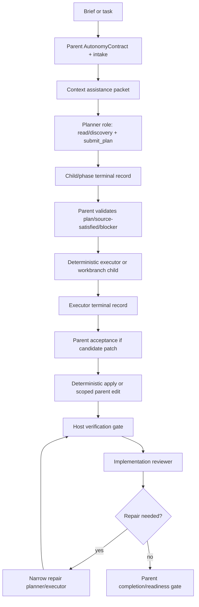

# Subagent And Context Management Integration

**Status:** design complete; first implementation milestone landed locally,
2026-06-12

**North Star:** AI coding agents are becoming common, but teams do not yet trust
their context, decisions, or outputs. Idiom sells the missing substrate: repo
memory, freshness, contracts, audit, and evals.

## Decision

Idiom should use role-bound workers for planning, implementation, review,
repair, verification interpretation, and read-only investigation. It should not
create a generic multi-agent scheduler or a new bespoke `subagent` lane.

The first implementable milestone is deliberately narrow:

1. Represent child dispatch and child outcomes as a durable contract lifecycle
   around the existing `AutonomyContract`.
2. Record a full runtime envelope for every child/model role call.
3. Record typed parent acceptance for child evidence, findings, and candidate
   patches before any downstream authority is granted.
4. Fix context promotion so weak or off-objective evidence cannot become answer
   or mutation readiness.
5. Audit the existing paths (`task`, workbranch child, `delegate_edit`, and
   plan-execute review-repair) before adding broader role orchestration.

The target architecture stays the same:

- The parent harness owns orchestration, scope, role dispatch, context packet
  selection, parent-child lifecycle records, child-result acceptance,
  verification closure, recovery, and final readiness.
- Role workers own bounded model work inside their phase: localize evidence,
  produce a plan, produce a candidate patch, inspect a diff, explain a
  verification failure, or propose a repair.
- Worker output is evidence, a plan artifact, findings, a terminal blocker, or
  a candidate patch. No worker output is release authority by itself.

This preserves the repo boundary:

- The model owns strategy inside its phase.
- The harness owns contracts across phases.

## Root Cause

Idiom already has role-bound child mechanisms, but parent-child authority is not
represented as one durable, replayable contract lifecycle. That absence lets
evidence, acceptance, readiness, and final-answer composition be inferred in
multiple places.

The live failure that motivated this design is narrower than "subagents need
more context." In session `20260611-212729.436`, a broad architecture request
was routed to read-only architecture, then a child `context_pack` request over
root/multi-area scope was rewritten to a `discovery_query` scoped only to
`internal/surfaces/tui/app`. The only source-body read was
`internal/surfaces/tui/app/busy_status.go`, and both child and parent accepted
that off-objective evidence as sufficient before producing a final answer about
TUI busy status instead of subagent/context management.

The first broken invariant is:

> A harness-owned rewrite or acceptance path must preserve the delegated
> objective's source scope, or mark the packet as weak/off-objective and block
> readiness promotion.

The owning boundary is delegated read-only bootstrap/rewrite plus read-only
evidence acceptance/completion. The fix must be a generic objective-aligned
evidence and parent-acceptance contract, not a topic-specific path heuristic.

## Evidence Base

### Local Idiom Evidence

- `docs/lane-architecture.md` defines `implement`, `plan-execute`, and
  `atom-spec`. `plan-execute` already separates a read/discovery plus
  `submit_plan` planner phase from executor/orchestrator-owned edits.
- `docs/subagent-lane-contracts-reviewed-intent.md` already records the right
  direction: subagents are role-bound projections through existing contracts,
  not a bespoke lane. It also names current gaps: no durable parent-child
  invocation record, no typed parent acceptance record, prompt transport for
  some acceptance obligations, and no explicit child backend kind.
- `internal/runtime/agent/runner_child_tasks.go` implements read-only child
  tasks with a child runner, default-deny policy, no nested task tool, and
  `ReadOnlyEvidencePacket` output.
- `internal/runtime/agent/runner_child_tasks.go` implements isolated workbranch
  child tasks with a temporary git worktree, an implementer client when
  configured, default-deny shell policy, and a rendered diff result that says
  the parent must explicitly apply or reject.
- `internal/runtime/agent/runner_delegate_edit.go` implements single-edit
  executor delegation. It directly mutates the parent workspace via
  `Workspace.Execute` after executor output is parsed, or by direct dispatch of
  the planner spec when the executor is missing or malformed.
- `internal/contracts/autonomy/contract.go` already has the right authority
  substrate: `ParentID`, invocation kinds, path roles, capability policy, tool
  policy, obligations, budget, verification, completion, readiness, and
  evidence refs.
- `internal/runtime/agent/model_protocol_projection.go` already compiles the
  runtime/protocol envelope that child records need: backend kind, model alias,
  parser/tool transport, parser contract, native-tool policy, response format,
  max tokens, thinking policy, and context budget.
- `internal/workflows/planexecute/types.go` carries `PackID`, packet freshness,
  compact pack quality, plan/executor handoff state, phase evidence, and
  review-repair reporting.
- `internal/capabilities/workspace/tool_sidecar_envelope.go` defines an
  `idiom.tool.v1` sidecar envelope with profile, caller metadata, contract,
  freshness, warnings, audit IDs, structured output, typed errors, and metadata.
- `idiom tool context_pack` for this task returned fresh packet
  `4ba39bf38877010b`, but reported weak source ownership. A separate reviewer
  packet `6be6d1b4477e9b6b` also reported low localization confidence. Fresh
  context can still be low quality.

### External Harness Evidence

- OpenCode exposes per-agent permissions, `primary`/`subagent`/`all` modes,
  hidden internal subagents, and `permission.task` rules that control which
  subagents an agent can invoke. Source: <https://opencode.ai/docs/agents/>.
- Claude Code subagents are separate context windows with custom prompts,
  tools, and permissions; examples use hooks when tool-level access needs finer
  validation. Source: <https://code.claude.com/docs/en/sub-agents>.
- OpenHands documents both parallel delegation and synchronous task-tool
  subagents; synchronous tasks return task IDs and can be resumed with their own
  context. Sources: <https://docs.openhands.dev/sdk/guides/agent-delegation>
  and <https://docs.openhands.dev/sdk/guides/task-tool-set>.
- Aider is the counterweight: it gets a lot of value from a single-agent loop,
  ranked repo maps, ask/code/architect modes, and lint/test repair without a
  generalized subagent system. Sources: <https://aider.chat/docs/repomap.html>
  and <https://aider.chat/docs/usage/modes.html>.
- Continue exposes Chat, Plan, and Agent modes, with Plan mode read-only and
  Agent mode write-capable. Source:
  <https://docs.continue.dev/ide-extensions/agent/quick-start>.

The shared lesson is not "add more agents." It is that role, context, runtime,
and permission boundaries must be explicit, isolated, observable, and resumable
when the contract requires them.

## Canonical Ownership

`AutonomyContract` remains the canonical authority object. Do not create a
parallel child-contract schema that copies path roles, tools, obligations, or
budget.

Add one child invocation shape:

- `InvocationKind = "child"` on `AutonomyContract`.
- `ParentID` points to the parent contract.
- `ContractScope` keeps the lane, phase, task family, path roles, and
  obligations that define the delegated authority.
- Do not add `ContractScope.Child` in v1. Child identity is an invocation kind,
  not a second scope hierarchy.

The parent-child record is a lifecycle/event wrapper. It references the parent
and child `AutonomyContract` IDs and records redacted runtime/artifact metadata.
It does not own authority independently.

## Parent-Child Invocation Record

Emit `idiom.parent_child_invocation.v1` before child dispatch:

```json
{
  "schema_version": "idiom.parent_child_invocation.v1",
  "invocation_id": "child-...",
  "parent_contract_id": "...",
  "child_contract_id": "...",
  "role": "source_investigator",
  "lane": "architecture",
  "phase": "read_only_evidence",
  "workspace_mode": "main|workbranch|no_write",
  "pack_id": "...",
  "contract_summary": {
    "path_role_digest": "...",
    "tool_policy_digest": "...",
    "obligation_digest": "..."
  },
  "runtime_envelope": {
    "backend_kind": "llama|mlx|minimax|openai_responses|codex|zai|deepseek",
    "model_alias": "...",
    "model_role": "planner|executor|reviewer|classifier|source_investigator",
    "role_resolution": {
      "requested_role": "executor",
      "resolved_role": "executor",
      "alias": "...",
      "source": "proxy_default|role_tag|lone_model|executor_coder_heuristic|unresolved",
      "ok": true
    },
    "capacity_admission": {
      "state": "acquired|unavailable|disabled|degraded|error",
      "pool": "...",
      "model_alias": "...",
      "wait_ms": 0,
      "degraded": false,
      "reason_class": "",
      "enforcement": "blocking|opportunistic"
    },
    "tool_transport_mode": "native|textual|none",
    "parser_transport_mode": "native|textual|none",
    "parser_contract": "...",
    "response_format": "...",
    "tool_choice": "...",
    "supports_native_tools": true,
    "force_native_tools": false,
    "thinking_policy": "...",
    "max_tokens": 4096,
    "context_budget": {
      "max_context_messages": 0,
      "max_context_chars": 0
    },
    "tool_schema_hash": "...",
    "request_timeout_ms": 75000
  },
  "created_at": "..."
}
```

Rules:

- `backend_kind` must use current config constants, not broad categories such
  as `hosted`.
- `role_resolution.source` must use existing `RoleAliasSource` values
  (`proxy_default`, `role_tag`, `lone_model`, or
  `executor_coder_heuristic`) when resolution succeeds. Unresolved roles need a
  typed extension such as `unresolved`; do not record a prose config path as
  the source.
- Capacity admission must be recorded for each model role dispatch. Blocking
  role calls cannot start without an `acquired` or explicitly degraded
  admission record. Opportunistic assistance may continue with `unavailable`
  capacity only when the parent contract allows degraded assistance.
- Hosted or client-only backends that do not use a local queue still record
  capacity admission. Use `state:"acquired"`, `pool:"external_client"` or an
  equivalent normalized pool, and a reason class that shows the admission came
  from client/backoff policy rather than a local queue lease.
- Transport strings persisted in this record are normalized public values:
  `native`, `textual`, or `none`. Runtime-specific labels such as
  `native_tools`, `textual_tools`, or `textual_json_terminal` may appear in
  debug metadata, but acceptance and audit should compare the normalized
  values.
- Runtime actor changes must be typed policy decisions such as
  `runtime_actor_changed`, with old/new role, alias, backend kind, resolution
  source, and reason codes like `executor_unavailable`, `backend_degraded`, or
  `deterministic_parent_dispatch`.
- A child invocation must be linked to every child tool request/result and to
  any terminal result or acceptance decision.
- The record must be audit-safe: no raw prompt, raw transcript, file body, or
  long diff content.
- V1 serializes write-capable child dispatch per parent workspace/write scope. Future
  parallel writes require non-overlapping scope leases and audit evidence
  before dispatch.

## Child Terminal Record

Every child run or delegated role call ends in a typed terminal record:

```json
{
  "schema_version": "idiom.child_terminal.v1",
  "terminal_id": "child-terminal-...",
  "invocation_id": "child-...",
  "child_contract_id": "...",
  "result_kind": "evidence_packet|plan_artifact|candidate_patch|findings|source_satisfied|typed_blocker|applied_parent_edit",
  "status": "completed|blocked|failed|budget_exhausted|parse_failed",
  "artifact_refs": [],
  "evidence_refs": [],
  "changed_paths": [],
  "pack_id": "...",
  "execution_metadata": {
    "route": "child_model|deterministic_direct|parent_executor|not_applicable",
    "parent_plan_authority_ref": "...",
    "path_gate_ref": "...",
    "path_gate_decision": "allow|deny|nudge|reject|not_applicable",
    "verification_obligation_refs": []
  },
  "objective_alignment": "accepted|weak|off_objective|not_applicable",
  "parse_status": {
    "schema_version": "...",
    "transport_observed": "native|textual|deterministic",
    "normalizer_status": "not_required|normalized|failed",
    "normalized_output_schema": "...",
    "parser_failure_class": "",
    "raw_output_redacted": true
  }
}
```

This separates terminal shape from acceptance. A terminal record says what the
child produced. Parent acceptance says whether that output grants downstream
authority.

Candidate patch terminals must reference a structured patch artifact instead
of requiring downstream code to parse rendered prose:

```json
{
  "schema_version": "idiom.candidate_patch_artifact.v1",
  "patch_id": "patch-...",
  "invocation_id": "child-...",
  "child_contract_id": "...",
  "base_sha": "...",
  "worktree_path_ref": "...",
  "changed_paths": [],
  "diff_stat": {
    "files": 0,
    "insertions": 0,
    "deletions": 0
  },
  "patch_path": "...",
  "patch_digest": "...",
  "verification_claim_refs": [],
  "created_at": "..."
}
```

`child_terminal.artifact_refs` points at this artifact for
`result_kind:"candidate_patch"`. The artifact is sanitized metadata plus a
digest/path reference to stored patch content; it does not embed raw diff text
in telemetry or audit summaries.

## Parent Acceptance Record

Emit `idiom.child_acceptance.v1` for any child terminal that could influence a
parent answer, next phase, patch application, verification, or release:

```json
{
  "schema_version": "idiom.child_acceptance.v1",
  "acceptance_id": "accept-...",
  "parent_contract_id": "...",
  "child_contract_id": "...",
  "invocation_id": "child-...",
  "terminal_id": "child-terminal-...",
  "result_kind": "evidence_packet|plan_artifact|candidate_patch|findings|source_satisfied|typed_blocker|applied_parent_edit",
  "decision": "accepted|rejected|repair_required|blocked|recorded_only",
  "runtime_envelope_ref": "...",
  "pack_id": "...",
  "pack_freshness": "fresh|stale|missing|unknown",
  "accepted_evidence_refs": [],
  "accepted_patch_refs": [],
  "required_repair_paths": [],
  "verification_obligation_refs": [],
  "execution_metadata_ref": "...",
  "parent_plan_authority_ref": "...",
  "path_gate_ref": "...",
  "path_gate_decision": "allow|deny|nudge|reject|not_applicable",
  "route": "child_model|deterministic_direct|parent_executor|not_applicable",
  "alignment_basis": {
    "delegated_objective_ref": "...",
    "effective_scope_refs": [],
    "accepted_source_body_refs": [],
    "candidate_only_refs": [],
    "mismatch_reasons": [],
    "evaluator": "host_contract|reviewer_finding|deterministic_rule"
  },
  "reason_code": "objective_aligned|scope_violation|stale_pack|verification_failed|direct_dispatch|..."
}
```

Rules:

- A changed required path is not acceptance.
- A child final answer is not acceptance.
- A passing command is not acceptance unless it resolves a declared
  verification obligation.
- A child patch cannot advance to verification or application without an
  accepted parent decision.
- Source-satisfied and typed blockers are first-class terminal result kinds,
  not prose that downstream code parses ad hoc.
- Acceptance records must cite evidence refs, artifact refs, or obligation refs
  that already exist.
- Objective alignment is not a label by itself. `decision:"accepted"` with
  `reason_code:"objective_aligned"` requires a delegated objective ref,
  effective child scope refs, accepted source-body refs when source evidence is
  required, and an evaluator basis. Search hits, context-pack candidates, and
  artifact-only refs remain `candidate_only_refs` until source-body or
  contract evidence accepts them.

## Verification Acceptance Record

Verification closure is also a typed parent-owned decision. A passing process
result does not close an obligation until it is accepted against that
obligation:

```json
{
  "schema_version": "idiom.verification_acceptance.v1",
  "verification_acceptance_id": "verify-accept-...",
  "parent_contract_id": "...",
  "obligation_refs": [],
  "command_ref": "...",
  "command_fingerprint": "...",
  "workspace_ref": "...",
  "base_sha": "...",
  "head_sha": "...",
  "exit_status": 0,
  "result_ref": "...",
  "scope_refs": [],
  "decision": "accepted|rejected|repair_required|blocked",
  "reason_code": "obligation_matched|wrong_command|wrong_scope|stale_revision|failed_exit|missing_result|..."
}
```

The command fingerprint must be computed from the normalized command, working
directory, relevant environment policy, workspace/base revision, and declared
obligation refs. Verification output can be summarized in the result ref, but
raw logs remain bounded and sanitized.

## Role Model

| Role | Contract projection | May mutate? | Output | Parent decision |
| --- | --- | --- | --- | --- |
| Context localizer | `child_read_only` plus `localize_change` capability | No | context assistance packet | localization evidence only |
| Source investigator | `child_read_only` with source-body obligation | No | `ReadOnlyEvidencePacket` | source evidence only if objective-aligned |
| Planner | plan-execute planner phase | No, except `submit_plan` | plan artifact, source-satisfied, or blocker | validate terminal shape |
| Plan reviewer | read-only reviewer phase | No | findings against plan/context | repair, block, or proceed |
| Workbranch executor | `child_write` in isolated worktree | Yes, isolated | candidate patch artifact | accept/reject/repair before apply |
| Deterministic executor | plan-execute executor | Yes, scoped parent workspace | applied edit result | verify against plan and obligations |
| `delegate_edit` executor | parent plan authority plus optional executor model | Yes, parent workspace | applied parent edit | record direct/executor path; not candidate patch |
| Implementation reviewer | read-only review-repair phase | No | findings and repair requirements | repair/block/proceed |
| Verification runner | host/deterministic command runner | Effects limited by policy | verification evidence | resolve/block obligation |
| Failure interpreter | read-only diagnostic role | No | failure classification and repair scope | open recovery/repair |
| Release arbiter | parent harness gate | No | readiness decision | N/A |

All model work can be role-separated. Not all authorities can be delegated.
Release, child acceptance, freshness validity, protected paths, verification
closure, and completion readiness stay host-owned.

`child_read_only` and `child_write` are contract projections over
`InvocationKind:"child"`; they are not extra invocation kinds.

`Release arbiter` is listed to show the boundary. It is not a worker role and
should not become a `RoleSpecFor` entry.

## Model-Facing Protocol

Each role needs an exact tool and terminal protocol. Prompts may describe these
rules, but the runtime projection and gates own them.

| Role | Valid actions | Invalid actions | Terminal outcomes |
| --- | --- | --- | --- |
| Planner | bounded read/discovery/source-body tools, `submit_plan` | per-edit writes, shell verification, `delegate_edit`, `task` | valid `submit_plan`; `Decision: source-satisfied` with per-path source-body evidence; `<<QUESTION>>:` blocker |
| Source investigator | read/search/context/source-body tools | writes, nested `task`, broad completion release | `ReadOnlyEvidencePacket`; typed blocker; failed/weak packet |
| Workbranch executor | scoped write tools and allowlisted verification/read shell | nested `task`, deploy/publish/push, parent-workspace mutation | candidate patch artifact; typed blocker; budget/parse failure |
| Reviewer | read-only diff/source inspection | release approval, writes unless in repair executor phase | findings: pass, repair-required, block |
| Verification interpreter | read-only logs/source/test evidence | marking verification closed directly | failure classification, repair scope, or typed blocker |

Direct-answer, architecture, explain, and review assistance lanes use advisory
readiness. Weak packet quality may justify a bounded probe or a normal
uncertainty answer, but it must not expose mutation-lane blocker protocol as a
user-facing final answer.

In assistance lanes, acceptance governs whether child evidence may influence or
be cited by the parent answer. The answering model still decides whether the
right response is certain, uncertain, or one bounded follow-up.

Mutation/planning terminal outcomes are stricter. If source-body evidence is
required before `submit_plan` or source-satisfied closeout, missing evidence is
a typed blocker or recovery state, not an advisory note.

## Context Assistance For All Lanes

Every lane should start from the same context assistance lifecycle, tuned by
lane risk:

1. Compile a parent `AutonomyContract` before any model worker starts.
2. Build or load a `context_pack` using stable task text plus parent contract
   fields such as required edit paths, forbidden paths, lane, budget, and
   freshness policy.
3. Render the shared compact projection into model-facing context. The full
   pack remains in `.idiom/comprehension/views/<pack_id>.json` and
   `graph_views`.
4. Carry `pack_id`, quality, freshness, referenced paths, and unresolved gaps
   through planner, executor handoff, review-repair, recovery, resume,
   telemetry, audit, and sidecar.
5. Treat the packet as localization evidence only. Source-body obligations
   still require source-body reads such as symbol/body tools or bounded
   `read_file`.
6. If packet quality is weak, stale, or off-objective, surface that state. Do
   not silently promote candidates to required scope or answer readiness.

Required edit paths are inputs from the parent contract/brief. The context pack
may echo them with provenance, but it does not mint new required coverage.
Candidate paths remain candidate paths until accepted by the parent contract.

## Mutation Lane Lifecycle



V1 serializes write-capable children per parent workspace/write scope.
Read-only children may still run concurrently when their contract is read-only,
their budgets are independent, and their terminal evidence is accepted
separately. Parallel write workers require a durable write-scope lease/dispatch
registry and are deferred until v1 audit can prove invocation, acceptance,
packet quality, and verification end to end.

## Executor Result Semantics

Do not force all executors through one lifecycle:

- `delegate_edit` is an applied parent-workspace edit under parent plan
  authority. When an executor model succeeds, record the executor runtime and
  parse status. When it falls back to direct dispatch, record
  `result_kind:"applied_parent_edit"` with reason `direct_dispatch`. It is not a
  candidate patch awaiting later acceptance. Its terminal and optional
  acceptance record must populate `execution_metadata`,
  `parent_plan_authority_ref`, `path_gate_ref`, `path_gate_decision`, `route`,
  parse status, and any verification obligations created by the applied edit.
  If an acceptance record is emitted for `delegate_edit`, its decision is
  `recorded_only` unless a separate verification gate is evaluating the
  already-applied edit.
- Deterministic plan-execute executor applies accepted plan artifacts in the
  parent workspace and then verification/review gates evaluate the results.
- Workbranch executor produces a candidate patch artifact. The parent workspace
  remains unchanged until parent acceptance validates child contract ID,
  changed paths, base SHA, patch artifact, and scope before deterministic
  apply.

## Sidecar Compatibility

Preserve the existing `idiom.tool.v1` envelope and legacy
`Tool`/`Summary`/`Output`/`Error` compatibility. Add optional child/context
metadata in a versioned nested object that old consumers can ignore:

```json
{
  "child_context": {
    "schema_version": "idiom.sidecar_child_context.v1",
    "parent_contract_id": "...",
    "child_contract_id": "...",
    "invocation_id": "...",
    "terminal_id": "...",
    "acceptance_id": "...",
    "pack_id": "...",
    "runtime_envelope_ref": "..."
  }
}
```

Sidecar inspection reports must remain sanitized: no raw prompt, file bodies,
long transcript excerpts, or raw diffs.

## Failure Modes And Required Handling

| Failure mode | Owner | Observable handling |
| --- | --- | --- |
| Context pack stale or missing | context assistance gate | one refresh attempt, then fallback packet or typed gap |
| Context pack weak source owner | context quality gate | no readiness promotion without objective-aligned source-body evidence |
| Child scope rewrite collapses objective | child bootstrap/acceptance | terminal `objective_alignment:off_objective`; parent rejects evidence |
| Child exceeds tool/model/time budget | child contract | terminal `budget_exhausted`; parent blocks or decomposes |
| Child writes outside scope | tool/path gate | write rejected, policy decision recorded, acceptance rejected |
| Child attempts nested delegation | child policy | `task` denied, policy event recorded |
| Workbranch cleanup fails | workbranch manager | diagnostic event; parent workspace remains unchanged |
| Candidate patch has no acceptance | parent acceptance gate | block apply/verification/release |
| `delegate_edit` executor unavailable | delegate edit runner | record direct deterministic dispatch, not child patch acceptance |
| Reviewer says "approved" while listing blockers | review gate | contradiction blocks; findings outrank prose approval |
| Verification passes wrong command | verification gate | obligation remains unresolved |
| Off-objective child packet in direct-answer lane | answerability | no answer-readiness promotion; optional uncertainty answer |
| Backend role fallback changes model actor | runtime contract | typed `runtime_actor_changed` event and audit finding |
| Parallel write scopes overlap | dispatch gate | v1 serializes; future parallel mode requires leases |
| Resume loses child context | lifecycle store | reload or classify stale/missing before continuation |

## Acceptance Criteria

### Mutation Happy Path

Given a plan-execute run that uses a workbranch executor:

- `parent_child_invocation` is emitted before child dispatch.
- `child_terminal` records a candidate patch artifact with child contract ID,
  base SHA, changed paths, pack ID, runtime envelope, parse status, and
  artifact ref.
- `idiom.candidate_patch_artifact.v1` records patch ID, invocation ID,
  child contract ID, base SHA, changed paths, diff stat, patch path, digest,
  and verification claim refs.
- `child_acceptance` accepts the candidate patch and cites patch/evidence refs.
- deterministic apply occurs only after acceptance.
- verification obligation resolves only from an accepted command/result.
- `idiom.verification_acceptance.v1` cites obligation refs, command
  fingerprint, workspace/base/head revision, exit status, result ref, scope
  refs, decision, and reason code.
- implementation review produces findings.
- final readiness occurs only after open obligations are closed.

### Mutation Negative Oracles

- A child diff plus child prose "approved" does not advance without
  `child_acceptance`.
- Missing required acceptance IDs are not synthesized or treated as observed
  acceptance in normal, resume, source-satisfied, or failure paths.
- A passing unrelated command does not resolve verification.
- Out-of-scope child writes are denied and produce `scope_violation`.
- Stale base SHA or missing patch artifact rejects workbranch acceptance.
- Reviewer self-release text is ignored.
- `InvocationKind` must be `child` for child contracts; no `ContractScope.Child`
  branch is accepted.
- Overlapping write-capable child scopes are serialized in v1.
- A runtime actor fallback without `runtime_actor_changed` is an audit failure.
- A role dispatch without role resolution and capacity admission metadata is an
  audit failure.
- `delegate_edit` terminal/acceptance records without route, path-gate,
  parent-plan-authority, parse-status, and verification-obligation refs are
  rejected or reported.
- Objective-aligned acceptance with missing `alignment_basis` objective,
  scope, required source-body, mismatch, or evaluator fields is rejected.

### Assistance Happy Path

Given a direct-answer, architecture, explain, or review lane:

- context packet quality/freshness is surfaced.
- answer promotion requires objective-aligned source-body findings or accepted
  evidence appropriate to the objective.
- the final answer cites accepted evidence paths, not only candidate paths.
- no mutation authority is created.

### Assistance Negative Oracles

- A fresh but low-quality packet does not become answer readiness by itself.
- Off-objective child packets do not satisfy answerability.
- Artifact-only or search-hit-only packets do not count as source-body evidence.
- Weak evidence can lead to a bounded probe or uncertainty answer, but not a
  user-visible mutation-lane blocker.

### Audit Oracles

`harness_audit` must report:

- missing parent-child invocation records.
- parent-child invocation records without terminal records.
- child terminal records without matching invocation.
- child outputs that influence parent state without acceptance.
- child acceptance records whose terminal, invocation, execution metadata, or
  path-gate refs are missing.
- stale/weak/off-objective context promoted to readiness.
- backend/model/runtime actor changes.
- missing role alias resolution or capacity admission records.
- child self-release text.
- overlapping write scopes if future parallel write mode is enabled.

## Rollout Plan

### Implemented Milestone, 2026-06-12

The first implementation slice now covers the existing role-bound paths rather
than adding a generic scheduler:

- `InvocationKind:"child"` is part of the autonomy contract shape.
- `idiom.parent_child_invocation.v1`, `idiom.child_terminal.v1`,
  `idiom.child_acceptance.v1`, `idiom.candidate_patch_artifact.v1`, and
  `idiom.verification_acceptance.v1` have typed contracts and validation.
- Runtime child paths emit lifecycle records for read-only `task`, workbranch
  child tasks, `delegate_edit`, and plan-execute review-repair.
- Parent acceptance records are emitted before child evidence, findings,
  blockers, applied parent edits, or candidate patches can be treated as
  accepted lifecycle output.
- Read-only child evidence acceptance uses typed source-body evidence packets;
  weak, missing, or implementation-shape off-objective evidence is not accepted
  as objective-aligned output.
- Candidate patch terminals reference structured patch artifacts with base SHA,
  changed paths, diff stats, patch refs, and digests.
- `delegate_edit` records applied-parent-edit route, parse status, path gate,
  parent plan authority, and verification-obligation refs.
- Plan-execute verification emits `verification_acceptance` records for
  accepted, failed, and rejected verification evidence.
- `harness_audit` reports invalid lifecycle records, missing invocation or
  terminal links, missing acceptances, mismatched lifecycle IDs, missing patch
  artifacts, weak accepted outputs, and invalid verification acceptance records.
- `idiom.tool.v1` sidecars support optional sanitized
  `idiom.sidecar_child_context.v1` metadata without changing legacy consumers.

1. **Lifecycle records around existing paths.** Add child invocation, terminal,
   and acceptance records around existing read-only `task`, workbranch child,
   `delegate_edit`, and plan-execute review-repair. Reuse `AutonomyContract`.
2. **Runtime envelope parity.** Populate runtime envelopes from existing model
   protocol projection/runtime call data. Use current backend kind constants,
   current `RoleAliasSource` values, role fallback events, and capacity
   admission records.
3. **Objective-aligned acceptance shadow mode.** First emit audit/read-only
   alignment decisions without broad enforcement where legacy paths lack full
   lifecycle records. Then require source-body findings to match the delegated
   objective before child evidence can promote answerability or planning
   readiness.
4. **Workbranch structured artifact.** Persist candidate patch artifacts before
   cleanup, with base SHA, changed paths, diff stat, child contract ID, patch
   digest/path, and verification claim refs. Parent acceptance validates before
   apply.
5. **Plan-execute acceptance reconciliation.** Reconcile current acceptance ID
   paths so required IDs are never synthesized into observed acceptance.
6. **Audit and eval coverage.** Add `harness_audit` checks and scripted
   regressions for the acceptance criteria above.
7. **Role expansion.** Extend `workerruntime.RoleSpecFor` only for roles with
   distinct permission/evidence/readiness contracts. Avoid a parallel role
   registry.
8. **Optional orchestration.** Add plan review, implementation review, repair,
   and disjoint parallel write orchestration only after lifecycle audit is
   reliable.
9. **Sidecar parity.** Expose optional child/context metadata through
   `idiom.tool`/MCP without breaking legacy consumers.

## Tests And Verification To Require

- Contract validation tests for `InvocationKind:"child"`, parent ID linking,
  rejection of `ContractScope.Child`, and current backend enums.
- Runtime envelope tests for role alias source, unresolved role fallback,
  capacity admission states, and `runtime_actor_changed` records.
- Runtime matrix tests for each current backend kind (`llama`, `mlx`,
  `minimax`, `openai_responses`, `codex`, `zai`, and `deepseek`) across the
  relevant native/textual/no-tool transport paths.
- Normalizer replay tests for native and textual child outputs.
- Runner tests proving read-only children cannot write or spawn tasks.
- Workbranch tests proving parent workspace is unchanged until acceptance and
  deterministic apply, and that rendered output is not parsed as the candidate
  patch artifact.
- `delegate_edit` tests distinguishing executor success, executor parse
  failure, and direct deterministic fallback; each path must emit route, parse
  status, path-gate result, parent plan authority, and verification obligation
  refs.
- Plan-execute tests proving `pack_id`, quality, freshness, child invocation,
  terminal, and acceptance records round-trip through planner, executor, review,
  resume, and recovery.
- Answerability tests proving off-objective delegated evidence is rejected and
  on-objective source-body evidence flows through one shared decision path with
  objective refs, effective scope refs, source-body refs, mismatch reasons, and
  evaluator basis.
- Verification acceptance tests proving unrelated commands, wrong workspaces,
  stale revisions, failed exits, and missing obligation refs cannot close
  verification obligations.
- Lifecycle audit tests proving invocations without terminals and terminals
  without invocations are both reported.
- Audit tests for every audit oracle.
- E2E lane tests for mutation happy path, stale/weak context, child budget
  exhaustion, reviewer-blocked repair, verification failure, source-satisfied
  no-op, assistance happy path, and off-objective assistance packet.
- Mutation-test style oracles for acceptance synthesis from required paths,
  stale-as-fresh pack handling, widened child scope, reviewer self-release,
  off-objective packet promotion, and verification-skip readiness.

## Migration Notes

- No new topic-specific final-answer, discovery fallback, or path-special-case
  branches should be added for this work. Existing topic-specific branches
  should be treated as migration debt to retire behind shared answerability and
  acceptance decisions.
- Do not let subagents inherit the full parent context by default. Pass a
  bounded prompt plus contract refs, pack refs, and exact evidence obligations.
- Do not use prompt text as durable authority for role, scope, tool access, or
  acceptance.
- Do not make `context_pack` source-body evidence.
- Do not let model reviewers release their own work.
- Do not hide external-agent sidecar results behind prose-only summaries.

## Deferred

- Generic multi-agent scheduler.
- Parallel write workers without durable scope leases.
- User-configurable role registry beyond existing `workerruntime` role specs.
- Default child context resumption. OpenHands shows value in task IDs, but
  Idiom should add persistent child state only when acceptance/recovery needs it.
- Broad repair orchestration beyond existing plan-execute/recovery mechanisms.
