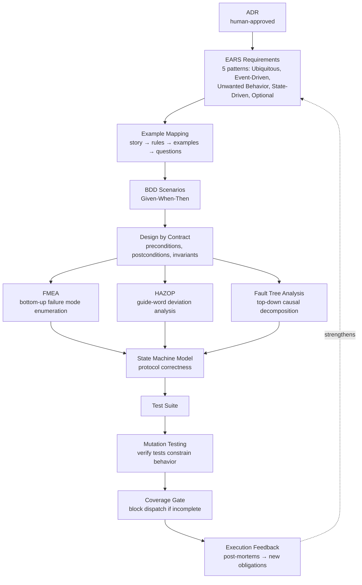

# Behavioral TDD Coverage

**North Star: AI coding agents are becoming common, but teams do not yet trust
their context, decisions, or outputs. Idiom sells the missing substrate: repo
memory, freshness, contracts, audit, and evals.**

Status: cross-pillar target design with implementation status overlay, drafted
2026-05-15; reviewed 2026-05-18

Implementation state as of 2026-05-24: the full behavioral coverage pipeline is
still a target design. The PRD/ADR/brief workflow effort has shipped a
deterministic tiered coverage evaluator, brief-render dependency, product
lint/audit authority preflight, and passive `coverage_gate_evaluated` telemetry
event. That gate is still not the complete nine-stage coverage pipeline
described here.

This document defines how Idiom achieves exhaustive behavioral coverage between
a human-approved ADR and a dispatch-ready implementation brief. It is the
verification contract for the upstream artifact pipeline defined in
[design-prd-adr-brief-research-workflow.md](design-prd-adr-brief-research-workflow.md).

The controlling policy remains:

- The model owns strategy.
- The harness owns contracts.

In this document, the harness owns the completeness of the behavioral test
contract. No single technique achieves exhaustive coverage. The design composes
multiple complementary techniques, each chosen to cover blind spots the others
leave.

## Executive Summary

Classic TDD is retrospective: you write tests for behaviors you can imagine.
Idiom needs prospective completeness: a systematic process that guarantees all
possible behaviors and failure modes have been enumerated before the contract is
frozen and the brief is dispatched.

This document specifies:

1. A staged pipeline from ADR to verified test contract.
2. The techniques at each stage and the specific blind spots each covers.
3. Obligation schemas that make behavioral coverage machine-checkable.
4. Gate criteria that block dispatch when coverage is incomplete.
5. A feedback loop that strengthens coverage from execution outcomes.

The pipeline is:

```text
ADR → EARS requirements → Example mapping → BDD scenarios → Design by Contract
→ Failure mode analysis (FMEA + HAZOP + FTA) → State machine model
→ Test suite generation → Mutation verification → Dispatch gate
```

## Problem Statement

The TDD obligation plan in the PRD-to-brief workflow defines obligation types
and rules, but it does not specify how to ensure the obligation set is
*complete*. The gaps are:

- EARS requirements specify desired behavior, but not undesired or unexpected
  behavior.
- BDD scenarios cover known cases, but not the edge cases no human would think
  to write.
- Contract tests verify nominal paths, but not the combinatorial explosion of
  boundary conditions.
- Regression tests catch known failures, but not failures that have not
  occurred yet.
- Mutation testing measures test quality, but current Idiom workflows do not
  require it.
- No gate blocks dispatch when behavioral coverage is incomplete.

The target is: a human-approved ADR should produce a test contract where every
reachable behavior has at least one test obligation, every failure mode has at
least one negative test, and mutation testing confirms the tests actually
constrain behavior.

## Design Goals

1. Compose multiple coverage techniques so their blind spots do not overlap.
2. Make coverage completeness machine-checkable, not a matter of reviewer
   judgment.
3. Integrate with the existing PRD-to-brief lifecycle without requiring model
   judgment for coverage decisions.
4. Keep the ADR as the human-approved authority; the test contract is derived,
  not independently authored.
5. Support incremental adoption: teams can start with EARS + BDD + FMEA and
  add techniques over time.
6. Feed execution outcomes back into coverage to close the loop.

## Non-Goals

- Do not replace the ADR or PRD as the human authority.
- Do not require formal verification (TLA+/Alloy) for every ADR. Reserve
  formal methods for protocol-critical or safety-critical contracts.
- Do not build a test generation engine inside Idiom core. Generate obligations
  and schemas; delegate test authoring to the implementation lane.
- Do not mandate a specific test framework. Specify obligation shapes and let
  the project choose the runner.
- Do not treat coverage percentage as the goal. The goal is behavioral
  completeness: every reachable behavior has a test obligation.

## Core Vocabulary

- **Behavioral domain**: the set of all reachable behaviors and failure modes
  for a given contract boundary.
- **Coverage technique**: a systematic method for enumerating a subset of the
  behavioral domain.
- **Coverage gap**: a reachable behavior or failure mode with no test
  obligation.
- **Obligation density**: the ratio of test obligations to contract invariants.
- **Mutation score**: the percentage of injected faults that the test suite
  detects. A score below threshold indicates tests that pass despite behavioral
  violations.
- **Decision table**: an exhaustive enumeration of all combinations of boolean
  conditions and their expected actions.
- **Guide-word analysis**: applying a fixed set of deviation keywords (No,
  More, Less, As Well As, Part Of, Reverse, Other Than, Early, Late, Before,
  After) to each step in a workflow to discover failure modes.

## The Coverage Pipeline



### Stage 1: ADR to EARS Requirements

Each ADR decision maps to one or more EARS requirements. EARS provides five
structured templates that eliminate ambiguous "should" language:

| EARS Pattern | Template | What It Covers |
| --- | --- | --- |
| Ubiquitous | The \<system\> shall \<behavior\> | Always-true invariants |
| Event-Driven | When \<event\>, the \<system\> shall \<response\> | Triggered behaviors |
| Unwanted Behavior | If \<unwanted condition\>, then the \<system\> shall \<response\> | Failure mitigation |
| State-Driven | While \<state\>, the \<system\> shall \<behavior\> | Conditional behaviors |
| Optional Feature | Where \<feature\>, the \<system\> shall \<behavior\> | Feature-gated behaviors |

Gate: every ADR consequence maps to at least one EARS requirement. EARS
requirements with ambiguous language ("should", "might", "appropriately") fail
the gate.

EARS-to-BDD mapping for downstream consumption:

| EARS Pattern | BDD Structure |
| --- | --- |
| Ubiquitous | Given system is running, When any operation, Then invariant holds |
| Event-Driven | Given precondition, When event occurs, Then response |
| Unwanted Behavior | Given unwanted condition is possible, When it occurs, Then mitigation |
| State-Driven | Given state is active, When trigger, Then behavior within constraints |
| Optional Feature | Given feature available, When trigger, Then enhanced behavior; Given feature NOT available, When trigger, Then fallback |

### Stage 2: Example Mapping

Each EARS requirement decomposes into:

- **Rules**: acceptance criteria derived from the EARS template
- **Examples**: 2-4 concrete instances per rule with specific data values
- **Questions**: ambiguities that require human resolution

The `tdd_eval` researcher role (defined in the PRD-to-brief workflow) can
propose examples. The human resolves questions. Unresolved questions block the
obligation plan.

Gate: every EARS requirement has at least one rule with at least two concrete
examples. Every question has a resolution or a documented blocker.

### Stage 3: BDD Scenarios

Examples become Given-When-Then scenarios. Each scenario is an executable
specification:

```gherkin
Feature: Protected path enforcement
  As the harness
  I want to prevent writes to protected paths
  So that agent config and git metadata remain safe

  Scenario: Agent attempts to edit .idiom config
    Given the agent is in implementation phase
    And .idiom/ is a protected path
    When the agent issues a write to .idiom/config.json
    Then the harness rejects the write
    And the harness emits tool_policy_decision with decision reject
    And the harness logs invariant_id write.protected_path
```

Extensions relevant to agent TDD:

- **Background**: shared session initialization preconditions
- **Scenario Outline + Examples**: parameterized scenarios for multiple
  input/output pairs
- **Tags**: @wip, @slow, @integration, @contract, @negative — control which
  scenarios run in which context

Gate: every BDD scenario has concrete data in Given, a specific action in When,
and testable assertions in Then. Abstract scenarios without concrete values fail
the gate.

### Stage 4: Design by Contract

Every port boundary gets three elements:

- **Precondition**: what must be true before (obligation of the caller)
- **Postcondition**: what is guaranteed after (obligation of the supplier)
- **Invariant**: what is always maintained

Contract schema for a port:

```yaml
port: tool_call_dispatch
preconditions:
  - tool_name is in allowed_tools
  - target_path resolves to required_edit or allowed_edit role
  - budget_remaining > 0
postconditions:
  - result is recorded in session events
  - obligations_opened or obligations_resolved is updated
  - path_roles_resolved event emitted
invariants:
  - budget_remaining >= 0
  - protected_path_accessed == false
  - all obligations are open or resolved (none are in unknown state)
```

The harness is the supplier for tool invocation postconditions. The model is
the caller for tool invocation preconditions. Session state invariants are
continuous checks.

Gate: every BDD Then clause maps to a postcondition. Every Given clause maps to
a precondition. Scenarios with unclear pass/fail criteria fail the gate.

### Stage 5: Failure Mode Analysis

Three complementary failure analysis techniques, each covering a blind spot:

#### FMEA (Bottom-Up Failure Mode Enumeration)

For each contract component, enumerate failure modes:

| Failure Class | Meaning | Example |
| --- | --- | --- |
| No function | Operation does not occur | Tool call not dispatched |
| Over function | Operation exceeds specification | Multiple tool calls when one expected |
| Under function | Operation falls short | Partial context injected |
| Intermittent | Operation works sometimes | Tool call succeeds only under certain timing |
| Unintended | Operation occurs when it should not | Write during read-only phase |

Score each failure mode:

- **Severity** (1-5): 1 = no effect, 5 = data loss or safety issue
- **Probability** (1-5): 1 = extremely unlikely, 5 = almost inevitable
- **Detection** (1-5): 1 = certain to be caught, 5 = undetected
- **Risk Priority Number** = Severity x Probability x Detection

Priority mapping:

| RPN Range | Action | TDD Obligation |
| --- | --- | --- |
| 1-20 | Accept or log | advisory obligation |
| 21-50 | Mitigate | should-have obligation |
| 51-100 | Must mitigate | must-have obligation with negative test |
| > 100 | Must mitigate with redundancy | must-have obligation with multiple test types |

FMEA output becomes negative test obligations: one test per failure mode with
RPN >= 21.

#### HAZOP (Guide-Word Deviation Analysis)

Apply guide words to each workflow step:

| Guide Word | Question | Example |
| --- | --- | --- |
| No / Not | What if this step does not happen? | Tool call not dispatched |
| More | What if too much of something? | Context exceeds budget |
| Less | What if too little? | Partial context injected |
| As Well As | What if extra unintended behavior? | Side effect during read |
| Part Of | What if incomplete? | Partial plan submitted |
| Reverse | What if reversed direction? | Verification before implementation |
| Other Than | What if wrong behavior entirely? | Wrong tool called |
| Early | What if timing is premature? | Verification before write complete |
| Late | What if timing is delayed? | Stale context injected |
| Before / After | What if sequence is wrong? | Write before plan approved |

Each deviation becomes a test obligation when the consequence is severity >= 3.

HAZOP is especially valuable for agent systems because LLM behavior is
non-deterministic: the model may produce any of these deviations at any time.

#### Fault Tree Analysis (Top-Down Causal Decomposition)

For each catastrophic outcome (severity 5), build a fault tree:

```text
                    PROTECTED_PATH_VIOLATED
                    /                     \
          AND gate                         OR gate
         /        \                       /       \
  model_ignores_    path_check_    path_check_    path_list_
  constraint        bypassed        not_run        stale
```

AND gates indicate where redundant defenses are needed. OR gates indicate
single points of failure. Each leaf becomes a test obligation. Each AND gate
becomes a multi-layer defense requirement.

FTA complements FMEA: FMEA asks "what can go wrong?" (bottom-up). FTA asks
"how could this bad outcome happen?" (top-down). Use both for complete
coverage.

### Stage 6: State Machine Model

The dispatch readiness state machine (already defined in the PRD-to-brief
workflow) is a protocol that must be verified:

```text
States: Draft → ResearchBlocked → PRDAudit → PRDBlocked → ADRAudit →
        ADRBlocked → TDDAudit → TDDBlocked → BriefLint → BriefBlocked →
        Intake → IntakeBlocked → DispatchReady → Dispatched →
        Verified → ExecutionBlocked → Feedback
```

Verification properties:

| Property | Question | Technique |
| --- | --- | --- |
| Reachability | Can every valid input reach DispatchReady? | State machine traversal |
| Deadlock freedom | Is any state unreachable from completion? | State machine analysis |
| Safety | Can a forbidden state be reached? | Invariant checking |
| Liveness | Does every active task eventually complete or block? | Fairness analysis |
| Idempotency | Does re-entering a state produce the same result? | Property-based test |

For protocol-critical contracts (multi-step handoffs, concurrent workers,
persistent state machines), consider lightweight formal verification:

- **TLA+** for system-level protocol correctness (temporal logic, model
  checking up to bounded state space)
- **Alloy** for component-level contract algebra (first-order relational logic,
  bounded exhaustive search with counterexample visualization)

Reserve formal methods for contracts where informal reasoning has already
failed or where the blast radius of a protocol bug is high.

### Stage 7: Test Suite Generation

From the accumulated analysis, generate the test suite:

| Test Type | Source | What It Covers |
| --- | --- | --- |
| BDD scenarios | EARS + Example Mapping | Known positive and negative cases |
| Contract tests | Design by Contract | Precondition/postcondition/invariant checks at every port |
| Property-based tests | Invariants from DbC + State Machine | Automated edge case discovery across arbitrary input sequences |
| FMEA negative tests | FMEA failure modes | Systematic failure mode coverage |
| HAZOP deviation tests | Guide-word analysis | Deviation-from-nominal coverage |
| Decision table tests | Combinatorial conditions | Exhaustive boolean condition coverage |
| Boundary value tests | Numeric bounds in contracts | Edge cases at partition boundaries |
| Characterization tests | Current codebase behavior | Legacy safety net before changes |
| Approval tests | Reference transcripts | Behavioral regression detection |

#### Property-Based Testing for Session Invariants

The core claim is: for any valid sequence of operations, the session invariant
holds. This is exactly what property-based testing verifies.

Define a state machine model of the agent session. The PBT framework generates
arbitrary sequences of state transitions. The property asserted is: the session
invariant holds after every transition.

This discovers sequences like: "if the agent makes a context_pack call, then a
file_write, then a second context_pack with the same task string, the cache
returns stale data" — edge cases no human would write as individual BDD
scenarios.

Obligation schema:

```json
{
  "id": "TDD-PBT-001",
  "type": "property_based",
  "invariant": "budget_remaining >= 0 AND NOT protected_path_accessed",
  "state_machine": "agent_session",
  "transitions": ["tool_call", "phase_change", "write", "verify"],
  "min_cases": 1000,
  "shrink_on_failure": true,
  "status": "pending"
}
```

#### Decision Table Tests for Combinatorial Logic

When behavior depends on multiple boolean conditions, enumerate all
combinations:

```text
| Budget OK | Path Protected | Context Fresh | In Recovery | Result              |
|-----------|---------------|---------------|-------------|---------------------|
| Y         | N             | Y             | N           | Execute normally    |
| Y         | N             | Y             | Y           | Execute with nudge  |
| Y         | N             | N             | N           | Execute + refresh   |
| Y         | N             | N             | Y           | Execute + refresh + nudge |
| Y         | Y             | -             | -           | Reject (protected)  |
| N         | -             | -             | -           | Halt (budget)       |
```

Even 4 conditions produce 16 combinations, most of which would never occur to
someone writing individual test cases. Decision tables ensure complete logical
coverage.

Obligation schema:

```json
{
  "id": "TDD-DT-001",
  "type": "decision_table",
  "conditions": ["budget_ok", "path_protected", "context_fresh", "in_recovery"],
  "rules": [
    {"conditions": [true, false, true, false], "expected": "execute"},
    {"conditions": [true, false, true, true], "expected": "execute_with_nudge"},
    {"conditions": [true, true, null, null], "expected": "reject_protected"},
    {"conditions": [false, null, null, null], "expected": "halt_budget"}
  ],
  "status": "pending"
}
```

#### Boundary Value Analysis for Numeric Bounds

Every numeric bound in a contract gets tested at boundary values:

| Parameter | Classes | Boundary Values |
| --- | --- | --- |
| Budget remaining | zero, positive, exhausted | 0, 1, threshold-1, threshold, max |
| Context window | empty, partial, near-full, full, over | 0%, 50%, 79%, 80%, 99%, 100%, 101% |
| Tool call count | zero, one, normal, at-limit, over | 0, 1, N-1, N, N+1 |
| Recovery attempts | none, some, at-max, exceeded | 0, 1, max-1, max, max+1 |

### Stage 8: Mutation Verification

After generating the test suite, verify that tests actually constrain behavior
by injecting faults:

**Mutation operators for agent contracts:**

| Operator | Transformation | What It Tests |
| --- | --- | --- |
| Invariant negation | `budget >= 0` → `budget >= 1` | Budget boundary detection |
| Path scope widening | `required_edit` → `allowed_edit` | Scope enforcement |
| Permission escalation | `deny` → `allow` | Permission boundary enforcement |
| State skip | `VERIFYING` → `COMPLETE` | State machine enforcement |
| Budget inflation | `remaining = 1000` → `remaining = 1000000` | Budget conservation |
| Freshness bypass | `fresh` → `stale` | Context freshness enforcement |

**Mutation score gate:**

| Score | Assessment |
| --- | --- |
| >= 90% | Strong: tests constrain behavior tightly |
| 80-89% | Acceptable: minor gaps, may proceed with documented weaknesses |
| 60-79% | Weak: significant coverage gaps, block dispatch |
| < 60% | Inadequate: tests are theatrical, block dispatch |

Mutation testing obligation:

```json
{
  "id": "TDD-MUT-001",
  "type": "mutation",
  "target_contract": "write.required_path_scope",
  "operators": ["negate_invariant", "widen_scope", "escalate_permission"],
  "min_score": 80,
  "status": "pending"
}
```

### Stage 9: Coverage Gate

The coverage gate blocks brief dispatch when behavioral coverage is incomplete.
This is the hard gate before stage 10 (Brief Lint and Intake) in the
PRD-to-brief lifecycle.

Gate criteria:

| Criterion | Threshold | Blocks On |
| --- | --- | --- |
| EARS coverage | 100% of ADR consequences mapped | Unmapped consequence |
| BDD scenario coverage | 100% of EARS requirements have scenarios | Requirement without scenario |
| Contract coverage | 100% of BDD Then clauses mapped to postconditions | Unmapped assertion |
| FMEA coverage | 100% of failure modes with RPN >= 21 have tests | Unmitigated high-risk failure |
| HAZOP coverage | 100% of deviations with severity >= 3 have tests | Unmitigated deviation |
| Decision table coverage | 100% of multi-condition decisions enumerated | Missing combination |
| Boundary value coverage | 100% of numeric bounds tested at boundaries | Untested bound |
| PBT coverage | 100% of session invariants have property-based tests | Untested invariant |
| Mutation score | >= 80% for contract-level tests | Theatrical tests |

The gate is deterministic. It does not require model judgment. It checks
obligation counts, obligation statuses, and mutation scores.

### Stage 10: Execution Feedback Loop

Execution outcomes feed back into coverage:

| Outcome | Feedback Action |
| --- | --- |
| Test passes but spec violated | Add spec-compliance eval obligation, strengthen mutation testing |
| Test fails unexpectedly | Add characterization test, check if FMEA missed this failure mode |
| Agent enters unexpected state | Add state machine test, check HAZOP coverage for this deviation |
| Recovery triggered | Add FMEA failure mode if not already enumerated |
| Budget exhausted before completion | Add boundary value test at budget limits |
| Post-mortem identifies incident | Create one new obligation per incident. Every incident must produce at least one test that would have caught it. |

Post-mortem obligation template:

```json
{
  "id": "TDD-PM-001",
  "type": "post_mortem",
  "incident": "agent loops on same tool call after context refresh",
  "root_cause": "loop fuse does not count context_refresh as a repeat trigger",
  "catching_test": "regression test: repeated context_refresh calls trigger loop break",
  "invariant_violated": "loop.same_tool_repeat",
  "invariant_already_in_contract": false,
  "action": "add_invariant",
  "status": "pending"
}
```

## Complementarity Map

These techniques are chosen so their blind spots do not overlap:

| Primary | Complement | Why |
| --- | --- | --- |
| BDD Scenarios | PBT | BDD covers known cases; PBT finds unknown edge cases |
| EARS Requirements | FMEA | EARS specifies desired behavior; FMEA specifies undesired behavior |
| DbC Contracts | Mutation Testing | DbC defines correct; mutation testing proves tests detect incorrect |
| State Machine Model | HAZOP | State machine covers nominal transitions; HAZOP covers deviations |
| Outside-In TDD | Hexagonal Testing | Outside-In drives interface design; Hexagonal ensures testability at boundaries |
| Approval Testing | BDD Scenarios | Approval captures complex output; BDD specifies behavioral expectations |
| FMEA | FTA | FMEA is bottom-up (what can go wrong?); FTA is top-down (how could this bad thing happen?) |
| Decision Tables | Boundary Values | Decision tables enumerate logic combinations; boundary values test numeric edges |
| Characterization Testing | Behavioral Tests | Characterization captures current; behavioral asserts desired; together they measure the gap |

Redundant pairs (pick one):

| Technique A | Technique B | Recommendation |
| --- | --- | --- |
| Decision Tables | Exhaustive BDD Scenarios | Decision tables for specification, BDD for execution |
| Alloy | TLA+ | Alloy for component contracts (cheaper), TLA+ for system protocols (stronger) |
| Error Guessing | HAZOP | HAZOP is systematic; error guessing is supplement only |

## Obligation Type Extension

The PRD-to-brief workflow defines eight obligation types. This document adds
nine more to achieve exhaustive coverage:

| New Type | When to use | Evidence source |
| --- | --- | --- |
| `property_based` | session invariant must hold for arbitrary sequences | contract invariants, state machine model |
| `fmea_negative` | failure mode with RPN >= 21 must be mitigated | FMEA analysis of contract boundary |
| `hazop_deviation` | deviation with severity >= 3 must be handled | guide-word analysis of workflow steps |
| `fault_tree` | critical top event leaf must be tested or mitigated | fault tree analysis of catastrophic outcomes |
| `decision_table` | behavior depends on multiple boolean conditions | combinatorial enumeration of conditions |
| `boundary_value` | numeric bound must be tested at edges | contract parameters with numeric ranges |
| `mutation_score` | test suite must detect injected faults | mutation testing of contract implementation |
| `post_mortem` | incident must produce at least one catching test | execution audit, telemetry, post-mortem |
| `formal_verification` | protocol-critical contract needs bounded model proof | TLA+/Alloy model check or equivalent artifact |

Updated complete obligation type set:

| Type | Category | When to use |
| --- | --- | --- |
| `characterization` | safety net | existing behavior is unclear or risky |
| `regression` | safety net | a known failure or behavior bug exists |
| `acceptance` | positive | user-visible behavior or workflow must change |
| `contract` | positive | harness boundary must hold |
| `source_sanity` | positive | source files change |
| `eval` | positive | agent behavior must improve |
| `audit` | positive | evidence/audit behavior must improve |
| `property_based` | coverage | session invariant must hold for arbitrary sequences |
| `fmea_negative` | negative | failure mode with RPN >= 21 must be mitigated |
| `hazop_deviation` | negative | deviation with severity >= 3 must be handled |
| `fault_tree` | negative | critical top event leaf must be tested or mitigated |
| `decision_table` | combinatorial | behavior depends on multiple boolean conditions |
| `boundary_value` | combinatorial | numeric bound must be tested at edges |
| `mutation_score` | verification | test suite must detect injected faults |
| `post_mortem` | feedback | incident must produce at least one catching test |
| `formal_verification` | optional formal | protocol-critical contract needs bounded model proof |
| `manual` | fallback | automation is unavailable |

## TDD Obligation Ledger Schema Extension

The obligation ledger schema gains coverage metadata:

```json
{
  "schema_version": "idiom.tdd_obligations.v2",
  "coverage": {
    "ears_total": 0,
    "ears_mapped": 0,
    "bdd_total": 0,
    "bdd_with_concrete_data": 0,
    "fmea_modes_total": 0,
    "fmea_modes_mitigated": 0,
    "hazop_deviations_total": 0,
    "hazop_deviations_tested": 0,
    "invariants_total": 0,
    "invariants_with_pbt": 0,
    "state_machines_total": 0,
    "state_machines_covered": 0,
    "decision_tables_total": 0,
    "decision_tables_enumerated": 0,
    "boundary_values_total": 0,
    "boundary_values_tested": 0,
    "fault_tree_leaves_total": 0,
    "fault_tree_leaves_tested": 0,
    "post_mortem_incidents_total": 0,
    "post_mortem_catching_tests": 0,
    "formal_models_total": 0,
    "formal_models_verified": 0,
    "mutation_score": null,
    "mutation_min_score": 80,
    "gates_passed": [],
    "gates_blocked": []
  },
  "obligations": []
}
```

## Coverage Gate Event Schema

```json
{
  "event": "coverage_gate_evaluated",
  "task_id": "example",
  "coverage": {
    "ears_coverage_pct": 100,
    "bdd_coverage_pct": 100,
    "fmea_mitigation_pct": 95,
    "hazop_tested_pct": 100,
    "invariant_pbt_pct": 100,
    "state_machine_pct": 100,
    "decision_table_pct": 100,
    "boundary_value_pct": 100,
    "fault_tree_coverage_pct": 100,
    "post_mortem_coverage_pct": 100,
    "formal_verification_pct": 100,
    "mutation_score": 85
  },
  "gate_result": "pass",
  "blocked_reasons": [],
  "waivers": []
}
```

## Red-Green-Refactor Flow Extension

The existing red-green-refactor flow in the PRD-to-brief workflow extends to
include coverage verification:

1. Add or modify the failing test first when the test surface is known and
   scoped.
2. Run the focused test and record expected failure.
3. Implement the minimal behavior.
4. Run the focused test and source-sanity.
5. Run broader verification when the changed contract or dependency surface
   justifies it.
6. **Run property-based tests for affected invariants.**
7. **Run mutation testing for the changed contract surface.**
8. **Check coverage gate: are all new failure modes tested?**
9. Feed results into the artifact ledger.

For harness behavior bugs, the expected default is:

- one regression test for the bad behavior
- one valid allowed-path test
- an audit or telemetry assertion if the failure was not diagnosable before
- **one FMEA failure mode entry if the failure mode was not previously enumerated**
- **one post-mortem obligation tracking the incident to a catching test**

## Spec-Compliance Evaluation

Separate spec compliance from functional correctness. Measure both
independently:

| | Code Works | Code Does Not Work |
| --- | --- | --- |
| **Spec Followed** | Ideal | Acceptable (implementation gap) |
| **Spec Violated** | Dangerous (lucky) | Expected failure |

The "Dangerous (lucky)" quadrant is where FMEA and mutation testing earn their
place: the code works by coincidence but violates the architectural contract.
Without spec-compliance evaluation, these cases are invisible until the
coincidence breaks.

Spec-compliance eval obligation:

```json
{
  "id": "TDD-SPEC-001",
  "type": "eval",
  "dimension": "spec_compliance",
  "assertions": [
    "all modified paths within required_edit scope",
    "all protected paths unmodified",
    "all invariants hold post-execution",
    "no prompt-magic contract triggers in output"
  ],
  "independent_of": "functional_correctness",
  "status": "pending"
}
```

## Relation To Existing Idiom Capabilities

This design composes with existing Idiom surfaces, not replaces them:

| Capability | Usage In Coverage Pipeline |
| --- | --- |
| `context_pack` | Locate candidate tests and affected invariants |
| `context_query` | Find test relationships and coverage gaps |
| `context_trace_pack` | Capture failing command output for FMEA regression tests |
| `harness_audit` | Feed behavior findings into FMEA; consume FMEA obligations |
| `architect packet` | Carry coverage metadata in planning packets |
| `brief lint` | Verify brief references complete TDD obligation set |
| `atom intake` | Block dispatch when coverage gate has not passed |
| `idiom-eval` | Run spec-compliance evaluation independently of functional tests |

## Phased Implementation

### Phase 0: Schema And Gate Definitions

- Add TDD obligation schema v2 with coverage metadata.
- Add coverage gate event schema. Implemented as passive
  `coverage_gate_evaluated` telemetry in `idiom product tdd --evaluate-coverage`.
- Add nine new obligation types to the obligation type enum. Implemented for
  ledger validation.
- Add coverage gate as a mandatory step between TDD audit (stage 8) and brief
  generation (stage 9) in the PRD-to-brief lifecycle. Implemented in
  `idiom product brief --render`, using the same authority-preflighted coverage
  evaluation as `idiom product tdd --evaluate-coverage`.
- No behavior change; schemas are passive.

### Phase 1: EARS And BDD Coverage Checks

- Add deterministic audit that verifies every ADR consequence has at least one
  EARS requirement and every EARS requirement has at least one BDD scenario
  with concrete data.
- Block on missing EARS-to-BDD traceability.
- Tests for the audit logic.

### Phase 2: FMEA And HAZOP Obligation Generation

- Add FMEA template to the `tdd_eval` researcher role output contract.
- Add HAZOP guide-word checklist to the researcher role.
- Add deterministic audit that verifies failure modes with RPN >= 21 have
  negative test obligations.
- Add deterministic audit that verifies deviations with severity >= 3 have
  deviation test obligations.

### Phase 3: PBT And Decision Table Support

- Add property-based test obligation schema.
- Add decision table obligation schema.
- Add deterministic audit that verifies every session invariant has a PBT
  obligation.
- Add deterministic audit that verifies every multi-condition decision has a
  decision table obligation.

### Phase 4: Mutation Score Gate

- Add mutation testing obligation schema.
- Integrate with a mutation testing framework (go-mutesting for Go, or
  language-appropriate tool).
- Add mutation score to the coverage gate.
- Block dispatch when mutation score < 80% for contract-level tests.

### Phase 5: Feedback Loop Integration

- Link execution outcomes to coverage gaps.
- Auto-generate post-mortem obligations from incidents.
- Feed new failure modes back into FMEA.
- Feed new deviations back into HAZOP.
- Update coverage gate with feedback-derived obligations.

### Phase 6: Formal Methods Integration

- Add optional TLA+/Alloy verification for protocol-critical contracts.
- Reserve for contracts where informal reasoning has failed or blast radius is
  high.
- Do not gate all dispatches on formal verification.

## Risks And Mitigations

| Risk | Mitigation |
| --- | --- |
| Obligation explosion | Require FMEA RPN >= 21 and HAZOP severity >= 3 as thresholds; lower thresholds are advisory. |
| Analysis paralysis | Coverage gate is pass/fail, not subjective. Gate criteria are explicit. |
| Over-engineering low-risk contracts | Tier coverage requirements by ADR blast radius: high-impact ADRs require full pipeline; low-impact ADRs require EARS + BDD + contract tests only. |
| PBT non-determinism in CI | Set fixed seed for reproducibility; log seed on failure for shrinking. |
| Mutation testing cost | Run mutation testing only on contract-level tests, not the full suite. Scope mutations to changed contracts. |
| HAZOP guide-word fatigue | Automate guide-word application using the `tdd_eval` researcher role; human reviews output, does not generate it. |
| Formal methods expertise gap | Phase 6 is optional. Most contracts achieve sufficient coverage without formal methods. |
| Feedback loop noise | Post-mortem obligations require root cause analysis, not just "something failed." Block lazy post-mortems. |

## Acceptance Criteria

The design is useful when a team can:

- map every ADR consequence to EARS requirements with zero unmapped items
- decompose every EARS requirement into BDD scenarios with concrete data
- enumerate failure modes and deviations systematically (FMEA + HAZOP)
- verify every session invariant with property-based tests
- enumerate every multi-condition decision with decision tables
- confirm test quality with mutation scoring >= 80%
- block dispatch when any coverage gate fails
- trace every execution incident back to a coverage gap and forward to a new
  obligation
- measure spec compliance independently of functional correctness
