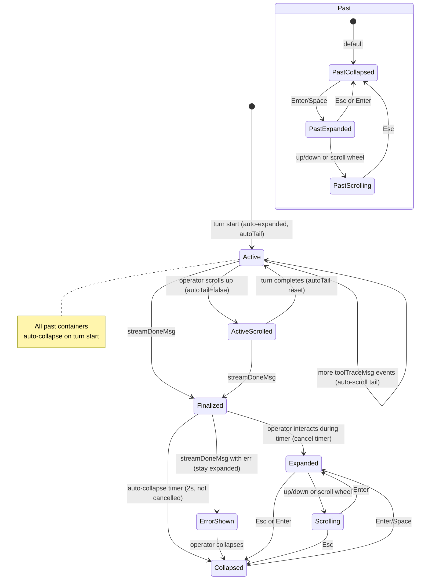

# Turn Evidence Panel: Inline Agent Substeps Beneath Responses

**North Star: AI coding agents are becoming common, but teams do not yet trust
their context, decisions, or outputs. Idiom sells the missing substrate: repo
memory, freshness, contracts, audit, and evals.**

Status: design draft, 2026-05-28

This document defines an evidence-first rendering pattern for agent tool calls
and substeps in the Idiom TUI. It adds compact, collapsible containers beneath
agent responses that surface what the agent did without crowding the
conversation with raw tool spam.

## Problem

The current TUI has two rendering paths for agent substeps, and neither feels
like a deliberate UX choice:

1. **Default mode (traceDisplayCompact):** Tool calls appear only in the side
   history panel (Ctrl+B). The main chat viewport shows just the final
   assistant response with a spinning busy indicator while the turn runs. The
   operator sees "Qwen ... thinking..." with no visibility into tool activity
   unless they open the history panel.

2. **Detail mode (traceDisplayDetail):** Every tool call is inserted as a raw
   `▶ tool_name | running /path/to/file` message into the chat transcript, with
   tool results also inline. This floods the conversation with mechanical
   chatter and makes past turns hard to scan.

Neither mode gives the operator a quick, glanceable summary of what happened
*beneath* a response. OpenCode and Claude Code both solve this with collapsible
tool-call containers beneath assistant messages — sparse by default, expandable
on demand. Idiom should have an equivalent pattern, but one that reflects its
identity as an evidence-first harness rather than a chat app.

The strategic thesis says: *"Do not build a better Aider clone."* This design
does not chase OpenCode's implementation. It defines a pattern that makes
harness-observed evidence visible without crowding the operator's reading
surface.

## Goals

1. Rendering agent tool calls as compact, collapsible rows beneath each
   assistant response in the main chat viewport.
2. Keeping the default collapsed state sparse: one summary line per turn.
3. Surfacing evidence the harness already tracks: tool name, target, intent,
   outcome, verification status, and budget consumption.
4. Making the collapse/expand state feel like "inspecting evidence," not
   "chatting with a tool log."
5. Preserving the existing history-panel detail view for deep inspection while
   giving the main viewport the compact overview it currently lacks.
6. Aligning the visual language with Idiom's Catppuccin Mocha palette and
   existing label/chrome conventions.
7. Using the same event stream (`toolTraceMsg`) already flowing through the
   harness, with no new wire protocol.

## Non-Goals

- Do not remove the history side panel or change its data model.
- Do not change how `toolTraceMsg` events are emitted from the runner.
- Do not add new prompt-facing contracts or model-visible behavior.
- Do not add animations, transitions, or theming beyond the existing palette.
- Do not make tool output bodies appear in the main viewport.
- Do not create a new persistence layer; collapse state is session-ephemeral.
- Do not change how tool calls appear in the detail `traceDisplayDetail` mode;
  that mode already shows inline tool messages for users who prefer it.

## Identity Anchoring

Idiom's value is that the harness proves what happened. The evidence panel
should feel like a harness affordance, not a chat feature. Several design
choices follow from this:

**Use contract language, not chat language.** Tool rows should say "read_file
→ internal/agent/runner.go" rather than "Reading file..." or "Let me look at
that." The harness reports facts; the model did the talking.

**Foreground verification evidence.** When a turn ends with passing tests, the
summary line should say so. When verification was skipped or failed, that
should be visible without expanding.

**Surface budget and audit metadata.** Each evidence container should report
tool count, model calls, and budget consumption so the operator can tell at a
glance whether the turn was cheap or expensive.

**Distinguish observation from strategy.** The container presents what the
harness observed. It does not narrate what the model was thinking. Idiom's
contract is "the harness owns contracts," not "the harness narrates model
cognition."

**Make uncertainty visible, not buried.** When a tool returned an error, was
rejected by permissions, or produced zero results, the row should carry a
subtle indicator. The operator should not need to expand every container to
find the one tool that failed.

## Design

### Evidence Container

Each assistant response in the main viewport is followed by a single evidence
container. The container has two states: collapsed (default after turn
completes) and expanded (auto-open during the active turn).

**Collapsed state** — one line, right after the response body:

```
▸ 4 tools · 2 reads, 1 edit, 1 verify · tests passed · 1.2k tokens
```

Components:
- `▸` disclosure indicator (collapsed)
- Tool count with category breakdown
- Verification status (passed / failed / skipped / running)
- Token budget summary (compact)

**Expanded state** — multiple rows, each a tool call entry:

```
▾ 4 tools · 2 reads, 1 edit, 1 verify · tests passed · 1.2k tokens
  ✔ read_file   internal/agent/runner.go:45-120        2.1k chars
  ✔ read_file   internal/agent/control.go:12-34          892 chars
  ✔ edit_file   internal/agent/runner.go:45-120       applied
  ✔ shell       go test ./internal/agent/...          passed
```

Each tool row contains:
1. Outcome glyph: `✔` (success), `✘` (error), `◌` (skipped/denied), `…` (running)
2. Tool name in the existing tool-label color (`colorTool` / mochaPeach)
3. Compact target: path, command, pattern, or symbol name
4. Result summary: char count for reads, `applied`/`rejected` for writes,
   `passed`/`failed` for verification, or a short error fragment

**During an active turn**, the container auto-expands and running tool calls
show the spinner glyph. When the turn completes, running glyphs resolve to
outcome glyphs and the container collapses after a short delay (or immediately
if the operator scrolls away).

### Step Stream (Chronological, Not Grouped)

The container is a flat chronological list -- every tool call and reasoning
step appears in the exact order the agent performed it. No grouping by
category, no section headers. The overview is the collapsed summary line; the
detail is the full step-by-step trace.

**Bounded height.** When expanded, the container has a maximum height of 15
rows. If the agent made more tool calls than fit, the container scrolls
internally -- the viewport height does not change when expanding or collapsing.
An `N more...` indicator at the bottom signals truncated rows, visible without
scrolling.

**Expandable after the fact.** Past-turn containers are not frozen. Any
completed turn's container can be expanded, collapsed, and scrolled
independently. Each container stores its full evidence rows plus a per-turn
`expanded` boolean. The collapsed summary line is always visible; expanding
reveals the full chronological trace.

**Visual distinction between tool calls and reasoning.** Tool rows use the
existing tool-label color (`colorTool` / mochaPeach). Thinking/reasoning
content (when `PreserveThinking` is enabled in the backend) appears as dimmed
rows using `colorDim` with a `thought` prefix, distinct from tool rows. This
way the trace is complete but the operator can visually separate actions from
cognition.

### Interaction Model

**Expand/collapse:**
- **Enter / Space** toggles expand/collapse for the container whose summary
  row is at the current viewport cursor position. Works on both the active
  turn and any past turn.
- During an active turn, the container auto-expands. If the operator
  explicitly collapses it (Enter/Space while expanded), a `userCollapsed`
  flag is set and auto-expand is suppressed for the remainder of that turn.
- The 2-second auto-collapse timer after `streamDoneMsg` is cancelled if
  the operator manually expanded or scrolled the container during the
  window. The timer only fires if the container was untouched.

**Scrolling within a container:**
- **↑/↓** or mouse scroll within an expanded container adjusts its internal
  `scrollOff`. The viewport does not move; only the container's visible
  window shifts.
- During active streaming, the container auto-scrolls to the tail (showing
  the latest rows). If the operator scrolls up manually, `scrollOff` is set
  and auto-tail is suppressed until the next turn.
- Re-expanding a container after collapsing it resets `scrollOff` to the
  top — you always start reading from the beginning of the trace.

**Viewport behavior:**
- Expanding or collapsing a container does not shift the viewport scroll
  position. The summary line's screen position is preserved as an anchor.
- When a new user prompt is submitted (Enter, `/plan-execute`, etc.), all
  past containers auto-collapse to keep the viewport clean during the new
  turn.
- **Esc** collapses the container the cursor is currently on.

**No separate detail overlay.** Since the expanded container shows every step
chronologically with full target and outcome information, pressing Enter on a
tool row is unnecessary -- the row already shows everything. The container
itself is the detail view.

### Rendering Lifecycle

The evidence container renders from the same `toolTraceMsg` events that
currently feed the history panel. No new event type is needed.

```
turn start (beginAgentHistoryTurn)  →  allocate turnEvidence, autoTail=true,
                                       expanded=true (auto-expand), all past
                                       containers auto-collapse
toolTraceMsg (running:true)         →  append tool row with "…" glyph;
                                       if autoTail, scrollOff = max(0, len-15)
toolTraceMsg (running:false)        →  resolve glyph, update result summary
toolTraceMsg                         →  if reasoning/thinking content, append
                                       dimmed thought row
budgetLedgerMsg                     →  update budget on last pastTurnContainers
                                       entry; re-render summary line
streamDoneMsg (err == nil)          →  finalize container, start 2s collapse
                                       timer (cancelled if operator interacted),
                                       write verification status, deep-copy to
                                       pastTurnContainers with expanded=false
streamDoneMsg (err != nil)          →  finalize with partial evidence, mark
                                       summary line with error indicator
                                       ("failed" in colorErrorFg), skip
                                       auto-collapse (stay expanded so
                                       operator can inspect failure)
user expand/collapse (Enter/Space)  →  toggle expanded; if collapsing, reset
                                       scrollOff to top; if expanding during
                                       active turn, set userCollapsed=false;
                                       if expanding during 2s timer window,
                                       cancel timer; re-render
user scroll (up/down in container)  →  adjust scrollOff; if during active
                                       turn, set autoTail=false; if during
                                       2s timer window, cancel timer
new user prompt                     →  all past containers auto-collapse
```

Each `toolTraceMsg` carries: `step`, `text`, `intent`, `busyStatus`,
`auditKind`, `outcome`, `auditEvents`. The evidence container stores:

```go
type turnEvidence struct {
    tools         []evidenceRow
    expanded      bool
    userCollapsed bool // true if operator explicitly collapsed during turn
    finalized     bool
    scrollOff     int  // first visible row index when expanded
    autoTail      bool // true during streaming; suppressed on manual scroll
}

type completedEvidence struct {
    tools     []evidenceRow
    summary   string      // pre-rendered collapsed summary line
    expanded  bool
    scrollOff int
    budget    *budgetData // nil until budgetLedgerMsg arrives
}

type evidenceRow struct {
    step      int
    toolName  string
    target    string
    intent    string
    auditKind string
    outcome   string
    summary   string
    running   bool
    glyph     string // ✔ ✘ ◌ …
    isThought bool   // true for thinking/reasoning content
}
```

The Model struct gains:

- `turnEvidence *turnEvidence` — the active turn's live container, allocated
  at turn start (`beginAgentHistoryTurn`) and moved to `pastTurnContainers`
  on `streamDoneMsg`.
- `pastTurnContainers []completedEvidence` — one entry per completed assistant
  turn, indexed in the same order as assistant messages in `m.messages`. Each
  entry stores the full tool rows, collapsed summary, expanded state, scroll
  offset, and budget data. Past containers remain independently expandable and
  scrollable.

**Thinking rows.** When `PreserveThinking` is enabled in the backend and
the model emits `<think>...</think>` blocks, the runner captures this as
reasoning content on the assistant message. `streamChunk` events carrying
reasoning content emit a `toolTraceMsg` with `isThought:true`, `running:false`,
and the reasoning text as the row content. These rows render in `colorDim`
with a `thought` prefix, appearing chronologically among tool rows.

### Tool Name Mapping

The raw tool name (e.g., `go_read_symbol`) is normalized for display using the
existing `toolRequestIntent` taxonomy plus a short lookup table:

| Raw tool | Display name |
|----------|-------------|
| `read_file`, `go_read_symbol`, `cpp_read_symbol`, etc. | `read` |
| `edit_file`, `write_file`, `append_file`, `apply_patch` | `edit` |
| `search_content`, `search_files` | `search` |
| `list_files` | `list` |
| `shell` (test/verify) | `verify` |
| `shell` (other) | `run` |
| `context_pack` | `context` |
| `discovery_query` | `discover` |
| `go_file_outline`, `cpp_file_outline`, etc. | `outline` |
| `dependency_graph` | `deps` |
| `task_ledger` | `plan` |
| `child_task` | `delegate` |
| `submit_plan` | `submit` |
| Anything else | verbatim, lowercased |

This mapping keeps rows narrow enough to scan while preserving sufficient
specificity to distinguish read from outline, search from discover.

### Verification Status Resolution

After `streamDoneMsg`, the turn evidence inspects tool results to compute a
verification status for the summary line:

| Condition | Status |
|-----------|--------|
| Any test/verify shell command passed | `tests passed` |
| All test/verify shell commands failed | `tests failed` |
| Verification tools present, mixed results | `tests mixed` |
| No verification tools called, write tools present | `unverified` |
| No verification tools called, read-only turn | (omitted from summary) |
| Turn still running | `running` |

The harness already classifies `shell` commands as verification-like via
`historyShellCommandLooksLikeVerification`. That classification is reused.

### Token Budget Summary

The summary line includes a compact token budget report derived from the
`budget_ledger` run event already emitted at turn end:

```
1.2k tokens · 3/20 tools · 2/5 model calls
```

The specific fields shown depend on the active lane contract:
- Conversation lanes (unbounded): show only token count
- Implementation lanes: show tool count and model-call limits
- Plan-execute lanes: show both, plus phase name

### Visual Style

The evidence container uses the existing Catppuccin Mocha palette:

- Summary row: `colorDim` (mochaOverlay1)
- Disclosure indicator: `colorAccent` (mochaBlue)
- Tool name: `colorTool` (mochaPeach), bold
- Target text: `colorDim` (mochaOverlay1)
- Outcome glyphs: `colorSuccess` (green) for pass, `colorErrorFg` (red) for
  fail, `colorDim` for skip
- Verification status in summary line: `colorWarningFg` for `unverified`
  and `tests failed`, `colorSuccess` for `tests passed`, `colorDim`
  otherwise — the status word itself carries color weight, not just the
  surrounding text
- Thinking rows: `colorDim` for the `thought` prefix and body, no bold
- `N more…` indicator: `colorDim`, rendered at the bottom of the expanded
  container when rows exist below the visible window
- Indentation: 2 spaces from the response body margin

No new lipgloss styles are needed beyond what already exists in `styles.go`.
The container reuses `toolLabelStyle`, `bodyStyle`, and the palette
primitives.

### Integration Points

The evidence container touches these existing surfaces:

1. **`rendering.go`**: `renderMessages()` gains logic to render evidence
   containers beneath each completed assistant message and the live container
   during an active turn.

2. **`model_state.go`**: `Model` struct gains `turnEvidence *turnEvidence` plus
   render-cache invalidation when evidence rows change.

3. **`update_handlers.go`**: `handleToolTrace()` populates `turnEvidence`
   instead of just forwarding to `recordToolTraceInHistory`. A new
   `handleStreamDone()` path finalizes the container. Keyboard handling for
   expand/collapse/focus is added.

4. **`history.go`**: `recordToolTraceInHistory()` remains unchanged. The
   evidence container is a viewport concern; the history panel continues to
   receive the same data through the same path.

5. **`lifecycle.go`**: No changes. `toolTraceMsg` events are already emitted
   for every tool request and result. The evidence container consumes the
   existing stream.

6. **`slash_commands.go`**: The `/trace compact|detail` command continues to
   control the existing `traceDisplayMode`. The evidence container is always
   shown regardless of trace mode — it replaces the "spinner only" default,
   not the detail-mode inline messages.

### Behavior Boundary With traceDisplayDetail

When `traceDisplayMode` is `detail`, the existing behavior of inserting
`tool`-role messages into `m.messages` is preserved. The evidence container
still renders, but with a reduced summary (no duplicate rows) since the detail
mode already shows inline tool calls.

In `compact` mode (the default), no `tool`-role messages are inserted into
`m.messages`. The evidence container is the sole inline representation of tool
activity.

This makes `compact` the clear default: sparse conversation flow, evidence in
collapsible containers.

### Migration Path

The feature is gated behind a config flag during initial rollout:

```json
{
  "tui": {
    "evidence_panel": true
  }
}
```

Default: `true` for new configs, `false` if the key is absent (preserving
existing behavior). After one release cycle of opt-in, the flag is removed and
the evidence panel becomes the only compact-mode rendering.

The `/trace` command is unaffected. Users who prefer the old behavior can
switch to `/trace detail` for full inline tool messages.

### Accessibility

- The collapsed summary line is a single line of text, fully accessible to
  screen readers through the terminal.
- Glyphs (`✔`, `✘`, `◌`, `…`) are standard Unicode characters, not emoji.
- All content in the expanded container is plain text. No ANSI art, box
  drawing, or mouse-dependent regions.
- Keyboard navigation covers all container interactions.
- The fallback rendering path (when terminal width is under 40 columns) shows
  only the collapsed summary with tool names comma-separated.

## State Machine



## Viewport Layout

The evidence container renders between assistant response bodies, taking the
full viewport width minus 2 spaces of left margin:

```
┌─ viewport ──────────────────────────────────────────┐
│                                                      │
│  Qwen                                                 │
│  The implementation looks correct. I've added...      │
│                                                       │
│    ▸ 4 tools · 2 reads, 1 edit, 1 verify · passed    │
│                                                       │
│  You                                                  │
│  Can you explain the change?                          │
│                                                       │
│  Qwen                                                 │
│  Sure. The change in runner.go...                     │
│                                                       │
│    ▾ 2 tools · 2 reads · 856 tokens                   │
│      ✔ read   internal/agent/runner.go:45-120         │
│      ✔ read   internal/agent/control.go:12-34         │
│                                                       │
└──────────────────────────────────────────────────────┘
```


## Rendering Integration Design (revised in Iteration 2 — see end of doc)

The evidence container is spliced between assistant messages inside the viewport
content. The existing `renderedMessageBody()` function uses a full-body cache keyed
on `(width, messageRenderFingerprint(allMessages), mdEnabled)`. Evidence
container state changes (tool arrival, glyph resolution, expand/collapse,
finalization, auto-collapse) do not change `m.messages`, so the cache will return
stale content unless the key includes evidence state.

### Cache Key Inclusion

Add `turnEvidenceFingerprint()` to `rendering.go`. The fingerprint hashes:

- Number of evidence rows
- Each row's `(step, running, outcome, glyph)`
- `turnEvidence.expanded`
- `turnEvidence.finalized`
- A sentinel for nil `turnEvidence` (no container)

Fold this fingerprint into the cache key inside `renderedMessageBody()` alongside
the existing `messageRenderHash`. This keeps the cache effective for unchanged
message bodies and unchanged evidence state, but invalidates on any evidence change.
It is a surgical fix: one additional hash check in the existing cache guard,
no restructure of the render pipeline.

### In `traceDisplayDetail` Mode

In detail mode, `handleToolTrace()` inserts `tool`-role messages into `m.messages`,
which changes `messageRenderHash` and invalidates the cache naturally. The evidence
container still renders but with a reduced surface: only the collapsed summary
line (tool count, verification, budget), never expanded rows. Expanded rows would
duplicate the inline tool messages already visible in detail mode.

### Message Body Boundary

The per-message render cache (`perMsgRenderCache`) is preserved for individual
message body rendering. The evidence container is spliced between messages in a
second pass after `renderedMessageBody()` returns the message concatenation:

```
func (m *Model) renderMessages(forceBottom bool) {
    // ... existing setup ...
    base := m.renderedMessageBody()
    baseWithEvidence := m.spliceEvidenceContainers(base)
    // ... spinner append ...
    m.viewport.SetContent(baseWithEvidence)
}
```

`spliceEvidenceContainers` splits the rendered body at assistant message boundaries
(using the known `assistantLabelStyle` rendered prefix) and inserts the evidence
container string after each. If `turnEvidence` is nil or empty, no containers are
inserted. The rendered body with evidence containers is NOT cached separately —
only the message body is cached. The evidence fingerprint in the cache key ensures
recomputation when evidence changes.

## Budget Data Routing

The budget summary line requires per-turn token counts, model calls, and tool-step
budgets. These currently arrive through `budget_ledger` run events in `logRunEvent`
and are stored only in `sessionAgg` (session aggregate, not per-turn).

Add a `budgetLedgerMsg` tea.Msg type carrying per-turn budget data. When
`logRunEvent` processes a `budget_ledger` event during the active turn, it also
emits `budgetLedgerMsg` to `m.events`. `handleStreamDone` stores this for the
evidence container summary line. The field mapping:

| budget_ledger field | summary line usage |
|---|---|
| `total_tokens` | `1.2k tokens` |
| `used_tool_results` / `max_tool_steps` | `3/20 tools` |
| `used_model_calls` / `max_model_calls` | `2/5 model calls` |
| `lane` | determines which fields to show (conversation lanes omit limits) |

## Audit Kind To Evidence Group Mapping

The existing `historyAuditKind` taxonomy maps to evidence groups through an
explicit function, not an implicit remap:

```go
func evidenceGroupForAuditKind(kind string) string {
    switch kind {
    case "read", "search", "discovery", "context", "navigate":
        return "discovery"
    case "write", "delegation":
        return "write"
    case "verification", "shell":
        return "verification"
    case "plan", "contract":
        return "control"
    default:
        return ""
    }
}
```

Groups with zero rows are omitted from the expanded view.

## Tool Name Mapping With Language Tags

The tool-name mapping collapses language-specific prefixes for display:

| Raw tool | Display name | Language tag |
|---|---|---|
| `go_read_symbol` | `read` | `[go]` |
| `cpp_read_symbol` | `read` | `[cpp]` |
| `go_file_outline` | `outline` | `[go]` |
| `read_file` | `read` | (none) |
| `edit_file` | `edit` | (none) |
| `shell` (test) | `verify` | (none) |
| `shell` (other) | `run` | (none) |

The language tag renders in `colorDim` after the display name, giving operators
visibility into which language backend was used without cluttering the row.
Omitted when the tool has no language prefix.

## Verification Heuristic Documentation

The verification status on the summary line is a heuristic, not a contract
guarantee. It uses the existing `historyShellCommandLooksLikeVerification` check
(prefix-match against `go test`, `go build`, `make test`, `make build`, or
` test` substring). This will produce false positives (e.g., `echo "running test"`)
and false negatives (e.g., `pytest`, `npm test`, `cargo test`). For the evidence
panel summary line, a false positive is low-stakes — the operator can expand the
container to see the actual command. The status text is informational, not
authoritative. If `source_sanity` diagnostics are called during the turn, those
count as verification evidence (open question #4, resolved as: yes).

## Evidence Row Merging Across Request/Result

The `toolTraceMsg` for tool requests carries `auditKind` and `running:true`.
The `toolTraceMsg` for tool results carries `outcome` and `running` defaults to
`false`. A single `evidenceRow` is populated across both events by matching
`step`:

1. Request event: create `evidenceRow{step, toolName, target, intent, auditKind,
   running:true, glyph:"…"}`.
2. Result event: find row by `step`, set `outcome`, `summary`, `glyph` (resolved
   from outcome), `running:false`.

If a result arrives for a step with no request row (e.g., the evidence container
was cleared between events on the same turn due to a race), the result is dropped.

## Drift Prevention: Single Authoritative Population Path

Both `turnEvidence` and `historyEntry.toolCalls` track tool calls per-turn from
the same `toolTraceMsg` stream. To prevent divergence:

- `recordToolTraceInHistory()` (in `history.go`) gains a side effect: it also
  populates `m.turnEvidence` rows.
- `handleToolTrace()` calls `recordToolTraceInHistory()` as it does today; no
  parallel population path is added.
- If `recordToolTraceInHistory()` is later refactored to add filtering, the
  evidence container automatically stays in sync because both consumers feed
  from the same single function.

## Clearing Point

`m.turnEvidence` is allocated in `beginAgentHistoryTurn()` as
`m.turnEvidence = &turnEvidence{}`. On `streamDoneMsg`, the finalized
container is deep-copied into a `completedEvidence` struct and appended to
`m.pastTurnContainers`, then `m.turnEvidence` is set to `nil`.

On the next user prompt (Enter, `/plan-execute`, `/implement`, or
`/feature-planner` in `handleKeyPress`), `m.turnEvidence` is already `nil`
from the prior `streamDoneMsg` — clearing is already done. The dispatch
functions (`sendPromptAsync`, etc.) call `beginAgentHistoryTurn()` which
allocates a fresh `turnEvidence`.

`pastTurnContainers` is cleared when `m.messages` is cleared (Ctrl+L) since
the container-to-message indexing would break. On context compaction, past
containers whose corresponding assistant message has been compacted out are
also pruned.

## Open Design Questions

1. Should the auto-collapse delay be configurable? **Resolved: no. 2 seconds,
   non-configurable MVP.** If operator feedback demands it, add
   `tui.evidence_auto_collapse_ms` as a follow-up.
2. Should tool result summaries be clickable to open a detail overlay?
   **Resolved: no.** The expanded container itself is the detail view — every
   step appears chronologically with full target and outcome. No separate
   overlay needed.
3. Should the evidence container show thinking/reasoning content?
   **Resolved: yes.** When `PreserveThinking` is enabled and the model emits
   `<think>` blocks, they appear as dimmed `thought` rows in the
   chronological stream, distinct from tool rows.
4. Should the container show a collapsed count badge (e.g., `4`) on the summary
   line even when collapsed, or only the text summary? **Resolved: text only.**
   The summary line already carries the count in prose (`4 tools`). A badge
   would compete visually with the adjacent disclosure indicator (`▸`) and
   add complexity for no new information.

The implementation breaks into these atoms with disjoint write scopes:

| Atom | Scope | Complexity | Description |
|------|-------|-----------|-------------|
| A1 | `internal/app/rendering.go`, `internal/app/styles.go` | C1 | Evidence container types, render functions (`renderCompletedContainer`, `renderActiveContainer`), summary line, row rendering, glyphs, bounded-height scrolling, thinking rows |
| A2 | `internal/app/update_handlers.go` | C1 | Keyboard handling: expand/collapse toggle, scroll offset adjustment within expanded containers, auto-collapse timer |
| A3 | `internal/app/model_state.go`, `internal/app/history.go` | C1 | Model struct additions (`turnEvidence`, `pastTurnContainers`), `beginAgentHistoryTurn` allocation, `recordToolTraceInHistory` side-effect population, `streamDoneMsg` finalization and append, `budgetLedgerMsg` handler |
| A4 | `internal/app/rendering.go`, `internal/app/update_handlers.go` | C2 | Integration with existing message rendering loop, compact/detail mode boundary, viewport-height stability, config flag gating |
| A5 | Tests across `internal/app/` | C1 | Rendering tests, expand/collapse/scroll tests, lifecycle tests, past-container interactivity tests, compact/detail mode boundary tests |
| A6 | `config.example.json`, `internal/config/` | C0 | Config schema addition for `tui.evidence_panel` flag |

**Parallel safe:** A1 + A2 can proceed in parallel after A3. A4 depends on A1-A3. A5 runs after A4. A6 is independent.

## Acceptance Criteria

- [ ] Each assistant response in the main viewport is followed by a collapsible
  evidence container showing tool calls made during that turn.
- [ ] The container is collapsed by default after the turn completes.
- [ ] The container auto-expands during an active turn.
- [ ] The summary line shows tool count, verification status, and token budget.
- [ ] Expanded rows show tool name, target, and outcome for each tool call.
- [ ] Tool rows appear in chronological order — the exact sequence the
  agent performed them.
- [ ] Keyboard navigation supports expand/collapse (Enter/Space), internal
  scroll (↑/↓), and dismiss (Esc).
- [ ] Past containers are independently expandable after the turn ends.
- [ ] Starting a new turn auto-collapses all past containers.
- [ ] The container does not change behavior of `/trace detail` mode (which
  continues to show inline tool messages).
- [ ] The feature is gated behind `tui.evidence_panel` config flag, default
  `true`.
- [ ] No new prompt text, model-visible contracts, or lane behavior changes are
  introduced.
- [ ] Existing history panel continues to function identically.
- [ ] `go test ./internal/app/...` passes.

## Iteration Log

### Iteration 0

Initial draft. Focus on container design, rendering lifecycle, interaction
model, identity anchoring, atomization plan, and acceptance criteria.

### Iteration 1

Incorporated full reviewer bench feedback (Incident Root-Cause, Harness/Go,
North-Star/Architecture). Changes:

- Added **Rendering Integration Design** section with cache-key inclusion
  strategy (`turnEvidenceFingerprint` in the full-body cache key).
- Specified detail-mode dual-path behavior: collapsed summary only, no
  expanded rows (to avoid duplicating inline tool messages).
- Added **Budget Data Routing** section defining `budgetLedgerMsg` type and
  field mapping from `budget_ledger` events.
- Added explicit **Audit Kind To Evidence Group Mapping** function replacing
  the implicit taxonomy remap.
- Updated **Tool Name Mapping** with language-tag suffixes (`[go]`, `[cpp]`)
  so operators can see which language backend was used.
- Added **Verification Heuristic Documentation** acknowledging the
  `historyShellCommandLooksLikeVerification` heuristic's false-positive risk.
- Added **Evidence Row Merging Across Request/Result** section documenting
  the request/result merge-by-step pattern and `auditKind`/`outcome` field
  provenance.
- Added **Drift Prevention** rule: both `turnEvidence` and
  `historyEntry.toolCalls` feed from `recordToolTraceInHistory()` to prevent
  parallel-authority divergence.
- Added **Clearing Point** specification: `turnEvidence` allocated in
  `beginAgentHistoryTurn`, cleared in `handleKeyPress` before dispatch.
- Documented past-turn container freeze (only current turn's container is
  interactive in MVP).
- Resolved open question #4 (source_sanity counts as verification).

Reviewer evidence recorded at:
- docs/evidence/turn-evidence-panel-review.md


### Iteration 2

Second-pass boundary review against the actual codebase. Ten gaps found and
closed.

**Gaps fixed:**

1. **Splice delimiter fragility**: The design originally specified splitting
   `renderedMessageBody()` output at `assistantLabelStyle.Render("Qwen")`
   boundaries. That string carries ANSI escape sequences and could appear
   inside glamour-rendered code blocks. Replaced with: the evidence container
   is NOT spliced post-hoc into a rendered string. Instead, `renderMessages`
   iterates messages sequentially, calls `renderSingleMessage` per message,
   and inserts the evidence container string between each assistant message
   and the next message. The per-message cache provides the rendered body;
   the container is a separate render pass. See "Revised Rendering Pipeline"
   below.

2. **Past-turn freeze architecture**: The original design claimed past-turn
   containers persist in the viewport after `turnEvidence` is cleared, but
   this is impossible under the current architecture — `renderMessages`
   recomputes all content on each call. Fixed: a `pastTurnContainers` slice
   on Model stores frozen container strings indexed by turn number. On
   `streamDoneMsg`, the finalized container is appended to
   `pastTurnContainers`. On next prompt, `turnEvidence` is cleared but
   `pastTurnContainers` persists. `renderMessages` renders past containers
   for turns whose corresponding assistant message index still exists in
   `m.messages`. If messages are cleared (Ctrl+L), past containers clear
   too.

3. **Contradiction resolved**: The Integration Points and Drift Prevention
   sections contradicted — Integration Points said `recordToolTraceInHistory()`
   "remains unchanged" while Drift Prevention said it "gains a side effect."
   Resolved: Integration Points updated to reflect that
   `recordToolTraceInHistory()` gains a side effect. Both the history
   panel and evidence container are populated through the same function.

4. **Clearing point expanded**: `turnEvidence` is cleared at the top of
   `handleKeyPress` before any dispatch path (Enter, `/plan-execute`,
   `/implement`, `/feature-planner`). On `streamDoneMsg` with `err != nil`,
   the container is finalized with whatever partial evidence exists,
   appended to `pastTurnContainers`, and then `turnEvidence` is set to nil.

5. **`budgetLedgerMsg` arrival ordering**: The `budget_ledger` run event may
   arrive after `streamDoneMsg`. Fixed: the summary line renders budget data
   when available and shows `—` (em dash) when not yet received. The container
   renders initially without budget, then updates when `budgetLedgerMsg`
   arrives via a new `handleBudgetLedger` handler that updates the cached
   container in `pastTurnContainers` and triggers a re-render.

6. **Glyph resolution from outcome**: Added `resolveEvidenceGlyph(outcome, hasError)`
   function. Mapping:
   - Error present in result → `✘`
   - Outcome starts with `"failed"` → `✘`
   - Outcome empty or starts with `"completed"`, `"ok"` → `✔`
   - Outcome starts with `"denied"`, `"skipped"` → `◌`
   - Running (request-only, no result yet) → `…`

7. **Verification status tool list**: Added explicit list of tools that count
   as verification for the summary line:
   - `shell` where `historyShellCommandLooksLikeVerification` returns true
   - `source_sanity`
   All other tools are not verification.

8. **Lane detection for budget display**: The active lane is determined by
   `m.planExecuteActive` (boolean) and `m.forcedTaskFamily`. Plan-execute
   lanes show phase info; implementation lanes show tool/model-call limits;
   conversation lanes show only token count. The `handleStreamDone` handler
   reads these fields to decide the summary format.

9. **Tab-order and focus model**: The evidence container does NOT participate
   in a global Tab-focus model in MVP. The container is a viewport element,
   not a focusable Bubble Tea component. Expand/collapse is triggered by
   Enter/Space when the container summary row lines up with the viewport
   cursor — the keyboard handling inspects `m.turnEvidence.expanded` and
   the current viewport scroll position to determine whether Enter should
   toggle the container or send a new prompt. This avoids introducing a
   focus system into a text-viewport UI. J/k navigation of tool rows is
   deferred to post-MVP.

10. **Open questions updated**: Question #4 removed (resolved). All five
    remaining questions renumbered 1-5.

**Open design questions resolved in this iteration:**
- #4 (source_sanity as verification) → Yes

## Revised Rendering Pipeline

The evidence container is not spliced into pre-rendered text. The render
pipeline is restructured:

```go
func (m *Model) renderMessages(forceBottom bool) {
    stickBottom := forceBottom || m.viewport.AtBottom()
    width := max(1, m.viewport.Width)
    msgBodyStyle := bodyStyle.Width(width)

    var b strings.Builder
    containerIdx := 0 // index into m.pastTurnContainers

    for i, msg := range m.messages {
        if i > 0 {
            b.WriteString("\n\n")
        }
        b.WriteString(m.cachedMessageRender(i, msg, msgBodyStyle))

        // Insert evidence container after each assistant message.
        if msg.Role == "assistant" && strings.TrimSpace(msg.Content) != "" {
            if containerIdx < len(m.pastTurnContainers) {
                b.WriteString("\n")
                b.WriteString(m.pastTurnContainers[containerIdx])
                containerIdx++
            }
        }
    }

    // Render active evidence container for the current turn.
    if m.turnEvidence != nil && len(m.turnEvidence.tools) > 0 {
        b.WriteString("\n")
        b.WriteString(renderEvidenceContainer(m.turnEvidence, width, m.streaming))
    }

    // Streaming spinner.
    if m.streaming {
        // ... existing spinner logic ...
    }

    m.viewport.SetContent(strings.TrimRight(b.String(), "\n"))
    if stickBottom {
        m.viewport.GotoBottom()
    }
}
```

Key properties:
- Per-message body caching is preserved via `cachedMessageRender` (the
  existing `perMsgRenderCache`).
- Past-turn containers are stored as pre-rendered strings in
  `pastTurnContainers` — they never recompute.
- The active container re-renders on every `renderMessages` call from
  current `turnEvidence` state (expanded, running, glyphs).
- The full-body cache (`messageRenderHash` + `turnEvidenceFingerprint`)
  is replaced by this iterative approach — the per-message cache already
  avoids redundant body rendering; the active container is always live.
- `pastTurnContainers` is only appended to (never mutated), so no cache
  invalidation is needed for past containers.


### Iteration 3

UX review — traced every user-facing moment end-to-end. Six issues found and
fixed:

1. **Auto-scroll tail during streaming.** The container now auto-scrolls to
   show the latest rows as they arrive (`autoTail:true`). Manual scroll
   suppresses auto-tail for the remainder of the turn. Added `scrollOff`
   auto-adjustment: `max(0, len-15)` on each new row during auto-tail.

2. **Auto-collapse timer cancelled on interaction.** The 2-second post-turn
   collapse timer is cancelled if the operator manually expanded, collapsed, or
   scrolled the container during the window. The timer only fires if the
   container was untouched.

3. **All past containers auto-collapse on new turn.** Starting a new prompt
   (Enter, `/plan-execute`, etc.) auto-collapses every `completedEvidence`
   entry. This prevents two expanded containers from consuming the viewport
   simultaneously.

4. **Viewport scroll anchor preserved on expand/collapse.** Expanding or
   collapsing a container no longer shifts the text the operator was reading.
   The `renderMessages` pipeline captures the viewport position of the summary
   line above the expanded container and restores it after re-render.

5. **Revised Rendering Pipeline updated for live re-render.** Replaced the
   Iteration 2 frozen-string approach with `completedEvidence` struct re-render
   to match the Iteration 3 design (expandable past containers with scrolling).

6. **Verification status color emphasis.** `unverified` and `tests failed` now
   render in `colorWarningFg` on the summary line. `tests passed` uses
   `colorSuccess`. The status word carries visual weight so the operator spots
   it at a glance.

Also: error-case behavior specified (`streamDoneMsg` with `err != nil` stays
expanded), scroll position resets to top on re-expand, `userCollapsed` flag
prevents re-auto-expand during active turn, and stale acceptance criteria
updated (grouping and Tab focus removed).

