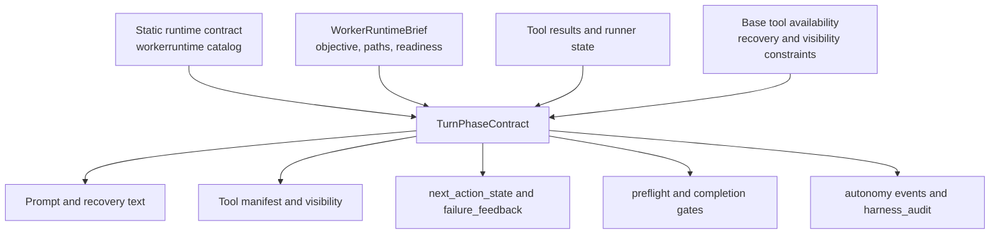

# Turn Phase Contract Design

Status: implemented through guidance projection and audit contradiction checks
Evidence snapshot: repo docs and source inspected on 2026-05-22; live TUI
plan-execute debugging through 2026-05-21; reviewer passes by Darwin, Erdos,
and Volta

## Objective

Reduce harness churn by making each model turn expose one coherent phase
contract across prompts, tool visibility, recovery text, logs, gates, and audit.

The target shape is:

```text
phase -> allowed tools -> required next shape -> invalid next actions -> stop condition
```

This design is intentionally incremental. It does not replace every runner guard
at once. It introduces a typed projection that can first run in shadow and then
become the source consumed by existing guidance and enforcement surfaces.

North star: the model owns strategy; the harness owns contracts. The harness
should not choose the implementation approach, but it must make the current
contract unambiguous and enforce real invariants.

## Problem Statement

Recent live TUI plan-execute runs exposed a recurring failure shape: one harness
surface correctly told the model that a terminal action was required, while
another generic surface still advertised a probe or follow-up as valid.

Examples of this class:

- Review-repair closeout hid discovery tools and required one terminal outcome,
  but generic `next_action_state` / `failure_feedback` still suggested an exact
  tool-shaped follow-up.
- Submit-plan readiness narrowed the visible surface to `submit_plan`, but
  unrelated recovery wording could still imply more discovery or generic
  answering.
- Required edit paths, source-body evidence obligations, and
  `submit_plan.edits[]` coverage are sometimes described with overlapping
  language, letting a model treat evidence, scope, and planned edits as the same
  thing.

These are not primarily model-capability failures. They are authority
composition failures. A capable local model can still behave poorly when the
latest prompt, tool manifest, recovery packet, and audit state disagree about
what turn it is in.

## Goals

- Make the active turn phase observable as one typed host-owned contract before
  each model call.
- Keep the model's strategy choices open when they are contract-compliant, while
  making real invariants unambiguous.
- Give prompts, tool visibility, recovery text, next-action state, gates, logs,
  and audit a shared source for allowed action classes, invalid action classes,
  terminal outcomes, and readiness state.
- Preserve the existing autonomy contract stream and runner gates during the
  first implementation; the new phase contract starts as a projection and drift
  detector.
- Keep mutation scope, source-body evidence obligations, and
  `submit_plan.edits[]` coverage separate in the contract vocabulary.
- Make runtime-call compatibility explicit so a phase that requires
  `submit_plan`, source refresh, or visible terminal text is paired with a
  backend/parser/tool surface that can actually express that action.

## Current Evidence

Verified source evidence:

- `README.md` describes Idiom as a local harness whose core split is "the model
  owns strategy; the harness owns contracts, evidence, and verification." It
  also states that `idiom lane` preloads a compact `context_pack` for implement
  and plan-execute lanes.
- `docs/idiom-strategic-thesis.md` and `docs/idiom-design-roadmap.md` define
  contract-first local autonomy, repository memory, auditable handoff, local
  model operations, and eval/audit learning as the product pillars.
- `docs/decisioning-north-star.md` says readiness is harness-computed observable
  state, prompts are not the source of truth, and typed authority contracts must
  carry required coverage paths, candidate scope, exact snippets, edit-set
  obligations, evidence paths, and recovery state.
- `.codex/common-traps.md` and `docs/idiom-maintenance-best-practices.md` record
  the failure patterns this design targets: conflicting terminal states,
  duplicate authority, prompt text parsed as authority, planner/executor tool
  confusion, overloaded required-path language, and missing final-state
  telemetry.
- `internal/autonomy/contract.go` already defines `AutonomyContract` with scope,
  authority sources, path roles, capabilities, tool policy, obligations, budget,
  verification, completion, readiness, policy decisions, and evidence refs.
- `internal/autonomy/event.go` already defines lifecycle, policy, obligation,
  readiness, completion, and gate events under `idiom.autonomy.event.v1`.
- `internal/agent/runner_autonomy.go` compiles contracts from
  `WorkerRuntimeBrief`, `RunPolicy`, and prior tool results, then emits
  `contract_compiled`, obligation, readiness, gate, and completion events.
  Required edit path status is currently reported as `pending` or `changed`
  from observed changed-path tool results.
- `internal/app/turn_planner.go` has deterministic routing for workflow
  contracts and explicit cases for `plan_then_execute_planner` and
  `plan_then_execute_review_repair`, proving the harness already distinguishes
  planner and review-repair actors.
- `internal/app/implementation_dispatch.go` already routes referenced design
  documents through plan-execute, extracts or materializes design-doc atoms,
  handles source-satisfied closeout, preserves design-doc test obligations, and
  distinguishes required paths from candidate scope in retry text.
- `internal/app/turn_planner_test.go` covers design-doc dispatch, ambiguous or
  unlinted plan documents, reference-only design-doc dispatch without refine,
  source-satisfied atom short-circuiting, and candidate-scope treatment for
  design-doc file references.
- `internal/autonomy/contract_test.go` proves the autonomy contract can build a
  stable summary and round-trip sidecar read-only contracts without strategy
  fields such as `next_action` or `must_call_tool`.

Inference from the evidence:

- The repo already has most durable contract primitives, but no compact
  per-turn projection that all prompt, tool, recovery, gate, and audit surfaces
  consume together.
- Many existing recovery strings encode the intended phase contract in prose.
  That is useful evidence for parity tests, but it should not become the
  runtime source of authority.
- A turn phase contract is best modeled as an adapter/projection over current
  runner state and the existing autonomy contract, not as a competing policy
  engine.

## Decision

Introduce a typed `TurnPhaseContract` projection in `internal/agent`.

`TurnPhaseContract` is a per-turn projection of the existing autonomy contract,
not a sibling policy engine. It should carry the stable contract identity and
invariant references needed to prove that the live prompt/tool/gate surfaces are
rendering the same harness-owned contract already represented by autonomy
events.

The projection should derive the live turn contract from:

- the static runtime contract in `workerruntime`,
- the current `WorkerRuntimeBrief`,
- prior `workspace.ToolResult`s,
- base tool availability plus current recovery/visibility constraints,
- last request/result where relevant,
- small runner state flags that cannot yet be derived from the transcript.

The projection should be pure or near-pure: it should not emit events, mutate
tool visibility, call tools, or write files. Callers render it into prompts,
next-action state, failure feedback, tool surfaces, and audit events.

```go
type TurnPhaseContract struct {
    SchemaVersion    string
    ContractID       string
    PhaseID          string
    PhaseEpoch       int
    ModelCallID      string
    Step             int
    Phase            string
    DerivationReason string
    InvariantIDs     []string
    PermissionProfile string
    AllowedTools     []string
    HiddenTools      []string
    RequiredNext     []string
    InvalidNext      []string
    StopConditions   []string
    TerminalOutcomes []string
    Constraints      []string
    ActionPolicy     TurnActionClassPolicy
    RuntimeCall      RuntimeCallContract
    EvidenceState    PhaseEvidenceState
    EnforcementMode  string
}

type TurnActionClassPolicy struct {
    AllowedActionClasses []string
    InvalidActionClasses []string
    TerminalResponseShapes []string
    CallableToolNames []string
}

type RuntimeCallContract struct {
    BackendKind string
    ModelAlias string
    ToolTransportMode string
    ParserContract string
    ResponseFormat string
    ToolChoice string
    ThinkingPolicy string
    MaxTokens int
    ExpectedVisibleOutput string
    ExpressibleActionClasses []string
}

type PhaseEvidenceState struct {
    AcceptanceRefs []string
    TDDObligationRefs []string
    VerificationEvidenceRefs []string
    ProductWorkflowState string
    AtomStatus string
    RecoveryPacketRefs []string
    ResidualBlockers []string
}
```

The first implementation should be a projection and parity layer, not a
behavior rewrite. Existing guards remain authoritative until tests prove a
contract field can replace them without changing valid behavior.

`AllowedTools` means callable manifest-visible tools only. Valid no-tool
terminal completions such as `Decision: source-satisfied`, `Decision: pass`, and
`<<QUESTION>>:` belong in `TerminalOutcomes` and `ActionPolicy`, not in the tool
list.

## Authority Boundaries

- `internal/frontier/workerruntime/catalog.go` remains the static source for
  task-family defaults, permission profiles, readiness gates, search policy, and stop
  conditions.
- `internal/agent` owns the live turn projection because live phase facts depend
  on runner state, prior tool results, dynamic tool surfaces, and recovery
  state.
- `TurnPhaseContract` should reference the active autonomy `contract_id` and
  invariant IDs. It is the compact live phase view over that contract, not an
  unlinked second contract stream.
- `internal/autonomy` and `harness_audit` consume projected contract snapshots
  for replay and drift detection. They should not become the live policy source.
- Prompt text, examples, tool schemas, and context packets explain or localize
  the contract. They are not the source of hard obligations.
- Existing string-based route helpers are temporary compatibility inputs, not
  durable authority. The projection should consume typed route state wherever it
  exists, and should not bless phrase matching as a contract selector.

The deterministic merge order should be:

```text
static catalog -> runtime brief -> result/readiness state -> recovery state
-> tool-surface/backend constraints -> final phase projection -> renderers
```

Renderers may format text or choose concise wording. They must not add action
classes, callable tools, terminal response shapes, or runtime-call obligations
that are absent from the projected contract.

## Lifecycle And Events

The contract should be derived before each model call and after any recovery or
tool-surface state transition. A rejected completion, hidden-tool update,
terminal surface refresh, or source-readiness transition can change the live
contract before the next model attempt.

Proposed lifecycle:

1. Compile the durable autonomy contract from lane/runtime inputs.
2. Derive the current `TurnPhaseContract` from the autonomy contract, runtime
   brief, visible tools, prior results, and recovery state.
3. Present the phase contract to model-facing renderers: prompt lead-in,
   recovery text, `next_action_state`, `failure_feedback`, and tool manifest.
4. Observe the model action as a tool request, terminal outcome, or invalid
   response shape.
5. Apply the existing deterministic gate for that action class: write,
   verification, completion, loop, budget, read-only, or plan-artifact gate.
6. Re-derive when gate output changes evidence state, hidden tools, terminal
   requirements, or recovery phase.
7. Close when a terminal outcome satisfies readiness and completion obligations,
   or stop with a typed blocker/exhausted-budget outcome.

Event mapping:

- `contract_compiled` remains the durable lane/phase contract event emitted
  from the existing autonomy contract.
- `turn_phase_contract` is the proposed per-model-call projection payload. It
  should be carried as an autonomy lifecycle presentation/recompile event, or as
  runner telemetry that links to the autonomy `event_id`, `sequence`, and
  `contract_id`. It must not become an uncorrelated second contract stream.
  The payload references phase identity, action classes, tool visibility,
  runtime-call contract, evidence state, and enforcement mode.
- `tool_intent_classified`, `path_roles_resolved`, `tool_policy_decision`, and
  `tool_policy_result` continue to describe the observed action and gate
  decision.
- `readiness_state_updated`, `completion_gate_decision`, and `gate_decision`
  continue to describe gate state. Audit correlates them with the latest prior
  `turn_phase_contract` rather than reconstructing intent from prose.



The `Contract --> Gates` edge is the long-term direction. During migration,
existing gates remain authoritative and consume the projection only after parity
tests prove the projected contract matches current enforcement.

## Action-Class Consistency

The important audit dimension is not exact wording. It is whether all surfaces
advertise the same action classes for the active phase.

Initial active action classes:

- `read`: bounded source or evidence reads.
- `search`: search/discovery across unknown scope.
- `submit_plan`: planner or corrective plan artifact submission.
- `per_edit_write`: direct workspace mutation tools.
- `deliverable_write`: non-source deliverable or scratchpad artifact write.
- `source_satisfied`: explicit no-op / already-satisfied decision with evidence.
- `blocker`: typed `<<QUESTION>>:` or exact blocker.
- `verify`: shell/source-sanity/test verification.
- `final_answer`: natural language closeout.
- `review_pass`: review-repair `Decision: pass`.
- `generic_probe`: open-ended follow-up that is not tied to the current phase
  contract.
- `prose_final`: prose-only closeout without the required terminal shape.

Future dormant action classes:

- `plan_part`: non-executable staged plan edit chunk.
- `finalize_plan`: final durable plan artifact creation from staged chunks.

`plan_part` and `finalize_plan` are forbidden in all current plan-execute phases
until staged-plan mode is intentionally designed and enabled.

For each phase, `TurnPhaseContract` should define allowed and forbidden action
classes. Renderers may choose wording, but they must not introduce a forbidden
class.

## High-Risk Phase Policies

| Phase | Allowed classes | Forbidden classes |
| --- | --- | --- |
| plan-execute required-source | `read`, `source_satisfied` only with current-state evidence for every required path, `blocker` | `submit_plan`, `per_edit_write`, broad `search` |
| plan-execute submit-ready native-required | callable `submit_plan`; `source_satisfied` and `blocker` are valid terminal exceptions only after transition to textual/completion-gate recovery | `read`, `search`, `verify`, `per_edit_write`, `generic_probe`, `prose_final`, non-tool prose while `ToolChoice=required` |
| plan-execute submit-ready textual/correction | `submit_plan`, `source_satisfied`, `blocker` | `read`, `search`, `verify`, `per_edit_write`, `generic_probe`, `prose_final` |
| plan-execute stale-anchor refresh | bounded `read` | `submit_plan`, `source_satisfied`, `blocker`, broad `search`, `per_edit_write` |
| malformed submit-plan recovery after source-ready | `submit_plan`, `source_satisfied`, `blocker` | `read`, `search`, `per_edit_write`, `prose_final` |
| review-repair terminal | `review_pass`, `submit_plan`, `blocker` | `read`, `search`, `verify`, `generic_probe`, `prose_final` |
| implementation write-ready | scoped `per_edit_write`, `blocker` | broad `search`, unrelated `per_edit_write`, `generic_probe` |
| scratchpad deliverable closeout | `deliverable_write`, `blocker` | `read`, broad `search`, `generic_probe` |
| product acceptance closeout | `final_answer`, `blocker` | `final_answer` when TDD evidence, post-write verification, product workflow state, or recovery packets remain open |

This table is a starting point. The implementation should keep phase names and
action classes small enough that every new class has a clear contract meaning.

Submit-ready and stale-anchor refresh must remain distinct phases. A rejected
plan with stale or missing anchors enters an anchor-refresh phase that exposes
only bounded source-body refresh while concrete refresh paths are known. It is
not an exception to terminal submit-ready; it is a different phase with a
different contract.

## Runtime Call Compatibility

An action contract is incomplete unless the model call can actually express the
required action under the active backend and parser mode. `RuntimeCallContract`
records the runtime facts that must align with the phase:

- backend kind/profile and model alias,
- native versus textual tool transport,
- parser contract and response format,
- tool choice,
- thinking policy,
- max token budget,
- expected visible-output shape.

Terminal plan-execute phases should declare one of:

- native `submit_plan` required,
- textual JSON `submit_plan` required,
- textual fallback active after native no-tool-call behavior,
- source-refresh parser required.

For native `submit_plan` calls with required tool choice, `TerminalOutcomes` may
still name the phase's logical outcomes, but `RuntimeCallContract` must mark
only the native `submit_plan` action class as expressible in that model call.
`Decision: source-satisfied` and `<<QUESTION>>:` become expressible only in a
textual correction, completion-gate recovery, or other visible-output phase.

Audit should flag cases where the phase allows `submit_plan` but the request
payload exposes neither native `submit_plan` nor a textual parser contract, or
where a terminal parser phase still preserves hidden-only output as acceptable
completion evidence.

## Acceptance And Product Evidence Contract

Action-class consistency does not by itself prove acceptance completeness. A
phase can expose the right next action while still lacking required product,
TDD, verification, or recovery evidence.

`PhaseEvidenceState` should carry harness-owned acceptance facts:

- acceptance criteria references,
- TDD obligation references and status,
- post-write verification evidence references,
- product workflow or atom status,
- recovery packet references,
- residual-work blockers.

Product closeout, review pass, and accepted final-answer phases must be invalid
when the active `VerificationContract`, readiness gate, product workflow state,
or open autonomy obligation refs require the missing evidence:

- required TDD evidence is missing or unmapped,
- verification evidence is absent, failed, or pre-write only,
- product workflow state is `recovery_open`, skipped, or incomplete,
- a lane has produced a product implementation defect that must return through a
  recovery packet or repair atom.

This is intentionally conditional. Docs, prompt, review-only, and other
`not_required_*` phases may close without generic post-write verification when
their active runtime contract says verification is not required and no separate
TDD, product, recovery, or review obligation remains open.

This preserves the TDD/lane-testing boundary: product implementation defects go
back through the lane as typed repair evidence. The design must not encourage
manual product-code patching by an external reviewer while the active goal is to
test TUI or lane behavior.

## Validation And Readiness Gates

The phase projection should not replace deterministic validation. It should make
the validation state visible before the model acts and make contradictions
audit-visible after the model acts.

Gate mapping:

- Write gate: validates write-side effects, protected paths, required edit path
  coverage, allowed/candidate edit scope, and plan-execute planner restrictions.
- Plan-artifact gate: validates `submit_plan` schema, edit shape, stale or
  missing anchors, required path coverage, and source-satisfied/no-op
  alternatives.
- Readiness gate: validates whether the current evidence permits reading,
  writing, verifying, submitting a plan, answering source-satisfied, passing
  review, or reporting a blocker.
- Verification gate: validates that verification evidence is post-write when
  the phase mutated source and that skipped verification is represented as a
  blocker when the contract requires source-aware evidence.
- Completion gate: validates final answer shape, open obligations,
  source-satisfied coverage, review-pass checklist consistency, changed path
  status, verification status, and recovery packet state.
- Loop and budget gates: validate repeated low-value actions and post-budget
  termination without turning budget pressure into a hidden strategy choice.

Readiness state should remain harness-computed. A phase may be:

- `needs_source_body`: bounded source-body evidence is still required for one or
  more required paths.
- `submit_ready_native`: source-body obligations are satisfied and the active
  backend exposes a required native `submit_plan` tool call. Non-tool terminal
  exceptions are logical outcomes, but not expressible in this model call.
- `submit_ready_textual`: source-body obligations are satisfied and the next
  visible output may be textual `submit_plan`, `Decision: source-satisfied`, or
  `<<QUESTION>>:`.
- `anchor_refresh`: a rejected plan had stale or invalid anchors and the next
  valid action is bounded source refresh or blocker.
- `write_ready`: implementation lanes may mutate only scoped paths through
  allowed write tools.
- `verify_ready`: source changes exist and post-write verification is the open
  obligation.
- `terminal_ready`: all evidence and verification obligations are closed and
  the model may produce the required final shape.
- `blocked`: the phase cannot proceed without a user or operator decision.

The projection can describe these states in text, but the gates remain the
authority. A renderer that wants to advertise an action class must find that
action class in the current `TurnPhaseContract`.

## Migration Plan

### 1. Shadow Projection

Implementation status: complete.

Add `internal/agent/phase_contract.go` with:

- `TurnPhaseContract`
- `TurnPhaseContractInput`
- `TurnActionClassPolicy`
- `deriveTurnPhaseContract(input TurnPhaseContractInput) TurnPhaseContract`
- helpers to classify structured fields and, only as fallback, rendered guidance
  strings into action classes for tests/audit.

Use the projection only for tests and logs at first. Do not delete guards.

### 2. Parity Tests

Implementation status: complete for the high-risk plan-execute, review-repair,
implementation write-ready, and product closeout phase policies. Additional
phase families remain future parity expansion.

Add table-driven tests for the highest-risk phases:

- debug-log phases,
- evidence-first mutation,
- exact-anchor prewrite,
- scoped edit,
- plan-execute unread source,
- plan-execute submit-ready,
- rejected stale-anchor refresh,
- malformed `submit_plan` recovery,
- review-repair terminal,
- product acceptance closeout,
- verification-only.

The first assertion is parity: the new projection should describe the same
allowed/invalid state the existing runner currently enforces.

Classification should prefer structured fields first: `AllowedTools`,
`RequiredNext`, `InvalidNext`, terminal outcomes, and known event types. Prose
classification is a conservative audit fallback and may return `unknown`; it
should not become a runtime enforcement dependency.

### 3. Guidance Projection

Implementation status: started. `next_action_state` and `failure_feedback`
consume the projection for non-generic phases; existing deterministic gates
remain authoritative.

Use `TurnPhaseContract` to populate:

- visible runtime brief phase hints,
- initial and per-step instructions,
- `RunState.NextActions` and `RunState.InvalidActions`,
- `next_action_state`,
- `failure_feedback`,
- terminal recovery prompts,
- native/textual tool prompts,
- terminal surface refresh events.

At this stage, prompts still render prose, but the prose is generated from the
same contract object. Tests should assert action-class consistency rather than
only exact substrings.

### 4. Tool Surface Projection

Implementation status: partial. The projection observes current manifest-visible
tools and hidden tools. It does not yet replace the runner's tool filtering.
Textual parser actions are represented through parser/runtime fields and
expressible action classes, not as manifest-visible `AllowedTools`.

Move tool filtering toward `contract.AllowedTools`, preserving existing external
tool append rules, backend-specific native/textual tool handling, and hidden
tool maps.

This step must explicitly check:

- `AllowedToolsForCapabilityProfile`,
- advertised allowed tools,
- hidden tool maps,
- workspace plan-execute planner mode,
- native tool versus textual tool backend behavior.

### 5. Guard Consolidation

Implementation status: not started beyond existing guard parity. Existing gates
and preflight guards remain authoritative.

Convert preflight guards gradually after parity coverage exists. Start with
guards that cleanly map to invalid action classes:

- plan-execute planner per-edit write rejection,
- review-repair terminal discovery rejection,
- submit-ready discovery rejection,
- stale-anchor immediate resubmit rejection.

The guard remains the enforcement point; the contract provides the shared state
and rendered explanation.

### 6. Audit Integration

Implementation status: started. The runner emits `turn_phase_contract` as an
autonomy `contract_presented` lifecycle payload before model calls, and
`harness_audit` surfaces autonomy audit findings for contradictions between the
latest projected phase and observed autonomy policy events. Full comparison
against `next_action_state`, `failure_feedback`, terminal refresh events, and
recovery prompts remains follow-up work.

Emit a compact `turn_phase_contract` projection before model calls. The preferred
shape is an autonomy lifecycle `contract_presented` / `contract_recompiled`
payload extension; if emitted as runner telemetry, it must include the linked
autonomy event id and sequence:

```json
{
  "schema_version": "idiom.turn_phase_contract.v1",
  "autonomy_event_id": "event_...",
  "autonomy_sequence": 42,
  "contract_id": "contract_...",
  "phase_id": "plan_execute.submit_ready",
  "phase_epoch": 7,
  "model_call_id": "call_...",
  "step": 12,
  "phase": "plan_execute_submit_ready",
  "allowed_tools": ["submit_plan"],
  "allowed_action_classes": ["submit_plan", "source_satisfied", "blocker"],
  "invalid_action_classes": ["read", "search", "verify", "per_edit_write", "generic_probe", "prose_final"],
  "required_next": ["submit_plan, source-satisfied, or blocker"],
  "terminal_outcomes": ["submit_plan", "Decision: source-satisfied", "<<QUESTION>>"],
  "stop_conditions": ["plan submitted", "source satisfied", "typed blocker"],
  "runtime_call": {
    "tool_transport_mode": "textual",
    "parser_contract": "submit_plan_json",
    "thinking_policy": "visible_output_required",
    "max_tokens": 16384,
    "expressible_action_classes": ["submit_plan", "source_satisfied", "blocker"]
  },
  "evidence_state": {
    "tdd_obligation_refs": [],
    "verification_evidence_refs": [],
    "residual_blockers": []
  },
  "enforcement_mode": "observe_only"
}
```

Teach `harness_audit` to scan recent logs for contradictions between:

- `turn_phase_contract`,
- `next_action_state`,
- `failure_feedback`,
- terminal surface refresh events,
- actual tool requests,
- completion-gate recovery prompts.

Correlation should use session id, model-call number, step, and the latest prior
`turn_phase_contract` event. This avoids noisy comparisons against superseded
guidance after a terminal surface refresh or recovery transition.

The audit should also compare runtime-call compatibility and evidence-state
completeness. Examples:

- `phase_id=plan_execute.submit_ready` but neither native `submit_plan` nor
  textual submit-plan parser is available,
- terminal visible-output phase preserves hidden-only completion as acceptable,
- product closeout advertises `final_answer` while TDD obligations or recovery
  packets remain open.

The audit should report clustered action-class mismatches with session and step
references. It should not recommend one-off phrase patches.

## Terminal Plan Pressure

Four-file textual `submit_plan` can become a large single generation for local
models. Increasing token budget is a scoped mitigation, but the long-term shape
should reduce visible terminal output without weakening audit semantics.

Proposed future extension:

- `stage_plan_edit` or `submit_plan_part`: submit one non-executable edit chunk.
- `submit_plan_finalize`: compile staged chunks into one normal executor-ready
  `idiom.plan.v3` artifact.

Hard constraints:

- Staged-plan mode must be explicitly enabled; staged actions are dormant and
  forbidden in current plan-execute phases.
- Staged chunks are drafts, not executable plans.
- Draft chunks should live outside the plan-artifact namespace, for example
  `.idiom/plan-drafts/<session>/`, with a distinct schema such as
  `idiom.plan_draft.v1`, no `.plan.json` suffix, and no `last.plan.json`
  pointer.
- Draft chunks must not be visible to `findLatestPlanArtifact` by construction.
- The executor must only see the finalized `PlanArtifact`.
- Draft chunks must never carry executable handoff semantics. Only finalization
  may create `handoff.ready=true` and executable approval permission.
- Per-chunk approval, if introduced, is draft metadata and must be ignored for
  execution.
- Finalization must rerun required path coverage, allowed/forbidden scope,
  source-body evidence expectations, anchor validation, approval/handoff audit,
  and privacy checks.
- Finalization needs a session-bound evidence ledger or access to the same
  runner result history that satisfied source-body readiness before staging;
  persisted draft chunks alone are not enough evidence.
- Partial approval must not mean partial executable plan approval.

This is future work. The first contract projection should not introduce staged
plan tools.

## Non-Goals

- Do not hard-pick the model's implementation strategy.
- Do not replace all runner guards in one change.
- Do not treat action-class classification as a substitute for deterministic
  validation of tool requests and plan artifacts.
- Do not make phrase matching the primary enforcement mechanism.
- Do not allow partial/staged plan chunks to dispatch execution.

## Acceptance Criteria

The initial implementation is acceptable when:

- focused table tests prove high-risk phase parity,
- action-class tests prove `next_action_state`, `failure_feedback`, terminal
  prompts, and tool surfaces agree for submit-ready, review-repair terminal,
  stale-anchor refresh, malformed submit-plan recovery, scratchpad deliverable
  closeout, and implementation write-ready phases,
- native tool surfaces and textual submit-plan prompts produce compatible
  action-class projections for terminal plan-execute phases, with native
  required-tool calls distinguishing logical terminal outcomes from action
  classes expressible in that model call,
- runtime-call tests prove native/textual transport, parser contract,
  response-format, thinking policy, and max-token budget align with terminal
  phase requirements,
- acceptance-state tests prove action-consistent closeout still blocks when TDD
  mapping/evidence, post-write verification, product workflow state, or recovery
  packets are incomplete,
- existing focused plan-execute/review-repair tests continue to pass,
- `harness_audit` can report at least one synthetic contradiction,
- no live behavior changes ship until the shadow projection matches current
  enforcement for the covered phases.

The first implementation should shadow only:

- plan-execute required-source,
- plan-execute submit-ready,
- malformed submit-plan recovery after source-ready,
- stale-anchor refresh,
- review-repair terminal,
- product acceptance closeout.

Future staged-plan work is acceptable only when:

- draft chunks cannot be loaded by `findLatestPlanArtifact`,
- finalized rollup preserves edit order,
- missing required paths fail at finalization,
- stale anchors fail at finalization or executor preflight,
- partial approval remains distinct from partial-plan staging.

Later enforcement migration is acceptable only when:

- the old guard and new contract decision are proven equivalent for the migrated
  phase,
- CLI and TUI runs consume the same projection,
- failure logs identify the active phase contract without transcript
  reconstruction,
- reviewer sign-off confirms the change enforces a real invariant and does not
  create a new recovery loop.

## Risks And Open Questions

Risks:

- Duplicate policy risk: if `TurnPhaseContract` starts making decisions instead
  of projecting existing autonomy/runner state, the repo gains another source of
  authority.
- Route phrase risk: current routing still has compatibility string detectors
  for plan-execute and required-path wording. The design must migrate toward
  typed route state instead of treating those phrases as durable authority.
- Phrase-matching risk: using rendered recovery text as the primary phase input
  would preserve the current drift problem under a typed-looking wrapper.
- Backend mismatch risk: terminal phases can appear contract-consistent while
  the active backend/parser cannot emit the required native or textual tool
  shape.
- False blocking risk: action-class gates that are too coarse could reject a
  valid source-satisfied closeout, bounded anchor refresh, or review-repair
  corrective plan.
- Audit-noise risk: comparing current guidance with stale earlier guidance can
  produce false contradictions unless events correlate by session, model call,
  step, and latest phase epoch.
- Local-model pressure risk: forcing large terminal `submit_plan` payloads can
  make a capable model look weak; staged-plan work may be needed later, but it
  must remain outside executable plan namespaces until finalized.

Open questions:

- Should action-class classification live only in tests/audit, or should runtime
  renderers also consume typed classes directly?
- What is the smallest useful `TurnPhaseContractInput` that avoids passing the
  entire runner state?
- Which hidden-tool states must be represented as contract fields versus
  backend/tooling implementation detail?
- What exact non-plan namespace and retention policy should staged plan chunks
  use so accidental executor pickup remains structurally impossible?
- How should TUI progress expose contract phase without flooding the transcript
  or UI?
