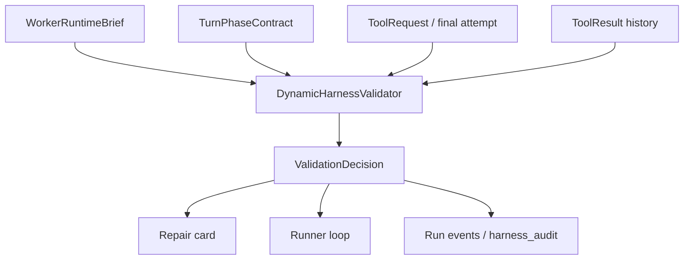

# Dynamic Harness Validator Design

Status: first atom implemented, broader validator consolidation still staged
Evidence snapshot: live TUI run `logs/conversations/20260524-104058.895.jsonl`,
scripted contract pack `5b559659bc295617`, reviewer bench feedback on
2026-05-24, and current runner inspection on 2026-05-24.

## Objective

Build a dynamic harness validator that evaluates the active runner contract on
every model turn and emits one coherent state packet for guidance, enforcement,
audit, and eval.

The validator should not choose the model's strategy. It should answer the
contract question the harness already owns:

- What is missing?
- What just failed, and why?
- Which next actions are valid now?
- Which actions are invalid now?
- When should the harness stop with a typed blocker?

This design narrows the scattered validator/recovery surface already present in
`internal/agent` into a typed, replayable contract-state evaluator.

## Reviewer Refinements

The pre-implementation reviewer bench agreed with the direction but rejected a
runner-only prose patch as insufficient. The durable refinement is:

- The first atom must emit `dynamic_validator_decision`; `write_description_*`
  prose events are only the rendered model-facing card, not the source of
  authority.
- The event must stay path/status/action oriented and must not include raw
  edit payloads such as `old_text`, `new_text`, file bodies, prompts, or
  transcript excerpts.
- The scripted suite must cover the motivating failure class, not only a clean
  design-doc required-path happy path.
- Repeated non-write detours after missing-description repair need a
  write-description-specific typed blocker instead of falling through to a
  generic hidden-tool blocker.
- Runtime/model configuration remains diagnostic evidence, not validator
  authority. Later audit work should correlate validator decisions with
  `model_call` and turn-phase events rather than having the validator choose
  backend or thinking policy.

## Current Evidence

The live TUI atom for `docs/design-tdd-coverage.md` Phase 1 showed the current
system working in important ways:

- The full single-line prompt reached the route and runtime stack.
- `writer_route_decision`, `control_rails`, and `brief_audit` all preserved the
  three required edit paths.
- Completion with no successful write was rejected by the mutation completion
  gate.
- An `edit_file` attempt against a required path was rejected because it lacked
  the required `description` field.
- Repeated out-of-scope `search_content` attempts were rejected and eventually
  closed with a typed blocker.

The same run also showed the architectural gap: the model received local
recovery messages from several independent gates, but not one compact dynamic
validator card saying:

> Missing: required-path writes. Last valid-intent write was missing only
> `description`. Valid next: reissue the same edit with `description`, or
> `<<QUESTION>>` with the exact blocker. Invalid next: search and broad
> discovery.

The harness already has most of this information. It is just distributed across
tool parsing, phase contracts, write-description guard, scoped-read recovery,
write-only recovery, completion gates, and final-answer decoration.

## Relationship To Existing Designs

This design is a focused implementation slice of
[`design-contract-first-local-autonomy.md`](design-contract-first-local-autonomy.md)
and [`contract-authority-migration.md`](contract-authority-migration.md).

It should not introduce a competing autonomy model. It should make the current
contract authority easier to consume by consolidating guidance and escalation
around a typed turn-state projection.

## Target Architecture

Introduce a small policy package under `internal/agent` first. Extract it later
only if package boundaries become clearer.

Suggested files:

- `internal/agent/dynamic_validator.go`
- `internal/agent/dynamic_validator_test.go`
- `internal/agent/dynamic_validator_card.go`

The runner remains the orchestrator. The validator owns state evaluation and
message construction.



## Domain Model

Start with plain structs, not a framework.

```go
type ValidatorInput struct {
    Brief         workerruntime.WorkerRuntimeBrief
    Phase         TurnPhaseContract
    Request       workspace.ToolRequest
    ResultHistory []workspace.ToolResult
    LastResult    *workspace.ToolResult
    AttemptKind   ValidatorAttemptKind
    Step          int
}

type ValidationDecision struct {
    Status              ValidationStatus
    InvariantID         string
    RecoveryID          string
    Missing             []MissingContractItem
    LastFailure         *LastFailure
    ValidNextActions    []string
    InvalidNextActions  []string
    HideTools           []string
    EmitRole            string
    UserVisibleBlocker  bool
    StopReason          string
    BlockerKind         string
}
```

Initial statuses:

- `allow`
- `nudge`
- `reject`
- `force_write_or_block`
- `stop_blocked`
- `accept_final`

Initial missing item kinds:

- `required_edit_path_unwritten`
- `write_description_missing`
- `verification_missing`
- `source_body_evidence_missing`
- `tool_protocol_invalid`
- `out_of_scope_path`
- `repeated_invalid_action`
- `final_answer_missing_required_evidence`

Keep this model independent of presentation. The card renderer should turn a
decision into model-facing text, while telemetry/audit can serialize the same
decision as JSON.

## Validator Responsibilities

The dynamic validator should own these responsibilities:

- Compute missing obligations from the active brief and result history.
- Classify the last failed action by invariant and recovery id.
- Convert local gate results into a common `ValidationDecision`.
- Produce compact model-facing repair cards.
- Escalate repeated invalid actions from nudge to reject to typed blocker.
- Emit stable events that `harness_audit` and scripted/live suites can assert.

It should not:

- Execute tools.
- Mutate workspace state directly.
- Pick exact source edits.
- Infer new scope from prose.
- Replace permission policy or protected-path enforcement.

## First Implementation Atom

The first atom consolidates only the live failure class:

**Scope**

- Missing `description` on an otherwise in-scope required-path write.
- Non-write detours after that failed write.
- Typed blocker when the model repeats invalid non-write recovery instead of
  repairing the write.

**Expected behavior**

1. Model calls `edit_file` on a required edit path without `description`.
2. Harness rejects the call before mutation.
3. Validator emits a repair card:
   - Missing: `description`.
   - Valid next: same write with `description`, or `<<QUESTION>>`.
   - Invalid next: search, broad discovery, unrelated path.
4. Harness hides non-write tools for that turn except any explicitly allowed
   bounded recovery read already supported by existing policy.
5. If the model reissues the corrected write, the write executes.
6. If the model repeats non-write detours, the run closes with a typed blocker.

This atom has low blast radius because it wraps an existing guard rather than
changing write semantics.

Implemented files:

- `internal/agent/dynamic_validator.go`
- `internal/agent/dynamic_validator_card.go`
- `internal/agent/dynamic_validator_test.go`
- `internal/agent/write_description_guard_test.go`
- `internal/agent/runner.go`
- `testdata/scripted-contracts/suite.json`
- `testdata/scripted-contracts/scripts/scripted-implement-missing-description-repair.json`
- `testdata/scripted-contracts/scripts/scripted-implement-missing-description-detour-blocker.json`

The runner still orchestrates enforcement. The validator owns the typed
decision and card for this atom: missing-description required-path writes emit
`force_write_or_block`, non-write detours emit `reject`, and repeated detours
emit `stop_blocked` with blocker kind
`write_description_repair_detour_repeated`.

## Later Atoms

1. **Repeated Scoped Read Validator**
   - Move `scoped_implementation_read_repeated` from runner-local map logic
     into the validator.
   - Preserve current behavior for empty-path and out-of-scope scoped reads.

2. **Completion Gate Validator**
   - Represent mutation completion failures as decisions with missing items.
   - Replace hand-written completion recovery prose with rendered cards.

3. **Tool Surface Projection**
   - Derive hidden tools and valid action classes from `ValidationDecision`.
   - Keep runner-side enforcement until parity tests prove equivalence.

4. **Audit Replay**
   - `dynamic_validator_decision` events now exist for write-description
     repair.
   - Teach `harness_audit` to report missing invariant ids, repeated recovery
     loops, and mismatches between validator guidance and actual enforcement.

5. **Plan-Execute Parity**
   - Extend the same evaluator to planner submit-plan, source-satisfied, and
     review-repair terminal phases.

## Model-Facing Repair Card Shape

Use one compact card, not a long prompt addendum.

```text
Harness validator:
- Missing: description on the required-path edit for internal/example.go.
- Last failure: edit_file was valid in scope but missing required field description.
- Valid next: reissue the same edit_file arguments with non-empty description, or answer <<QUESTION>> with the exact blocker.
- Invalid next: search_content, broad discovery, unrelated path writes, prose final answer.
```

Rules:

- Say what is missing, not just what was wrong.
- Name the last failed invariant.
- Give a small set of valid next action classes.
- Keep examples non-copyable unless the exact JSON is generated from the actual
  request.
- Do not include raw file bodies, raw transcripts, secrets, or customer data in
  events or durable artifacts.

## Event Contract

Emit one event per decision:

```json
{
  "schema_version": "idiom.dynamic_validator_decision.v1",
  "contract_id": "contract_...",
  "phase_id": "implementation.write_ready",
  "step": 14,
  "status": "force_write_or_block",
  "invariant_id": "write.description.required",
  "recovery_id": "write_description_repair",
  "missing": [
    {"kind": "write_description_missing", "path": "internal/example.go"}
  ],
  "valid_next_actions": ["same_write_with_description", "typed_blocker"],
  "invalid_next_actions": ["search", "broad_discovery", "unrelated_path_write", "prose_final_answer"],
  "hide_tools": ["non_write_tools"],
  "blocker_kind": ""
}
```

This event is intentionally path/count/status oriented. Do not store raw edit
payloads or file content in the event.

## Test Plan

Focused unit tests:

- Missing-description required-path write emits `force_write_or_block`.
- Corrected write after missing-description recovery executes normally.
- Non-write retry after missing-description recovery is rejected.
- Repeated non-write retry after missing-description recovery returns typed
  blocker.
- Empty-path scoped read returns `scoped_implementation_read_repeated` after the
  configured repeat threshold.
- Final answer with required paths unchanged produces missing
  `required_edit_path_unwritten` items.

Runner integration tests:

- Existing write-description guard tests continue to pass.
- Existing scoped-read tests continue to pass.
- Existing plan-execute tests are unchanged in the first atom.

Scripted/live tests:

- Added a scripted contract where the fake model:
  1. emits an in-scope edit without `description`,
  2. tries a non-write detour,
  3. reissues the same edit with `description`,
  4. verifies and closes.
- Added a negative scripted contract where the fake model repeats the detour and
  receives a typed blocker.

Verification:

- `go test ./internal/agent -run 'DynamicValidator|WriteDescription|WriteReadyPacket' -count=1`
- `go test ./internal/agent ./internal/app ./internal/planexecute ./cmd/idiom-swe-eval -count=1`
- `make scripted-contract-suite`
- `make scripted-contracts`

## Migration Guidance

Use shadow mode first for any existing guard migration:

1. Existing runner gate makes the real decision.
2. Dynamic validator computes the intended decision.
3. Emit both decisions and compare them in tests/audit.
4. Move enforcement only after parity is clean for that guard.

Do not migrate all guards at once. The first enforcement migration should be
write-description repair because the invariant is local, deterministic, and
already covered by tests.

## Handoff Prompt

The first implementation prompt is now historical evidence:

```text
Implement the first atom from docs/dynamic-harness-validator-design.md.

Scope: add a small dynamic harness validator for missing-description repair on in-scope required-path writes. Preserve existing write-description guard semantics. The validator should emit a typed decision/card for write_description_missing, force write-or-block recovery for that turn, reject non-write detours, allow the corrected write, and emit a stable dynamic_validator_decision event without raw edit payloads.

Required edit paths:
- internal/agent/dynamic_validator.go
- internal/agent/dynamic_validator_card.go
- internal/agent/dynamic_validator_test.go
- internal/agent/write_description_guard_test.go
- internal/agent/runner.go

Acceptance:
- focused tests for missing-description repair, corrected write success, non-write detour rejection, and repeated-detour typed blocker
- existing write-description and scoped-read tests still pass
- go test ./internal/agent -run 'DynamicValidator|WriteDescription|WriteReadyPacket' -count=1
- go test ./internal/agent ./internal/app ./internal/planexecute ./cmd/idiom-swe-eval -count=1
```

## Open Questions

- Should the validator live permanently in `internal/agent`, or should it move
  toward a smaller contract-policy package after the first two atoms?
- Should `ValidationDecision` become the source of `TurnPhaseContract` valid and
  invalid action classes, or remain a post-phase projection initially?
- What repeat threshold should apply by recovery id: one detour then blocker, or
  two detours then blocker?
- Should live TUI render the validator card separately from ordinary recovery
  prose?

## Success Criteria

The design is successful when a behavior-debugging run can answer these
questions from structured events without reading the whole transcript:

- What contract was active?
- What was missing?
- What invalid action repeated?
- What exact validator decision was shown to the model?
- What tools were hidden or exposed because of that decision?
- Why did the runner continue, execute, or stop?
