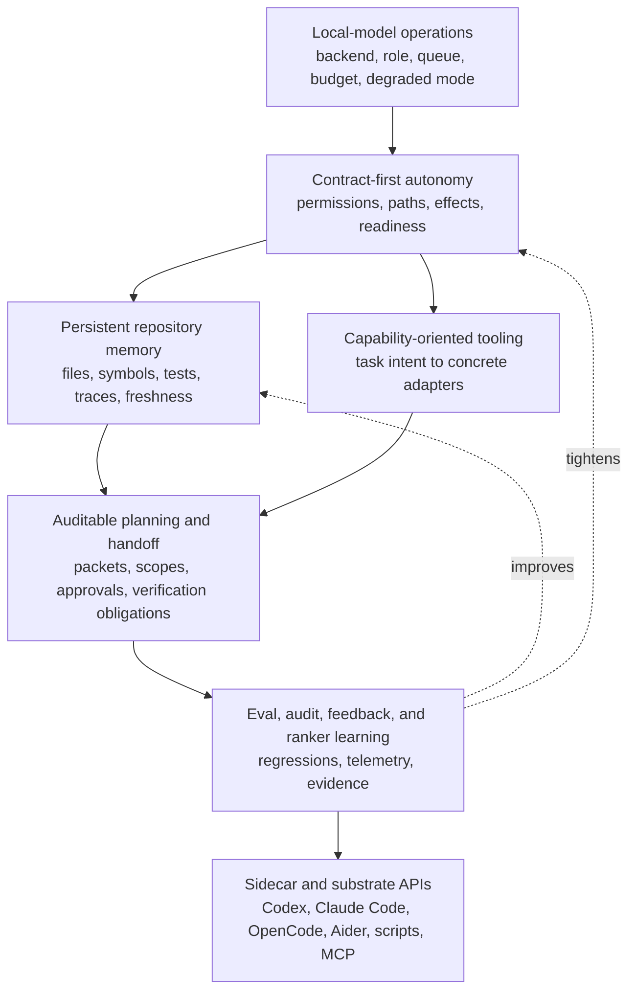

# Idiom Design Roadmap

**North Star: AI coding agents are becoming common, but teams do not yet trust
their context, decisions, or outputs. Idiom sells the missing substrate: repo
memory, freshness, contracts, audit, and evals.**

Status: coordinating design index, drafted 2026-05-12

This document connects the project thesis to the seven pillar design docs. It is
the map for deciding whether a proposed harness change strengthens Idiom's
differential or merely chases another agent's surface area.

The controlling thesis is still:

- The model owns strategy.
- The harness owns contracts.

The strategic source is [idiom-strategic-thesis.md](idiom-strategic-thesis.md).
The decisioning policy is [decisioning-north-star.md](decisioning-north-star.md).
The executable implementation plan is
[idiom-implementation-plan.md](idiom-implementation-plan.md).

## Pillar Set

| Pillar | Design Doc | Primary Claim |
| --- | --- | --- |
| Contract-first local autonomy | [design-contract-first-local-autonomy.md](design-contract-first-local-autonomy.md) | Every autonomous lane, phase, and worker runs under a typed, locally enforced, auditable contract. |
| Persistent repository memory | [design-persistent-repository-memory.md](design-persistent-repository-memory.md) | Repository facts become durable, fresh, source-linked, confidence-labeled memory rather than repeated prompt stuffing. |
| Capability-oriented tooling | [design-capability-oriented-tooling.md](design-capability-oriented-tooling.md) | Models ask for task capabilities; the harness resolves precise language, graph, runtime, or fallback adapters. |
| Auditable planning and handoff | [design-auditable-planning-handoff.md](design-auditable-planning-handoff.md) | Planning becomes a packet-backed, replayable, audit-checked artifact before execution mutates files. |
| Local-model operations | [design-local-model-operations.md](design-local-model-operations.md) | Local inference is treated as an operational system with role routing, queue admission, context budgets, and readiness checks. |
| Eval/audit/learning flywheel | [design-eval-audit-learning-flywheel.md](design-eval-audit-learning-flywheel.md) | Runs produce structured evidence that becomes evals, audits, ranker updates, and regression protection. |
| Agent substrate and sidecar | [design-agent-substrate-sidecar.md](design-agent-substrate-sidecar.md) | Idiom's context, audit, verification, and contract surfaces become reusable by Codex, Claude Code, OpenCode, Aider, scripts, and MCP clients. |

## Cross-Pillar Designs

- [PRD to ADR to brief research workflow](design-prd-adr-brief-research-workflow.md)
  defines the upstream artifact pipeline that turns aligned research evidence
  into traceable product requirements, architecture decisions, proactive TDD
  obligations, and dispatch-ready Idiom briefs. As of 2026-05-18, this workflow
  has deterministic headless CLI surfaces and a closed durable effort folder,
  but the design still has open blockers for status-migration hardening, TUI
  continuation/handoff, coverage-gate authority reuse, durable supersession
  fixtures, sidecar exposure, and operator UX/API parity.
- [Design doc implementation workflow](design-doc-implementation-workflow.md)
  defines the operating rule for turning broad design docs into reviewed,
  atomized, parallelizable, and resumable implementation work. It requires
  durable reviewer evidence, dispatchable atom fields, disjoint write scopes for
  parallel work, docs freshness checks, final full-bench review, and commit/push
  only after the assembled deliverable passes review.
- [Feature planner orchestration](design-feature-planner-orchestration.md)
  defines the headless, durable state machine for complex multi-atom
  deliverables: loopable planning, planner-question repair, active-run
  continuation, SDD/TDD dispatch gates, runtime envelopes, recovery
  reconciliation, leases, and release readiness.
- [Behavioral TDD coverage](design-tdd-coverage.md)
  defines the staged pipeline from human-approved ADR through EARS requirements,
  example mapping, BDD scenarios, Design by Contract, failure mode analysis
  (FMEA, HAZOP, FTA), state machine modeling, property-based testing, decision
  tables, mutation verification, and the deterministic coverage gate that blocks
  dispatch when behavioral coverage is incomplete. This is the verification
  contract for the PRD-to-brief workflow; only a narrower tiered coverage
  evaluator has shipped so far.
- [Decompose on failure](design-decompose-on-failure.md)
  defines the recovery layer that turns a failed lane or atom into a durable
  failure record, deterministic failure classification, smaller gated recovery
  atoms, and auditable reconciliation through the `idiom recover` namespace.
  The plan-execute and lane-implement slices now write failure records and
  decomposition packets automatically, with
  `recover inspect/status/decompose/promote/reconcile` covering the operator
  loop and read-only `recovery_inspect`/`recovery_status` exposed through the
  sidecar/MCP tool surface. Product/operator status and
  audit-watch, product-evidence, release-evidence, and the TUI
  `/product-status` and `/recover-status` presenters now project recovery
  packet state through bounded summaries. The recovery classifier covers the
  documented `scope_too_large` and `verification_failed` classes, and
  reconciliation artifacts close packets only after packet-digest, atom
  manifest, and required-test evidence validation. Successful reconciliation
  also records sanitized evidence-only ranker-learning events under
  `source:"recovery_reconciliation"` without mutating learned weights.
  Residual-work records now carry scoped required-path, changed-path, failure,
  and required-test evidence refs without raw prompt/transcript/file-body
  content. Write-capable TUI continuation actions and additional
  non-plan-execute failure sources remain follow-up work.
- [Malformed output distillation](design-malformed-output-distillation.md)
  defines the boundary for recurring malformed tool JSON, invalid
  `submit_plan` artifacts, and local-model serialization failures. The policy
  is permissive intake with strict acceptance: raw model output may be
  normalized or distilled into typed intent, but only schema/source/preflight
  validated artifacts can reach execution. This design deliberately separates
  the route classifier, artifact distiller, patch compiler, and executor so
  repair does not silently become mutation authority. The first deterministic
  lifecycle is implemented through `internal/workflows/planintent`: exact
  `idiom.edit_intent.v1` artifacts validate against the active runtime brief,
  compile to candidate `workspace.PlanEdit` values, and still pass through
  normal `submit_plan` validation before executor handoff. The
  `artifact_distiller` runtime family is present as a no-tool/no-write role for
  future model-based distillation, backend structured-output capability
  reporting is explicit, and `harness_audit` now summarizes parse/distill/
  compile/validate/recovery-exhaustion stage events without raw transcript
  exposure.
- [Contract and capability architecture overhaul](design-contract-capability-architecture-overhaul.md)
  defines the staged consolidation needed to make `AutonomyContract`,
  capability routing, model-facing protocol, runtime envelopes, path roles,
  runner gates, and audit replay one maintainable contract lifecycle. It is a
  cross-pillar refactor plan for stability, readability, and maintenance, with
  reviewer evidence recorded in
  [contract-capability-architecture-overhaul-review.md](evidence/contract-capability-architecture-overhaul-review.md).
- [Harness optimization program](design-harness-optimization-program.md)
  defines the sequence for reducing avoidable friction between models and
  Idiom's guards without weakening invariants. The first implementation wave is
  now verified: passive guard-friction events and audit grouping are present,
  plan-execute planner calls receive an active protocol projection, covered
  turn-phase surfaces reconcile in report-only mode, and the read/navigation
  interface has capability-shaped metadata and runtime summaries. The fresh
  replay baseline, gate consumption, rendering migration, and static-prompt
  pruning remain staged. Its focused designs are
  [guard friction observability](design-guard-friction-observability.md),
  [contract protocol projection](design-contract-protocol-projection.md),
  [turn-phase contract reconciliation](design-turn-phase-contract-reconciliation.md),
  and
  [capability-first model interface](design-capability-first-model-interface.md).

## System Shape

The pillars are not independent feature tracks. They form one architecture:

Local-model operations defines the runtime capacity: which backend, role, queue,
context budget, and degraded mode are active.

Contract-first autonomy defines the authority boundary: which paths, tools,
effects, verification obligations, and completion claims are legal for the
current task.

Persistent repository memory supplies the evidence substrate: files, symbols,
tests, dependencies, traces, freshness, confidence, ranker signals, and graph
views.

Capability-oriented tooling is the interface layer between model intent and
implementation detail. It keeps model-visible requests task-shaped while the
harness picks Go, C++, Python, TypeScript, Rust, Java, graph, structural, shell,
or generic adapters.

Auditable planning and handoff turns repository evidence and task contracts into
durable plan artifacts. It is the bridge between "the model has an approach" and
"the executor is authorized to mutate these specific files."

The eval/audit/learning flywheel consumes the traces from all of the above. It
decides whether a failure becomes a regression, an audit rule, a ranker update,
a prompt cleanup, a contract change, or an explicit non-goal.

The sidecar/substrate pillar exposes the same surfaces to external agents. It is
not a new strategy loop. It is the stable API boundary for repository evidence,
capability discovery, verification, and audit.

## Shared Vocabulary

Use these terms consistently across pillar work:

- `contract`: the typed host-owned authority and obligation object for a lane,
  phase, or sidecar call.
- `capability`: a task-level request such as localize change, inspect symbol,
  find references, source sanity, verify edit, or audit behavior.
- `adapter`: the concrete backend chosen to satisfy a capability: language
  tools, graph query, structural search, history, shell, or fallback read/search.
- `packet`: bounded evidence prepared for a model or executor, with handles,
  freshness, scope, risk, and handoff fields.
- `view`: cached, source-linked graph output persisted for reuse and replay.
- `profile`: a named permission/tool-surface preset such as discovery, verify,
  write, or lane-owned.
- `freshness`: the declared relationship between evidence and the current
  workspace state.
- `sidecar`: Idiom used by another agent or script without running Idiom's own
  inference loop.

## Dependency Rules

1. Contract changes must say which invariant they enforce and which audit/eval
   signal proves the change worked.
2. Memory changes must expose freshness, provenance, confidence, and uncertainty
   rather than returning context as unqualified prose.
3. Capability changes must preserve model strategy: a tool result may report
   available capabilities or blockers, but should not prescribe a next strategy
   step unless enforcing an invariant.
4. Planning changes must keep packets as evidence envelopes, not hidden plans.
5. Local-model changes must surface readiness and degraded mode explicitly.
6. Eval/audit changes must be able to replay from logs or structured artifacts.
7. Sidecar changes must reuse the same manifest, schemas, permissions,
   telemetry, freshness, and audit contracts as first-party lanes.

## Sequencing

The first implementation cycle should make the pillars observable rather than
trying to build the whole target state at once:

1. Stabilize the compiled contract surface and emit stable contract decision
   events.
2. Export schemas for `idiom tool` and make graph-backed tool freshness
   structured.
3. Define the capability vocabulary and route a small read-only subset through
   the resolver.
4. Build the context-localization benchmark and feed verified edit signals into
   ranker learning.
5. Tighten plan artifact handoff around packet IDs, editable paths, evidence
   paths, and verification obligations.
6. Extend `idiom doctor` and telemetry so local backend readiness, queue state,
   route-classifier health, and context budget are visible before lanes run.
7. Ship the discovery-profile sidecar path: stable CLI envelope first, MCP stdio
   second, Streamable HTTP only after auth/origin/profile gates are in place.

## Project Gates

New roadmap items should answer four questions before they land:

1. Which pillar does this advance?
2. Which contract, evidence source, or feedback loop becomes stronger?
3. Which metric, audit finding, eval scenario, or test should move?
4. Which frontier/Aider/OpenCode/Claude/Codex surface are we intentionally not
   copying unless it strengthens the pillar?

If an item cannot answer those questions, it is probably polish, parity, or
prompt drift rather than strategy.
