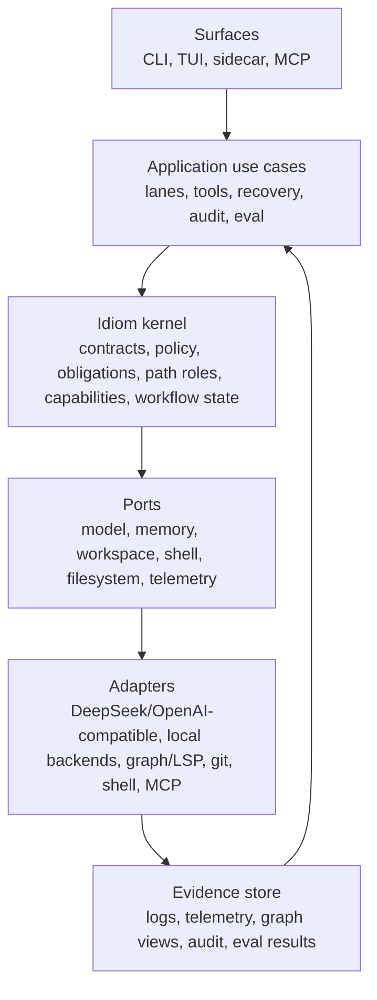

# Idiom Rearchitecture Tracker

**North Star: AI coding agents are becoming common, but teams do not yet trust
their context, decisions, or outputs. Idiom sells the missing substrate: repo
memory, freshness, contracts, audit, and evals.**

Status: design complete / implementation tracker active
Owner: docs / rearchitecture tracker
Last updated: 2026-06-18
Related docs:
[idiom-design-roadmap.md](idiom-design-roadmap.md),
[design-contract-capability-architecture-overhaul.md](design-contract-capability-architecture-overhaul.md),
[agent-rearchitecture-design.md](agent-rearchitecture-design.md),
[agent-rearchitecture-test-plan.md](agent-rearchitecture-test-plan.md)

## Purpose

This tracker turns the broad rearchitecture target into an incremental,
testable migration plan. It is intentionally not a rewrite plan. The goal is to
consolidate Idiom around one maintainable contract-centered architecture while
preserving behavior at each step.

## Design Completion Closure

The architecture design is complete as of 2026-06-18. The closed design
decisions are:

- Idiom remains a modular monolith with clean/hexagonal boundaries, not a
  second repository or service split.
- `internal/contracts/autonomy` and adjacent contract packages own typed
  authority, obligation, path-role, protocol, and audit contracts.
- `internal/runtime/agent` remains the orchestration host while policy,
  recovery, evidence, guidance, lifecycle, and state mechanics are consolidated
  into tested runner-owned engines. These engines are runtime adapters over
  contract/kernel authority, not canonical authority owners.
- Workspace, sidecar, MCP, CLI, and TUI surfaces translate requests and expose
  equivalent contract metadata; they do not invent lane authority.
- Prompts describe the active protocol; runtime contracts, tool manifests,
  parser policies, state machines, and audit events own enforcement.

The checklist rows below are now implementation backlog or enforcement gates,
not unresolved design decisions. A row marked `Report-only` means the design
contract is specified and partial typed evidence exists, but enforcement remains
deliberately gated until the listed parity, audit, and regression evidence is
present. A row marked `Implementation pending` names code, parity, audit, or
test work still required before that phase can graduate to enforcement; it does
not reopen the design decision unless the closed vocabulary above is changed.

The target is a modular monolith with clean/hexagonal boundaries:

- surfaces translate user or sidecar input into application requests;
- application use cases orchestrate lanes, tools, recovery, audit, and evals;
- the kernel owns contracts, obligations, path roles, policy decisions,
  capabilities, and workflow state;
- adapters execute concrete model, repository, shell, filesystem, MCP, and
  telemetry operations;
- evidence, audit, and evals replay what happened without reconstructing
  authority from prompts.

The controlling rule remains:

- The model owns strategy.
- The harness owns contracts.

## Target Shape



Dependency rule:

- `internal/contracts/...` and the future kernel packages must not import CLI,
  TUI, runner, workspace manager internals, shell execution, model backends, MCP
  clients, or concrete graph stores.
- Runner code consumes contract decisions. It does not compile authority.
- Workspace and repository packages execute adapters. They do not own lane
  semantics.
- Prompts explain the active protocol. Prompts do not create authority.

## Migration Principles

- Preserve observable behavior during structural moves.
- Prefer report-only instrumentation before enforcement changes.
- Move one live invariant at a time, then delete the duplicate legacy owner.
- Start with plan-execute planner because it exercises path coverage,
  source-satisfied closeout, `submit_plan`, malformed-output recovery, and
  executor handoff without requiring the whole TUI/product workflow.
- Do not move read-only readiness into forced synthesis. Read-only lanes remain
  strategy lanes.
- Treat sidecar parity as a product requirement, not a follow-up cleanup.
- Run narrow package tests first, then full-suite tests when shared policy,
  runner behavior, prompts, routing, workspace tools, or audit semantics change.

## Current Tracker

| Phase | Status | Primary Owner | Main Risk | Exit Gate |
| --- | --- | --- | --- | --- |
| 0A. Current-state reconciliation | Complete | docs / rearchitecture tracker | Tracker starts from a false zero state | Implemented report-only pieces are inventoried in [rearchitecture-phase0-evidence.md](rearchitecture-phase0-evidence.md) |
| 0B. Authority inventory and observe-only parity | Report-only | docs / rearchitecture tracker | Enforcement moves before parity is proven | Authority inventory recorded; old/new typed parity fixtures still pending for enforcement |
| 0. Baseline and guardrails | Complete | docs / rearchitecture tracker | Refactor begins without measurable baseline | Focused baseline tests, audit, full suite, replay corpus, import-boundary confirmation, and live smoke recorded |
| 1. Canonical contract compiler | Report-only | `internal/contracts/autonomy`, `internal/contracts/compile` | A second contract source is introduced | Covered runs emit one active contract id |
| 1.5. Typed route, ToolIntent, runtime policy | Report-only | `internal/contracts/autonomy`, `internal/runtime/agent` | Policy keeps branching on raw tools/parser quirks | Every action has normalized intent and runtime policy |
| 2. Obligation ledger | Report-only | `internal/contracts/autonomy`, `internal/contracts/plan` | Readiness/final-answer behavior regresses | Audit/replay expose a normalized open/resolved/waived ledger, and plan edit-set contracts expose required-path open obligations; runtime gates remain legacy |
| 3. Path role resolver | Complete | `internal/contracts/autonomy`, `internal/runtime/agent`, `internal/surfaces/tui/app` | Required coverage and candidate scope are confused | Core resolver roles are first-class; `submit_plan`, runtime write-scope, recovery, sidecar, audit replay, and TUI dispatch consume resolver coverage |
| 4. Policy engine extraction | Complete | `internal/runtime/agent` policy engines as runtime adapters over contract authority | Runner logic is copied instead of moved | Tool/final decisions cite contract and invariant ids |
| 4.5. Typed recovery state | Complete | `internal/runtime/agent` CardEngine and recovery state | Recovery remains prompt text instead of state | Recovery cards, prompts, next-action state, and autonomy summaries route through typed recovery state |
| 5. Capability resolver | Complete | `internal/capabilities/workspace` | Precision is hidden behind generic tools | Results report adapter, precision, fallback, freshness |
| 6. Workflow state machines | Complete | `internal/workflows/workflowstate`, plan-execute/recovery/CLI/TUI adapters | Prose or prompt headings still drive state | Non-dispatchable work is rejected before model dispatch |
| 7. Surface slimming and parity | Report-only | `internal/capabilities/workspace`, `internal/surfaces/cli/mcp` | CLI/TUI/sidecar reconstruct policy | Same request yields same contract shape across surfaces |
| 8. Evidence, audit, eval, learning hardening | Report-only | `internal/contracts/autonomy`, `internal/capabilities/workspace` | Failures remain transcript-only | Audit groups findings by contract and invariant |
| 9. Legacy deletion | In progress | phase owners / rearchitecture tracker | Dead compatibility paths remain | Duplicate authority removed with retention table |

Use these status values: `Not started`, `In progress`, `Blocked`, `Report-only`,
`Enforcing`, `Complete`.

The phase numbers preserve the conceptual decomposition. The implementation
order below is authoritative for sequencing; in particular, path-role authority
must be canonical before obligation-ledger enforcement.

## Closed Contract Vocabulary

These semantics are design-closed even when their implementation remains
report-only or backlog:

- `lane`, `phase`, `task_family`, `model_role`, `path_role`, `run_state`, and
  `hidden_tool` are first-class contract inputs. They may be missing from a
  current implementation slice, but future code must consume them through the
  contract compiler rather than deriving them from prompt prose or surface-local
  strings.
- Stable contract events are `contract_compiled`, `contract_presented`,
  `runtime_contract_bound`, `contract_decision`, `obligation_updated`, and
  `contract_closed`. Any new event that opens, resolves, rejects, or stops work
  must carry `contract_id`, `invariant_id`, and relevant `obligation_id`.
- Source evidence levels are ordered as candidate path, outline/search hit,
  source-body evidence, and exact-snippet coverage. Generated logs,
  diagnostics, context packets, search hits, and mentioned paths cannot close a
  source-body obligation unless promoted by accepted source-body evidence.
- Obligation states are `open`, `closed`, `waived_with_reason`, `blocked`,
  `stale`, and `superseded`. Runtime readiness and final-answer gates must map
  into this ledger before enforcement replaces legacy gates.
- Surface application requests carry user intent, lane/classifier result,
  permission profile, path-role inputs, runtime envelope, tool profile,
  freshness packet, and caller surface. CLI, TUI, sidecar, and MCP adapters may
  omit fields only by recording an explicit parity gap.

## Cross-Phase Gates

These gates apply to every phase. They are deliberately stronger than normal
documentation checklists because the migration changes authority boundaries.

- No migrated invariant may enforce until old decision, new typed decision,
  recovery surface, and audit event agree for valid actions and hard invalid
  actions on the replay corpus.
- No new contract event may lack `contract_id`, `invariant_id`, and relevant
  `obligation_id` when the invariant opens, resolves, rejects, or stops work.
- `control_rails`, allowed tools, visible tools, callable tools, hidden tools,
  recovery cards, sidecar envelopes, TUI next-action state, final-answer gates,
  and audit events must reference the same `contract_id`, `contract_version`,
  and `protocol_hash` for a covered phase.
- Audit/eval is not deferred to Phase 8. Every phase must define the audit
  signal expected to move before enforcement changes.
- Sidecar parity starts in Phase 1 report-only mode. Every migrated invariant
  needs at least CLI plus sidecar contract-shape parity; TUI may record an
  explicit parity gap until its surface migrates.
- Any enforcement graduation requires both blocked-case and allowed-case
  regression tests.
- Any phase introducing a pass-through engine, resolver, or wrapper without at
  least one production caller and one contract-event assertion fails review.
- Any regression in protected paths, read-only sidecar denial,
  source-satisfied classification, stale/dirty intake, or
  verification-after-write blocks the phase.
- DeepSeek hosted smoke must complete with expected lane/phase, backend profile
  or model alias `deepseek-v4-flash`, contract id, protocol hash, parser mode,
  and terminal state. If the hosted backend or `DEEPSEEK_API_KEY` is unavailable,
  the smoke is blocked, not silently rerouted to local Qwen, `ds4`, MiniMax, or
  another profile.
- Missing or blank runtime attribution blocks the smoke: `backend_profile`,
  `effective_model`, planner/executor/classifier aliases, contract id, protocol
  hash, parser mode, and terminal state must be present in the selected
  telemetry/log evidence. Lane-wrapper and plan-execute subcommand attribution
  must either agree or one event must be named as authoritative for the atom.
- No policy or recovery enforcement may graduate until lifecycle state has one
  owner and replay proves exactly one terminal closeout per run.

## Implementation Atom Schema

Each phase must be split into dispatchable atoms before code changes start. A
phase checklist is not sufficient implementation authority.

| Field | Required Content |
| --- | --- |
| Atom id | Stable id, for example `R1.5-A` |
| Invariant | The invariant moved or observed |
| Canonical owner package | Package that owns the behavior after the atom |
| Expected files | Files or packages expected to change |
| Forbidden files | Files or packages that must not change |
| Owner/package matrix | Canonical owner and every consumer/adapter touched |
| Consumer matrix | Model-facing, machine-consumed, user-facing, audit-only, or mixed |
| Context/evidence | `context_pack` id, replay log, audit output, or exact source anchors |
| TDD obligations | Tests that must be written before or with the change |
| Blocked-case test | Regression proving invalid behavior is blocked |
| Allowed-case test | Regression proving valid behavior still works |
| Protocol projection fixture | Brief/control rails, visible/callable/hidden tools, parser contract, action classes, terminal shapes, recovery alternatives, gate decision, and audit event tied to one `contract_id`/`protocol_hash` |
| Terminal-shape matrix | Accepted native call, accepted textual fallback, accepted terminal blocker/source-satisfied/final answer, and rejected prose/JSON/mismatched-envelope cases |
| Transport compatibility matrix | DeepSeek native tool call, OpenAI-compatible native shape if distinct, textual Qwen/MLX/llama shape, malformed textual shape, parser outcome, prompt projection snapshot, and terminal state |
| Required verification | Narrow tests, full tests, audit, smoke, or build commands |
| DeepSeek smoke command | Live smoke command when the atom changes runtime behavior |
| Audit signal before/after | Metric, event, or finding expected to move |
| Lifecycle/concurrency evidence | Terminal closeout, cancellation/timeout behavior, event ordering, and per-session isolation when touched |
| Compatibility surface | CLI, sidecar, TUI, MCP, or runner compatibility expectation |
| Contract/protocol evidence | Contract id, protocol hash, telemetry event, and session/log path |
| Rollback trigger | Concrete condition that reverts or disables enforcement |
| Implementor evidence | Summary file, log, diff, or command output |
| Reviewer evidence | Independent review result and required follow-up |
| Old test-plan gap mapping | `covered`, `moved`, `deleted with rationale`, or `still open` |

Atom no-go conditions:

- stale context without a refresh plan;
- dirty scoped paths without owner approval;
- missing expected files or forbidden files;
- missing blocked/allowed test pair for enforcement;
- missing audit signal for the migrated invariant;
- missing rollback note;
- missing backend/runtime attribution for runtime-changing atoms;
- implementation that adds a second authority surface instead of moving one.

## First Slice Atom Registry

Phase 0 atoms are documentation/evidence atoms only. Runtime source edits are
forbidden until Phase 0C is complete and dirty scoped paths have an owner.

| Atom id | Status | Invariant | Canonical owner package | Expected files | Forbidden files | Required first action |
| --- | --- | --- | --- | --- | --- | --- |
| R0A-A | Complete | migration state must not start from false zero | docs / rearchitecture tracker | tracker, evidence note, smoke brief, smoke target, smoke template | `internal/runtime/agent/**`, `internal/contracts/**`, `prompts/**`, `cmd/**`, `internal/surfaces/**`, `.idiom/backends.json` | Shipped report-only inventory recorded |
| R0A-B | Complete | P0/P1 legacy gaps must be mapped before extraction | docs / rearchitecture tracker | tracker, evidence note, smoke brief, smoke target, smoke template | runtime, contracts, prompts, CLI/TUI, backend config | Old test-plan gap mapping recorded |
| R0C-A | Complete | baseline commands and runtime attribution must be recorded | docs / rearchitecture tracker | tracker, evidence note, smoke brief, smoke target, smoke template, ignored local smoke config | runtime, contracts, prompts, CLI/TUI, backend config | Full tests, replay corpus, import-boundary confirmation, and live DeepSeek smoke recorded |
| R0T-P3F-A | Complete | plan-execute recovery plans need focused coverage before extraction | `internal/runtime/agent` tests | `internal/runtime/agent/plan_execute_recovery_plan_test.go` | runtime source until a later recovery-policy atom approves it | Test-only completion: added blocked/allowed recovery-plan coverage; no runtime authority moved |
| R0T-P3F-B | Complete | plan-execute recovery plan builders need one source owner before recovery extraction | `internal/runtime/agent` `CardEngine` | `internal/runtime/agent/card_engine.go`, `internal/runtime/agent/plan_execute_recovery_plan.go`, recovery runner callsites, recovery tests | contracts, prompts, CLI/TUI, backend config | Recovery builders and production recovery callsites now route through `CardEngine`; recovery plan file owns only value types and rendering |
| R0T-P4C-A | Complete | pre-write runtime brief must narrow to write-only behavior before the first required-path write | `internal/runtime/agent` tests | `internal/runtime/agent/recovery_plan_and_brief_test.go` | runtime source until a later pre-write-policy atom approves it | Test-only completion: tightened write-only surface assertions; no runtime authority moved |
| R45-A | Report-only | recovery needs a typed projection before enforcement moves out of runner prompts | `internal/runtime/agent` recovery state | `internal/runtime/agent/plan_execute_recovery_state.go`, `internal/runtime/agent/plan_execute_recovery_state_test.go` | contracts, prompts, CLI/TUI, backend config | Added report-only recovery state fields and focused derivation tests; no runtime enforcement changed |

`R0A-S1` is the parent documentation/evidence slice for `R0A-A`, `R0A-B`, and
`R0C-A`. It has no runtime authority. Phase 0C now records replay corpus
evidence, import-boundary confirmation, and live hosted-backend smoke evidence.
Runtime-source atoms remain non-dispatchable while overlapping dirty source
changes exist unless a later atom names the owner, exact write scope, and
rollback trigger.

Atom schema instantiations:

| Atom id | Owner/package matrix | Consumer matrix | Context/evidence | TDD obligations | Protocol/terminal/transport matrix | Verification/audit/rollback |
| --- | --- | --- | --- | --- | --- | --- |
| R0A-A | Owner: docs tracker. Referenced packages: `internal/contracts/autonomy`, `internal/contracts/compile`, `internal/contracts/plan`, `internal/contracts/pathparse`, `internal/contracts/writerroute`, `internal/runtime/agent`, `internal/workflows/planexecute`, `internal/runtime/workerruntime`. | Audit-only and reviewer-facing; no model-facing runtime change. | Phase 0 evidence inventory, smoke brief/target/template, `context_status`, `harness_audit`, focused tests. | Inventory must name owners, tests, dirty overlap, and shipped report-only behavior. | Not touched; runtime matrices remain unchanged. | `git diff --check`, focused tests, full `go test ./...`; rollback trigger is any runtime/source diff in this slice. |
| R0A-B | Owner: docs tracker. Referenced consumers: old test plan and future runtime/test atoms. | Audit-only tracker surface. | Old P0/P1 gap table and mapping in Phase 0 evidence. | Every P0/P1 old gap must map to covered/moved/deleted/still-open atom status. | Not touched; runtime matrices remain unchanged. | `git diff --check`; rollback trigger is any unmapped P0/P1 row. |
| R0C-A | Owner: docs tracker. Consumers: future implementation atoms and reviewer bench. | Audit-only; complete after replay corpus, import-boundary confirmation, and live smoke were recorded. | Baseline `git status`, `context_status`, architecture and behavior audits, backend status, smoke brief/target/template, focused tests, full tests, hosted DeepSeek smoke session `73e7a98210375846`. | Baseline records current failures, dirty state, stale context, replay corpus evidence, import-boundary evidence, and live-smoke attribution. | Live DeepSeek smoke recorded backend profile/model alias, role aliases, parser mode, contract/scope id, terminal state, and rejected blank/mismatched attribution during earlier attempts. | Focused tests, `go test ./...`, audits; rollback trigger is missing replay/import-boundary evidence or missing/inferred telemetry attribution. |
| R0T-P3F-A | Owner after dispatch: `internal/runtime/agent` tests. Recovery policy source remains owned by existing dirty runtime changes until a later source atom narrows that scope. Consumers: recovery cards, plan-execute planner/executor, audit. | Test-only coverage for model-facing, machine-consumed, user-facing, and audit recovery surfaces; no production behavior changed. | User migration goal approved a test-only runtime edit; exact source anchors are `plan_execute_recovery_plan.go`, dirty moved builder code in `card_engine.go`, and recovery tests. Context pack `be5919fd74680fa1`. | Added blocked/allowed recovery-plan tests: malformed submit-plan parse does not reopen discovery, missing-target low-value recovery does not advertise submit, anchor refresh allows only bounded source refresh, repeated correction has no terminal escape, native no-call fallback switches to textual submit only. | Runtime behavior unchanged; protocol/terminal/transport matrix remains required for the later source-moving recovery-policy atom. | `go test ./internal/runtime/agent -run 'TestPlanExecute.*RecoveryPlan|TestPlanExecute.*Recovery.*|TestPlanExecute.*Fallback|TestPlanThenExecute.*RecoveryPlan|TestPlanThenExecute.*RecoveryPrompt|TestPlanThenExecute.*Fallback' -count=1`, `go test ./internal/runtime/agent -count=1`; full suite and reviewer bench still required before graduating beyond test-only. |
| R0T-P3F-B | Owner after dispatch: `internal/runtime/agent` `CardEngine`. `PlanExecuteRecoveryPlan` remains a value/rendering type, while plan-execute recovery builders are methods on the injected card engine. Consumers: runner recovery prompts, repeated-correction handling, parser recovery, tests. | Model-facing recovery plan generation moves behind one source owner; runner callsites use `r.cardEngine()` where a runner is available, and helper tests may pass nil to use the default engine. No contract, prompt, CLI/TUI, or backend config changed. | Adopted existing dirty source move and completed production wiring: `card_engine.go` owns builder methods and state-aware variants, `plan_execute_recovery_plan.go` shrinks to kind/type/rendering, and runner submit-correction, anchor-refresh, repeated-correction, hidden-only, low-value, parser-recovery, unscoped empty submit, and native fallback paths route through the engine. | Test obligations from `R0T-P3F-A` cover builder behavior; production callsite coverage includes focused low-value/recovery tests, injected-engine boundary tests, and package tests. The source atom additionally requires no duplicate legacy builder functions remain outside `CardEngine`. | Runtime behavior should be preserved; protocol/terminal/transport semantics are still the same values rendered through `RenderPlanExecuteRecoveryPlan`, including the blocker-allowed `<<QUESTION>>` variants for repeated rejected submit plans. | `rg` confirms legacy `planThenExecute*RecoveryPlan` builders are gone and production recovery builder callsites route through `CardEngine`; focused recovery tests, `go test ./internal/runtime/agent -count=1`, and full suite are required. Rollback trigger is duplicate builder authority, missing injection path, or recovery prompt regression. |
| R0T-P4C-A | Owner after dispatch: `internal/runtime/agent` tests. Pre-write policy source remains in `runner_implementation_brief.go`. Consumers: implementation lane write gate and model-facing runtime brief. | Test-only coverage for the model-facing pre-write surface; no production behavior changed. | Explorer-selected low-risk atom. Source anchors: `runner_implementation_brief.go`, `runner_brief_hints.go`, and `recovery_plan_and_brief_test.go`. | Tightened tests prove `implementationPreWriteRuntimeBrief` removes read/search/shell affordances, keeps write tools, sets required write-only tool guidance, and preserves required edit paths plus existing constraints/guidance. | Runtime behavior unchanged; protocol/terminal/transport matrix remains required for any later source-moving pre-write-policy atom. | `go test ./internal/runtime/agent -run 'TestImplementationPreWriteRuntimeBriefSetsWriteOnlySurface|TestImplementationPreWriteRuntimeBriefPreservesRequiredEditPaths' -count=1`, `go test ./internal/runtime/agent -count=1`; rollback trigger is any production-source diff in this atom or a pre-write surface that still exposes broad read/search/shell before the first write. |
| R45-A | Owner after dispatch: `internal/runtime/agent` typed recovery state. Consumers: future recovery cards, audit events, protocol projection, runner recovery prompts. | Report-only projection only; it does not authorize tools, change CardEngine prompts, or replace runner gates. | `PlanExecuteRecoveryState` derives recovery id, failed invariant id, action class, rejected subject, remaining budget, visible safe alternatives, terminal blocker allowance, and recovery-card/protocol projection id from existing `TurnPhaseContract`, recovery-card helpers, and plan-execute state. | Focused tests cover stale-anchor derivation and absence for non-planner/no-rejection inputs. | Runtime behavior unchanged; this is the typed state foothold required before routing recovery cards/prompts/events through one state object. | `go test ./internal/runtime/agent -run 'TestPlanExecuteRecoveryState|TestPlanExecuteRecoverySurface|TestRecoveryCardSurfaceSummaryReconcilesWithPhaseContract' -count=1`, package tests, full suite, and reviewer pass required. Rollback trigger is any behavior change or enforcement use before parity. |

## Old Test-Plan Gap Mapping

The existing [agent-rearchitecture-test-plan.md](agent-rearchitecture-test-plan.md)
remains active. Before extracting or enforcing an area, map its P0/P1 gaps into
the atom table.

| Legacy Gap Area | Required Mapping Before Migration |
| --- | --- |
| Plan-execute recovery plans | Covered, moved, or deleted with rationale before recovery/policy extraction |
| Pre-write runtime brief | Covered before write-ready surface or runtime policy moves |
| Answer decoration blockers | Covered before final-answer policy extraction |
| Write-ready redirect detection | Covered before obligation/readiness enforcement |
| Source evidence redirects | Covered before source-body obligations enforce |
| Submit-plan coverage paths | Covered before planner policy enforces |
| Recovery nudges | Covered before typed recovery replaces prompt nudges |
| Budget and fingerprint decisions | Covered before loop/budget policy moves |

Current mapping is recorded in [rearchitecture-phase0-evidence.md](rearchitecture-phase0-evidence.md):

- plan-execute recovery plans -> `R0T-P3F-A`;
- pre-write runtime brief -> `R0T-P4C-A`;
- answer decoration blockers -> `R0T-P5A-A`;
- write-ready redirect detection -> `R0T-P2B-A`;
- source evidence redirects -> `R0T-P2B-B`;
- submit-plan coverage paths -> `R0T-P4B-A`;
- recovery nudges -> `R0T-P3E-A`;
- budget and fingerprint decisions -> `R0T-P1B-A`;
- discovery recovery freshness -> `R0T-P3G-A`;
- mutation retry recovery -> `R0T-P3H-A`;
- write-ready non-write recovery -> `R0T-P4D-A`;
- context-bearing line detection -> `R0T-P5B-A`.

## Promotion States

Use these states for any migrated invariant:

| State | Meaning |
| --- | --- |
| `legacy_only` | Existing behavior remains the sole authority |
| `observe_only` | New typed path emits events but cannot enforce |
| `parity_verified` | Old/new decisions match on replay fixtures |
| `report_only` | Audit reports findings, but behavior still follows legacy |
| `enforcing_shadowed` | New policy enforces with legacy backstop still present |
| `enforcing_primary` | New policy is the live owner |
| `legacy_removed` | Duplicate legacy authority has been deleted |

No invariant may skip from `observe_only` to `enforcing_primary`.

## Phase 0: Baseline And Guardrails

Goal: make current behavior measurable before moving boundaries.

### Phase 0A: Current-State Reconciliation

Goal: prevent the tracker from pretending existing report-only work has not
started.

Checklist:

- [x] Inventory implemented pieces in `internal/contracts/autonomy`,
  `internal/contracts/compile`, `internal/contracts/plan`,
  `internal/contracts/pathparse`, and `internal/contracts/writerroute`.
- [x] Inventory plan-execute planner report-only compiler and recorder behavior
  from the accepted contract/capability overhaul.
- [x] Mark any already-shipped slice as `Report-only` rather than `Not started`.
- [x] Assign owners for Phase 0A, Phase 0B, Phase 0C, and the first populated
  atom slice before any implementation atom is dispatched.
- [x] Record existing tests that cover the shipped slice.
- [x] Record dirty and untracked work that overlaps rearchitecture docs or
  runner extraction work.
- [x] Record retained behavior from [agent-rearchitecture-design.md](agent-rearchitecture-design.md)
  so future phases do not recreate removed wrapper surfaces.

Exit gate:

- The phase table reflects actual current state.
- Existing report-only behavior has owner, tests, and audit evidence.
- No implementation atom is dispatchable until this gate is complete.

### Phase 0B: Authority Inventory And Observe-Only Parity

Goal: compare legacy authority and typed authority before enforcement changes.

Checklist:

- [x] Inventory authority sources for route, prompt lead-in, runtime brief,
  visible tools, callable tools, hidden tools, recovery cards, verification,
  final-answer acceptance, sidecar envelopes, and TUI next-action state.
- [x] Map each authority source to an invariant id and future canonical owner.
Backlog before enforcement graduation:

- Add or identify a replay report that marks fields as `typed`,
  `derived_from_legacy`, or `prose_only`.
- For covered actions, emit old decision, new typed decision, action class,
  invariant id, and divergence reason.
- Classify divergences as intentional future behavior, missing typed input,
  stale packet, unsupported parser shape, or legacy prompt authority.

Exit gate:

- No guard is removed while parity is incomplete.
- At least one direct-answer, implement, plan-execute planner, plan-execute
  executor, recovery, and sidecar flow has an observe-only parity record.

### Phase 0C: Baseline Evidence Capture

Goal: record the current measurable state after reconciliation and before
implementation atoms begin.

Checklist:

- [x] Record current `git status --short` before each work batch.
- [x] Record current `go test ./...` result.
- [x] Record current contract/audit counts, including turn-phase
  contradictions, open-obligation inconsistencies, unmatched obligation
  resolutions, lifecycle closeout gaps, and unmapped capability adapters.
- [x] Run `idiom tool harness_audit --input '{"purpose":"architecture_state"}'`.
- [x] Run `idiom tool harness_audit --input '{"purpose":"behavior"}'`.
- [x] Record context tool health. If `context_pack` or `context_status` times
  out, record that as baseline evidence rather than assuming discovery is green.
- [x] Capture a small replay corpus:
  - [x] direct answer or read-only architecture run;
  - [x] `plan-execute` planner;
  - [x] `plan-execute` executor;
  - [x] implement lane;
  - [x] recovery flow;
  - [x] sidecar `context_pack`.
- [x] Confirm or add import-boundary tests for contract/kernel packages.
- [x] Record known untracked or dirty user changes before touching overlapping
  files.

Verification:

```bash
go test ./internal/contracts/...
go test ./internal/runtime/agent/...
go test ./internal/capabilities/workspace/...
go test ./internal/workflows/...
go test ./...
idiom tool harness_audit --input '{"purpose":"architecture_state"}'
```

Smoke:

Use Idiom's default hosted DeepSeek V4 Flash backend. Do not override to
MiniMax for this tracker unless a phase is specifically testing backend-profile
selection.

```bash
SMOKE_BRIEF=docs/rearchitecture-smoke-brief.md
SMOKE_TARGET=docs/rearchitecture-smoke-target.md
cp docs/rearchitecture-smoke-target.template.md "$SMOKE_TARGET"
idiom backend status --profile deepseek-v4-flash
idiom lane plan-execute --config .idiom/rearchitecture-smoke-config.json --project-root . --backend-profile deepseek-v4-flash --allow-stale-brief --allow-dirty --json "$SMOKE_BRIEF"
cp docs/rearchitecture-smoke-target.template.md "$SMOKE_TARGET"
```

The lane wrapper takes the brief file as the positional argument. Do not use the
direct subcommand's `--prompt-file` flag for these hosted-profile smokes because
that path does not exercise `--backend-profile deepseek-v4-flash`.
The smoke reset intentionally copies the target immediately before dispatch, so
the target mtime can be newer than the brief. `--allow-stale-brief` is allowed
only for this reset fixture and must be called out in the evidence.
`--allow-dirty` is also allowed only for this disposable smoke target in the
current dirty worktree and must be named in the evidence. The ignored local
`.idiom/rearchitecture-smoke-config.json` file keeps the smoke on hosted
DeepSeek V4 Flash with workspace writes enabled; the benchmark hosted config is
read-only, and the default workspace config still carries local-controller
fields.

Exit gate:

- Baseline commands and known failures are recorded in an evidence note.
- Boundary tests prevent inward packages from importing outer details.
- Smoke evidence records selected backend profile/model alias
  `deepseek-v4-flash`, planner/executor/classifier role aliases, runtime
  contract id, parser mode, protocol hash, and terminal state.
- Missing or blank attribution fields block the smoke. Do not infer success from
  a passing command if telemetry cannot prove the effective model.

Rollback:

- No behavior changes should ship in this phase. Rollback is doc/test cleanup
  only.

## Phase 1: Canonical Contract Compiler

Goal: every lane, phase, and sidecar call has one active contract identity
before model dispatch, adapter execution, final-answer acceptance, or lifecycle
closeout.

Checklist:

- [x] Treat `internal/contracts/autonomy` as the contract domain owner.
- [x] Keep `internal/contracts/compile` as the canonical compiler or rename only
  if the migration justifies the churn.
- [x] Compile from plain input models where covered by the report-only slice:
  - [x] lane and phase;
  - [x] task family and model role;
  - [x] permission profile;
  - [x] path roles;
  - [x] runtime envelope;
  - [x] tool profile;
  - [x] current run state;
  - [x] target packet refs, projected as compact packet metadata with
    freshness-unknown authority until typed packet freshness is supplied.
- [x] Emit stable report-only events for the covered runtime lifecycle:
  - [x] `contract_compiled`;
  - [x] `contract_presented`;
  - [x] `gate_decision` and `completion_gate_decision`;
  - [x] `obligation_opened`, `obligation_resolved`, and `obligation_waived`;
  - [x] `readiness_state_updated`;
- [x] Keep the ledger/audit vocabulary compatible with blocked, stale,
  superseded, recompiled, and stopped transitions when those events are
  supplied by lifecycle or migration paths; the runner does not synthesize those
  transitions in the steady-state execution path.
- [x] Start in report-only mode.
- [x] Add protocol projection fields:
  - [x] `contract_id`;
  - [x] `contract_version`;
  - [x] `protocol_hash`;
  - [x] parser/transport mode;
  - [x] visible tools;
  - [x] callable tools;
  - [x] hidden tools;
  - [x] callable action classes;
  - [x] invalid action classes;
  - [x] terminal response shapes.

Verification:

```bash
go test ./internal/contracts/...
go test ./internal/runtime/agent -run 'Autonomy|Contract|Protocol|PlanThenExecute' -count=1
go test ./internal/capabilities/workspace -run 'ToolManifest|ToolProfile|Sidecar|SubmitPlan' -count=1
```

Smoke:

```bash
SMOKE_BRIEF=docs/rearchitecture-smoke-brief.md
SMOKE_TARGET=docs/rearchitecture-smoke-target.md
cp docs/rearchitecture-smoke-target.template.md "$SMOKE_TARGET"
idiom backend status --profile deepseek-v4-flash
idiom lane plan-execute --config .idiom/rearchitecture-smoke-config.json --project-root . --backend-profile deepseek-v4-flash --allow-stale-brief --allow-dirty --json "$SMOKE_BRIEF"
cp docs/rearchitecture-smoke-target.template.md "$SMOKE_TARGET"
idiom tool context_pack --input '{"task":"contract compiler smoke","mode":"plan","limit":5}'
```

Exit gate:

- Covered model calls, tool calls, final-answer attempts, and lifecycle closeout
  events carry a contract id.
- Existing lane behavior is unchanged except for additional structured events.
- `harness_audit` can report contract coverage for covered lanes.

Rollback:

- Disable enforcement and leave compiler events report-only.
- Do not remove legacy contract construction until Phase 4 or later.

## Phase 1.5: Typed Route, ToolIntent, And Runtime Policy

Goal: every executed action has a typed route contract, runtime policy,
normalized intent, path-role input, and policy decision before execution.

This phase is a prerequisite for serious policy extraction. Without it, policy
code will keep branching on raw tool names, parser quirks, native/textual
transport differences, and prompt-derived route hints.

Checklist:

- [x] Define or complete `typed_route_contract` fields:
  - [x] lane;
  - [x] task family;
  - [x] workflow kind and phase;
  - [x] actor role;
  - [x] command mode;
  - [x] route source;
  - [x] required coverage paths;
  - [x] allowed candidate paths;
  - [x] evidence paths;
  - [x] forbidden paths;
  - [x] exact snippets;
  - [x] edit-set obligations;
  - [x] terminal outcome family.
- [x] Normalize model actions into `ToolIntent` or terminal intent across:
  - [x] native tool calls;
  - [x] textual tool syntax;
  - [x] fenced JSON;
  - [x] bare JSON;
  - [x] explicit XML/tool envelope;
  - [x] known safe key aliases.
- [x] Emit parser outcomes:
  - [x] `normalized`;
  - [x] `missing_tool_inferred`;
  - [x] `unsupported_shape`;
  - [x] `unsafe_to_infer`;
  - [x] `requires_terminal_action`;
  - [x] `transport_mismatch`.
- [x] Centralize runtime policy fields covered by report-only runtime policy:
  - [x] backend kind;
  - [x] model alias;
  - [x] native/textual transport;
  - [x] response format;
  - [x] parser contract;
  - [x] tool choice;
  - [x] thinking policy;
  - [x] max tokens;
  - [x] timeout/live watchdog;
  - [x] effective fallback/degraded state.
- [x] Define minimal lifecycle state before policy enforcement for covered
  lifecycle fields:
  - [x] typed phase;
  - [x] allowed transitions;
  - [x] terminal states;
  - [x] closeout owner;
  - [x] cancellation state;
  - [x] timeout state;
  - [x] event ordering.
- [x] Add tests proving prompt magic such as `Contract: implementation_result`
  or `first action must be edit_file` cannot change route, tool surface,
  obligations, or authority.
- [x] Add tests proving `submit_plan` is only allowed when the runtime call can
  express native `submit_plan` or a supported textual submit-plan shape.
- [x] Add tests proving `missing_tool_inferred` never infers across action
  class, never infers when required args are absent, never infers from
  prompt-like prose, and never infers when parser/transport mode cannot express
  the resulting action.
- [x] Add a terminal-shape matrix for the covered phase before policy
  enforcement.
- [x] Add a transport compatibility matrix for runtime, prompt, parser, or
  control-rail atoms:
  - [x] DeepSeek native tool call;
  - [x] OpenAI-compatible native shape if distinct;
  - [x] textual Qwen/MLX/llama shape;
  - [x] malformed textual shape;
  - [x] prompt-projection snapshot;
  - [x] parser outcome;
  - [x] terminal state.
- [x] Add a non-live textual replay fixture when local textual backends are
  unavailable; require live textual smoke only when the configured local profile
  is available.

Verification:

```bash
go test ./internal/contracts/... ./internal/runtime/workerruntime/... -count=1
go test ./internal/runtime/agent -run 'ToolIntent|RuntimePolicy|Route|Protocol|SubmitPlan|Transport' -count=1
```

Exit gate:

- Equivalent safe native and textual requests produce equivalent action class
  and capability fields.
- Unsafe narrative text, mismatched envelopes, missing required arguments, and
  unsupported shapes route to typed recovery without execution.
- DeepSeek-native and textual transports receive equivalent authority, visible,
  callable, and hidden tools, terminal shapes, and recovery alternatives for the
  covered phase.
- Runtime telemetry records backend profile/model alias, parser mode, response
  format, and expressible terminal outcome.
- Lifecycle state has exactly one owner for the covered phase, and replay proves
  one terminal closeout per run.
- No policy extraction atom proceeds without these inputs for the covered
  action class.

Rollback:

- Keep `ToolIntent` and runtime policy observe-only until parser and legacy
  decisions match on replay fixtures.

## Phase 2: Obligation Ledger

Goal: replace scattered readiness booleans and prose-derived completion state
with one typed ledger.

Phase 2 must remain report-only until Phase 3 path roles are canonical for the
covered paths. Obligations may consume path roles; they must not invent them.

Checklist:

- [x] Define obligation types covered by the current report-only ledger:
  - [x] source evidence;
  - [x] source-body evidence;
  - [x] required edit coverage;
  - [x] exact snippet coverage;
  - [x] verification after write;
  - [x] final answer support;
  - [x] approval;
  - [x] loop/budget;
  - [x] blocker.
- [x] Define obligation states covered by the current report-only ledger:
  - [x] open;
  - [x] closed;
  - [x] waived with reason;
  - [x] blocked;
  - [x] stale;
  - [x] superseded.
- [x] Map existing runner readiness and completion state into typed autonomy
  events and the report-only obligation ledger.
- [x] Keep final-answer gate decisions tied to typed obligation refs and
  protocol hashes before enforcement branches act on them.
- [x] Preserve read-only strategy lanes: readiness is advisory, not a forced
  no-tools turn.
- [x] Add negative tests proving allowed candidate paths never become required
  coverage.
- [x] Add negative tests proving generated logs, diagnostics, context packets,
  search hits, and mentioned paths cannot close source-body obligations unless
  promoted by accepted source-body evidence.

Verification:

```bash
go test ./internal/contracts/...
go test ./internal/runtime/agent -run 'ReadOnly|Answerability|Completion|Verification|RequiredEvidence|SourceEvidence' -count=1
```

Exit gate:

- Audit can explain open and closed obligations from structured state.
- Final-answer rejection reasons identify an obligation id.
- Read-only lanes still allow relevant follow-up reads unless a real invariant
  rejects them.
- No obligation state creates path authority not supplied by the path-role
  resolver.

Rollback:

- Keep ledger as telemetry-only and route final-answer gates through legacy
  state while fixing mismatches.

## Phase 3: Path Role Resolver

Goal: one resolver owns path authority.

This phase is the authority prerequisite for enforcing write, evidence, and
final-answer obligations. Path roles precede obligations in the live decision
path.

Checklist:

- [x] Centralize these roles:
  - [x] required edit;
  - [x] allowed edit;
  - [x] evidence-only;
  - [x] protected;
  - [x] forbidden;
  - [x] generated artifact;
  - [x] verification output;
  - [x] external effect.
- [x] Route consumers through the resolver:
  - [x] `submit_plan` validation;
  - [x] workspace write preflight;
  - [x] apply-patch preflight;
  - [x] recovery packet classification;
  - [x] TUI dispatch;
  - [x] sidecar tools;
  - [x] audit replay.
- [x] Add negative fixtures proving candidate scope does not become required
  coverage.
- [x] Add protected-path fixtures for `.git`, `.idiom`, logs, environment
  files, and configured forbidden paths.
- [x] Add tests proving evidence-only paths cannot be edited.
- [x] Add tests proving required edit path reads do not satisfy plan coverage.
- [x] Add tests proving external-effect paths and tools default conservative
  until mapped to capability and side-effect class.
- [x] Define workspace port rules: workspace write/apply-patch preflight
  receives path-role and capability decisions, emits evidence, and must not
  import or reconstruct lane policy.
- [x] Add tests proving workspace adapters consume resolver output for
  candidate, evidence, required, protected, and forbidden paths.

Verification:

```bash
go test ./internal/contracts/...
go test ./internal/capabilities/workspace -run 'SubmitPlan|Write|Patch|ToolRules|Protected|Path' -count=1
go test ./internal/runtime/agent -run 'PlanThenExecute|ImplementationScope|ApplyPatch|RequiredEdit' -count=1
```

Exit gate:

- Every write rejection and plan-scope rejection cites one path-role decision.
- Required edit paths, allowed candidate paths, and evidence paths are distinct
  event fields.
- Workspace preflight acts as an adapter over path-role decisions and does not
  infer lane semantics.

Rollback:

- Keep the resolver in observe mode and compare against legacy decisions until
  parity mismatches are resolved.

## Phase 4: Policy Engine Extraction

Goal: runner asks policy for decisions; runner does not own policy.

Checklist:

- [x] Extract policy evaluation for:
  - [x] model call readiness;
  - [x] tool call authorization;
  - [x] malformed tool call handling;
  - [x] final-answer acceptance;
  - [x] verification closeout;
  - [x] lifecycle closeout;
  - [x] repeated low-value tool loops.
- [x] Keep runner responsible for loop mechanics, model I/O, and result
  transport.
- [x] Move pure decision tests out of runner tests when the owning logic moves.
- [x] Add parity tests before deleting old branches.
- [x] Add one production caller and one contract-event assertion for every new
  policy surface before keeping it.
- [x] Reject pass-through engines or wrappers that do not remove live runner
  authority.
- [x] Maintain a retention table for each legacy runner branch removed:
  changed area, original failure, current covering tests, keep/remove decision,
  focused verification.

Phase 4 retention table:

| Slice | Changed Area | Original Failure | Covering Tests | Keep/Remove Decision | Focused Verification |
|------|--------------|------------------|----------------|----------------------|----------------------|
| R4-A repeated low-value loop policy | `internal/runtime/agent/loop_policy.go`, request-budget fingerprint/same-path/rejected-retry callsites, runner loop event emission | Repeated low-value loop decisions lived as runner/request-budget branches with legacy string-only outcomes, so the runner still owned policy semantics and could not emit typed `{pack_id, invariant_id, decision, reason_code}` policy results for this class | Pure parity tests in `runner_request_budget_test.go` cover fingerprint nudge/block, same-path fixation, terminal-artifact retry, zero-hit family, rejected retry, and write-ready deferral; runtime tests assert typed autonomy policy events for fingerprint nudge, same-path fixation, and rejected retry nudge/block | Removed duplicate request-budget decision methods; kept runner loop mechanics, terminal recovery transport, prompt append, result recording, and final-answer closeout in runner | `go test ./internal/runtime/agent -run 'TestFingerprintNudgeFiresOncePerFingerprint|TestConversationSamePathFixationNudgesOnVariedRanges|TestRejectionRetryBlocked|TestRunnerRequestBudget|TestWriteReadyNudgeActiveDefersRejectionRetry|TestRejectionRetryNudgeThenBlock' -count=1` |
| R4-B malformed tool policy | `internal/runtime/agent/malformed_tool_policy.go`, `runner_turn_control.go`, autonomy `policy.pack_id` vocabulary | Malformed tool rejection policy was assembled in `recordParseFailure`, mixing parser decision metadata with controller result-recording mechanics; raw malformed text could also leak through synthetic `tool_parse` result output | `TestMalformedToolPolicyRejectsParserFailureWithTypedMetadata` covers pure parser rejection metadata and empty raw output; `TestRunnerTurnControllerRecordParseFailureEmitsParserGuardFriction` asserts emitted `tool_policy_result` carries `parser/tool_request`, `parser.tool_request`, reject decision, reason, parser failure, and malformed policy source; `TestLegacyMalformedToolRequestUsesToolChannel` and `TestRunnerAutonomyRecorderModelExchangeClassifiesModelResponseAsNonAuthoritativeAndPrivacySafe` cover model-facing and telemetry safety | Removed inline policy assembly from the controller and stopped echoing raw malformed text in `ToolResult.Output`; kept assistant-turn preservation, synthetic `tool_parse` result recording, parse-recovery prompting, and result transport in runner/controller | `go test ./internal/runtime/agent -run 'TestMalformedToolPolicy|TestRunnerTurnControllerRecordParseFailure|TestRunnerAutonomyRecorderModelExchangeClassifiesModelResponseAsNonAuthoritativeAndPrivacySafe|TestLegacyMalformedToolRequestUsesToolChannel|TestToolParseErrorFeedback' -count=1`; `go test ./internal/contracts/autonomy -run 'Test.*Event|Test.*Policy' -count=1` |
| R4-C final-answer acceptance policy | `internal/runtime/agent/final_answer_acceptance.go`, `runner.go`, autonomy final-answer pack vocabulary | Final-answer acceptance rules were owned by a runner method, mixing acceptance policy ordering with runner evidence gathering and retry/transport callers | `TestFinalAnswerPolicy*` covers pure accepted, required-edit-path rejected, combined grounding/objective decisions, and terminal override consistency with `final_answer/acceptance`, `final_answer.acceptance`, and allow/reject policy metadata; existing final-answer acceptance/read-only closeout tests cover parity across runner consumers; telemetry tests assert production `readiness_check` / `final_answer_critic` policy fields | Runner now gathers facts and asks `FinalAnswerPolicyEngine`; retry loops, completion-gate result transport, answer-tool handling, telemetry emission, and host closeout mechanics stay in runner while terminal overrides keep policy metadata consistent | `go test ./internal/runtime/agent -run 'TestFinalAnswerPolicy|TestFinalAnswerAcceptance|TestReadOnlyCloseout|Test.*FinalAnswer.*Acceptance|Test.*FinalAnswer.*Reject|Test.*FinalAnswer.*Accept' -count=1`; `go test ./internal/contracts/autonomy -run 'Test.*Event|Test.*Policy' -count=1` |
| R4-D verification closeout policy | `internal/runtime/agent/verification_policy.go`, verification gate callsites, autonomy verification gate emission | Post-write verification rejection/result decisions were assembled in runner branches, mixing verification policy metadata with tool rejection and prompt transport | `TestVerificationPolicy*` covers source-edit verification required, post-write verification required, write-count gate parity, and verification pass/fail result decisions with `verification.post_write` and allow/reject metadata; existing verification/autonomy gate tests cover emitted verification gate payloads | Runner now rejects only when `VerificationPolicyEngine` returns a handled decision; runner still owns rejection transport, post-write verification prompts, deterministic verifier dispatch, result recording, and completion closeout | `go test ./internal/runtime/agent -run 'TestVerificationPolicy|TestRunnerAutonomyRecorderEmitsGateEventsForExistingGates|Test.*Verification' -count=1`; `go test ./internal/contracts/autonomy -run 'Test.*Event|Test.*Policy' -count=1` |
| R4-E lifecycle closeout policy | `internal/runtime/agent/lifecycle_closeout_policy.go`, runner defer closeout, autonomy loop/budget gate emission | Loop and budget closeout gate decisions were assembled inside recorder emission methods, mixing terminal policy mapping with telemetry transport and leaving no pure parity tests for closeout reason/default/budget-state rules | `TestLifecycleCloseoutPolicy*` covers loop open-obligation closeout, closed-loop skip, stop-reason pass-through, budget exhaustion stop, default completed reason, and budget state projection; `TestRunnerUsesInjectedLifecycleCloseoutPolicy` covers runner defer wiring with an injected policy; `TestRunnerAutonomyRecorderLifecycleEventsCloseSuccessfulGateObligations` covers production recorder emission and audit obligation resolution | Runner now asks `LifecycleCloseoutPolicyEngine` at defer time and the recorder only emits handled gate decisions; runner still owns stop-reason mechanics, budget ledger emission, run metrics, and final transport | `go test ./internal/runtime/agent -run 'TestLifecycleCloseoutPolicy|TestRunnerUsesInjectedLifecycleCloseoutPolicy|TestRunnerAutonomyRecorderLifecycleEventsCloseSuccessfulGateObligations|TestRunnerAutonomyRecorderGateDecisionPayloadIncludesPackModeFactsAndAlternatives' -count=1`; `go test ./internal/contracts/autonomy -run 'Test.*Event|Test.*Policy' -count=1` |
| R4-F model-call readiness policy | `internal/runtime/agent/model_call_readiness_policy.go`, pre-model-call runner loop | Pre-model-call readiness decisions for duration/model-call budget stops and scoped implementation last-chance write-only activation lived inline in `Runner.Run`, mixing lane policy decisions with model I/O setup and prompt/tool transport | `TestModelCallReadinessPolicy*` covers duration stop, model-call stop, conversation/read-only investigation budget skip, scoped last-chance activation, and suppression after mutation; `TestRunnerUsesInjectedModelCallReadinessPolicyBeforeMainModelCall` covers runner injection before normal model-call setup; existing runtime tests cover budget ledger stop reason and last-chance write-only model-call surface | Runner now asks `ModelCallReadinessPolicyEngine` before preparing a model call and the stale runner-level duplicate last-chance predicate is removed; runner still owns chat-option shaping, prompt append, status events, phase contract emission, model I/O, and transport mechanics for contract-authorized terminal or write-only surfaces. Forced-answer transport and tool hiding are permitted only for concrete deliverable invariants that the active contract allows, never from read-only readiness alone. | `go test ./internal/runtime/agent -run 'TestModelCallReadinessPolicy|TestRunnerUsesInjectedModelCallReadinessPolicyBeforeMainModelCall|TestScopedImplementationLastChanceHidesReadsBeforeModelCallBudgetExhaustion|Test.*MaxModelCalls' -count=1` |
| R4-G tool-call authorization policy | `internal/runtime/agent/tool_authorization_policy.go`, runner permission-policy, current-surface, submit-only surface, and write-approval callsites, autonomy `tool/authorization` pack vocabulary | Tool permission allow/ask/deny metadata, current tool-surface rejection, submit-only surface rejection, and write-approval ask metadata were assembled inline in the runner, mixing host authorization policy with recovery redirects, legacy permission events, and workspace dispatch | `TestToolAuthorizationPolicy*` covers allow, ask, deny, workspace-rule deny, current-surface rejection, recovery allowance skip, and write-approval ask with `tool/authorization` metadata; `TestRunnerPermissionPolicyDeniesToolBeforeExecution`, `TestRunnerWriteApprovalRequiredEmitsToolAuthorizationPolicy`, and `TestPlanExecuteSubmitCorrectionWrongReadUsesStrictRunnerBranch` cover production deny/ask/current-surface emissions | Runner now asks `ToolAuthorizationPolicyEngine` for permission, current-surface, submit-only surface, and write-approval decisions; runner still owns intent/path-role emission, plan-execute redirects and specialized nudges, legacy event transport, child-task disabling, checkpointing, workspace rule execution, and actual tool dispatch | `go test ./internal/runtime/agent -run 'TestToolAuthorizationPolicy|TestRunnerPermissionPolicyDeniesToolBeforeExecution|TestRunnerWriteApprovalRequiredEmitsToolAuthorizationPolicy|TestPlanExecuteSubmitCorrectionWrongReadUsesStrictRunnerBranch' -count=1`; `go test ./internal/contracts/autonomy -run 'Test.*Event|Test.*Policy' -count=1` |

Verification:

```bash
go test ./internal/contracts/...
go test ./internal/runtime/agent -run 'Gate|Completion|Recovery|PlanThenExecute|Policy|Loop|Malformed' -count=1
go test ./internal/runtime/agent/...
```

Exit gate:

- Tool, malformed-tool, final-answer, verification, and lifecycle decisions
  carry `{contract_id, invariant_id, decision}`.
- Runner tests assert policy events rather than transcript strings only.
- Old decision, new typed decision, recovery surface, and audit event match for
  valid actions and hard invalid actions before enforcement graduates.

Rollback:

- Keep the new policy interface active in report-only mode for any decision
  class that has parity gaps.

## Phase 4.5: Typed Recovery State

Goal: recovery becomes a typed state transition instead of prompt text or
scattered retry helpers.

Checklist:

- [x] Define recovery state fields:
  - [x] recovery id;
  - [x] failed invariant id;
  - [x] action class;
  - [x] rejected subject;
  - [x] remaining recovery budget;
  - [x] visible safe alternatives;
  - [x] terminal blocker allowance;
  - [x] recovery card/protocol projection id.
- [x] Route recovery cards, recovery prompts, next-action state, and autonomy
  summaries through the same recovery state.
- [x] Preserve existing CardEngine-owned production paths; do not recreate
  removed recovery wrapper surfaces.
- [x] Add tests for submit-correction, anchor-refresh, repeated correction,
  hidden-only fallback, malformed submit-plan recovery, and source-satisfied
  terminal recovery.
- [x] Add tests proving rejected `submit_plan` attempts are invalid attempts,
  not plan artifacts.

Verification:

```bash
go test ./internal/runtime/agent -run 'RecoveryCard|RecoveryPlan|SubmitPlan|AnchorRefresh|SourceSatisfied|Malformed|NextAction' -count=1
go test ./internal/runtime/agent/...
```

Exit gate:

- Recovery decisions cite contract id, invariant id, recovery id, and protocol
  hash.
- Recovery card, runner prompt, next-action state, and audit event cannot
  diverge for a covered recovery state.
- Planner terminal states remain exactly valid `submit_plan`, accepted
  source-satisfied, or typed blocker.

Rollback:

- Keep typed recovery state report-only and route model-facing recovery through
  legacy CardEngine paths until parity is proven.

## Phase 5: Capability Resolver

Goal: reduce model-visible tool-menu complexity without losing precise
language, graph, history, shell, or MCP adapters.

The resolver chooses an adapter for a declared capability. It must not choose
the model's next strategy step.

Checklist:

- [x] Define stable read capabilities:
  - [x] `localize_change`;
  - [x] `query_context`;
  - [x] `inspect_file`;
  - [x] `inspect_symbol`;
  - [x] `find_symbol`;
  - [x] `find_definition`;
  - [x] `find_references`;
  - [x] `find_implementations`;
  - [x] `calls_from`;
  - [x] `calls_into`;
  - [x] `related_files`;
  - [x] `source_sanity`;
  - [x] `trace_runtime_failure`;
  - [x] `verify_edit`;
  - [x] `audit_behavior`.
- [x] Keep write capabilities separate:
  - [x] edit/write/apply patch;
  - [x] `submit_plan`;
  - [x] delegate edit.
- [x] Normalize result fields:
  - [x] selected adapter;
  - [x] precision tier;
  - [x] fallback used;
  - [x] freshness;
  - [x] absence confidence;
  - [x] unresolved gaps;
  - [x] evidence refs.
- [x] Keep language-prefixed tools callable through compatibility paths.
- [x] Update prompts and runtime briefs to teach capabilities, not language
  menus.
- [x] Add tests proving capability results report selected adapter, precision
  tier, fallback state, freshness, unresolved gaps, and uncertainty without
  prescribing the next tool.
- [x] Add tests proving write operations remain explicit write capabilities and
  are not hidden behind generic read/navigation capability facades.

Verification:

```bash
go test ./internal/capabilities/...
go test ./internal/repository/...
go test ./internal/runtime/agent -run 'Discovery|Capability|SourceSanity|Verification' -count=1
idiom tool context_pack --input '{"task":"capability resolver smoke","mode":"plan","limit":5}'
idiom tool context_query --input '{"query":"capability resolver smoke","resolution":"symbol"}'
```

Exit gate:

- Every read-only adapter is routed, direct-compatible, or explicitly deferred
  with a stable reason.
- Capability results make fallback and uncertainty visible.
- Sidecar compatibility is preserved.

Rollback:

- Keep direct tools visible while capability routing is report-only.

## Phase 6: Workflow State Machines

Goal: lane, recovery, product, and sidecar flows become explicit typed
transitions.

Checklist:

- [x] Define state machines for:
  - [x] direct answer;
  - [x] plan-execute planner;
  - [x] plan-execute executor;
  - [x] implement;
  - [x] recovery inspect/status/decompose/promote/reconcile;
  - [x] sidecar tool call;
  - [x] product workflow dispatch/status;
  - [x] atom intake;
  - [x] prompt-context packet projection.
- [x] Define terminal states:
  - [x] complete;
  - [x] source-satisfied;
  - [x] blocked;
  - [x] stale-needs-rebase;
  - [x] invalid-scope;
  - [x] missing-scope;
  - [x] dirty-scope;
  - [x] verification-failed;
  - [x] recovery-open.
- [x] Refuse non-dispatchable work before model dispatch.
- [x] Remove any state transition that depends on magic prompt phrases or
  headings.

Implementation evidence:

- `internal/workflows/workflowstate` defines the shared workflow registry,
  terminal states, and plan-execute terminal classifier.
- Plan-execute terminal completion, parser dispatch state, recovery status,
  lane atom intake, prompt-context packet projection, and completion-gate
  recovery prompts now project through typed workflow ids, state ids, terminal
  states, and dispatchability fields.
- Compatibility heading scans remain explicit fallback paths only after typed
  dispatchable scope exists.
- Reviewer bench findings on unregistered dispatch states, recovery-open
  pseudo-states, invalid recovery terminal state coverage, lane missing-scope
  ownership, and anchor-refresh terminal-outcome contradictions were fixed.
- Integrated reviewer bench findings on product operator closed-terminal
  dispatchability and `next_valid_action:"none"` recovery-open classification
  were fixed with focused negative tests.

Verification run after the latest Phase 6 patch:

```bash
go test ./internal/workflows/... -count=1
go test ./internal/runtime/agent -run 'PlanThenExecute|Recovery|Terminal|SourceSatisfied|Stale|Dirty|CompletionGateRecovery' -count=1
go test ./internal/surfaces/cli/lane ./internal/surfaces/tui/app -count=1
go test ./internal/workflows/workflowstate -run 'TestClassifyPlanExecuteTerminalStates|TestClassifyPlanExecuteTerminalTypedFieldsOverrideLegacyStrings' -count=1
go test ./internal/workflows/productworkflow -run 'TestProductOperatorStatusViewPreservesClosedTerminalProjection|TestProductOperatorStatusViewUsesTypedContinuationActions' -count=1
```

Verification:

```bash
go test ./internal/workflows/...
go test ./internal/runtime/agent -run 'PlanThenExecute|Recovery|Terminal|SourceSatisfied|Stale|Dirty' -count=1
go test ./internal/surfaces/cli/... ./internal/surfaces/tui/...
```

Exit gate:

- Artifact intake state is typed before dispatch.
- Non-dispatchable work does not spend model tokens.
- Recovery and reconcile state can be audited without raw transcript reads.

Rollback:

- Keep state-machine classification report-only until it matches legacy
  dispatch behavior for the replay corpus.

## Phase 7: Surface Slimming And Parity

Goal: CLI, TUI, sidecar, and MCP translate requests and render outcomes; they
do not reconstruct policy.

Checklist:

- [x] Default/no-subcommand CLI prompt and TUI runtime paths build an
  application request model before dispatch; explicit subcommands remain local
  adapter surfaces.
- [x] TUI uses typed commands or route classifier output for lane activation.
- [x] TUI natural language falls back to conversation when classification is
  unavailable.
- [x] CLI and MCP sidecar surfaces share contract, capability, schema,
  freshness, and audit metadata construction for sidecar tool calls.
- [x] First-party runner lanes record tool results through runner telemetry and
  autonomy events; parity is evidence-compatible but not the same sidecar
  envelope path.
- [x] MCP exposure reuses the sidecar manifest and risk annotations.
- [x] Add parity fixtures comparing CLI and sidecar contract shapes for the
  same request.

Report-only implementation evidence:

- `BuildToolSidecarContract` is the shared contract-shape builder used by
  sidecar envelopes.
- CLI tool output and MCP tool-call output compare equivalent
  `sidecar.contract` metadata against the same workspace-owned builder, with
  only transport differing (`cli` vs `mcp_stdio`).

Verification run for the current Phase 7 slice:

```bash
go test ./internal/capabilities/workspace -run 'TestBuildToolSidecarEnvelope|TestBuildToolSchemaExport' -count=1
go test ./internal/surfaces/cli/mcp -run 'TestMCPDiscoveryResourceFreshnessMatchesCLISidecarReportOnly|TestMCPClientStdioSmokeTelemetryAndCallerParity' -count=1
```

Verification:

```bash
go test ./cmd/idiom/...
go test ./internal/surfaces/...
go test ./internal/capabilities/workspace -run 'Sidecar|Schema|Envelope|DiscoveryProfile' -count=1
```

Smoke:

```bash
idiom tool schemas
idiom tool context_status --input '{"refresh":false,"limit":20}'
SMOKE_BRIEF=docs/rearchitecture-smoke-brief.md
SMOKE_TARGET=docs/rearchitecture-smoke-target.md
cp docs/rearchitecture-smoke-target.template.md "$SMOKE_TARGET"
idiom lane plan-execute --config .idiom/rearchitecture-smoke-config.json --project-root . --backend-profile deepseek-v4-flash --allow-stale-brief --allow-dirty --json "$SMOKE_BRIEF"
cp docs/rearchitecture-smoke-target.template.md "$SMOKE_TARGET"
```

Exit gate:

- Surfaces do not decide path authority, verification authority, or completion
  authority.
- CLI and sidecar produce equivalent contract metadata for equivalent requests.

Rollback:

- Route only one surface through the new application model at a time.

## Phase 8: Evidence, Audit, Eval, And Learning Loop

Goal: every material behavior failure is replayable and promotable to a
regression.

This phase hardens and expands the loop. It is not the first phase where audit
or eval sees the new architecture; every earlier phase must already define and
verify its own audit signal.

Checklist:

- [x] Group audit findings by:
  - [x] contract id;
  - [x] invariant id;
  - [x] lane;
  - [x] phase;
  - [x] adapter route;
  - [x] terminal state.
- [x] Add audit checks for the current report-only coverage:
  - [x] contractless events;
  - [x] protocol hash mismatches;
  - [x] hidden tool projection mismatches;
  - [x] unmapped capability adapters;
  - [x] lifecycle closeout gaps;
  - [x] stale or unsupported final-answer evidence.
- [x] Promote recurring behavior failures into replay/eval fixtures and focused
  contract/audit regression tests.
- [x] Feed verified edit and context-quality signals into ranker learning as
  evidence-only events unless a phase explicitly owns weight mutation.
- [x] Add architecture fitness checks for imports and duplicate authority.
- [x] Add or update replay/audit fixtures before live DeepSeek smoke for each
  migrated invariant.
- [x] Add checks for readiness-forcing incidents:
  - forced no-tools turn;
  - useful tool hidden after readiness;
  - host-composed answer after a relevant model probe.

Report-only implementation evidence:

- `ModelProtocolProjection` now carries `hidden_tools`, preserving the
  compiler's forbidden-tool projection in the model-facing protocol hash and
  compact packet contract path.
- `autonomy.ObligationLedger` now normalizes blocked, stale, superseded, and
  blocker obligations in addition to open/resolved/waived state, and replay
  classification counts those obligation events through the same event path.
- `internal/contracts/compile/layer_boundaries_test.go` now guards contract
  import boundaries and fails if core authority vocabulary such as
  `ToolPolicyDecision`, `GateKind`, `ObligationKind`, or `EnforcementMode` is
  redefined outside `internal/contracts/autonomy`; the readiness report renamed
  its local enforcement enum to `ReadinessEnforcementMode`.
- `runnerAutonomyRecorder` emits compiled, presented, gate, completion, readiness,
  and obligation lifecycle events with stable contract IDs, protocol hashes, and
  invariant IDs. The audit/replay tests validate that gate and model protocol
  events share the compiled authority instead of reconstructing local authority.
- Read-only readiness regressions are covered by runner tests that assert no
  post-readiness terminal gate is emitted and that relevant follow-up reads still
  dispatch after answer readiness.
- Ranker learning evidence is explicit and evidence-only through
  `RecordVerifiedRankerEvidence`; tests cover recovery reconciliation,
  product-feedback evidence summaries, context-quality metrics, privacy-safe
  learning logs, protected ranker-state path rejection, and no `weights.json`
  mutation for evidence-only recording.
- `autonomy.EventAuditReport` now includes report-only
  `readiness_forcing_coverage` refs and findings for forced no-tools turns,
  useful read/search tools hidden after readiness with open obligations, and
  host-composed completion after a model response requested missing context.
- `autonomy.EventAuditReport` now includes `audit_group_coverage`, grouping
  autonomy events by contract id, invariant id, lane, phase, adapter route, and
  terminal state when those fields are present.
- Audit grouping includes structured model-exchange `phase_id` and
  `invariant_id` fields, so permission snapshots, failure deltas, validation
  signals, and related model-facing records do not collapse to `unknown` when
  their emitters supplied contract metadata.
- Existing audit findings already cover contractless autonomy events,
  model-exchange protocol hash gaps, completion-gate protocol hash mismatch,
  lifecycle closeout gaps, and stale/unsupported final-answer evidence through
  reference coverage, turn-phase contradiction, completion coverage, and
  harness lifecycle checks.
- Turn-phase surface reconciliation covers hidden/callable/allowed tool
  projection mismatches; tests prove hidden base-only tools are not audited as
  manifest-visible and that runtime/parser/protocol parity issues become
  turn-phase contradictions.
- `harness_audit` now emits an informational `unmapped_capability_adapter`
  finding from capability registry coverage so unmapped adapter parity is visible
  without changing resolver enforcement.
- `harness_audit` receives this grouping through its existing embedded
  `contract_coverage` report without changing enforcement.

Verification run for the current Phase 8 slice:

```bash
go test ./internal/contracts/autonomy -run 'AuditEvents' -count=1
go test ./internal/contracts/... -count=1
go test ./internal/capabilities/workspace -run 'HarnessAudit|ContractCoverage' -count=1
go test ./internal/contracts/autonomy -run 'TestAuditEventsGroupsByContractInvariantLanePhaseAdapterAndTerminal|AuditEvents' -count=1
go test ./internal/capabilities/workspace -run 'TestHarnessAuditReportsCapabilityRegistryMetrics|TestReadOnlyCapabilityCoverageReportsUnmappedAdapters|HarnessAudit|ToolSurface' -count=1
```

Verification:

```bash
go test ./internal/evidence/...
go test ./internal/capabilities/workspace -run 'HarnessAudit|HarnessFeedback|ToolSurface|Sidecar' -count=1
idiom tool harness_audit --input '{"purpose":"architecture_state"}'
idiom tool harness_audit --input '{"purpose":"behavior"}'
```

Exit gate:

- Audit can answer which contract was active, which invariant fired, what safe
  alternatives were offered, and whether the final state was valid.
- At least one replay fixture fails before a migrated invariant and passes after
  the migrated invariant.

Rollback:

- Keep new audit findings informational until their false-positive rate is
  acceptable on the replay corpus.

## Phase 9: Legacy Deletion

Goal: remove duplicate authority after parity is proven.

Checklist:

- [x] Build a retention table before each deletion:
  - [x] changed area;
  - [x] original failure or obligation;
  - [x] current tests/logs that still depend on it;
  - [x] keep/remove decision;
  - [x] focused verification.
- [x] Delete duplicate runner policy only after the new owner is enforcing.
- [x] Delete duplicate workspace policy only where sidecar parity is proven; keep
  compatibility/report-only workspace paths where parity is intentionally narrow.
- [x] Delete prompt or recovery nudges only where protocol projection covers
  their invariant; keep recovery text rendered from typed recovery state.
- [x] Update architecture docs and tracker evidence after deletion.

Phase 9 retention table:

| Slice | Changed Area | Original Failure Or Obligation | Current Tests / Logs That Still Depend On It | Keep/Remove Decision | Focused Verification |
|------|--------------|---------------------------------|----------------------------------------------|----------------------|----------------------|
| R9-A runner policy branches | `internal/runtime/agent` policy-engine migrations from Phase 4 | Runner-owned policy decisions duplicated contract authority after policy engines had pure tests, production callers, and autonomy event assertions | Phase 4 retention rows R4-A through R4-G name the parity and production tests for loop, malformed-tool, final-answer, verification, lifecycle, model-call readiness, and tool-authorization decisions | Removed duplicate runner decision branches only where the new policy owner is enforcing; kept runner-owned loop mechanics, transport, prompt append, result recording, tool dispatch, and closeout mechanics | `go test ./internal/runtime/agent -run 'Policy|Loop|Malformed|FinalAnswer|Verification|Lifecycle|ModelCallReadiness|ToolAuthorization' -count=1`; `go test ./internal/contracts/autonomy -run 'Test.*Event|Test.*Policy' -count=1` |
| R9-B workspace sidecar policy | `internal/capabilities/workspace` sidecar contract builder, CLI/MCP sidecar surfaces | CLI and MCP sidecar surfaces can drift if they reconstruct contract metadata separately | Current Phase 7 parity tests prove CLI and MCP sidecar contract metadata share `workspace.BuildToolSidecarContract`; workspace direct compatibility remains live | Keep compatibility paths and report-only sidecar contract projection until sidecar parity is broadened beyond the current `context_status` fixture | `go test ./internal/capabilities/workspace -run 'TestBuildToolSidecarEnvelope|TestBuildToolSchemaExport' -count=1`; `go test ./internal/surfaces/cli/mcp -run 'TestMCPDiscoveryResourceFreshnessMatchesCLISidecarReportOnly|TestMCPClientStdioSmokeTelemetryAndCallerParity' -count=1` |
| R9-C recovery prompt nudges | `internal/runtime/agent` recovery cards, completion-gate recovery, plan-execute correction prompts | Prompt text can become duplicate authority when it advertises terminal outcomes or safe alternatives that do not match typed recovery state | Phase 4.5 and Phase 6 tests cover typed recovery state, anchor-refresh recovery shape, submit-plan correction, malformed recovery, source-satisfied terminal recovery, and next-action state | Removed the contradictory anchor-refresh terminal-outcome advertisement; kept model-facing recovery card text where it is rendered from CardEngine/recovery-state values and still required for protocol projection | `go test ./internal/runtime/agent -run 'RecoveryCard|RecoveryPlan|SubmitPlan|AnchorRefresh|SourceSatisfied|Malformed|NextAction|CompletionGateRecovery' -count=1` |
| R9-D safe private dead-code deletion | `internal/runtime/agent`, `internal/surfaces/tui/app`, `internal/workflows/planexecute` private wrappers and duplicate parser/decorator helpers | Dead private wrappers and duplicate parsing/facade paths obscure the new owner boundary and make future cleanup harder to review | `deadcode -test` plus repo-wide `rg` proved no callers for removed private helpers; the later runtime-agent overhaul deleted root `agent` facades for mode and session evidence after updating callers to the package owners | Removed no-caller private wrappers, parser/decorator duplicates, and root compatibility facades for `modepolicy` and `evidence`; kept exported `planexecute` APIs still used by CLI/tests/docs | `go test ./internal/runtime/agent -run 'GateEngine|Modes|SessionEvidence|CompletionGate' -count=1`; `go test ./internal/surfaces/tui/app ./internal/surfaces/tui/implementationdispatch ./internal/workflows/planexecute -count=1`; `go test ./internal/runtime/agent/... -count=1` |

Verification:

```bash
go test ./...
git diff --check
idiom tool harness_audit --input '{"purpose":"architecture_state"}'
idiom tool harness_audit --input '{"purpose":"behavior"}'
```

Exit gate:

- No deleted behavior lacks a replacement owner, test, and audit signal.
- Codebase docs describe the actual post-migration shape.

Rollback:

- Revert the deletion batch only, not the whole migration. If rollback is
  needed, add a regression fixture before retrying deletion.

## Recommended Implementation Order

1. Phase 0A current-state reconciliation.
2. Phase 0B authority inventory and observe-only parity.
3. Phase 0 baseline and guardrails.
4. Phase 1 contract IDs everywhere, report-only.
5. Phase 1.5 typed route, ToolIntent, runtime policy.
6. Phase 3 path roles centralized.
7. Phase 2 obligation ledger, report-only.
8. Phase 4 plan-execute planner consumes real policy.
9. Phase 4.5 plan-execute planner recovery state consumes typed recovery.
10. Phase 4 plan-execute executor consumes real policy.
11. Phase 4 implement lane consumes real policy.
12. Phase 2/4 read-only and direct-answer lanes consume ledger and policy
   without forced synthesis.
13. Phase 5 capability resolver promotion.
14. Phase 6 workflow state machines.
15. Phase 7 sidecar parity hardening.
16. Phase 7 TUI parity.
17. Phase 8 audit/eval/learning hardening.
18. Phase 9 delete duplicate legacy policy.

## Standard Verification Matrix

Run the smallest relevant set first, then broaden when the phase touches shared
runtime behavior.

| Change Area | Required Verification |
| --- | --- |
| Contract schema/compiler | `go test ./internal/contracts/...` |
| Runner policy/gates | `go test ./internal/runtime/agent/...` |
| Workspace tools/sidecar | `go test ./internal/capabilities/workspace/...` |
| Repository memory/capabilities | `go test ./internal/repository/... ./internal/capabilities/...` |
| Workflows/recovery/product | `go test ./internal/workflows/...` |
| CLI/TUI surfaces | `go test ./cmd/idiom/... ./internal/surfaces/...` |
| Shared runtime/prompt/control rails | `go test ./...` plus audit |
| Entry point/build wiring | `go build ./cmd/idiom` or `make build` |

Default native-hosted smoke backend:

- Use Idiom's hosted DeepSeek V4 Flash backend for standard smokes.
- Treat this as native hosted smoke evidence, not as architecture-wide runtime
  compatibility proof. Runtime, prompt, parser, or control-rail atoms also need
  the transport compatibility matrix above.
- Do not use `--backend-profile minimax-m2.7` for this tracker's standard
  smokes.
- If a backend-profile override is necessary for a targeted test, record why it
  is not the standard smoke.
- Use `idiom backend status --profile deepseek-v4-flash` for backend
  attribution checks.
- Use `--backend-profile deepseek-v4-flash` in live lane smoke commands unless
  the atom is explicitly testing default-profile selection.
- Smoke evidence must show the selected backend profile or model alias is
  `deepseek-v4-flash` for planner, executor, and classifier roles. A run that
  silently falls back to `ds4`, Qwen, MiniMax, or another profile does not pass
  this tracker.
- Missing or blank `backend_profile`, `effective_model`, role alias, contract
  id, protocol hash, parser mode, or terminal state is a blocked smoke, not a
  pass with caveats.

Standard smoke commands:

```bash
SMOKE_BRIEF=docs/rearchitecture-smoke-brief.md
SMOKE_TARGET=docs/rearchitecture-smoke-target.md
cp docs/rearchitecture-smoke-target.template.md "$SMOKE_TARGET"
idiom backend status --profile deepseek-v4-flash
idiom tool context_status --input '{"refresh":false,"limit":20}'
idiom tool context_pack --input '{"task":"rearchitecture smoke","mode":"plan","limit":5}'
idiom lane plan-execute --config .idiom/rearchitecture-smoke-config.json --project-root . --backend-profile deepseek-v4-flash --allow-stale-brief --allow-dirty --json "$SMOKE_BRIEF"
cp docs/rearchitecture-smoke-target.template.md "$SMOKE_TARGET"
idiom tool harness_audit --input '{"purpose":"architecture_state"}'
```

Focused verification commands to consider for phase gates:

```bash
go test ./internal/contracts/... ./internal/runtime/workerruntime/... -count=1
go test ./internal/runtime/agent -run 'RecoveryCard|SubmitPlan|AnchorRefresh|SourceSatisfied|CompletionGate|Autonomy|TurnPhase' -count=1
go test ./internal/capabilities/workspace -run 'TestHarnessAudit|ToolSchema|ToolProfile|Sidecar|Capability|Policy' -count=1
go test ./internal/evidence/eval -run 'ContractReplay|Learning|SWETask' -count=1
go test ./internal/surfaces/cli/... -run 'DeepSeek|ModelOverride|PlanExecute|Contract' -count=1
go test ./internal/runtime/agent ./internal/runtime/workerruntime -run 'Qwen|MLX|Llama|TextualTransport|ToolIntent|Parser|PromptProjection' -count=1
go test ./...
git diff --check
```

## Phase Review Checklist

Before marking an implementation phase complete, the phase owner must satisfy
these criteria:

- Canonical owner is named.
- Consumer matrix is updated: model-facing, machine-consumed, user-facing,
  audit-only, or mixed.
- Similar surfaces were scanned for duplicate authority.
- Negative oracle covers an adjacent lane that must not change.
- Projection parity is tested where tool surfaces or protocol shape changed.
- Protocol projection fixture is present for migrated protocol surfaces.
- Terminal-shape matrix is present for migrated terminal/parser behavior.
- Transport compatibility matrix is present for runtime, prompt, parser, or
  control-rail changes.
- Old/new parity is recorded before enforcement.
- CLI plus sidecar parity is recorded or the gap is explicitly marked.
- `agent-rearchitecture-test-plan.md` P0/P1 gaps are mapped for the area.
- Audit signal exists for the migrated invariant.
- DeepSeek smoke evidence records selected backend profile/model alias and
  runtime contract metadata when runtime behavior changed.
- Runtime attribution fields are nonblank, or the smoke is marked blocked.
- Lifecycle owner and single-terminal-closeout evidence are recorded when
  policy, recovery, final-answer, or workflow state changed.
- Rollback path is limited to the phase batch.
- Docs and diagrams are updated only for behavior that actually landed.

## Review Log

Use this section to record independent plan reviews before implementation
batches.

| Date | Reviewer | Lens | Result | Required Follow-up |
| --- | --- | --- | --- | --- |
| 2026-06-18 | Erdos | Architecture/strategy | Changes required | Added current-state reconciliation, old/new parity, ToolIntent/runtime-policy phase, atom schema, DeepSeek telemetry gate, per-phase sidecar parity |
| 2026-06-18 | Gibbs | Contract/root-cause | Changes required | Added projection parity, read-only readiness non-authority, final-answer policy boundary, path-role-before-obligation guard, audit replay completeness, DeepSeek fail-closed smoke |
| 2026-06-18 | Avicenna | Regression/testing | Changes required | Added atom fields, cross-phase audit gates, no-wrapper rollback gate, old test-plan mapping, blocked/allowed test requirement, focused verification commands |
| 2026-06-18 | Nash | Incident root-cause | On board with changes required | Confirmed `contract.active_authority` as first broken invariant; required Phase 0A evidence before implementation |
| 2026-06-18 | Schrodinger | Model runtime/config | Changes required | Made live lane smokes use `--backend-profile deepseek-v4-flash`; added nonblank attribution fail-closed gate |
| 2026-06-18 | Anscombe | Harness/Go | Changes required | Pulled minimal lifecycle state before policy enforcement; added workspace port rules and lifecycle/concurrency evidence |
| 2026-06-18 | Newton | Prompt/protocol | Changes required | Added protocol projection fixture, terminal-shape matrix, and stricter `missing_tool_inferred` negative cases |
| 2026-06-18 | Boyle | TDD/acceptance | Changes required | Added first-slice atom registry, Phase 0C heading, binary atom evidence requirements, and reproducible DeepSeek smoke command |
| 2026-06-18 | Dewey | North-star/architecture | On board with changes required | Confirmed modular-monolith/clean architecture intent; made Phase 0A/0B hard gates and added owner/consumer matrices |
| 2026-06-18 | Averroes | Model-agnostic/cross-backend | Changes required | Labeled DeepSeek as native-hosted smoke and added transport compatibility matrix for textual/local transports |
| 2026-06-18 | Dirac / Gibbs closure bench | Design closure / architecture authority | Accepted after follow-up | Resolved competing migration contracts by making this tracker authoritative and recasting `agent-rearchitecture-design.md` as runner-internal extraction; added closed contract vocabulary, authority-boundary language, read-only strategy constraints, normalized statuses, and implementation-pending semantics |
