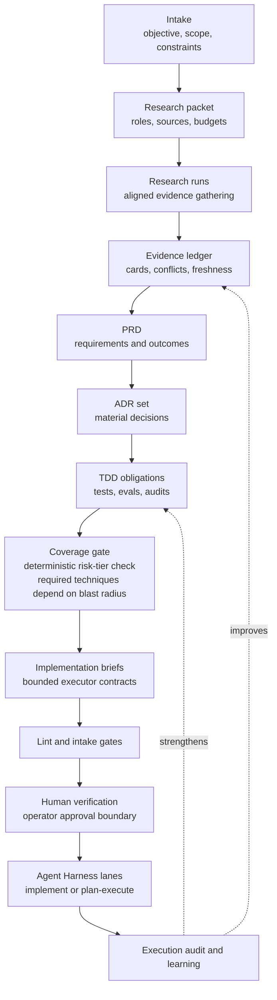
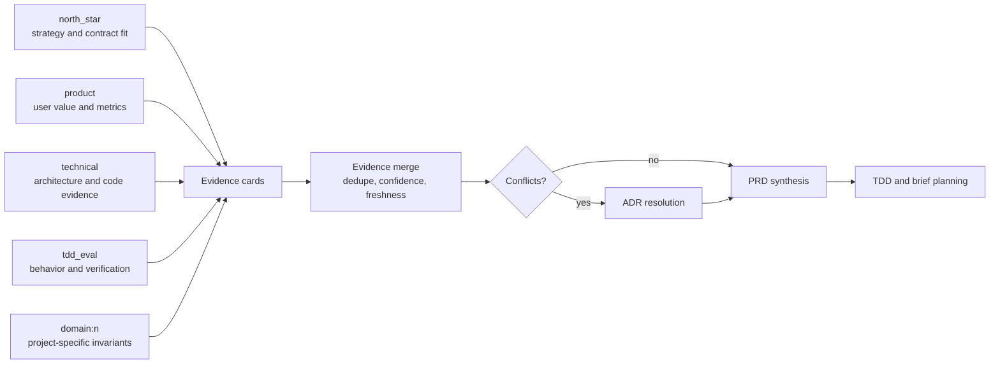
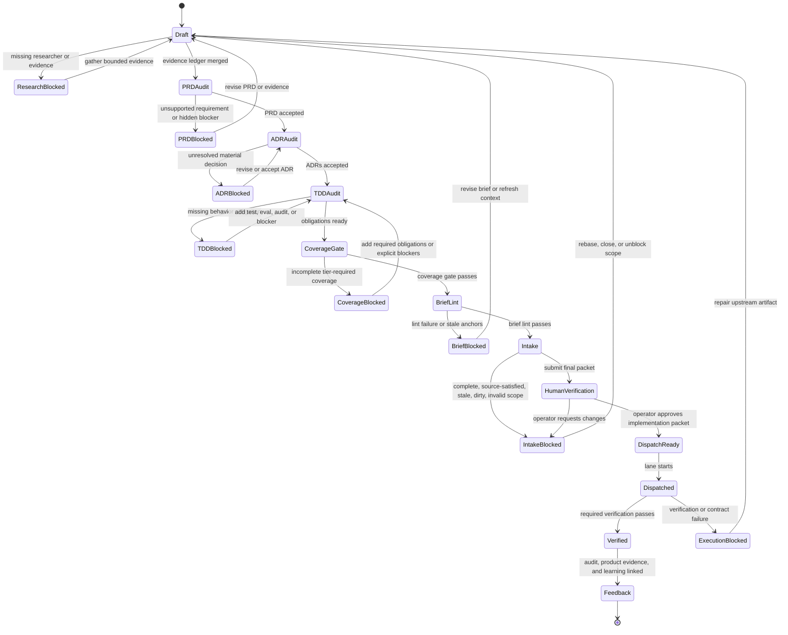

# PRD To ADR To Brief Research Workflow

**North Star: AI coding agents are becoming common, but teams do not yet trust
their context, decisions, or outputs. Agent Harness sells the missing substrate: repo
memory, freshness, contracts, audit, and evals.**

Status: design guidance
YYYY-MM-DD; reviewed YYYY-MM-DD

Implementation state in the current target state: the durable implementation effort has
been migrated to
`docs/product-workflows/efforts/closed/prd-adr-brief-workflow`, and many
headless product workflow surfaces now ship as deterministic CLI behavior. The
closed folder is a durable status bucket, not proof that every acceptance
criterion in this design has been delivered. Treat this document as the target
contract plus the status overlay below.

Shipped workflow surfaces include product lint/audit/status, research profile
inspection/planning/merge/prompt rendering, PRD/ADR prompt rendering,
acceptance metadata and ADR supersession validation, plan-only TDD obligation
synthesis, deterministic coverage-gate evaluation, lint-verified brief
rendering, read-only execution feedback linking, bounded feedback
reconciliation, product-workflow metrics, Obsidian parity checks, CLI
next-action guidance, ranker-learning evidence adapters, the CLI-ready operator
status view model, the read-only effort browser, and status-migration
plan/apply behavior.

Open delivery blockers from the YYYY-MM-DD post-closeout review: status
migration apply must harden predictable temp-path writes against pre-existing
symlinks; the TUI continuation/handoff surface is not yet delivered; the
coverage gate must reuse product lint/audit authority or run those checks as
blocking preconditions; the durable two-ADR supersession fixture and
index-vs-markdown divergence policy are still missing; Phase 7 `harness tool`/MCP
read-only product workflow exposure is not shipped; and operator UX/API parity
gaps remain for closed-effort actions, missing-state recovery, and JSON
usage-error output.

This document designs the upstream product and architecture workflow that turns
research-backed product intent into dispatchable Agent Harness implementation briefs:

```text
research evidence -> PRD -> ADR set -> TDD obligations -> Agent Harness brief
```

The goal is not to make the harness decide product strategy. The goal is to let
one or more aligned researchers gather and compress evidence, then let Agent Harness
enforce the traceability, freshness, TDD, and dispatch contracts needed before a
local model starts implementation.

The controlling policy remains:

- The model owns strategy.
- The harness owns contracts.

In this workflow, researchers and planner models may argue for a requirement,
decision, decomposition, or implementation shape. Agent Harness owns the artifact
schemas, source links, researcher role boundaries, evidence freshness, conflict
tracking, TDD readiness, brief linting, intake classification, and audit trail.

## Executive Summary

Agent Harness already has the lower half of the workflow:

- `context_pack`, `context_query`, `context_zoom`, `context_impact`, and
  `context_trace_pack` can provide local codebase evidence with freshness and
  provenance.
- `harness architect packet --schema planning_v2` can package evidence into a
  planning packet with contracts, candidate scope, freshness, language
  capabilities, handoff, and context budget.
- `harness architect plan`, `critique`, `brief`, and `plan-audit` can render and
  audit planning artifacts.
- `harness brief lint` checks dispatch brief structure, scope, anchors, test
  commands, prompt-magic triggers, and stale or vague implementation shapes.
- `harness atom intake` classifies non-dispatchable work before a model spends
  tokens.
- `plan-execute` and `implement` consume briefs as Agent Harness's execution entrypoint.
- `harness product-evidence export` and `harness release evidence` already provide
  privacy-safe evidence bundles for product and release review.
- `harness_audit`, telemetry, replay evals, SWE evals, and localization
  benchmarks already create the behavioral feedback surface needed to improve
  future packets and briefs.

The missing layer is a first-class product-decision pipeline above those tools.
That pipeline should:

1. Run one or more bounded researchers with explicit alignments.
2. Store research as evidence cards, not prompt prose.
3. Synthesize a PRD with traceable requirements and measurable outcomes.
4. Produce ADRs for material technical/product choices.
5. Convert desired behavior into test obligations before implementation.
6. Generate one or more dispatchable briefs that satisfy existing Agent Harness lint and
   intake gates.
7. Feed execution, audit, product-evidence, and release-evidence outcomes back
   into future research, PRDs, ADRs, TDD obligations, and ranking.

original implementation/target ecosystem is the useful reference project because it already shows the
shape Agent Harness should generalize: spec-first orchestration, project-specific
research topics, guard-driven discovery discipline, local model brief preloads, atom
intake before dispatch, exact brief allowlists, and explicit acceptance/review
boundaries. Agent Harness should adopt the generic engineering pattern, not original implementation's
game-specific vocabulary.

## Problem

Implementation briefs are currently the practical entrypoint for Agent Harness lanes,
but high-quality briefs often require upstream work that is not represented as a
durable product workflow:

- market, deployment, domain, and technical evidence may live in ad hoc notes
- local repository behavior may be rediscovered during implementation instead
  of analyzed once and cited
- architectural decisions may be implied inside a brief instead of captured as
  ADRs
- tests may be selected after implementation rather than used to shape it
- researcher disagreements may be collapsed into a confident summary
- product intent may not be traceable to code, logs, tests, or user-visible
  behavior
- stale or already-satisfied artifacts may reach an implementation lane
- project-specific workflow scripts may encode reusable harness behavior

The result is a weak handoff. A local model receives an implementation brief,
but the brief may be doing too much hidden work: product framing, architecture
selection, repository localization, test design, risk analysis, and exact edit
instruction. That overload is especially costly for local/smaller models.

The target workflow should make upstream decisions explicit enough that the
brief is a bounded executor contract, not a miniature product process.

## Design Goals

1. Support multiple researchers with explicit alignments such as north-star,
   product, technical, UX, security, ops, and domain-specific roles.
2. Keep researcher output evidence-shaped: findings, sources, local handles,
   confidence, uncertainty, conflicts, and recommended follow-up probes.
3. Produce PRDs whose requirements are traceable to evidence or clearly labeled
   inference.
4. Produce ADRs for decisions that materially affect architecture, contracts,
   data ownership, tests, operations, or user experience.
5. Make TDD proactive: desired behavior becomes test obligations before a brief
   is dispatchable.
6. Use Agent Harness's local contextual capabilities as the default evidence source for
   repository facts and behavior.
7. Preserve existing brief lint and atom intake as the hard dispatch gates.
8. Keep project-specific research profiles and domain rules outside Agent Harness core
   while keeping generic schemas, gates, and telemetry inside Agent Harness.
9. Make the workflow usable manually with today's commands before adding new
   orchestration commands.
10. Feed execution outcomes, harness behavior, localization quality, and test
   results back into future planning and ranker learning.

## Non-Goals

- Do not build a generic autonomous product manager that approves its own PRDs.
- Do not require web research for repository-local work. External research is
  optional and should be profile-controlled.
- Do not let a researcher output authorize writes. Only briefs, lane contracts,
  and runtime gates authorize execution.
- Do not encode workflow behavior through magic phrases in PRDs, ADRs, or
  briefs.
- Do not replace `architect packet`, `brief lint`, `atom intake`, or
  `plan-execute`; this workflow composes them.
- Do not make the harness choose the implementation strategy when a model can
  safely decide from packet-backed evidence.
- Do not generalize original-implementation-specific game design rules into Agent Harness core.
- Do not require the full behavioral coverage pipeline for every low-risk
  artifact. Coverage gates are deterministic, but their required techniques are
  tiered by artifact risk and ADR blast radius.

## Evidence Grounding

Verified Agent Harness facts on YYYY-MM-DD:

- `README.md` describes `harness lane` as the recommended entrypoint and confirms
  that `implement` and `plan-execute` lanes preload compact `context_pack`
  evidence unless `--no-context-pack` is used.
- `docs/architect-packets.md` defines the current packet flow:
  `context impact`, `context pack`, `architect packet`, `lint`, `budget`,
  `plan`, `artifact`, and `plan-audit`.
- `internal/architect/packet.go` defines packet schemas and profile rules,
  collectors, gates, roles, file refs, tests, anchors, evidence, risks, and
  unknowns.
- `internal/architect/planning_v2.go` enriches planning packets with contracts,
  repository view, candidate scope, freshness, language capabilities, handoff,
  and context budget.
- `internal/architect/prompts.go` can render plan, critique, and brief prompts
  from a packet and prior plan.
- `internal/architect/plan_audit.go` checks plans and plan artifacts for packet
  identity mismatches, scope mismatches, missing files, unsupported handles,
  validation gaps, stale context, unresolved questions, approval handoff issues,
  and placeholders.
- `cmd/harness/brief-preflight.py` enforces brief structure, no prompt-magic
  triggers, test-anchor preload, verified current state, exact-anchor
  specificity, file existence, and dispatch-safe brief wording.
- `internal/eval/localization_corpus.go` and
  `internal/eval/localization_benchmark.go` define the current structure for
  measuring context localization quality, broad-read counts, zero-hit searches,
  candidate path waste, and competitive baselines.
- `cmd/harness/product_evidence.go` and `cmd/harness/release_evidence.go` define the
  current privacy-safe evidence exports used for product and release review.
- `README.md` currently states that Agent Harness is used primarily as a headless runner
  and that the Bubble Tea TUI still exists but is not the actively maintained
  path. The workflow below must therefore define a TUI/operator contract before
  it can be considered complete for interactive multi-session use.

Verified original implementation/target ecosystem reference patterns on YYYY-MM-DD:

- `original implementation/AGENTS.md` makes Agent Harness/local model implementation lanes primary, requires
  `context_pack` before plans/briefs, uses `harness atom intake` before dispatch,
  treats non-dispatchable states as workflow outcomes, and requires exact
  files-to-modify tables and anchors.
- `original implementation/.agent-config/README.md` describes a spec-first orchestrated workflow:
  research, verify one load-bearing finding, update campaign, write atom spec,
  implement, accept, and review.
- `original implementation/scripts/research_topics.py` rotates domain/product research topics
  with explicit queries and a hot-take focus.
- `original implementation/scripts/local-model_brief_preload.sh` emits brief-ready preload sections for
  recurring atom kinds, reducing executor discovery overhead by packaging
  canonical patterns, traps, files, and verification commands.

The inference from this evidence is that Agent Harness's generic opportunity is not a
new chat mode. It is a durable upstream artifact pipeline that turns aligned
research into traceable PRDs, ADRs, TDD obligations, and dispatch-ready briefs.

## Current Implementation State

The proposal should be read in two layers:

| Layer | Current state | Implication |
| --- | --- | --- |
| Lower harness substrate | Implemented: context graph tools, architect packets, artifact generation, brief lint, atom intake, lane dispatch, plan-execute progress state, lane history, product evidence, release evidence, telemetry, and audit. | The workflow can be composed from stable headless harness capabilities. |
| Product workflow CLI | Partially implemented: durable effort folders/indexes, product lint/audit/status, research profile surfaces, evidence merge, PRD/ADR prompt renderers, acceptance/supersession checks, plan-only TDD obligation synthesis, deterministic coverage evaluation, brief rendering, execution feedback, metrics, Obsidian parity, effort browsing, and status migration. | These surfaces are usable as headless deterministic workflow contracts, but several design acceptance criteria remain open. |
| Product workflow TUI/sidecar | Not complete: the shared operator status model exists for CLI use, but TUI continuation/handoff fixtures and read-only `harness tool`/MCP product workflow exposure are not delivered. | Do not claim graceful interactive continuation or external-agent product workflow consumption until these slices close. |

For TUI users, the current implementation does not yet provide a first-class
interactive product-workflow surface. Existing resume support can replay a prior
conversation, and workspace workflow/task memory can auto-resume, but this design
still needs an explicit operator-facing state model before it can claim graceful
multi-session research and implementation for complex features.

## Core Vocabulary

- **Researcher**: a bounded model pass, human pass, script, or external agent
  configured with an alignment, scope, allowed evidence sources, and output
  contract.
- **Alignment**: the lens a researcher applies, such as north-star, product,
  technical, security, operations, or a project-defined domain.
- **Evidence card**: a structured finding with source handles, confidence,
  freshness, uncertainty, and conflicts.
- **PRD**: a product requirements document containing the problem, users,
  desired outcomes, requirements, non-goals, metrics, risks, and open questions.
- **ADR**: an architecture decision record for one material decision, including
  alternatives, evidence, chosen decision, consequences, and status.
- **TDD obligation**: a required characterization, regression, acceptance,
  source-sanity, harness-audit, or manual verification check tied to a behavior.
- **Brief**: the executable Agent Harness entrypoint consumed by `implement` or
  `plan-execute`.
- **Traceability matrix**: the graph linking evidence cards to PRD requirements,
  ADR decisions, TDD obligations, brief sections, execution results, and later
  audit/eval/product-evidence/release-evidence findings.

## Target Lifecycle

```text
0. Intake
1. Research packet
2. Research runs
3. Evidence merge
4. PRD draft
5. PRD audit
6. ADR candidates
7. ADR acceptance
8. TDD obligation plan (risk-tiered; may include FMEA, HAZOP, PBT, decision
   tables, and mutation verification)
8a. Coverage gate (deterministic, risk-tiered completeness check)
9. Brief generation
10. Brief lint and intake
10a. Human verification (operator approval of the final PRD/ADR/TDD/brief packet)
11. Lane dispatch
12. Execution audit and learning (feeds back into step 8)
```

This is the artifact flow at the level the harness should own:



### 0. Intake

Input can be a user prompt, issue, strategy note, failing behavior log,
existing brief, project campaign item, or external sidecar request.

The harness records:

- objective text
- workspace root and git/worktree fingerprint
- requested output: PRD, ADR, brief, or all
- project profile
- known constraints
- user-provided evidence
- privacy level
- allowed external research policy
- expected dispatch lane, if known

Intake should classify the request without pretending the PRD or ADR is already
known. It should also detect obvious terminal states: already-complete,
source-satisfied, missing scope, invalid scope, stale source, or dirty scoped
files.

### 1. Research Packet

The research packet is the upstream equivalent of an architect packet. It
defines the researcher roster, allowed sources, evidence expectations, and
budget.

It should include:

- `task_id`
- task statement
- project profile and rule evidence
- researcher roster
- required and optional evidence sources
- local context handles or pending context requests
- known project decisions and prior ADRs
- privacy constraints
- output schemas
- budget tier
- conflict policy
- completion gates
- requested durability level: local working artifact, source-controlled decision
  record, or external evidence export

The packet is host-authored. Researchers can report gaps or contradictions, but
they should not silently change their own scope.

### 2. Research Runs

Researchers run independently or sequentially depending on local model capacity.
Each researcher receives the same base packet plus its own alignment.

Minimum researcher set:

| Researcher | Alignment | Primary question | Default sources |
| --- | --- | --- | --- |
| `north_star` | Agent Harness thesis and strategy/contract split | Does this strengthen repo memory, freshness, contracts, audit, or evals without stealing model strategy? | project docs, decisioning docs, prior ADRs, harness audit |
| `product` | user value and workflow fit | What user problem does this solve, and how will success be measured? | PRDs, issues, user notes, product evidence, usage logs |
| `technical` | architecture and implementation risk | What architecture, contracts, boundaries, and migration path are needed? | context tools, language tools, tests, docs, telemetry |
| `tdd_eval` | behavior and verification | What behavior should be characterized or tested before code changes? What failure modes exist at the contract boundary? | tests, logs, `context_trace_pack`, `harness_audit`, eval suites, FMEA templates, HAZOP guide-word checklists |
| `domain:<name>` | project-specific domain lens | Which domain rules, vocabulary, invariants, and traps apply? | project profiles, domain docs, project discovery tools |

Optional researchers can cover security/privacy, operations, UX, compliance,
market, support, or release readiness.

Researchers must output evidence cards. They may include recommendations, but
recommendations are not decisions until accepted by the PRD or ADR step.

### 3. Evidence Merge

The merge step deduplicates evidence cards and records conflicts.

Merge rules:

- Preserve source handles and researcher IDs.
- Separate verified facts from inference.
- Keep minority/conflicting findings visible.
- Prefer local code, tests, logs, and telemetry for repository behavior claims.
- Treat external research as product/domain evidence, not as proof of local
  implementation state.
- Mark stale, missing, or low-confidence evidence explicitly.

The output is a merged evidence ledger and traceability seed.

### 4. PRD Draft

The PRD translates evidence into product requirements. It should not contain
implementation instructions unless those instructions are product constraints.

Required sections:

- Problem statement
- User or operator persona
- Goals and non-goals
- Current behavior and evidence
- Desired behavior
- Functional requirements
- Non-functional requirements
- Success metrics
- TDD obligations summary
- Dependencies and constraints
- Risks
- Open questions
- Evidence appendix

Each requirement should include:

- stable requirement ID
- evidence references
- owner alignment
- priority
- measurable outcome
- testability status
- open questions or blockers

PRDs can contain inference, but inference must be labeled. A PRD audit should
reject requirements that present unsupported guesses as facts.

### 5. PRD Audit

The PRD audit is deterministic where possible and model-assisted only for
judgment-heavy review.

Hard errors:

- missing goals or non-goals
- requirement with no evidence reference and no inference label
- success metric absent for a high-priority requirement
- repository behavior claim without local source/log/test evidence
- contradiction with a currently accepted ADR
- privacy violation in durable evidence
- unresolved blocker hidden as a requirement

Warnings:

- low-confidence evidence
- requirement too broad for one implementation brief
- testability not yet specified
- external research cited without date/source metadata
- researcher conflict left unresolved

### 6. ADR Candidates

Every material decision should become an ADR candidate. Material decisions
include:

- new or changed harness contract
- artifact schema or state machine
- authority boundary between model and harness
- persistent storage or migration
- queue/concurrency behavior
- tool or capability surface
- test strategy or eval metric
- project profile extension point
- privacy/audit behavior
- dependency addition

ADR fields:

- ADR ID
- title
- status: proposed, accepted, superseded, rejected
- context
- decision
- alternatives considered
- evidence references
- consequences
- compatibility and migration notes
- TDD obligations
- rollback plan
- open questions

An ADR is the point where conflicting researcher recommendations are resolved.
The ADR may choose one option, defer, or mark a blocker.

### 7. ADR Acceptance

Human acceptance should be the default for product or architecture decisions
with meaningful blast radius. Model acceptance can be allowed for low-risk,
local, reversible decisions when the profile permits it.

Acceptance gate checks:

- each accepted ADR links to a PRD requirement or explicit maintenance goal
- alternatives are real, not straw men
- consequences include failure modes and operational cost
- validation requirements are concrete
- coverage tier is declared and justified by blast radius
- implementation scope is small enough for one or more briefs
- the decision does not duplicate an existing accepted ADR
- superseded ADRs are linked
- acceptance metadata records approver role, timestamp, acceptance profile,
  source packet/evidence snapshot, and any model-accepted low-risk exception

### 8. TDD Obligation Plan

The workflow should turn desired behavior into tests before implementation.
This is the main place where "properly proactive TDD" becomes enforceable.

The full behavioral coverage pipeline is specified in
[design-tdd-coverage.md](design-tdd-coverage.md). This section summarizes the
obligation types and rules. The coverage doc defines the staged pipeline from
ADR through EARS requirements, example mapping, BDD scenarios, Design by
Contract, failure mode analysis (FMEA, HAZOP, FTA), state machine modeling,
test suite generation, and mutation verification.

The workflow is risk-tiered. The harness should force the smallest deterministic
coverage contract that honestly matches the artifact risk:

| Coverage tier | Applies to | Required before brief generation |
| --- | --- | --- |
| `documentation` | prose-only docs, examples, or non-normative notes | evidence references, acceptance check, privacy scan when durable, and `git diff --check` |
| `local_low` | low-risk local code/config changes with no shared contract change | requirement/testability status, focused validation command, source sanity for source edits, and explicit blocker if automation is unavailable |
| `behavior_standard` | user-visible behavior, shared helper behavior, or workflow behavior with bounded blast radius | EARS requirement, concrete examples or BDD scenarios, contract assertions for changed boundaries, regression/acceptance tests, and focused verification |
| `contract_high` | harness contracts, permissions, state machines, protocol handling, privacy/security, queueing, audit, eval, or cross-session workflow state | EARS, BDD, Design by Contract, FMEA/HAZOP for high-risk failures, state/PBT obligations for invariants, decision/boundary coverage where applicable, mutation or an explicit unavailable-tool blocker |
| `formal_optional` | protocol-critical or safety-critical contracts where model/harness ambiguity is still too high | all `contract_high` obligations plus optional formal model/checker artifacts when justified |

TDD obligation types:

| Type | Category | When to use | Evidence source |
| --- | --- | --- | --- |
| `characterization` | safety net | existing behavior is unclear or risky | current tests, logs, local probes |
| `regression` | safety net | a known failure or behavior bug exists | conversation logs, telemetry, issue repro, failing test |
| `acceptance` | positive | user-visible behavior or workflow must change | PRD requirement, product metric |
| `contract` | positive | harness boundary must hold | runtime brief, brief lint, atom intake, plan audit |
| `source_sanity` | positive | source files change | language diagnostics, build, typecheck |
| `eval` | positive | agent behavior must improve | `harness-eval`, SWE suite, localization benchmark |
| `audit` | positive | evidence/audit behavior must improve | `harness_audit`, audit watch |
| `property_based` | coverage | session invariant must hold for arbitrary sequences | contract invariants, state machine model |
| `fmea_negative` | negative | failure mode with RPN >= 21 must be mitigated | FMEA analysis of contract boundary |
| `hazop_deviation` | negative | deviation with severity >= 3 must be handled | guide-word analysis of workflow steps |
| `decision_table` | combinatorial | behavior depends on multiple boolean conditions | combinatorial enumeration of conditions |
| `boundary_value` | combinatorial | numeric bound must be tested at edges | contract parameters with numeric ranges |
| `mutation_score` | verification | test suite must detect injected faults | mutation testing of contract implementation |
| `post_mortem` | feedback | incident must produce at least one catching test | execution audit, telemetry, post-mortem |
| `manual` | fallback | automation is unavailable | explicit command or inspection steps plus blocker reason |

Rules:

- Every high-priority PRD requirement needs at least one validation obligation,
  but obligation depth follows the selected coverage tier.
- Every accepted ADR needs a declared coverage tier, validation evidence, or a
  documented blocker.
- Every implementation brief must carry exact validation commands or an explicit
  reason why validation is blocked.
- For behavior bugs, the first preferred test is a regression fixture that
  catches the bad behavior, followed by a valid allowed-path test, followed by
  a FMEA failure mode entry if the failure mode was not previously enumerated.
- For legacy or poorly understood behavior, characterization comes before
  change.
- Patch hygiene alone is not enough for source edits.
- Tautological tests and placeholder assertions must fail lint/audit.
- Session invariants in `contract_high` and `formal_optional` work must have
  property-based or equivalent state-model obligations.
- Failure modes with FMEA RPN >= 21 require negative-test obligations when the
  selected tier includes FMEA.
- HAZOP deviations with severity >= 3 require deviation-test obligations when
  the selected tier includes HAZOP.
- Multi-condition decisions require decision-table obligations when the selected
  tier includes combinatorial coverage.
- Numeric bounds require boundary-value obligations when the selected tier
  includes boundary coverage.
- Mutation score for contract-level tests defaults to >= 80% only when mutation
  tooling is available and the selected tier requires mutation. Otherwise the
  gate records an explicit unavailable-tool blocker or advisory.
- Every execution incident must produce at least one post-mortem obligation.

### 8a. Coverage Gate

Between the TDD obligation plan and brief generation, the workflow must pass a
deterministic coverage gate. The gate is defined in
[design-tdd-coverage.md](design-tdd-coverage.md), but this workflow selects which
criteria are blocking through the artifact's coverage tier:

| Criterion | Default threshold | Blocking tier |
| --- | --- | --- |
| Evidence and acceptance coverage | 100% of requirements and artifacts cite evidence or labeled inference | all tiers |
| EARS coverage | 100% of material ADR consequences mapped | `behavior_standard`, `contract_high`, `formal_optional` |
| BDD/example coverage | 100% of EARS requirements have concrete examples or scenarios | `behavior_standard`, `contract_high`, `formal_optional` |
| Contract coverage | 100% of BDD Then clauses mapped to postconditions for changed boundaries | `behavior_standard`, `contract_high`, `formal_optional` |
| FMEA coverage | 100% of failure modes with RPN >= 21 have tests or blockers | `contract_high`, `formal_optional` |
| HAZOP coverage | 100% of deviations with severity >= 3 have tests or blockers | `contract_high`, `formal_optional` |
| Decision table coverage | 100% of required multi-condition decisions enumerated | `contract_high`, `formal_optional` when applicable |
| Boundary value coverage | 100% of required numeric bounds tested at boundaries | `contract_high`, `formal_optional` when applicable |
| PBT/state coverage | 100% of session invariants have PBT or equivalent state-model coverage | `contract_high`, `formal_optional` |
| Mutation score | >= 80% for contract-level tests, or explicit unavailable-tool blocker | `contract_high`, `formal_optional` when mutation is configured |

The coverage gate emits `coverage_gate_evaluated` events. A blocked gate
returns the obligation plan to the relevant owner:

- missing coverage tier -> step 6 or 7 (ADR revision)
- missing evidence, EARS, or BDD coverage -> step 4 (PRD revision)
- missing failure mode or deviation coverage -> step 8 (obligation plan
  revision with FMEA/HAZOP follow-up)
- low mutation score -> step 8 (obligation plan revision with test quality
  improvement)
- missing property-based or decision table tests -> step 8 (obligation plan
  revision)

The coverage gate must share validation authority with product lint/audit rather
than becoming a weaker parallel checker. Before it can pass, the gate must either
reuse the artifact-link, traceability, acceptance, and supersession validators
directly, or run the relevant product lint/audit checks as blocking preconditions
and report their typed findings in the gate result. Coverage is not complete if a
requirement, evidence card, ADR, TDD obligation, or brief section can pass the
gate while failing the canonical cross-link validators.

### 9. Brief Generation

Brief generation is the final compression step. It consumes the accepted PRD,
accepted ADRs, TDD obligations, and current local context packet.

Required brief properties:

- one bounded implementation objective
- exhaustive files-to-modify allowlist
- files-to-read-first only when exact read evidence remains necessary
- verified current state and anchors
- required edits or required behavior
- hard prohibitions tied to concrete scope
- exact tests and acceptance commands
- relevant ADR decisions
- stop rule for contradicted or missing facts
- no discovery mandates for facts the planner should already have supplied
- no prompt-magic contract triggers

If the design decomposes into multiple implementation atoms, each brief should
map to one coherent change with its own TDD obligations and acceptance gate.

### 10. Brief Lint And Intake

Existing gates remain authoritative:

```bash
harness brief lint <brief.md>
harness atom intake --spec <brief.md> --project-root <root> --json
```

The workflow should not dispatch when either gate reports a blocker. A blocked
brief returns to the relevant owner:

- missing product outcome -> PRD revision
- missing decision -> ADR revision
- missing evidence -> researcher follow-up
- missing test -> TDD obligation revision
- stale source -> rebase or refresh
- bad anchors -> brief revision
- dirty scoped files -> operator action

### 11. Lane Dispatch

Dispatch uses existing Agent Harness lanes:

- `implement` for small, tightly scoped changes where the executor can safely
  interleave reads and writes.
- `plan-execute` for multi-file work where a planner should submit a structured
  edit plan and a deterministic executor applies edits.
- `artifact --no-tools` for PRD, ADR, plan, critique, or brief drafting phases
  that should not inspect or mutate the workspace.

The brief is still the entrypoint. The PRD and ADRs are upstream evidence, not
write authority.

### 12. Execution Audit And Learning

After execution, the workflow should capture:

- changed paths
- verification commands and status
- source-sanity status
- plan-to-execution drift
- required edit path coverage
- context packet used
- broad-read and zero-hit search counts
- harness audit findings
- brief lint and intake outcomes
- final user-visible status

Outcomes feed back into:

- PRD metrics
- ADR consequences
- TDD obligations
- regression suites
- `harness_feedback`
- context ranker learning
- product-evidence and release-evidence exports
- future researcher prompts and profile rules

## TUI And Multi-Session Operator Experience

The workflow can support comprehensive research and implementation of complex
features only if the TUI is a view over typed workflow state, not the source of
truth. Chat transcript replay is useful context, but it is not enough to safely
continue a multi-stage product workflow after a pause, crash, compaction, or
operator handoff.

Current reality: Agent Harness's TUI exists, and session resume can replay prior
conversation messages, while workspace workflow/task memory can auto-resume from
persisted state. The README currently describes the TUI as not the actively
maintained path. This design therefore requires a product-workflow TUI contract
before claiming graceful interactive support.

### Operator Mental Model

A TUI user should see one work item as a durable state machine:

```text
research -> PRD -> ADRs -> TDD obligations -> coverage gate -> briefs
-> dispatch -> verification/audit -> feedback
```

At any point, the TUI should show:

- active `task_id`, title, artifact root, current phase, and terminal state if any
- current context packet IDs, freshness, referenced paths, and unresolved gaps
- accepted PRD/ADR/TDD artifact IDs and whether they are working or durable
- selected coverage tier and open validation obligations
- dispatchable briefs, blocked briefs, and exact blocker reasons
- lane sessions already run, changed paths, verification status, and audit links
- valid next actions and which actor owns each action: operator, model,
  researcher, product workflow, brief lint, atom intake, lane, or reviewer

The TUI must not ask the user to infer progress from chat prose. It should render
the same typed state that product CLI commands and audit tools consume.

### Workflow State Contract

Each product workflow needs one effort folder with a small machine-readable state
file in the working root and, after acceptance, in the durable root:

- `.harness/product/efforts/<status>/<effort-id>/workflow_state.json` for local
  working state
- `docs/product-workflows/efforts/<status>/<effort-id>/workflow_state.json` for
  accepted durable state when the project chooses to commit the workflow

Required fields:

- schema version, `effort_id`, `task_id`, title, created/updated timestamps,
  workspace fingerprint, state revision, and last event ID
- current status bucket: `unstarted`, `started`, or `closed`
- current phase and state: draft, blocked, ready, dispatched, verified,
  source-satisfied, stale-needs-refresh, complete, or abandoned
- artifact IDs and paths for evidence ledger, PRD, ADRs, TDD ledger, briefs,
  product-evidence export, release-evidence bundle, and lane reports
- artifact hashes, durability level, and promotion status for accepted artifacts
- context packet IDs, freshness state, referenced paths, unresolved packet gaps,
  and refresh policy
- open questions, open obligations, blockers, owner, and next valid actions
- coverage tier, gate results, and blocking/advisory criteria
- session IDs for TUI, artifact, lane, plan-execute, review-repair, telemetry,
  and audit records
- current folder path, previous folder paths, and last status migration event
- last reconciliation timestamp and any state/artifact mismatch blockers
- privacy/redaction status and fields excluded from durable artifacts

Conversation logs, telemetry, and lane history become linked evidence records.
They are not the canonical state because replaying prose can reintroduce stale
anchors, forgotten blockers, or accidental prompt authority.

### Effort Hosting And Status Browsing

Design docs and generated artifacts should be hosted as effort folders. The
coarse folder status is for human browsing; the stable `effort_id` is the
identity used in references, events, and evidence.

Working effort folders live under:

- `.harness/product/efforts/unstarted/<effort-id>/...`
- `.harness/product/efforts/started/<effort-id>/...`
- `.harness/product/efforts/closed/<effort-id>/...`

Accepted durable effort folders live under:

- `docs/product-workflows/efforts/unstarted/<effort-id>/...`
- `docs/product-workflows/efforts/started/<effort-id>/...`
- `docs/product-workflows/efforts/closed/<effort-id>/...`

Each effort folder should contain the whole reviewable packet for one design doc
or product effort:

- `design.md` or `source_design_ref.json` for the original design document or
  initiating request
- `workflow_state.json`
- `events.jsonl`
- `evidence/`
- `prd.md`
- `adrs/`
- `tdd.json`
- `briefs/`
- `reports/`
- `README.md` as a compact human index

Status migration rules:

- `unstarted`: the effort is captured for review, but no research, PRD, TDD, or
  implementation lane has started.
- `started`: any researcher, artifact generation, coverage gate, brief, lane, or
  dispatch work has begun.
- `closed`: the effort is complete, source-satisfied, abandoned, superseded, or
  intentionally blocked with an accepted terminal reason.

Moving an effort between status folders must be an application-level transition:
update `workflow_state.json`, append a status migration event, move the folder,
and update the effort index atomically. Index files such as
`.harness/product/efforts/index.json` and
`docs/product-workflows/efforts/index.json` should map each stable `effort_id` to
its current status folder and record prior paths. Internal links inside the
effort folder should be relative so the folder can move without rewriting every
artifact.

### End-To-End Wiring Contract

The user experience is complete only if the CLI and TUI are two presenters over
the same application workflow:

```text
operator intent -> create/open effort -> render status
-> advance one action -> write artifacts/evidence -> reconcile state
-> render next status
```

Required wiring:

- **Effort resolution**: a prompt, CLI argument, or TUI action resolves exactly
  one `effort_id`, working folder, and optional durable folder. Ambiguous names,
  moved folders, or missing state files become typed blockers before any model
  run.
- **Shared use cases**: TUI actions and future `harness product status`,
  `continue`, `promote`, and `close` commands call the same application use
  cases. The TUI must not directly mutate workflow files, atom docs, or lane
  state.
- **Atomic transitions**: every action loads the latest `workflow_state.json`,
  validates schema/version/freshness, checks for concurrent updates, runs one
  application use case, writes artifacts, appends an event, and then writes the
  next state snapshot. A crash between artifact write and state write must be
  recoverable by reconciliation.
- **Reconciliation adapters**: lane history, plan-execute progress state, atom
  tracker docs, telemetry, product-evidence exports, and release-evidence bundles
  are read through adapters. Reconciliation updates workflow state with bounded
  IDs, relative paths, hashes, statuses, and blockers; it does not paste raw
  transcript or file bodies into state.
- **Shared view model**: CLI status output and TUI panels should render the same
  application view model: status bucket, phase, freshness, artifacts, blockers,
  next actions, owner, verification state, and audit/evidence links.
- **No hidden continuation**: if the next action would use stale context,
  unresolved conflicts, a dirty artifact, missing verification evidence, or a
  state/index mismatch, the UI shows the blocker and the specific repair action
  instead of dispatching.

### Context Management

For long feature work, context should be graceful by construction:

- Research phases use evidence cards and context handles instead of raw source
  bodies.
- PRD/ADR/TDD phases use compact artifact summaries and traceability IDs.
- Brief generation receives the current context packet plus exact anchors needed
  for dispatch; it should not ask the executor to rediscover planner-owned facts.
- Implementation lanes receive one bounded brief and a compact auto-preloaded
  `context_pack`; they verify exact anchors before writes.
- Resume loads workflow state, not a full raw transcript. The next model turn
  should see only the active phase summary, accepted artifacts, open obligations,
  current packet freshness, and one exact next decision boundary.
- If freshness is stale, the valid next action is refresh/rebase or block; the
  TUI should not continue execution against stale load-bearing evidence.

This keeps complex work from becoming a single ever-growing prompt. The harness
owns compression into artifacts, packets, and workflow-state summaries; the
model owns strategy inside the current safe phase.

### Execute And Continue Semantics

The operator needs explicit continuation verbs:

| Action | Meaning | Required state |
| --- | --- | --- |
| Start research | Build research packet and gather evidence | intake accepted |
| Continue research | Run only researchers with open evidence gaps | research blocked or incomplete |
| Draft/refresh PRD | Synthesize requirements from current evidence ledger | evidence ledger ready |
| Accept ADR | Mark a decision durable with acceptance metadata | ADR audit passed |
| Build TDD plan | Generate/update obligations for accepted requirements/ADRs | PRD/ADR accepted |
| Run coverage gate | Evaluate required criteria for the declared coverage tier | TDD ledger ready |
| Generate briefs | Produce bounded dispatch briefs | coverage gate passed or documented blocker |
| Submit for human verification | Ask the operator to approve or reject the final PRD/ADR/TDD/brief packet | brief lint and atom intake passed |
| Approve for implementation | Record human approval for the implementation packet | operator accepted the final packet |
| Dispatch brief | Run `implement` or `plan-execute` | human verification approved |
| Continue execution | Resume lane/review-repair from saved progress state | incomplete resumable lane state |
| Close workflow | Mark complete, source-satisfied, abandoned, or blocked | no open dispatch/verification obligations, or explicit blocker |

Each continuation should be idempotent: rerunning it either advances one typed
state, reports no-op/source-satisfied, or returns a typed blocker. A TUI "resume"
button should therefore choose from workflow-state next actions, not merely
restart the last prompt.

### User Journey Coverage

The design must cover these journeys end to end:

1. A user captures a design doc or rough request but does not start work. Agent Harness
   creates an `unstarted` effort folder with the source design doc, state file,
   and index entry.
2. A user starts work from the TUI or CLI. Agent Harness migrates the effort folder to
   `started`, gathers initial evidence, and renders the first safe next action.
3. A user exits after research or PRD drafting. On return, the TUI loads workflow
   state, reconciles artifacts and evidence, and shows decisions, gaps, and the
   next valid action without requiring transcript review.
4. A user continues after a blocker. The blocker names owner, missing evidence,
   repair action, and the command or UI action that will retry only the blocked
   phase.
5. A user dispatches implementation. The workflow records the brief, lane or
   plan-execute session ID, changed paths, verification evidence, and atom
   closeout status before offering follow-up actions.
6. A user switches between CLI and TUI. Both surfaces reconcile and render the
   same workflow state, so work started in one can be inspected or continued in
   the other.
7. A user closes the effort. Agent Harness requires no open dispatch or verification
   obligations, records the terminal reason, migrates the folder to `closed`, and
   keeps the effort browsable by status and stable ID.
8. A user accepts artifacts for team use. Promotion copies accepted artifacts to
   the durable status folder with hashes and acceptance metadata, then records
   the promotion in workflow state and product/release evidence links.

### First-Run Reliability Standard

Users should expect the first run to be safe, understandable, and recoverable.
They should not expect flawless autonomous completion for arbitrary complex
features on the first try. For complex work, a typed blocker, stale-context
warning, missing-obligation report, or required human acceptance step is a
successful product outcome when it prevents unsafe dispatch.

The first-run promise is:

- happy-path fixtures can be captured, started, linted, given TDD obligations,
  browsed by status, and resumed without manual file spelunking
- unsupported or incomplete real efforts fail closed with a typed blocker and a
  next valid action
- no accepted artifact is silently treated as durable while it only exists under
  `.harness/`
- no TUI action dispatches implementation from stale state, missing TDD
  obligations, dirty artifacts, or unresolved reconciliation mismatch
- rerunning the same command or TUI action is idempotent: it advances one valid
  state, reports no-op/source-satisfied, or repeats the same typed blocker
- the user can inspect what happened through the effort folder, status view,
  event log, and evidence links without reading raw transcripts

This is the right reliability bar for a local agent harness: deterministic
contracts around uncertain model work, not a claim that the model always gets
complex research and implementation right on the first attempt.

### Completion Bar

The design is complete for TUI users only when a user can close the app after
research, reopen later, and see:

- what has been decided
- what evidence is fresh or stale
- which obligations remain open
- which briefs are dispatchable or blocked
- what command/session produced each artifact
- the next safe action without rereading the transcript

Until that operator contract exists, the workflow is suitable for headless/manual
composition and design fixtures, but not yet a fully graceful TUI experience for
complex multi-state feature work.

## Researcher Model

Researchers are configured by data, not hardcoded prompt branches.

The researcher model is a fan-in, not a consensus shortcut. Each role produces
evidence from its alignment; the merge step preserves conflicts until the PRD
or ADR process resolves them.



Example profile sketch:

```json
{
  "schema_version": "harness.research_profile.v1",
  "name": "harness-prd-adr-brief",
  "researchers": [
    {
      "id": "north_star",
      "alignment": "north_star",
      "question": "Does the proposal strengthen Agent Harness's evidence, contract, audit, or eval substrate?",
      "required_sources": ["docs/harness-strategic-thesis.md", "docs/decisioning-north-star.md"],
      "allowed_capabilities": ["query_context", "audit_behavior"],
      "output": "evidence_cards"
    },
    {
      "id": "technical",
      "alignment": "technical",
      "question": "Which code surfaces, contracts, tests, and migration steps are implicated?",
      "allowed_capabilities": ["localize_change", "query_context", "inspect_symbol", "trace_runtime_failure"],
      "output": "evidence_cards"
    },
    {
      "id": "domain_original implementation",
      "alignment": "domain",
      "question": "Which original implementation/target ecosystem workflow lessons apply generically, and which are project-specific?",
      "required_sources": ["../original implementation/AGENTS.md", "../original implementation/.agent-config/README.md"],
      "allowed_capabilities": ["inspect_file"],
      "output": "evidence_cards"
    }
  ],
  "merge_policy": {
    "conflicts": "preserve_until_adr",
    "unsupported_claims": "block_prd_audit",
    "stale_local_context": "refresh_or_mark_gap"
  }
}
```

Researcher output contract:

```json
{
  "schema_version": "harness.research_cards.v1",
  "researcher_id": "technical",
  "alignment": "technical",
  "cards": [
    {
      "id": "card-001",
      "kind": "finding",
      "claim": "brief lint already rejects prompt-magic contract triggers",
      "evidence": [
        {
          "type": "file",
          "path": "cmd/harness/brief-preflight.py",
          "handle": "file://cmd/harness/brief-preflight.py",
          "freshness": "current"
        }
      ],
      "confidence": "high",
      "uncertainty": "",
      "implications": ["PRD-to-brief workflow should reuse brief lint instead of duplicating it"]
    }
  ],
  "open_questions": [],
  "conflicts": []
}
```

## Artifact Schemas

Durability rule: `.harness/` is local harness state and is ignored in normal
worktrees. Product workflow commands may write drafts, event logs, and reports
under `.harness/product/efforts/<status>/<effort-id>/...`, but accepted PRDs,
accepted ADRs, dispatch-ready TDD ledgers, and approved briefs must be promoted
to a source-controlled or caller-configured durable artifact root before they
become team decision records.

For this repository, the default tracked root should be:

- `docs/product-workflows/efforts/<status>/<effort-id>/...`

Promotion from the working root to the durable root should preserve artifact IDs,
source hashes, report paths, and acceptance metadata so a reviewer can trace the
accepted artifact back to the local generation/audit run without committing raw
prompt bodies or file bodies.

In the schema examples below:

- `<working-effort-root>` means
  `.harness/product/efforts/<status>/<effort-id>`
- `<durable-effort-root>` means
  `docs/product-workflows/efforts/<status>/<effort-id>`

### PRD

Working locations:

- `<working-effort-root>/prd.md`
- `<working-effort-root>/reports/prd.report.json`

Accepted durable locations:

- `<durable-effort-root>/prd.md`
- `<durable-effort-root>/reports/prd.report.json`

PRD front matter:

```yaml
schema_version: harness.prd.v1
prd_id: prd-YYYY-MM-DD-example
status: draft
task_id: example
evidence_ledger: evidence.jsonl
research_run_id: research-abc123
created_at: YYYY-MM-DDT00:00:00Z
durability: working
accepted_at:
accepted_by:
```

Requirement shape:

```yaml
id: REQ-001
priority: must
statement: "Generate dispatchable implementation briefs from accepted ADRs."
evidence_refs: ["card-technical-001", "adr-001"]
testability: automated
tdd_obligations: ["TDD-001", "TDD-002"]
open_questions: []
```

### ADR

Working locations:

- `<working-effort-root>/adrs/ADR-0001-title.md`
- `<working-effort-root>/adrs/index.json`

Accepted durable locations:

- `<durable-effort-root>/adrs/ADR-0001-title.md`
- `<durable-effort-root>/adrs/index.json`

ADR front matter:

```yaml
schema_version: harness.adr.v1
adr_id: ADR-0001
status: proposed
prd_refs: ["REQ-001"]
evidence_refs: ["card-north-star-001", "card-technical-004"]
tdd_obligations: ["TDD-003"]
coverage_tier: contract_high
accepted_at:
accepted_by:
acceptance_profile:
```

ADR body:

- Context
- Decision
- Alternatives considered
- Evidence
- Consequences
- Compatibility and migration
- TDD obligations
- Rollback
- Open questions

### TDD Obligation Ledger

Working location:

- `<working-effort-root>/tdd.json`

Accepted durable location:

- `<durable-effort-root>/tdd.json`

The obligation ledger schema v2 includes coverage metadata for gate evaluation.
The full schema is specified in
[design-tdd-coverage.md](design-tdd-coverage.md). Example v1 obligation:

```json
{
  "schema_version": "harness.tdd_obligations.v1",
  "obligations": [
    {
      "id": "TDD-001",
      "type": "contract",
      "behavior": "Briefs with missing verified current state fail pre-dispatch lint.",
      "owner": "cmd/harness",
      "command": "go test ./cmd/harness",
      "required_before": "brief_dispatch",
      "status": "pending"
    }
  ]
}
```

Example v2 obligation with coverage metadata:

```json
{
  "schema_version": "harness.tdd_obligations.v2",
  "coverage_tier": "contract_high",
  "coverage": {
    "ears_total": 5,
    "ears_mapped": 5,
    "bdd_total": 12,
    "bdd_with_concrete_data": 12,
    "fmea_modes_total": 8,
    "fmea_modes_mitigated": 8,
    "hazop_deviations_total": 6,
    "hazop_deviations_tested": 6,
    "invariants_total": 3,
    "invariants_with_pbt": 3,
    "decision_tables_total": 2,
    "decision_tables_enumerated": 2,
    "mutation_score": 85,
    "mutation_min_score": 80,
    "gates_passed": ["ears", "bdd", "fmea", "hazop", "pbt", "decision_table", "mutation"],
    "gates_blocked": []
  },
  "obligations": [
    {
      "id": "TDD-001",
      "type": "contract",
      "behavior": "Briefs with missing verified current state fail pre-dispatch lint.",
      "owner": "cmd/harness",
      "command": "go test ./cmd/harness",
      "required_before": "brief_dispatch",
      "status": "pending"
    }
  ]
}
```

### Brief

Working location:

- `<working-effort-root>/briefs/<atom-id>.md`

Accepted durable location:

- `<durable-effort-root>/briefs/<atom-id>.md`

The brief should use the existing source-touching sections already expected by
`harness brief lint`:

- Files To Modify
- Files to Read First, when needed
- Verified Current State
- Required Edits or Required Behavior
- Constraints
- Tests
- Acceptance
- Decisions

The `Decisions` section should cite accepted ADR IDs. The `Tests` and
`Acceptance` sections should cite TDD obligation IDs.

## Proposed Architecture

Follow Clean Architecture boundaries:

### Domain Layer

New domain concepts:

- research profile
- researcher role
- evidence card
- evidence ledger
- PRD
- requirement
- ADR
- TDD obligation
- coverage tier
- traceability matrix
- effort folder
- effort status bucket
- artifact state
- artifact durability state
- workflow state
- product/release evidence link

These types should be framework-free and persistence-ignorant.

### Application Layer

Use cases:

- `CreateOrOpenProductWorkflow`
- `RenderProductWorkflowStatus`
- `AdvanceProductWorkflow`
- `BuildResearchPacket`
- `RunResearcher`
- `MergeResearchEvidence`
- `DraftPRD`
- `AuditPRD`
- `DraftADRs`
- `AuditADR`
- `BuildTDDObligations`
- `EvaluateCoverageGate`
- `GenerateImplementationBriefs`
- `AuditTraceability`
- `MigrateEffortStatus`
- `PromoteAcceptedArtifacts`
- `LinkExecutionEvidence`
- `ReconcileWorkflowState`
- `ResumeProductWorkflow`
- `CloseProductWorkflow`

Ports:

- local context capability port
- model artifact generation port
- working artifact store port
- durable artifact store port
- workflow state store port
- workflow event store port
- effort index store port
- workflow lock or compare-and-swap port
- atom tracker reader port
- lane history reader port
- plan-execute progress reader port
- telemetry reader port
- clock and ID generator
- audit/event sink
- product-evidence export port
- release-evidence bundle port
- optional external research port

### Interface Adapters

Adapters:

- CLI commands
- TUI workflow presenter
- CLI workflow status presenter
- Markdown front matter parser
- JSON artifact encoder/decoder
- existing `architect` packet renderer
- existing `brief lint` and `atom intake` bridges
- existing `context_*` and language capability tools
- optional project overlay resolvers

### Infrastructure

Infrastructure owns:

- working filesystem artifact store under `.harness/product/efforts/`
- accepted durable artifact store under the configured source-controlled root
- atomic workflow state, status migration, and event writes
- telemetry JSONL writes
- model runner invocation through `harness artifact`
- optional web/MCP/external research adapters
- queue integration for local model capacity

The runner should consume finalized briefs. It should not own PRD, ADR, or
research synthesis policy.

## CLI Shape

Start with manual composition. Then add commands only where repeated workflows
need a stable contract.

### Manual Workflow With Current Tools

```bash
WORKING_EFFORT_ROOT=.harness/product/efforts/started/<effort-id>

harness tool context_pack --input '{"task":"<task>","mode":"plan","limit":12}'

harness architect packet \
  --schema planning_v2 \
  --task-file /tmp/task.md \
  --context-view .harness/comprehension/views/<pack_id>.json \
  --output "$WORKING_EFFORT_ROOT/packet.json"

harness architect plan \
  --packet "$WORKING_EFFORT_ROOT/packet.json" \
  --output "$WORKING_EFFORT_ROOT/prd.prompt.md"

harness artifact \
  --prompt-file "$WORKING_EFFORT_ROOT/prd.prompt.md" \
  --output "$WORKING_EFFORT_ROOT/prd.md" \
  --json-out "$WORKING_EFFORT_ROOT/events/prd.events.jsonl" \
  --report-out "$WORKING_EFFORT_ROOT/reports/prd.report.json" \
  --no-tools \
  --mechanical-repair

harness architect brief \
  --packet "$WORKING_EFFORT_ROOT/packet.json" \
  --prior-file "$WORKING_EFFORT_ROOT/approved-plan.md" \
  --output "$WORKING_EFFORT_ROOT/brief.prompt.md"

harness brief lint "$WORKING_EFFORT_ROOT/briefs/<atom>.md"
harness atom intake --spec "$WORKING_EFFORT_ROOT/briefs/<atom>.md" --project-root . --json
harness lane plan-execute --title <atom> "$WORKING_EFFORT_ROOT/briefs/<atom>.md"
```

This is intentionally imperfect for PRD/ADR authoring, but it proves the first
version can reuse current packet, artifact, brief, and lane surfaces. Artifacts
created under `.harness/product/efforts` are local working artifacts; accepted
decision records must be promoted to the durable root before they count as team
records.

### Future Command Set

Add a product workflow command family only after schemas stabilize:

```bash
harness product capture --design-doc docs/plan.md --status unstarted
harness product list --status unstarted
harness product start --effort <effort-id>
harness product research --effort <effort-id> --profile harness-prd
harness product research --effort <effort-id> --merge-evidence --profile harness-prd
harness product prd --effort <effort-id>
harness product adr --effort <effort-id>
harness product tdd --effort <effort-id>
harness product brief --effort <effort-id>
harness product audit --effort <effort-id>
harness product status --effort <effort-id>
harness product continue --effort <effort-id>
harness product close --effort <effort-id> --reason complete
harness product promote --effort <effort-id> --durable-root docs/product-workflows/efforts
```

`harness product brief` should call or reuse `harness brief lint` rather than
duplicating dispatch lint logic.

## TDD Design Details

The workflow should treat test design as a first-class artifact, not as a
footer in the brief. The full behavioral coverage pipeline, including EARS
requirements, example mapping, BDD scenarios, Design by Contract, failure mode
analysis (FMEA, HAZOP, FTA), state machine modeling, property-based testing,
decision tables, boundary values, mutation testing, and the coverage gate, is
specified in [design-tdd-coverage.md](design-tdd-coverage.md).

This section covers the implementation-facing aspects of test design.

### Test Selection

Use local contextual capabilities to identify candidate tests:

- `context_pack` suggested tests
- `context_query` or `context_zoom` test relationships
- language-specific related-file tools
- `context_trace_pack` for failing commands or stack traces
- `harness_audit` for harness behavior regressions
- existing eval suite metadata

The TDD planner then classifies the test gap:

- existing test can be extended
- new focused unit test required
- integration/e2e test required
- replay/eval fixture required
- manual check required because automation is not available
- source-sanity/build check sufficient for low-risk config/prose change

### Red-Green-Refactor Flow

For implementation briefs that change behavior:

1. Add or modify the failing test first when the test surface is known and
   scoped.
2. Run the focused test and record expected failure, or explicitly mark why the
   pre-change failure cannot be run.
3. Implement the minimal behavior.
4. Run the focused test and source-sanity.
5. Run broader verification when the changed contract or dependency surface
   justifies it.
6. Run property-based tests for affected invariants when the selected coverage
   tier requires state/PBT coverage.
7. Run mutation testing for the changed contract surface when the selected tier
   requires mutation and tooling is available.
8. Check coverage gate: are all tier-required behaviors and failure modes
   covered or explicitly blocked?
9. Feed results into the artifact ledger.

For harness behavior bugs, the expected default is:

- one regression test for the bad behavior
- one valid allowed-path test
- an audit or telemetry assertion if the failure was not diagnosable before
- one FMEA failure mode entry if the failure mode was not previously enumerated
- one post-mortem obligation tracking the incident to a catching test

### Behavior Analysis Inputs

The workflow should prefer actual behavior over intended behavior:

- conversation JSONL
- local telemetry JSONL
- `harness_audit` behavior findings
- `harness-eval` replay scenarios
- SWE eval logs and oracles
- `context_trace_pack` from focused commands
- changed-path and verification events from previous lanes
- localization benchmark metrics

Claims like "the model loops" or "briefs are stale" should cite logs, audit
counts, or reproducible fixtures. If the evidence is anecdotal, the PRD should
label it as such and create a TDD/eval obligation.

## original implementation Lessons To Generalize

Adopt these patterns:

- Spec-first orchestration before production edits.
- One load-bearing finding should be verified before an atom is accepted.
- Project profiles can supply domain researchers and domain traps.
- Brief preloads reduce executor discovery overhead when they package
  recurring patterns, APIs, and tests.
- Discovery-first guardrails should become typed Agent Harness gates and context
  capabilities where generic.
- Non-dispatchable states are useful workflow outcomes, not model failures.
- Exact file allowlists and anchors make local model execution more reliable.
- Audit both conversation logs and telemetry for behavior debugging.

Do not generalize these original-implementation-specific details into Agent Harness core:

- game-specific seven pillars
- native/GDScript-specific safety rules
- campaign naming schemes
- specific local model backend aliases
- specific scenario fixture APIs
- specific research topic rotations

The generic Agent Harness feature is profile-owned research and brief preload overlays,
not hardcoded original implementation content.

## Dispatch Readiness Gates

A product workflow artifact is dispatchable only when all relevant gates pass:



| Gate | Owner | Blocks on |
| --- | --- | --- |
| research coverage | product workflow | required researcher missing or evidence merge conflict unresolved |
| PRD audit | product workflow | unsupported requirement, hidden blocker, missing metric |
| ADR audit | product workflow | missing decision, weak alternatives, no validation |
| TDD audit | product workflow | high-priority requirement without test obligation |
| coverage gate | product workflow | incomplete tier-required evidence, EARS, BDD, contract, FMEA, HAZOP, PBT, decision table, boundary, or mutation coverage |
| context freshness | comprehension | stale or missing local evidence needed for edit |
| plan audit | architect | unsupported paths, handles, validation, placeholders |
| brief lint | brief preflight | malformed brief, vague anchors, prompt magic |
| atom intake | atom preflight | complete, source-satisfied, stale, dirty, invalid scope |
| lane contract | runner | permission, protected path, verification, readiness |

The workflow should expose valid next states after a block. It should not ask
the model to "try harder" when a deterministic gate knows the artifact is not
dispatchable.

## Telemetry And Audit

New events should connect upstream decisions to downstream outcomes:

- `research_packet_created`
- `effort_captured`
- `effort_status_migrated`
- `researcher_started`
- `researcher_completed`
- `evidence_card_recorded`
- `evidence_conflict_recorded`
- `prd_drafted`
- `prd_audited`
- `adr_drafted`
- `adr_accepted`
- `tdd_obligations_created`
- `coverage_gate_evaluated`
- `brief_generated`
- `brief_linted`
- `product_artifact_dispatch_ready`
- `product_artifact_blocked`
- `workflow_state_updated`
- `brief_dispatched`
- `execution_result_linked`
- `product_evidence_linked`
- `release_evidence_linked`

Every event should carry stable IDs and privacy-safe metadata:

- task ID
- artifact ID
- researcher ID, when relevant
- packet ID or context view ID
- evidence card IDs
- status
- counts
- paths, when safe and bounded
- command IDs
- session IDs
- redacted error class
- product-evidence export IDs and release-evidence bundle IDs, when relevant
- effort status bucket and effort folder path, when relevant

Avoid raw prompts, full transcripts, file bodies, secrets, and deployment
identifying information in durable audit artifacts.

## Evaluation Metrics

Product workflow quality:

- PRD requirements with evidence references
- PRD requirements with measurable success metrics
- high-priority requirements with TDD obligations
- ADRs with alternatives and consequences
- unresolved conflicts per PRD
- accepted artifacts promoted from working root to durable root
- workflows resumable without raw transcript replay
- efforts browsable by `unstarted`, `started`, and `closed` status
- effort status migrations with stable ID preservation
- workflows resumed successfully after crash, TUI restart, or CLI/TUI handoff
- reconciliation mismatches found before dispatch
- time from intake to dispatch-ready brief

Coverage quality (see [design-tdd-coverage.md](design-tdd-coverage.md)):

- coverage tier distribution
- tier-required coverage pass rate
- EARS coverage percentage (ADR consequences mapped)
- BDD scenario coverage percentage (EARS requirements with scenarios)
- FMEA mitigation rate (failure modes with RPN >= 21 that have tests)
- HAZOP tested rate (deviations with severity >= 3 that have tests)
- session invariants with property-based test coverage
- multi-condition decisions with decision table enumeration
- contract-level mutation score
- coverage gate first-pass rate

Product/release evidence quality:

- PRD/ADR/TDD/brief artifacts linked to product-evidence export IDs
- release-evidence bundles linked to workflow state and dispatch outcomes
- release review linkage status for product workflow outputs
- privacy-safe export rate and forbidden-field blocker count

Brief quality:

- first-pass `harness brief lint` pass rate
- atom intake dispatchable rate
- source-satisfied/stale artifacts blocked before dispatch
- average brief size and context density
- required edit path coverage

Context quality:

- top-1/top-3/top-5 expected edit path coverage
- candidate path waste
- broad read count after context packet
- zero-hit search count
- stale context prevented

Implementation quality:

- focused test pass rate
- full-suite pass rate when run
- plan-to-execution drift
- verification blocked rate
- review-repair rate
- regression recurrence rate
- implementation atoms with recorded complexity tier and model/effort
  justification
- implementation atoms with distinct implementor and reviewer agents
- implementation atoms that can be resumed from workflow state without reading
  raw transcripts
- post-effort investigation reports completed before atom closeout
- Obsidian proposal/roadmap parity checked or justified before atom closeout
- human-readable CLI output covered for each operator-facing command

Harness learning:

- audit findings closed with regression coverage
- `harness_feedback` items promoted to tests or docs
- ranker learning events with verified provenance
- replay/eval before-after improvement

## Implementation Operating Model

The implementation of this workflow is itself a long-lived product workflow.
It must be run as a sequence of small implementation atoms that can pause and
resume across sessions. The atom ledger is part of workflow state, not a chat
memory convention.

Every implementation atom must pass a staffing and complexity gate before work
starts:

1. Resolve the active `effort_id`, status folder, latest `workflow_state.json`,
   implementation ledger, event log, and current git state.
2. Run or reuse a fresh `context_pack` for the exact atom and record the
   `pack_id`.
3. Declare the atom's complexity tier, blast radius, expected files, forbidden
   files, TDD obligations, required verification, and post-effort investigation
   checklist.
4. Select the cheapest sufficient GPT external coding agent implementor model and reasoning
   effort for the atom's complexity. The implementor must start from the
   recorded `context_pack` and use Agent Harness discovery tools where they apply before
   falling back to raw file reads for exact localized evidence.
5. Select the cheapest sufficient external coding agent/GPT reviewer model and reasoning
   effort.
6. Assign one dedicated GPT external coding agent implementor sub-agent and one distinct
   dedicated external coding agent/GPT reviewer sub-agent.
7. Persist the assignments, model choices, reasoning-effort choices, discovery
   evidence, session IDs, and rationale before implementation begins.

If the selected GPT external coding agent implementor is unavailable, the atom is blocked unless
an operator records an explicit exception and assigns a replacement GPT external coding agent
implementor and an independent reviewer. The same actor must not both implement
and approve an atom.

Complexity tiers:

| Tier | Applies to | Implementor | Reviewer |
| --- | --- | --- | --- |
| `C0` | prose docs, fixtures, examples, tiny mechanical updates | `gpt-5.3-external-agent-spark`, medium | `gpt-5.4-mini`, medium |
| `C1` | schema structs, validators, focused unit tests, narrow adapters | `gpt-5.3-external-agent-spark`, high | `gpt-5.4`, medium |
| `C2` | CLI commands, storage, status migration, reconciliation, deterministic audit logic | `gpt-5.3-external-agent`, medium or high | `gpt-5.4`, high |
| `C3` | harness contracts, dispatch gates, telemetry, workflow state shared by CLI/TUI, TUI continuation state | `gpt-5.4`, high with orchestration checkpoints | `gpt-5.5`, high |
| `C4` | privacy/security boundaries, protocol/state-machine correctness, data migrations, ambiguous behavioral failures | `gpt-5.5`, xhigh after planning acceptance | `gpt-5.5`, xhigh plus human acceptance |

The table is an economic default, not a license to under-scope risk. A task may
upgrade the reviewer or require extra external coding agent orchestration checkpoints when
evidence shows higher ambiguity, larger blast radius, weak tests, or
privacy/security exposure. A downgrade to a cheaper GPT external coding agent model is allowed
only when the atom records why the cheaper implementor is still sufficient and
which deterministic checks compensate for the lower reasoning budget.

Each atom must record a structured task entry:

```json
{
  "schema_version": "harness.product_implementation_atom.v1",
  "effort_id": "effort-example",
  "task_id": "impl-001",
  "phase": "phase-1-schemas",
  "state": "planned",
  "complexity_tier": "C1",
  "blast_radius": "new domain schemas and validators only",
  "context_pack_id": "pack-id",
  "implementor": {
    "agent_id": "external-agent-gpt-worker-impl-001",
    "runtime": "external-agent_subagent",
    "model": "gpt-5.3-external-agent-spark",
    "reasoning_effort": "high",
    "discovery_evidence": ["context_pack:<pack-id>"],
    "selection_reason": "cheapest sufficient GPT external coding agent worker for focused schema and validator work"
  },
  "reviewer": {
    "agent_id": "agent-review-001",
    "model": "gpt-5.4",
    "reasoning_effort": "medium",
    "selection_reason": "independent review of schema boundaries and tests"
  },
  "expected_files": [],
  "forbidden_files": [],
  "tdd_obligations": [],
  "required_tests": [],
  "implementation_report": "reports/impl-001-implementation.json",
  "review_report": "reports/impl-001-review.json",
  "post_effort_investigation_report": "reports/impl-001-investigation.json",
  "resume_notes": [],
  "open_blockers": []
}
```

The implementation ledger must be resumable. At minimum, the effort folder
contains:

- `implementation_ledger.jsonl` with one append-only task record per atom state
  transition
- `reports/<task-id>-implementation.json` from the implementor
- `reports/<task-id>-review.json` from the reviewer
- `reports/<task-id>-investigation.json` with the final post-effort
  investigation
- event links to any lane, artifact, telemetry, audit, product-evidence, or
  release-evidence records used by the atom

Session continuation rules:

- A new session starts by reading `workflow_state.json`,
  `implementation_ledger.jsonl`, the latest event log, the latest task reports,
  and current `git status`.
- The session may continue only the next valid atom action: plan, implement,
  review, investigate, repair, block, or close.
- An atom cannot start while an earlier atom is implemented but unreviewed,
  review-blocked, missing its post-effort investigation, or missing required
  verification evidence.
- If the codebase changed since the atom's `context_pack_id`, the atom must
  refresh context or record a stale-context blocker before dispatch.
- Reviewer closeout must explicitly assess scope, tests, coverage tier,
  traceability, privacy, auditability, generated events, and whether new
  follow-up obligations are required.
- The post-effort investigation must be complete before an atom can move to
  `closed`, and the investigation must identify any carry-forward tasks for the
  next session.

Post-effort investigation is required after every atom, including documentation
and fixture atoms. The investigation answers:

- What changed, and are all changed paths inside the atom scope?
- Which requirements, ADR decisions, TDD obligations, and coverage-gate
  criteria did the atom satisfy?
- Which tests, source-sanity checks, audits, and lint commands ran, and what
  failed or was blocked?
- Did the change duplicate authority between prompts, schemas, gates, telemetry,
  or docs?
- Did any artifact, event, report, or evidence export expose raw prompts, raw
  transcript text, file bodies, secrets, or deployment-identifying data?
- Did the reviewer find open blockers, missing tests, stale context, weak model
  selection, or follow-up obligations?
- What exact state should the next session load, and what is the next valid
  action?

## Rollout Plan

### Phase 0: Manual Workflow And Design Fixtures

- Add this design doc.
- Create one example PRD, ADR, TDD ledger, and brief fixture under `testdata`
  or docs evidence after the first implementation target is chosen.
- Use current `context_pack`, `architect packet`, `artifact`, `brief lint`, and
  `atom intake` commands manually.
- Create the long-lived implementation ledger for this workflow and seed it
  with one `C0` documentation/fixture atom whose implementor, reviewer, model
  effort, reports, and post-effort investigation are persisted.
- Document the minimum traceability matrix.
- Document the minimum `workflow_state.json` shape and promotion path from
  `.harness/product/efforts/<status>/<effort-id>` to
  `docs/product-workflows/efforts/<status>/<effort-id>`.
- Document the effort folder layout and `unstarted` / `started` / `closed`
  browse buckets.
- Add one happy-path fixture that demonstrates capture -> start -> TDD obligation
  lint -> status browse -> close without relying on transcript replay.

### Phase 1: Artifact Schemas And Linters

- Add schema structs and validators for research cards, PRDs, ADRs, and TDD
  obligations, workflow state, artifact durability, and coverage tiers.
- Add implementation atom schema, complexity tier enum, implementor/reviewer
  assignment fields, and long-lived implementation ledger validation.
- Add effort folder, status bucket, status migration, and effort index schemas.
- Add the shared workflow status view model and state-transition contract used by
  both CLI and TUI presenters.
- Add state revision, event ID, artifact hash, and reconciliation mismatch fields
  to `workflow_state.json`.
- Add deterministic audit commands that do not require a model.
- Keep working storage local and ignored; keep accepted storage local,
  source-controlled, and diffable.
- Add tests for unsupported claims, unresolved conflicts, missing TDD
  obligations, stale context references, and invalid privacy fields.
- Add tests that block atom closeout when the implementor and reviewer are the
  same actor, model/effort selection is missing, or post-effort investigation is
  incomplete.
- Add first-run failure fixtures for missing state, stale context,
  reconciliation mismatch, and missing TDD obligations; each must return a typed
  blocker with one next valid action.

### Phase 2: Research Profiles

- Add project-owned research profiles under `.harness/research/profiles/`.
- Support role-specific model/artifact prompts through `harness artifact
  --no-tools`.
- Merge researcher outputs into an evidence ledger.
- Preserve conflicts until PRD or ADR resolution.

### Phase 3: PRD And ADR Generation

- Add prompt renderers for PRD and ADR drafting from evidence ledgers.
- Add PRD and ADR audits.
- Add acceptance state and supersession links.
- Keep human acceptance as default for material decisions.
- Add a durable supersession fixture with at least two accepted ADRs in a chain.
  The fixture must exercise markdown front matter, ADR index metadata, audit
  output, and workflow status together.
- Define and test the index-vs-markdown divergence policy for ADR supersession
  metadata. Until encoded, divergence should fail closed instead of silently
  choosing one source.

### Phase 4: TDD Planner And Brief Generator

- Build TDD obligation synthesis from PRD, ADRs, context packets, and local
  test relationships.
- Generate implementation briefs that satisfy existing brief lint.
- Connect TDD obligations to brief Tests and Acceptance sections.
- Add regression fixtures for generated brief failures.
- Add TDD obligation schema v2 with coverage metadata.
- Add coverage tier selection and deterministic tier justification checks.
- Add seven new obligation types: `property_based`, `fmea_negative`,
  `hazop_deviation`, `decision_table`, `boundary_value`, `mutation_score`,
  `post_mortem`.
- Add coverage gate between TDD audit and brief generation.
- Make the coverage gate reuse or preflight product lint/audit traceability,
  acceptance, and supersession validation, with typed findings carried through to
  the gate result.
- Coverage gate phases track the TDD coverage rollout plan in
  [design-tdd-coverage.md](design-tdd-coverage.md):
  - Phase 1: EARS and BDD coverage checks
  - Phase 2: FMEA and HAZOP obligation generation
  - Phase 3: PBT and decision table support
  - Phase 4: Mutation score gate
  - Phase 5: Feedback loop integration
  - Phase 6: Formal methods integration (optional)

### Phase 5: Execution Feedback Loop

- Link lane events back to PRD requirements, ADRs, and TDD obligations.
- Link product-evidence export IDs and release-evidence bundle IDs back to
  workflow state.
- Add reconciliation from lane history, plan-execute progress state, atom tracker
  docs, telemetry, and evidence exports back into workflow state.
- Add product workflow metrics to `harness_audit` or a dedicated audit command.
- Add an Obsidian parity check to product lint/audit or closeout reporting so
  stale roadmap/proposal status is detected before effort closeout, or an
  explicit no-change rationale is recorded.
- Require every new operator-facing CLI command to test human-readable text
  output as well as JSON output, including actionable failure text and the next
  valid action.
- Promote verified context and test outcomes into ranker learning only through
  deterministic evidence adapters.

### Phase 6: TUI Operator And Continuation Surface

- Render workflow state, context freshness, open obligations, blockers, and next
  valid actions in the TUI.
- Support start/continue/promote/dispatch/close actions from typed workflow
  state rather than transcript replay alone.
- Browse efforts by `unstarted`, `started`, and `closed` status while preserving
  stable effort IDs across folder migrations.
- Route TUI actions through the same `CreateOrOpenProductWorkflow`,
  `RenderProductWorkflowStatus`, `AdvanceProductWorkflow`, and
  `ReconcileWorkflowState` use cases as the CLI.
- Add CLI/TUI handoff fixtures proving a workflow started in one surface can be
  inspected, reconciled, and continued in the other without hidden transcript
  context.
- Add tests or replay fixtures proving a workflow can pause and resume across
  research, PRD/ADR, TDD, brief generation, dispatch, and verification states.
- Add tests proving implementation atom assignments, reports, and post-effort
  investigations survive session restart and expose the next valid action.

### Phase 7: Sidecar And External Agent Use

- Expose read-only product workflow commands through `harness tool` and MCP when
  schemas are stable.
- Let external agents consume PRD/ADR/brief artifacts without running Agent Harness's
  inference loop.
- Keep write authorization in existing lane contracts.

## Risks And Mitigations

| Risk | Mitigation |
| --- | --- |
| Artifact bloat | Use evidence cards and context handles; keep raw source out of PRDs/ADRs except short anchors. |
| Ignored artifacts mistaken for durable records | Treat `.harness/product` as working state only; promote accepted artifacts to a tracked durable root with IDs, hashes, and acceptance metadata. |
| Researcher consensus theater | Preserve conflicts and force ADR resolution instead of averaging recommendations. |
| Prompt drift | Put durable gates in schemas and audits; prompts only explain how to satisfy them. |
| original implementation overfitting | Keep original implementation references in profiles/examples, not core code. |
| Test theater | Reject tautological assertions and require behavior-linked obligations. Use mutation testing for tier-required contract tests when tooling is available. |
| Coverage obligation explosion | Select a coverage tier by ADR blast radius. Require FMEA RPN >= 21 and HAZOP severity >= 3 only when the tier includes those techniques; lower thresholds are advisory. |
| Coverage under-blocking | Require every artifact to declare and justify its coverage tier; high-risk contract boundaries default to `contract_high` unless an accepted ADR lowers the tier. |
| Weak coverage gate authority | Make the coverage gate reuse product lint/audit validators or run them as blocking preconditions; do not duplicate partial traceability logic. |
| ADR metadata split-brain | Define markdown-vs-index authority for supersession metadata and fail closed on divergence until the policy is encoded and tested. |
| Stale external roadmap | Treat Obsidian roadmap/proposal parity as a closeout check or require an explicit no-change rationale in the atom report. |
| Stale local evidence | Carry freshness fields and block dispatch when stale evidence is load-bearing. |
| TUI transcript mistaken for workflow state | Persist workflow state separately and render it in the TUI; conversation logs are evidence links, not continuation authority. |
| Split-brain CLI/TUI state | Make CLI and TUI share application use cases, state revisions, reconciliation adapters, and a common status view model. |
| Status folder path churn | Use stable effort IDs and effort indexes as identity; keep intra-folder links relative so status migration does not break artifacts. |
| Crash after artifact write | Reconcile state from artifact hashes, event IDs, lane history, atom tracker docs, and progress state before offering the next action. |
| "Works first try" overpromise | Define first-run success as safe happy-path fixture completion or a typed blocker with next action, not guaranteed autonomous completion for arbitrary complex work. |
| Local model capacity | Run researchers sequentially by default; use queue admission for parallel lanes. |
| Long-lived implementation loses state between sessions | Persist implementation atom state, agent assignments, model/effort choices, reports, and next actions in the effort folder; treat raw transcripts as evidence links only. |
| Over-spending on simple atoms | Require complexity-tier assessment and cheapest-sufficient GPT model/effort selection before every atom. |
| Under-reviewing risky atoms | Require a dedicated reviewer sub-agent with equal or stronger model/effort than the implementor for `C2` and above, and human acceptance for `C4`. |
| Privacy leaks | Store IDs, paths, hashes, counts, and statuses; redact prompts, transcripts, secrets, and file bodies. |
| Too many commands | Start with manual composition and add CLI verbs only after repeated usage proves the contract. |
| Harness overreach | Researchers recommend, PRDs frame, ADRs decide, briefs authorize; the runner only enforces contracts. |

## Open Questions

1. Should product workflow commands live under `harness product`, `harness
   architect`, or a new `harness design` namespace?
2. What is the minimum PRD schema that is useful without becoming product
   management ceremony?
3. Which ADR decisions require human approval by default, and which can be
   model-accepted under a low-risk profile?
4. Should research profiles support true parallel subagents, or should Phase 2
   stay artifact-only for local model capacity?
5. How should accepted PRDs and ADRs be reused across future tasks without
   bloating every packet?
6. Which localization benchmark metrics should be mandatory before ranker
   learning consumes product workflow outcomes?
7. What exact default thresholds should each coverage tier use after the first
   design fixtures produce real pass/fail data?
8. What is the minimum mutation score threshold before dispatch, and should it
   vary by obligation type?
9. Which TUI continuation actions should ship first: status/read-only resume,
   artifact promotion, or dispatch continuation?

## Acceptance Criteria For The Effort

Post-closeout review status in the current target state: the durable effort is in the
`closed` status bucket after Atom 38, but the feature does not yet satisfy all
criteria below. The remaining blockers are the status-migration temp-path
hardening issue, Phase 6 TUI continuation/handoff completion, coverage-gate
authority reuse, durable two-ADR supersession/divergence fixtures, Phase 7
sidecar exposure, and operator UX/API parity gaps.

The feature is useful when a team can:

- define a researcher roster for a task
- produce a PRD whose requirements cite evidence
- accept ADRs for material decisions
- prove ADR supersession with a durable two-ADR fixture and fail closed on
  index/markdown supersession divergence
- generate tier-appropriate TDD obligations before implementation, including
  failure mode, deviation, property-based, and mutation obligations when the
  selected tier requires them
- pass the risk-tiered coverage gate, with all tier-required criteria met or
  explicitly blocked
- pass the coverage gate only after canonical lint/audit traceability,
  acceptance, and supersession validations pass or are reported as blockers
- generate one or more briefs that pass `harness brief lint`
- block stale/source-satisfied/non-dispatchable/under-covered work before model
  dispatch
- host each design doc or effort in a single folder containing its artifacts
- browse efforts by `unstarted`, `started`, and `closed` status
- migrate effort folders between status buckets while preserving stable effort IDs
  and index references
- promote accepted artifacts from `.harness/product/efforts` into a durable tracked
  root
- use the same workflow status and continuation behavior from CLI and TUI
- reconcile workflow state from artifacts, atom docs, lane history, telemetry,
  and plan-execute progress before dispatch
- complete the happy-path first-run fixture or return a typed blocker with a
  concrete next action for unsupported real work
- trace execution results back to PRD requirements, ADR decisions, and tests
- trace every execution incident to a coverage gap and forward to a new
  obligation
- link product-evidence exports and release-evidence bundles to the workflow
- resume complex TUI/operator work from workflow state without rereading raw
  transcripts
- resume this implementation effort across sessions from the implementation
  ledger, with each atom carrying complexity tier, GPT model/effort selection,
  dedicated implementor, dedicated reviewer, verification, and post-effort
  investigation state
- keep Obsidian proposal/roadmap notes in parity with durable workflow state, or
  record why a given atom did not need a docs update
- cover both JSON and human-readable text output for operator-facing CLI
  commands
- audit the workflow without reading raw transcripts
- improve future context ranking or brief quality from verified outcomes
- measure spec compliance independently of functional correctness

That is the product shape: not "an agent wrote a plan", but "Agent Harness produced an
auditable path from research evidence to product requirements, architecture
decisions, proactive tests, and dispatch-ready implementation briefs."
