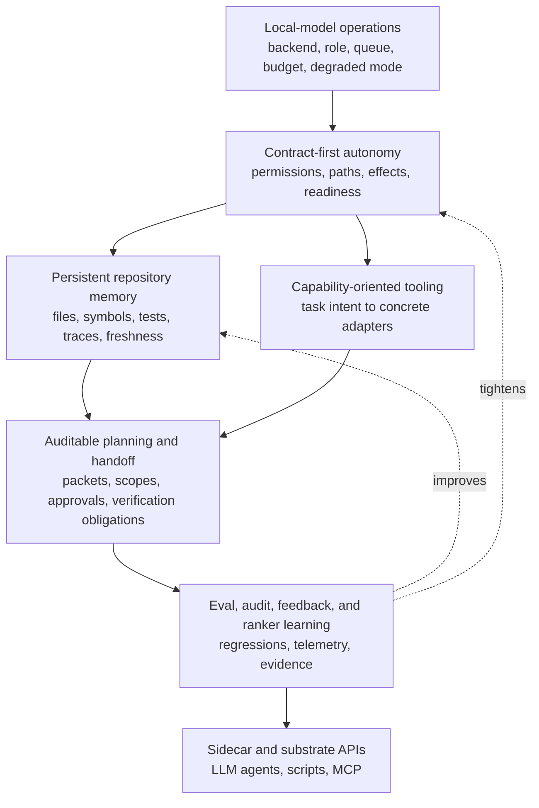

# Agent Harness Design Map

**North Star: AI coding agents are becoming common, but teams do not trust
their context, decisions, or outputs. Agent Harness sells the missing substrate: repo
memory, freshness, contracts, audit, and evals.**

Status: design guidance

This document connects the project thesis to the seven pillar design docs. It is
the map for deciding whether a proposed harness change strengthens Agent Harness's
differential or merely chases another LLM agent's surface area.

The controlling thesis is still:

- The model owns strategy.
- The harness owns contracts.

The strategic source is [harness-strategic-thesis.md](harness-strategic-thesis.md).
The decisioning policy is [decisioning-north-star.md](decisioning-north-star.md).
The executable rebuild plan is the exported Obsidian note
`docs/obsidian/22 - Ground-Up Implementation Plan.md`.

## Pillar Set

| Pillar | Design Doc | Primary Claim |
| --- | --- | --- |
| Contract-first local autonomy | [design-contract-first-local-autonomy.md](design-contract-first-local-autonomy.md) | Every autonomous lane, phase, and worker runs under a typed, locally enforced, auditable contract. |
| Persistent repository memory | [design-persistent-repository-memory.md](design-persistent-repository-memory.md) | Repository facts become durable, fresh, source-linked, confidence-labeled memory rather than repeated prompt stuffing. |
| Capability-oriented tooling | [design-capability-oriented-tooling.md](design-capability-oriented-tooling.md) | Models ask for task capabilities; the harness resolves precise language, graph, runtime, or fallback adapters. |
| Auditable planning and handoff | [design-auditable-planning-handoff.md](design-auditable-planning-handoff.md) | Planning becomes a packet-backed, replayable, audit-checked artifact before execution mutates files. |
| Local-model operations | [design-local-model-operations.md](design-local-model-operations.md) | Local inference is treated as an operational system with role routing, queue admission, context budgets, and readiness checks. |
| Eval/audit/learning flywheel | [design-eval-audit-learning-flywheel.md](design-eval-audit-learning-flywheel.md) | Runs produce structured evidence that becomes evals, audits, ranker updates, and regression protection. |
| Agent substrate and sidecar | [design-agent-substrate-sidecar.md](design-agent-substrate-sidecar.md) | Agent Harness's context, audit, verification, and contract surfaces become reusable by LLM agents, scripts, and MCP clients. |

## Cross-Pillar Designs

- [PRD to ADR to brief research workflow](design-prd-adr-brief-research-workflow.md)
  defines the upstream artifact pipeline that turns aligned research evidence
  into traceable product requirements, architecture decisions, proactive TDD
  obligations, and dispatch-ready Agent Harness briefs. The workflow should
  include deterministic headless CLI surfaces, durable effort state, TUI
  continuation/handoff, coverage-gate authority reuse, durable supersession
  fixtures, sidecar exposure, and operator UX/API parity.
- [Behavioral TDD coverage](design-tdd-coverage.md)
  defines the staged pipeline from human-approved ADR through EARS requirements,
  example mapping, BDD scenarios, Design by Contract, failure mode analysis
  (FMEA, HAZOP, FTA), state machine modeling, property-based testing, decision
  tables, mutation verification, and the deterministic coverage gate that blocks
  dispatch when behavioral coverage is incomplete. This is the verification
  contract for the PRD-to-brief workflow.
- [Decompose on failure](design-decompose-on-failure.md)
  defines the recovery layer that turns a failed lane or atom into a durable
  failure record, deterministic failure classification, smaller gated recovery
  atoms, and auditable reconciliation through the `harness recover` namespace.
  The target recovery loop writes failure records and decomposition packets,
  exposes `recover inspect/status/decompose/promote/reconcile`, projects
  recovery state through product/operator status, and records sanitized
  evidence-only learning events without mutating learned weights. Residual-work
  records should carry scoped required-path, changed-path, failure, and
  required-test evidence refs without raw prompt/transcript/file-body content.

## System Shape

The pillars are not independent feature tracks. They form one architecture:

Local-model operations defines the runtime capacity: which backend, role, queue,
context budget, and degraded mode are active.

Contract-first autonomy defines the authority boundary: which paths, tools,
effects, verification obligations, and completion claims are legal for the
active task.

Persistent repository memory supplies the evidence substrate: files, symbols,
tests, dependencies, traces, freshness, confidence, ranker signals, and graph
views.

Capability-oriented tooling is the interface layer between model intent and
implementation detail. It keeps model-visible requests task-shaped while the
harness picks Go, C++, Python, TypeScript, Rust, Java, graph, structural, shell,
or generic adapters.

Auditable planning and handoff turns repository evidence and task contracts into
durable plan artifacts. It is the bridge between "the model has an approach" and
"the executor is authorized to mutate these specific files."

The eval/audit/learning flywheel consumes the traces from all of the above. It
decides whether a failure becomes a regression, an audit rule, a ranker update,
a prompt cleanup, a contract change, or an explicit non-goal.

The sidecar/substrate pillar exposes the same surfaces to LLM agents. It is
not a new strategy loop. It is the stable API boundary for repository evidence,
capability discovery, verification, and audit.

## Shared Vocabulary

Use these terms consistently across pillar work:

- `contract`: the typed host-owned authority and obligation object for a lane,
  phase, or sidecar call.
- `capability`: a task-level request such as localize change, inspect symbol,
  find references, source sanity, verify edit, or audit behavior.
- `adapter`: the concrete backend chosen to satisfy a capability: language
  tools, graph query, structural search, history, shell, or fallback read/search.
- `packet`: bounded evidence prepared for a model or executor, with handles,
  freshness, scope, risk, and handoff fields.
- `view`: cached, source-linked graph output persisted for reuse and replay.
- `profile`: a named permission/tool-surface preset such as discovery, verify,
  write, or lane-owned.
- `freshness`: the declared relationship between evidence and the active
  workspace state.
- `sidecar`: Agent Harness used by another LLM agent or script without running Agent Harness's own
  inference loop.

## Dependency Rules

1. Contract changes must say which invariant they enforce and which audit/eval
   signal proves the change worked.
2. Memory changes must expose freshness, provenance, confidence, and uncertainty
   rather than returning context as unqualified prose.
3. Capability changes must preserve model strategy: a tool result may report
   available capabilities or blockers, but should not prescribe a next strategy
   step unless enforcing an invariant.
4. Planning changes must keep packets as evidence envelopes, not hidden plans.
5. Local-model changes must surface readiness and degraded mode explicitly.
6. Eval/audit changes must be able to replay from logs or structured artifacts.
7. Sidecar changes must reuse the same manifest, schemas, permissions,
   telemetry, freshness, and audit contracts as first-party lanes.

## Sequencing

The first implementation cycle should make the pillars observable rather than
trying to build the whole target state at once:

1. Stabilize the compiled contract surface and emit stable contract decision
   events.
2. Export schemas for `harness tool` and make graph-backed tool freshness
   structured.
3. Define the capability vocabulary and route a small read-only subset through
   the resolver.
4. Build the context-localization benchmark and feed verified edit signals into
   ranker learning.
5. Tighten plan artifact handoff around packet IDs, editable paths, evidence
   paths, and verification obligations.
6. Extend `harness doctor` and telemetry so local backend readiness, queue state,
   route-classifier health, and context budget are visible before lanes run.
7. Define the discovery-profile sidecar path: stable CLI envelope first, MCP stdio
   second, Streamable HTTP only after auth/origin/profile gates are in place.

## Project Gates

New design map items should answer four questions before they land:

1. Which pillar does this advance?
2. Which contract, evidence source, or feedback loop becomes stronger?
3. Which metric, audit finding, eval scenario, or test should move?
4. Which LLM-agent surface are we intentionally not
   copying unless it strengthens the pillar?

If an item cannot answer those questions, it is probably polish, parity, or
prompt drift rather than strategy.
