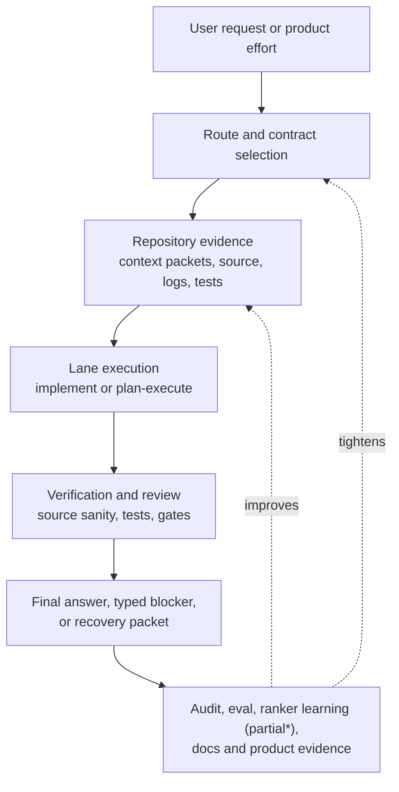
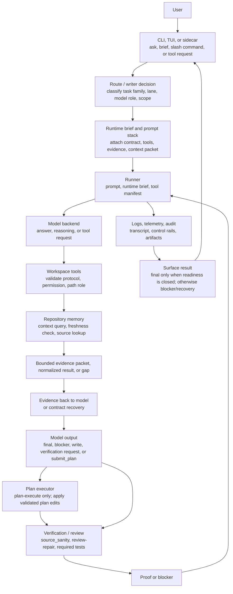

---
tags:
  - idiom
  - architecture
  - system-map
---

# System Map

Idiom is a local, evidence-first coding-agent harness. It is built for useful
autonomous software work with local or hosted models while keeping the durable
authority outside the model.

The product claim is:

> AI coding agents are becoming common, but teams do not yet trust their
> context, decisions, or outputs. Idiom sells the missing substrate: repo
> memory, freshness, contracts, audit, and evals.

The engineering rule is:

- The model owns strategy.
- The harness owns contracts.

The model may explore, infer, choose a plan, propose edits, and synthesize the
answer. The harness decides which tools and paths are legal, which artifacts are
dispatchable, which evidence is fresh enough, which verification is required,
and whether completion is supported.

## Product Shape

This is deterministic around the model, not deterministic inside the model. The
host shapes the work so a smaller/local model can make choices inside bounded,
auditable conditions.

## Major Systems

| System | Primary package or docs | Responsibility | Onboarding |
| --- | --- | --- | --- |
| CLI and lanes | `cmd/idiom`, [[04 - Runtime Lanes]] | Repeatable command surface, lane orchestration, plan-execute, implement, atom intake | [[23 - Major Systems Architectural Onboarding#CLI And Lanes|Start here]] |
| TUI/session lifecycle | `internal/surfaces/tui/app`, [[19 - CLI TUI and Operator Surface]] | Interactive operator surface, prompt-mode dispatch, slash-command presenters, debug logs | [[23 - Major Systems Architectural Onboarding#TUI And Session Lifecycle|Start here]] |
| Runner and contracts | `internal/runtime/agent`, [[05 - Runner Contracts and Control Rails]] | Model loop, tool-call parsing, runtime briefs, recovery nudges, readiness, completion gates | [[23 - Major Systems Architectural Onboarding#Runner And Contracts|Start here]] |
| Workspace tools | `internal/capabilities/workspace`, [[06 - Workspace Tools and Capability Routing]] | Tool schemas, permissions, source sanity, discovery tools, sidecar envelopes | [[23 - Major Systems Architectural Onboarding#Workspace Tools And Capability Routing|Start here]] |
| Repository memory | `internal/repository/comprehension`, `internal/repository/discovery`, [[07 - Repository Memory and Context Graph]] | Persistent graph, context packets, freshness, trace packs, cached views | [[23 - Major Systems Architectural Onboarding#Repository Memory And Context Graph|Start here]] |
| Planning and handoff | `internal/surfaces/cli/planexecute`, `internal/workflows/architect`, [[08 - Planning Packets and Handoff]] | Structured plans, `submit_plan`, packet inheritance, executor handoff | [[23 - Major Systems Architectural Onboarding#Planning And Handoff|Start here]] |
| Verification/readiness | `internal/capabilities/workspace/source_sanity.go`, `internal/runtime/agent`, [[09 - Verification Readiness and Completion]] | Post-write proof, changed-path evidence, readiness closure | [[23 - Major Systems Architectural Onboarding#Verification Readiness And Completion|Start here]] |
| Telemetry/audit/eval | `internal/evidence/telemetry`, `internal/evidence/eval`, `harness_audit`, [[10 - Telemetry Audit Eval and Learning]] | Conversation logs, command telemetry, behavior audit, eval and ranker feedback* | [[23 - Major Systems Architectural Onboarding#Telemetry Audit Eval And Learning|Start here]] |
| Local model operations | `internal/runtime/backends`, `internal/runtime/llama`, [[11 - Local Model Operations]] | Backend profiles, route models, queueing, degraded mode, readiness checks | [[23 - Major Systems Architectural Onboarding#Local Model Operations|Start here]] |
| Sidecar/integrations | `internal/capabilities/mcp`, `idiom tool`, [[12 - Sidecar and External Integrations]] | External agent access to evidence, tools, recovery status, and schemas | [[23 - Major Systems Architectural Onboarding#Sidecar And External Integrations|Start here]] |
| Product workflow | `internal/workflows/productworkflow`, `internal/productcmd`, [[20 - Product Workflow and Behavioral Coverage]] | Research evidence, PRD, ADR, TDD obligations, coverage gate, dispatch briefs | [[23 - Major Systems Architectural Onboarding#Product Workflow And Behavioral Coverage|Start here]] |
| Recovery | `internal/workflows/recovery`, `internal/recovercmd`, [[21 - Recovery and Decomposition]] | Failure records, decomposition packets, recovery atoms, reconciliation | [[23 - Major Systems Architectural Onboarding#Recovery And Decomposition|Start here]] |

## Literal Harness Flow

The same components appear in different surface modes:

- `idiom lane` is the most repeatable path. It composes a lane prompt, preloads
  context when appropriate, forwards required edit paths, and calls `implement`
  or `plan-execute`.
- Direct `idiom plan-execute` runs a read-only planner that must emit
  `submit_plan`; the executor then validates scope and applies edits
  deterministically.
- The TUI is an interactive surface over `RunPromptOnce`; when implementation
  dispatch is enabled it can resolve a referenced design doc, preflight or
  atomize it, and dispatch atoms through plan-execute.
- `idiom tool` exposes the same repository memory and diagnostic surfaces to
  external agents without running Idiom's model loop.

## Authority Model

The model is allowed to decide:

- What evidence is relevant.
- Which design path to propose.
- Which tool capability it needs next.
- Whether it should answer, edit, verify, ask a question, or block.

The harness decides:

- Whether a tool call is permitted.
- Whether an artifact is dispatchable.
- Whether paths are editable, evidence-only, forbidden, protected, or outside
  scope.
- Whether verification is required after a write.
- Whether a completion claim is supported by observed evidence.
- Whether loops, repeated low-value probes, and exhausted budgets must stop.
- Whether failure should become a recovery record instead of another retry.

This is explained in detail in [[02 - Deterministic Evidence-Based Development]]
and [[05 - Runner Contracts and Control Rails]].

## Repository-Owned State

Idiom keeps agent state outside normal source files unless a command explicitly
creates project artifacts:

- `.idiom/config.json` for local project configuration.
- `.idiom/comprehension/graph.sqlite` for repository memory.
- `.idiom/comprehension/views/*.json` for exported context views.
- `.idiom/plan-execute/sessions/*.json` for durable plan-execute progress.
- `.idiom/recovery/<failure-id>/failure.json` and `packet.json` for recovery.
- `.idiom/atoms/<title>/atom-NNN.md` for TUI/prompt design-doc dispatch atoms.
- `logs/conversations/*.jsonl` and `logs/telemetry/*.jsonl` for behavior
  evidence and diagnostics.
- `docs/product-workflows/efforts/...` for durable accepted product workflow
  fixtures.
- `prompts/` for static prompt layers and profiles.
- `docs/` for design intent and operator documentation.

## What Makes It Deterministic

Idiom does not try to make model output deterministic. Instead, it makes the
surrounding development system deterministic:

- Tools have schemas.
- Lanes have explicit phases.
- Plans have typed artifacts.
- Workspace access has path roles and permission checks.
- Context packets have freshness and provenance.
- Readiness is computed from obligations and evidence.
- Verification is tied to risk and changed paths.
- Audit and evals replay observed behavior.

## Related Notes

- [[02 - Deterministic Evidence-Based Development]]
- [[03 - Architecture Layers]]
- [[04 - Runtime Lanes]]
- [[05 - Runner Contracts and Control Rails]]
- [[09 - Verification Readiness and Completion]]
- [[22 - Ground-Up Implementation Plan]]
