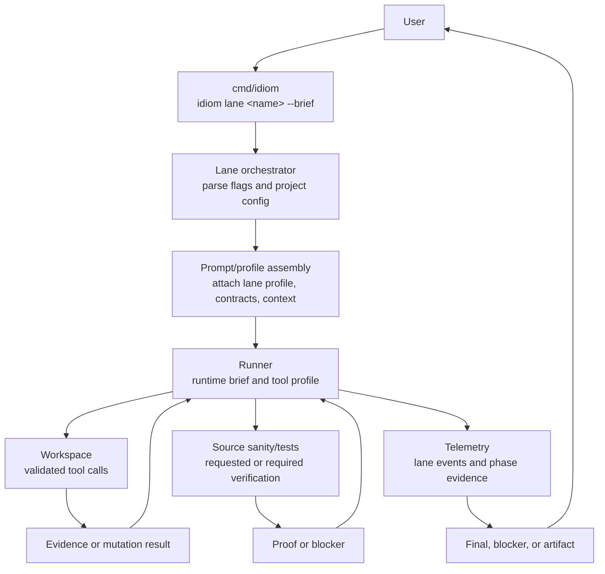
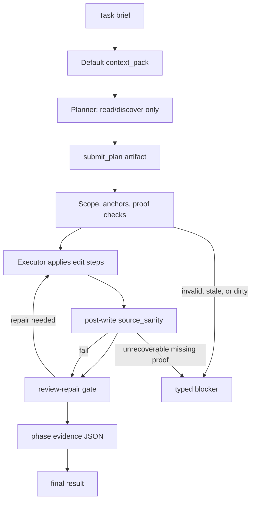

---
tags:
  - idiom
  - lanes
  - workflow
---

# Runtime Lanes

A lane is one structured path from a task brief to completed work, verification,
or a typed blocker. Lanes provide deterministic workflow shape around a model
that still owns strategy.

The canonical design is in [docs/lane-architecture.md](../lane-architecture.md).

The CLI is the primary repeatable lane surface. The TUI and prompt-mode CLI use
the same `RunPromptOnce` path, and when implementation dispatch is enabled they
can hand referenced design docs to plan-execute rather than treating them as
ordinary chat context.

## Lane Types

| Lane | Purpose | Mutation | Primary contract |
| --- | --- | --- | --- |
| `implement` | Direct write-capable task execution | Yes | The model may interleave reads, edits, verification, and final response under runtime gates |
| `plan-execute` | Planner emits structured plan, executor applies deterministic phases | Yes | Planner cannot write; executor dispatches scoped edit operations and verification |
| `atom-spec` | Draft an atom/spec artifact | No workspace mutation | Produces structured artifact for later workflow |

## Lane Lifecycle

## `implement`

`implement` is the direct execution lane. It is useful for bounded changes where
the model can gather evidence, edit files, run tests, and close readiness inside
one loop.

Typical flow:

1. Attach runtime brief and tool manifest.
2. Attach a compact `context_pack` by default.
3. Let the model choose evidence probes.
4. Validate tool calls through the workspace manager.
5. Apply edits when permitted.
6. Require verification according to risk.
7. Close readiness before final response.

Use `--no-context-pack` only when the caller already supplied equivalent
context. Keep the same task string across related context calls so packet cache
reuse remains possible.

When `implement` is run through `idiom lane implement`, a non-zero subcommand
exit writes `.idiom/recovery/<failure-id>/failure.json` and `packet.json` from
bounded lane/session evidence. The wrapper records the original brief path and
required edit paths rather than the composed temporary prompt, so follow-up
`idiom recover inspect`, `decompose`, `status`, `promote`, and `reconcile`
operations stay tied to the operator-authored atom.

## `plan-execute`

`plan-execute` splits strategy from mutation.

The planner phase is intentionally read-only. It can use discovery and read
tools, then emits a structured `submit_plan` artifact. It should not call shell,
git, task ledger, source sanity, or write tools.

The contract-capability overhaul now has a report-only compiler foundation for
this planner phase in `internal/contracts/contractcompile`. The compiler records required
edit paths as submit-plan coverage, keeps source-body obligations distinct,
binds a runtime envelope, and projects the model-visible protocol without
granting planner write authority. Runner enforcement still remains with the
existing gates until a later migration atom wires policy decisions into covered
lane behavior.

Like `implement`, `plan-execute` preloads a compact `context_pack` by default
unless `--no-context-pack` is supplied. Refine scratchpad meta-prompts are the
notable exclusion because refine already preloads phase-specific source and
lint evidence.

The executor phase receives the structured plan and dispatches edits through
controlled workspace execution. The lane then performs post-write source sanity,
phase evidence capture, and review-repair gates.

Direct `idiom plan-execute` persists durable progress state under
`.idiom/plan-execute/sessions/<session-id>.json`. Resume is not transcript
replay: `--resume` must point at an existing progress state, must match the
same prompt or prompt file, and only continues states that are ready for
review-repair.

## `atom-spec`

`atom-spec` drafts structured work artifacts without mutating the workspace.
It is useful when the user needs task decomposition, acceptance criteria, or
handoff-ready specification before source edits.

## TUI Design-Doc Dispatch

When a TUI or prompt-mode implementation turn references a markdown design doc
and `chat.implementation_dispatch` is `plan_execute`, the harness can convert
that design doc into plan-execute work:

- Ambiguous or unreadable document references become typed blockers before the
  planner runs.
- Atom intake and brief lint classify dispatchability, stale state, dirty
  scope, source-satisfied state, and single-purpose failures before model
  tokens are spent.
- Broad design docs can be materialized into atom briefs under
  `.idiom/atoms/<title>/atom-NNN.md`.
- Materialized atoms carry exact current-state anchors for existing files and a
  `NEW FILE` marker for missing paths.
- Existing terminal atoms are preserved during materialization and skipped on
  rerun.
- Source-satisfied atoms close without placeholder edits only when source and
  required test evidence support the claim.
- Blockers and unproven verification obligations do not mark atom docs
  complete.

This keeps design-doc execution aligned with the lane contract: the model
chooses strategy inside bounded phases, while the harness owns artifact shape,
scope classification, terminal-state detection, and readiness gates.

For broad architecture or harness designs, implementation orchestration follows
[Design Doc Implementation Workflow](../design-doc-implementation-workflow.md):
full pre-implementation reviewer bench, durable reviewer evidence,
dispatchable atoms, disjoint write scopes for parallel work, per-atom review,
docs freshness, and final full-bench review before commit and push.

## Deterministic Lane Guarantees

Lanes should make these properties observable:

- Which phase the session is in.
- Which tools are available in that phase.
- Which artifact is required to advance.
- Which paths are in scope.
- Which obligations are still open.
- Which verification command or source sanity check was run.
- Which result is terminal.
- Which generated atom docs remain pending, terminal, blocked, or
  source-satisfied.

## Auxiliary Lane Commands And Status

Other lane-adjacent surfaces appear in the CLI and docs:

- `idiom lane postflight` reviews returned diffs.
- `history` and `explain` style surfaces are operator aids rather than primary
  write lanes.
- `refine` workflows preload phase-specific lint/source evidence instead of
  receiving an additional broad repo map.
- Lane JSON events and `.idiom/lane-history.jsonl` are diagnostic surfaces for
  routing, phase, and degradation state.

Treat these as workflow surfaces around the main lane contracts unless the code
promotes one to a first-class lane with its own phase/tool contract.

## Common Lane Failure Modes

The maintenance docs call out common traps:

- Planner emits vague or stale anchors.
- Executor treats evidence paths as write scope.
- Review pass finds issues but neither repairs nor blocks.
- Terminal states conflict.
- Prompt profile grants tools that the lane phase should not expose.
- Phase evidence exists but cannot be correlated with tool events.

The fix should usually be a stronger typed artifact, gate, or test, not a
longer reminder in the prompt.

## Related Notes

- [[08 - Planning Packets and Handoff]]
- [[09 - Verification Readiness and Completion]]
- [[10 - Telemetry Audit Eval and Learning]]
- [[19 - CLI TUI and Operator Surface]]
