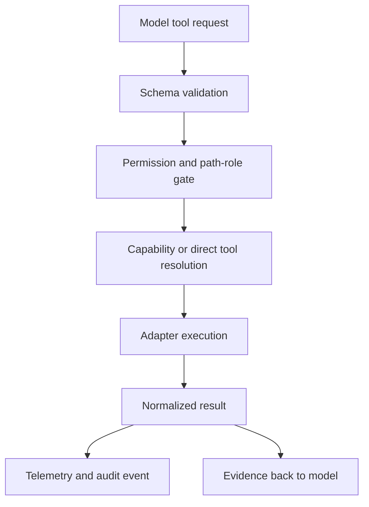

---
tags:
  - harness
  - workspace
  - tools
  - capability-routing
---

# Workspace Tools and Capability Routing

The workspace layer turns model intent into safe, typed, auditable operations.

The model should ask for a capability. The harness should resolve the concrete
adapter, enforce permissions, execute the operation, normalize the result, and
emit telemetry.

## Tool Dispatch Shape

`internal/workspace` owns the tool manager and dispatch surface. Tool requests
are schema-shaped and include the command name, arguments, and call identifier.
Lane/profile/role context is mostly carried outside the request itself: in the
runtime brief, CLI profile handling, manager configuration, MCP profile
handling, and plan artifacts.



## Capability-Oriented Tooling

Capability routing is described in
[docs/design-capability-oriented-tooling.md](../design-capability-oriented-tooling.md).

The goal is to avoid making the model memorize backend names. It should express
what it needs:

- Localize a change.
- Inspect a file or symbol.
- Find references or implementations.
- Explain dependency structure.
- Run source sanity.
- Trace a runtime failure.
- Verify an edit.
- Audit behavior.

The harness then chooses the best available adapter based on target, language,
precision, freshness, cost, permissions, and contract requirements.

## Current Implementation Versus Design Target*

`*` marks target behavior that may be broader than the current implementation.

| Area | Current implementation | Design target* |
| --- | --- | --- |
| Direct tools | Built-in workspace tools are exported through schemas and dispatched by the workspace manager. | Keep schemas stable and normalized across CLI, runner, and sidecar/MCP surfaces.* |
| `read_only_capability` | Current registry supports a small set of read-only capability IDs in code. | Broader capability vocabulary from the design doc, resolved by adapter scoring.* |
| Source sanity | Implemented as diagnostics or generic syntax sanity. | Remain source-aware, and stay distinct from test/build verification.* |
| Project external tools | `.harness/external_tools/<name>.json` can define project tools with schemas and safety flags. | Treat external tools as first-class adapters behind the same permission and telemetry boundary.* |
| MCP | CLI/MCP surfaces reuse tool schemas, with current inbound MCP filtered toward discovery/context surfaces. | Parity across transports without duplicating less-safe tool implementations.* |

## Capability Vocabulary

| Capability* | Typical tool or adapter | Purpose |
| --- | --- | --- |
| `localize_change` | `context_pack`, discovery tools | Find relevant files, symbols, tests |
| `query_context` | `context_query`, graph queries | Ask graph-shaped questions |
| `inspect_file` | read tools | Read bounded file content |
| `inspect_symbol` | language-aware tools, context zoom | Inspect symbol shape and relationships |
| `find_definition` | language-aware adapter | Navigate to definition |
| `find_references` | language-aware adapter | Find call sites or usages |
| `explain_dependency` | `dependency_graph`, graph tools | Understand package/module relationships |
| `source_sanity` | source sanity tool | Diagnostics or syntax sanity after edits |
| `audit_behavior` | `harness_audit` | Diagnose agent behavior from logs/artifacts |

`*` means this vocabulary includes design-target names. For the current implemented
`read_only_capability` IDs, check `internal/workspace/capabilities.go` before
documenting a capability as supported.

## Tool Catalog

Built-in tools group roughly into:

- State and filesystem: `pwd`, `list_files`, `search_files`, `search_content`,
  `read_file`, `file_stats`.
- Workflow state: `task`, `task_ledger`, `submit_plan`.
- Context graph and memory: `context_index`, `context_status`,
  `context_query`, `context_zoom`, `context_pack`, `context_impact`,
  `context_trace_pack`, `discovery_query`.
- Language and structure: `code_navigate`, `source_sanity`,
  `structural_search`, `dependency_graph`, `ctags_symbols`, and language
  families for Go, C/C++, Python, TypeScript/JavaScript, Rust, and Java.
- History and security: `history_range`, `history_symbol`, `blame_range`,
  `semgrep_scan`, `joern_scan`.
- Audit and learning: `harness_audit`, `harness_feedback`.
- Git and execution: `git_status`, `git_diff`, `shell`.
- Writes: `mkdir`, `edit_file`, `write_file`, `append_file`, `apply_patch`,
  `delegate_edit`.
- External project tools: `.harness/external_tools/<name>.json` definitions
  loaded through the external tool registry.

## Tool Result Discipline

Tool results should report facts:

- Findings.
- Paths.
- Symbols.
- Counts.
- Freshness.
- Confidence.
- Uncertainty.
- Blockers.

Tool results should avoid prescribing the model's next strategic step unless a
contract invariant requires it.

## Direct Tool CLI

External agents can invoke tools through:

```bash
harness tool <tool-name> --input '<json>'
```

Important tools include:

- `context_pack`
- `context_query`
- `context_zoom`
- `context_status`
- `context_index`
- `context_impact`
- `context_trace_pack`
- `discovery_query`
- `structural_search`
- `dependency_graph`
- `history_range`
- `history_symbol`
- `blame_range`
- `ctags_symbols`
- `semgrep_scan`
- `joern_scan`
- `harness_audit`

See [[07 - Repository Memory and Context Graph]] for context tools.

## Permission And Scope

Workspace operations must respect:

- Protected paths.
- Required edit paths.
- Forbidden paths.
- Tool profile permissions.
- Lane phase restrictions.
- Dirty worktree preservation.
- User-owned changes.

This is why the workspace layer is not a generic shell proxy. It is a contract
boundary.

## Source Sanity

`source_sanity` is a source-aware verification route. It should be used when
source edits require more than patch hygiene.

Current scope:

- Language diagnostics when available.
- Generic UTF-8 and delimiter/syntax sanity fallback.
- Bounded source sanity findings.

It is not the same as focused package tests, builds, or full semantic
verification. Those checks can sit beside `source_sanity`, but they should not
be described as what `source_sanity` itself currently performs.

See [[09 - Verification Readiness and Completion]].

## Design Rule

If a capability is stable and important, encode it in a schema, registry,
normalized result, test, and telemetry event. Avoid burying it in one-off prompt
text or ad hoc command parsing.

## Source Anchors

| Source | Why it matters |
| --- | --- |
| `internal/workspace/manager.go` | `ToolRequest`, manager dispatch, external tool registry ownership |
| `internal/workspace/tool_schemas.go` | Built-in tool schema definitions |
| `internal/workspace/capabilities.go` | Current read-only capability registry and dispatch |
| `internal/workspace/source_sanity.go` | Current source sanity implementation |
| `docs/design-capability-oriented-tooling.md` | Broader design target* |

## Related Notes

- [[07 - Repository Memory and Context Graph]]
- [[09 - Verification Readiness and Completion]]
- [[12 - Sidecar and External Integrations]]
- [[17 - Security Privacy and Data Boundaries]]
