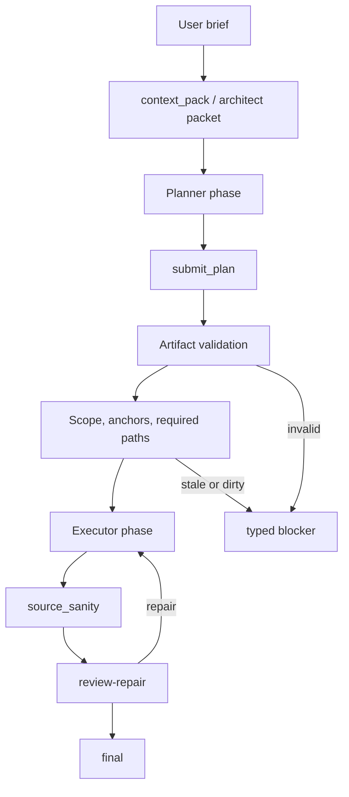

---
tags:
  - idiom
  - planning
  - packets
  - handoff
---

# Planning Packets and Handoff

Planning and handoff systems make model reasoning auditable without allowing
free-form prose to become an implicit contract.

The planner can choose strategy. The harness requires typed artifacts,
dispatchable scopes, freshness, and verification.

## Artifact Roles

| Artifact | Role | Mutates source? |
| --- | --- | --- |
| Context packet | Evidence envelope for localization | No |
| Architect packet | Higher-level planning, design, or blast-radius evidence | No |
| `submit_plan` artifact | Structured edit plan for executor | No by itself |
| Phase evidence | Record of execution and verification phases | No by itself |
| Source edits | Actual mutation | Yes |
| Review-repair report | Acceptance, repair, or blocker evidence | Sometimes, if repair is performed |
| Atom tracker doc | Materialized design-doc atom and closeout state | No by itself |

## Plan-Execute Handoff

## Planner Contract

The planner should:

- Gather evidence.
- Use repository memory and discovery tools.
- Identify target files, anchors, risks, and tests.
- Emit a structured plan.
- Preserve uncertainty.
- Avoid source mutation.

The planner should not:

- Edit files.
- Run arbitrary shell commands unless the phase permits it.
- Treat evidence paths as required edit paths.
- Smuggle instructions into prose that the executor cannot validate.

## Executor Contract

The executor should:

- Read the structured plan.
- Validate scope and anchors.
- Apply edits through permitted workspace operations.
- Run source sanity and focused verification.
- Emit phase evidence.
- Repair or block when review finds issues.

The executor should not:

- Ignore stale anchors.
- Write outside scope.
- Treat a successful patch as behavior verification.
- Finalize while readiness obligations remain open.

## Dispatchable Artifact States

Maintenance docs describe artifact states that should be classified before
dispatch:

- `dispatchable`
- `source-satisfied`
- `stale-needs-rebase`
- `blocked-dirty-files`
- `invalid-scope`
- `missing-scope`
- `complete`
- `failed-refine-draft`

These states prevent a lane from executing stale or ambiguous plans.

Atom tracker docs also use terminal status lines to prevent reruns from doing
completed work again. Current terminal statuses are:

- `completed`
- `complete`
- `accepted`
- `closed`
- `source-satisfied`
- `source satisfied`
- any status containing `do not dispatch`

Terminal atom docs should be preserved when a design doc is materialized again
and skipped during atomized dispatch.

## Design-Doc Atom Materialization

The TUI/prompt implementation dispatch path can turn a referenced design doc
into plan-execute atoms. The harness owns this transformation so the model does
not have to infer workflow state from free-form prose.

Materialized atoms are written under `.idiom/atoms/<title>/atom-NNN.md` and
include:

- A single file or bounded source scope.
- The source design-doc path.
- Exact current-state anchors for existing files.
- `NEW FILE` wording for missing paths.
- Extracted design-doc test obligations.
- A source-design-doc excerpt for traceability.

If an atom file already exists for the same target path and carries a terminal
status, materialization reuses that atom instead of overwriting its status or
result evidence.

The atom result section is the local persisted closeout record. Successful
dispatch can write `Status: completed`. No-op closeout can write
`Status: source-satisfied - do not dispatch`. Blockers and unproven
verification commands leave the atom open.

## Packet ID Round Trip

Plan-execute can pass a `pack_id` through:

1. Planner receives or creates a context packet.
2. Planner includes the `pack_id` in `submit_plan`.
3. Executor inherits the packet.
4. Telemetry emits `executor_inherits_pack` or `executor_pack_miss`.
5. Debug tooling can correlate execution with the evidence packet.

This is an example of the deterministic evidence pattern: strategy remains
model-owned, but the evidence envelope is typed and traceable.

## Plan Artifact Schema

Durable plan artifacts use the `idiom.plan.v2` shape in current design and
implementation work. Check the Go structures before changing behavior, but the
important concepts are:

- Plan metadata and schema version.
- Scope and required paths.
- Evidence references, including `pack_id` where available.
- Edit steps with target path, operation, purpose, and anchors.
- Approval state for approval-gated plans.
- Handoff readiness and handoff IDs.
- Verification expectations.
- Audit status and privacy-safe metadata.
- Large edit spill references when edit bodies are stored outside the compact
  artifact.
- Legacy `submit_plan` normalization into the durable shape.

The artifact should carry enough structure for the executor to validate and
dispatch. It should not rely on unparseable prose as the only source of scope,
approval, or edit intent.

## Review Evidence Bundle

Review and repair phases should receive enough evidence to decide pass, repair,
or blocker:

- Packet status and `pack_id`.
- Candidate files, symbols, and tests.
- Unresolved packet gaps.
- Changed paths.
- Source-sanity results.
- Diff hygiene result.
- Focused test/build output when required.
- Open obligations.
- Review outcome and repair evidence.

## Source-Satisfied And No-Op Cases

Do not make whitespace or placeholder edits merely because a contract is
write-shaped. If source already satisfies the requested change and the lane
allows a no-op closeout, close as `source-satisfied` with per-path evidence.
Otherwise return a typed blocker explaining the missing contract or required
user decision.

For design-doc atoms, `source-satisfied` requires source evidence for the target
path and, when the atom carries test obligations, matching test evidence. A test
or build command listed in the atom is an obligation, not proof by itself; the
closeout answer must cite a successful run before the atom can be marked
complete or source-satisfied.

## Common Handoff Bugs

- Planner produces generic steps with no anchors.
- Plan cites a file that changed after planning.
- Executor writes based on packet relevance instead of explicit scope.
- Review finds a problem but produces a contradictory success state.
- Phase evidence records a command but not the relevant path, role, or result.
- A rerun overwrites a terminal atom and loses the prior closeout evidence.
- A `<<QUESTION>>` blocker is interpreted as a completed atom.
- A required verification command is treated as evidence merely because it is
  listed in the design doc.

The repair should usually strengthen the artifact schema, validation, or tests.

## Related Notes

- [[04 - Runtime Lanes]]
- [[07 - Repository Memory and Context Graph]]
- [[09 - Verification Readiness and Completion]]
- [[14 - Maintenance Playbooks]]
