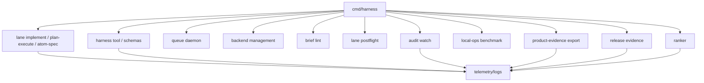

---
tags:
  - harness
  - operations
  - evidence-products
  - commands
---

# Operational Commands and Evidence Products

Agent Harness has several operator-facing command surfaces in addition to the main TUI
and lane commands. They exist to make LLM-agent work dispatchable,
inspectable, reproducible, and reviewable.

## Command Surface Map



## Queue

`harness queue` gates concurrent work against per-pool caps so local model
backends do not crash or thrash under multiple simultaneous lanes.

Key commands:

- `harness queue serve`
- `harness queue run`
- `harness queue status`
- `harness queue ping`
- `harness queue cancel`

Lane entrypoints acquire a lease when the daemon is reachable. If no daemon is
running, the lane proceeds without queue gating. That makes the queue a
readiness and capacity feature, not a required server dependency.

## Backend Commands

`harness backend start|stop|status|list|proxy` manages local inference roles and
backend processes. Backend readiness belongs in local operations evidence and
should be reported as pass, degraded, or blocked rather than hidden in a failed
model call.

## Plan-Execute Progress State

Direct `harness plan-execute` writes a durable progress state for each session
under `.harness/plan-execute/sessions/<session-id>.json`. The state records the
schema version, session ID, prompt hash, prompt file, phase, status, required
and allowed edit paths, plan path, `pack_id`, changed paths, executor evidence,
source-sanity checks, and review-repair status.

When a saved progress state is `failed`, plan-execute writes recovery artifacts
under `.harness/recovery/<failure-id>/`: `failure.json` for the classified
failure record and `packet.json` for candidate recovery atoms. Failed
`harness lane implement` subprocesses should write the same artifact pair from
bounded lane history, session summary, original-brief path, required edit
paths, and stop-reason evidence. Operators inspect or promote these artifacts
through:

```bash
harness recover inspect --session <session-id> --json
harness recover decompose --session <session-id> --json
harness recover status --packet .harness/recovery/<failure-id>/packet.json --json
harness recover promote --packet .harness/recovery/<failure-id>/packet.json --atom recovery-001 --output briefs/recovery-001.md
harness recover reconcile --packet .harness/recovery/<failure-id>/packet.json --completed recovery-001 --json
```

The TUI exposes the same packet status presenter through
`/recover-status [--packet <path>|<path>]`. It is read-only, resolves relative
packet paths from the active workspace directory, and inserts an
operator-authored transcript entry that is not replayed into later model
context. CLI and TUI packet-status reads require packet paths under the
workspace root and reject symlinked parents or symlinked packet files.
Reconciliation artifacts discovered for status are loaded only through the same
workspace and symlink boundary.

Read-only recovery state is also sidecar-visible:

```bash
harness tool recovery_inspect --profile discovery --input '{"session_id":"<session-id>"}'
harness tool recovery_status --profile discovery --input '{"packet_path":".harness/recovery/<failure-id>/packet.json"}'
```

`recovery_decompose` writes local `.harness/recovery` artifacts, so it is exposed
only through the default tool profile and rejects output paths that leave the
workspace or traverse symlinked directories. CLI `recover inspect`,
`recover decompose`, `recovery_inspect`, and `recovery_decompose` resolve both
plan-execute and lane-implement failure records by session ID. CLI
`recover decompose --output` also rejects protected paths such as `.git`,
`logs`, `.env`, and `config.json`, plus recovery control artifacts such as
`failure.json` and `reconciliation.json`. `recovery_promote` and
`recovery_reconcile` remain CLI-only.

Product workflow status can surface recovery packets when durable
`workflow_state.json` includes `artifact_paths.recovery_packet`. The shared
operator status view exposes recovery packet status, gates, required tests,
product links, blockers, reconciliation counts, and a runnable
`harness recover status --packet ...` hint. The TUI `/product-status` command
renders that shared product operator view, and `/recover-status` renders the
packet-level recovery status view; `/product-status` also appends a TUI-local
`/recover-status --packet ...` handoff hint for the referenced packet. While a
recovery packet is open, normal workflow continuation actions are not
dispatchable. A reconciliation artifact closes the blocker only when its packet
digest, completed/remaining atom manifest, and required-test command results
validate against the active packet.

After `harness recover reconcile` validates and writes the reconciliation
artifact, it also appends an evidence-only ranker-learning event under
`source:"recovery_reconciliation"`. The event records packet-quality,
localization, completed/remaining atom, and verification metrics for
`harness_audit` and product evidence summaries, and it does not mutate
`.harness/ranker/weights.json`.

Product and release evidence exports also scan local `.harness/recovery`
artifacts. They report metadata-only recovery counts, failure classes, next
actions, reconciliation counts, open/recovered/blocked packet counts,
release-impact status, and blockers. Open packets make recovery visible as
partial release-impact evidence; malformed, missing, or stale recovery artifacts
block the export without loading raw prompts, transcripts, or file bodies.

Relevant JSON events include:

- `harness.plan_execute.resume_state_saved`
- `harness.plan_execute.resume_state_loaded`
- `harness.plan_execute.writer_route_decision`
- `harness.plan_execute.required_edit_paths_resolved`
- `harness.plan_execute.recovery_failure_record_written`
- `harness.plan_execute.recovery_decomposition_packet_written`
- `harness.plan_execute.recovery_failure_record_failed`
- `harness.plan_execute.recovery_decomposition_packet_failed`

`harness plan-execute --resume <session-id>` is intentionally strict. It fails if
the progress file does not exist, if the supplied prompt or prompt file does not
match the saved prompt hash, or if the saved phase/status is not
review-resumable. This prevents an operator typo from silently starting a fresh
run and losing the state needed to review or repair prior work.

## Brief Lint

`harness brief lint <brief.md>` runs deterministic pre-dispatch checks on
implementation briefs. It catches:

- Multi-purpose or under-scoped briefs.
- Prompt-magic contract triggers.
- Unsafe content fences.
- Missing verified-active-state sections.
- Missing exact anchors for required edit paths.
- Plan-execute edit-shape gaps.

Brief lint exists because vague briefs cause expensive local-model loops. It
does not replace runtime contracts; it rejects or warns before dispatch.

## Lane Postflight

`harness lane postflight --diff <patch>` is a QC surface for returned diffs. It
is part of the review loop around lanes and should remain tied to source-aware
verification when code behavior changes.

## Audit Watch

`harness audit watch` polls telemetry and conversation JSONL streams, debounces
high-signal trigger events, runs behavior audits, and writes review packets
under `.harness/audits/watch`.

Useful triggers include:

- Completed implement processes.
- Completion-gate records.
- High-risk stop reasons.
- Malformed tool input.
- Stale-context reports.
- Recovery failure-record and decomposition-packet events.
- `harness_feedback` events.

Audit watch is a local monitoring loop. It should emit deterministic review
packets, not raw prompt or transcript dumps. When recovery events trigger a
review, the packet includes a bounded `recovery` summary with failure classes,
candidate atom counts, next valid actions, sessions, and artifact paths.

## Product Evidence Export

`harness product-evidence export` writes a local go/no-go report for product
review. It reports contracts, IDs, hashes, counts, statuses, class coverage,
redaction status, limitations, recovery rollups, and release review linkage.

It should not include:

- Prompt bodies.
- Chat transcript bodies.
- File bodies.
- Secrets or credentials.
- Private absolute paths.
- Protected workspace URLs.
- Partner or deployment identifiers.
- Unredacted telemetry paths.

## Release Evidence

`harness release evidence` creates a release evidence bundle. It compares
baseline/active command artifacts and summarizes validation, audit/security,
local-ops, benchmark, sidecar integration, product-evidence export, and client
classification coverage.

Release evidence should cite bounded IDs, hashes, relative paths, statuses, and
blockers rather than raw private content.

## Ranker Commands

`harness ranker` is the manual control surface for context ranking learning.

Commands include:

- `harness ranker boost`
- `harness ranker penalize`
- `harness ranker show`
- `harness ranker reset`

Manual ranker changes write to the same learning log as eval-triggered updates
so audit can distinguish source, reason, and effect.

## Evidence Product Rule

Operational evidence products should answer:

- What ran?
- What changed?
- What was verified?
- What remains blocked?
- What evidence IDs, hashes, counts, and statuses support the result?
- Which private content was deliberately excluded?

They should not tell the model or reviewer what strategy to choose next except
where a typed invariant blocks progress.

## TUI And Prompt Dispatch Evidence

TUI/prompt implementation dispatch is observable through debug logs and the
materialized atom docs it writes. Important evidence paths include:

- `.harness/atoms/<title>/atom-NNN.md` for generated atom briefs and local
  persisted closeout status.
- `.harness/refine/<title>/accepted.md` for refined dispatchable briefs.
- `logs/conversations/*.jsonl` for `dispatch_atomize`, `dispatch_refine`, and
  `dispatch_source_satisfied` messages.
- `logs/telemetry/*.jsonl` for command/process lifecycle evidence.

The local persisted atom status is the operator-facing state for "what remains
to do" when the same design doc is run again. Closed atoms should be skipped;
optional atoms should be refined, preflighted, and dispatched; blockers should
remain visible instead of being marked complete.

## Product Workflow Effort Evidence

The product workflow stores each design doc or product effort as one effort
folder under a status bucket:

- `.harness/product/efforts/unstarted/<effort-id>/...`
- `.harness/product/efforts/started/<effort-id>/...`
- `.harness/product/efforts/closed/<effort-id>/...`

Accepted artifacts can be promoted to matching durable folders under
`docs/product-workflows/efforts/<status>/<effort-id>/...`. Effort indexes should
map stable effort IDs to their active status folder and prior paths. Evidence
products should cite effort IDs, status buckets, relative paths, hashes, and
promotion status rather than relying on the active folder path as identity.

## Related Notes

- [[10 - Telemetry Audit Eval and Learning]]
- [[11 - Local Model Operations]]
- [[17 - Security Privacy and Data Boundaries]]
- [[19 - CLI TUI and Operator Surface]]
