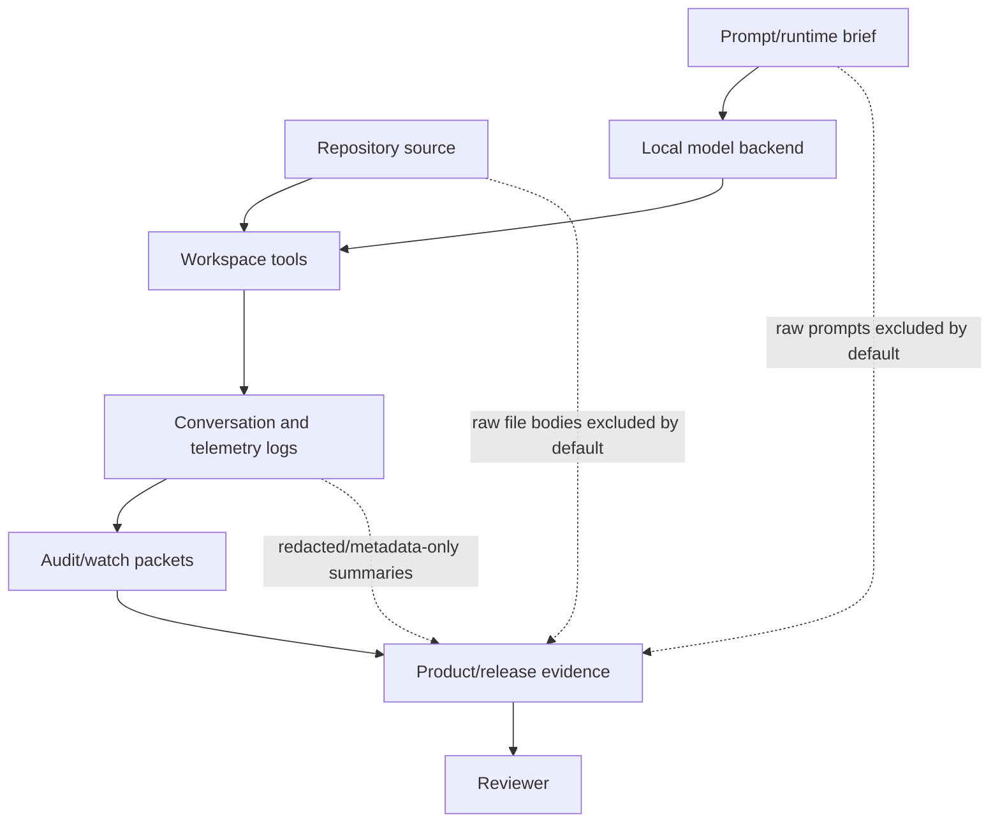

---
tags:
  - idiom
  - security
  - privacy
  - data-boundaries
---

# Security Privacy and Data Boundaries

Idiom's security and privacy posture is local, contract-first, and
evidence-based. It is not a compliance certification. It is a set of reviewable
controls and bounded evidence products for local agent work.

The canonical posture artifact is
[docs/security-privacy-posture.md](../security-privacy-posture.md).

## Boundary Principle

The harness owns:

- Protected paths.
- Forbidden paths.
- Redaction.
- Local artifact scope.
- Telemetry minimization.
- Side-effect policy.
- Readiness contracts.
- Evidence export boundaries.

The model owns:

- Strategy.
- Synthesis.
- Evidence interpretation inside the allowed contract.

## Data Flow

## Durable Evidence Should Prefer

- Paths or path IDs.
- Hashes.
- Counts.
- Status fields.
- Command labels.
- Policy codes.
- Session IDs.
- Artifact IDs.
- Relative paths when safe.
- Bounded summaries.

## Durable Evidence Should Avoid

- Raw prompts.
- Raw transcript bodies.
- Raw file bodies.
- Secrets.
- Credentials.
- Private repo URLs.
- Customer identifiers.
- Patient names.
- Account numbers.
- Unredacted log excerpts.
- Private absolute paths.

## Reviewable Controls

| Control | Evidence direction |
| --- | --- |
| Protected-path denial | Autonomy/path-role tests and sidecar denial behavior |
| Redaction | Telemetry and product-evidence tests for forbidden marker exclusion |
| Local artifact scope | Local ops, product evidence, and cleanup status |
| Telemetry minimization | Metadata-only telemetry, redacted arguments, disabled hosted telemetry |
| Side-effect policy | Discovery profile denial for writes, shell, destructive effects, and unknown effects |
| MCP/resource containment | Root clamping, protected-resource denial, metadata-only resource reads where applicable |

## Regulated And Enterprise Claims

The repo distinguishes proof from certification:

- Finance rows are regulated proof-only, not FINRA or banking compliance claims.
- Healthcare rows are regulated proof-only, not HIPAA compliance or PHI
  processing attestations.
- Public-sector rows are regulated proof-only, not FedRAMP, DoD, or NIST
  certification.
- Enterprise SaaS rows focus on local sidecar posture, retained-use evidence,
  and buyer-safe exports.

This distinction matters for director-level review. The product can show
bounded evidence and strong local controls without overstating compliance.

## Privacy-Safe Product Evidence

Product-evidence and release-evidence outputs should be metadata-only by
default. They are useful because they preserve enough evidence for review while
excluding raw private content.

If an export needs a fact from sensitive content, prefer:

- A check ID.
- A hash.
- A pass/fail status.
- A bounded reason code.
- A redacted relative path.
- A count.

Do not include the sensitive source itself.

## Security Maintenance Checklist

When changing security, privacy, telemetry, audit, sidecar, or evidence export:

- Add adversarial tests for forbidden markers.
- Check protected-path and forbidden-path behavior.
- Verify unknown fields or raw-content fields are rejected where schemas require
  strictness.
- Run relevant focused tests under `cmd/idiom`, `internal/contracts/autonomy`,
  `internal/capabilities/workspace`, and `internal/evidence/telemetry`.
- Run `git diff --check`.
- Update this note if the durable evidence boundary changes.

## Related Notes

- [[06 - Workspace Tools and Capability Routing]]
- [[10 - Telemetry Audit Eval and Learning]]
- [[12 - Sidecar and External Integrations]]
- [[16 - Operational Commands and Evidence Products]]
