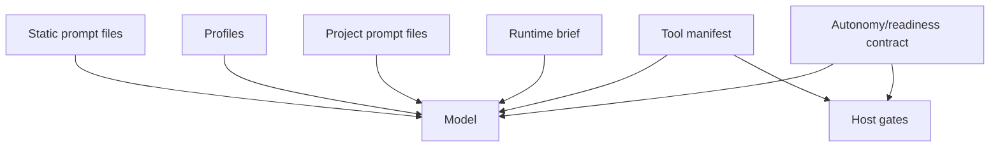

---
tags:
  - harness
  - prompts
  - profiles
  - authority
---

# Prompt Stack and Profiles

Prompt layers help the model understand its role, but durable behavior belongs
in typed contracts, schemas, gates, telemetry, and tests.

## Prompt Assembly

The TUI and prompt paths build the hidden system prompt from layered sources:

1. `chat.system_prompt`
2. `chat.system_prompt_files`
3. `chat.default_profiles` loaded from `chat.profiles_dir`
4. Project prompt files from `chat.project_root`

The TUI footer reports the active prompt sources as context. Debug logs record
prompt source metadata; redacted mode avoids storing raw prompt bodies by
default.

## Main Prompt Files

| Path | Role |
| --- | --- |
| `prompts/base.md` | Baseline behavior shared across sessions |
| `prompts/plan-mode.md` | Plan-mode expectations |
| `prompts/profiles/coding.md` | Code-quality profile expectations |
| `prompts/profiles/external-agent-worker.md` | Executor-model profile for external coding agent/local model worker-style runs |

Project-local profiles can also be loaded through configured profile dirs.

## Runtime Brief Versus Prompt Text

Static prompts teach behavior. Runtime briefs and tool manifests describe the
current lane, task, tools, obligations, paths, and verification expectations.
Host gates enforce the invariants.

## Authority Rules

Use prompts for:

- Role expectations.
- Tool capability explanations.
- Evidence interpretation guidance.
- Lane conventions.
- Communication style.

Use code and contracts for:

- Tool permissions.
- Path roles.
- Required edit paths.
- Protected paths.
- Artifact state transitions.
- Verification requirements.
- Completion readiness.
- Repeated-loop fuses.

## Prompt Anti-Patterns

Avoid:

- Prompt-magic contract triggers such as "Contract: implementation_result".
- Instructions that act like hidden mode switches.
- "First action must be edit_file" style rules when a typed gate should own
  the invariant.
- Project-specific scenario fixes in reusable prompts.
- Duplicating the same operational requirement across several prompt layers.
- Tool results that prescribe strategy instead of reporting evidence.

## TUI Profile Controls

The TUI supports profile controls:

- `/profile list`
- `/profile add <name>`
- `/profile remove <name>`

Profile changes reload the prompt stack for the active session. They should not
silently change tool permissions unless the runtime/tool profile layer also
changes.

## Tests And Evidence

Prompt-stack changes should usually check:

- `internal/promptstack` tests for composition, dedupe, required files, and
  profile listing.
- Runner behavior tests when prompt text changes expected agent behavior.
- Eval fixtures when prompt behavior is meant to prevent a recurring failure.
- Debug logs to verify prompt source metadata without leaking raw prompt bodies.

## Source Anchors

| Source | Why it matters |
| --- | --- |
| `internal/promptstack` | Prompt composition and profile loading |
| `internal/app/lifecycle.go` | TUI prompt stack loading and debug prompt source records |
| `internal/frontier/workerruntime/runtime.go` | Runtime brief fields |
| `internal/frontier/workerruntime/catalog.go` | Tool profiles and role contracts |
| `prompts/` | Baseline prompt files |
| `prompts/profiles/` | Profile prompt files |

## Related Notes

- [[05 - Runner Contracts and Control Rails]]
- [[14 - Maintenance Playbooks]]
- [[19 - CLI TUI and Operator Surface]]
- [[17 - Security Privacy and Data Boundaries]]
