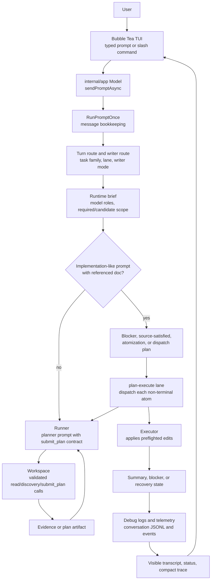
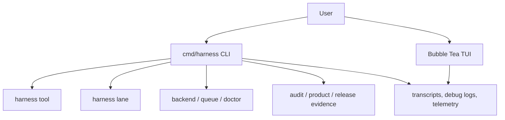

---
tags:
  - harness
  - cli
  - tui
  - operator
---

# CLI TUI and Operator Surface

Agent Harness exposes both an interactive TUI and structured CLI commands. The TUI is
for live local sessions. The CLI is for repeatable lanes, tools, evidence
exports, sidecar use, and automation.

## Target State

The actively maintained repeatable path is the CLI: `harness lane`, direct
`harness plan-execute`, sidecar `harness tool`, and evidence/audit commands. These
surfaces emit structured events and are the right fit for automation,
regression repros, and externally orchestrated runs.

The TUI remains an interactive operator surface, not a separate workflow engine.
Interactive sends call the same `RunPromptOnce` path used by prompt-mode CLI
runs, so active prompt routing, writer-route decisions, debug logs, and
implementation dispatch behavior are shared. The TUI should still be treated as
less automation-friendly than the CLI because it is optimized for live local
sessions.

When `chat.implementation_dispatch` is `plan_execute`, the session is in build
mode, and writes are enabled, implementation-like TUI or prompt-mode turns can
route referenced design docs through plan-execute instead of asking the model to
free-form implement the document. That dispatch path resolves the referenced
markdown, preflights it, refines or atomizes when needed, and then executes
dispatchable atoms through plan-execute.

This is pre-dispatch decomposition. The post-failure plan-execute loop described
in [[21 - Recovery and Decomposition]] should write a durable failure record,
classified failure shape, and decomposition packet automatically when a
plan-execute session fails; failed `harness lane implement` subprocesses should
write the same recovery artifact pair from bounded lane/session evidence. The
CLI surface is `harness recover inspect`, `harness recover status`,
`harness recover decompose`, `harness recover promote`, and
`harness recover reconcile`. Product operator status should project referenced
recovery packets, blocks normal workflow dispatch while recovery is open, and
unblocks only after a validated reconciliation artifact covers the active
packet's candidate atom manifest with passing required-test evidence. The TUI
`/product-status [--effort-root <path>]` command renders that same shared
operator status text from the same lint, metrics, workflow-state, and recovery
inputs. The TUI `/recover-status [--packet <path>|<path>]` command renders the
same packet-level presenter as `harness recover status` and resolves relative
packet paths from the active workspace directory while keeping packet reads
inside the workspace boundary. `/product-status` appends a TUI-local
`/recover-status --packet ...` handoff hint when recovery packet state is
present. Both status commands are read-only, operator-authored, filtered before
compaction, and not replayed as model messages.

## Literal TUI Prompt Flow

The TUI does not own a parallel planning engine. It owns interactive
presentation, local session state, slash commands, and dispatch glue.
Contracts, write scope, `submit_plan`, executor preflight, readiness,
verification, and recovery state are shared with CLI lane machinery.

## Operator Surface Map

The CLI remains the preferred reproducible surface for regression tests and
automation. The TUI is the preferred exploratory/operator surface when the user
wants to watch a local session, inspect status, switch profiles, or use
read-only presenters during an interactive run.

## Main CLI Families

| Command family | Purpose |
| --- | --- |
| `harness doctor` | Host and workflow readiness evidence |
| `harness lane` | Structured lane execution |
| `harness plan-execute` | Direct planner/executor orchestration with durable progress state |
| `harness tool` | Sidecar/tool invocation and schemas |
| `harness backend` | Local backend process/profile operations |
| `harness queue` | Concurrency leases for local model resources |
| `harness atom` | Atom/spec intake and classification |
| `harness brief lint` | Pre-dispatch brief linting |
| `harness lane postflight` | Diff QC after lane output |
| `harness recover` | Failure-record inspection, packet status, decomposition, promotion into a gated brief, and packet reconciliation |
| `harness local-ops benchmark` | Activation and local readiness evidence |
| `harness product-evidence export` | Product go/no-go evidence |
| `harness release evidence` | Release evidence bundle |
| `harness audit watch` | Local behavior monitoring, including recovery event summaries, and review packets |
| `harness ranker` | Ranker learning inspection and manual adjustment |
| `harness mcp serve` | Inbound MCP stdio server |

## TUI Controls

Common controls include:

- `Ctrl+S`: save transcript.
- `Ctrl+T`: cycle panel tabs.
- `/help`: show slash commands.
- `/debuglog [mode redacted|full]`: show or change debug log mode.
- `/trace [compact|detail]`: compact or detailed visible tool trace.
- `/profile list|add|remove`: manage active profiles.
- `/product-status [--effort-root <path>]`: render the shared product operator
  status view for an explicit effort root, or for the active workspace
  directory only when that directory contains `workflow_state.json`.
- `/recover-status [--packet <path>|<path>]`: render the shared recovery packet
  status view without granting recovery write authority. Packet paths must stay
  under the workspace root and must not traverse symlinked directories or
  symlinked packet files; reconciliation artifacts discovered for status use
  the same boundary.
- `/resume [id]`: resume a prior session by ID or open the session picker.

The default debug mode is redacted. Full mode is for local deep debugging and
can retain sensitive content.

## TUI Design-Doc Dispatch

The TUI should handle a prompt such as "start implementing docs/plan.md" as a
first-class workflow when implementation dispatch is enabled:

1. Resolve the referenced markdown file unambiguously.
2. Run deterministic preflight through atom intake and brief lint.
3. Refine non-dispatchable briefs when refine can produce a lint-clean accepted
   brief.
4. Atomize broad design docs into `.harness/atoms/<title>/atom-NNN.md`.
5. Add active-state anchors for existing files and mark missing-path atoms as
   `NEW FILE`.
6. Dispatch each non-terminal atom through plan-execute.
7. Mark atom docs complete or source-satisfied only when the answer is not a
   blocker and verification obligations are proven.
8. Skip atom docs whose status is terminal.

Terminal atom statuses include `completed`, `complete`, `accepted`, `closed`,
`source-satisfied`, `source satisfied`, and any status containing
`do not dispatch`.

This is deliberately a harness-owned workflow. The model still owns strategy
inside the planner/executor phases, but document resolution, atom materializing,
terminal-state detection, source-satisfied classification, and closeout writes
belong to the TUI/prompt harness path.

## Product Workflow UX Contract

For the product workflow, the TUI is a presenter over the same application use
cases as the CLI. The CLI has a shared operator status view model, effort
browsing, and status migration; the TUI has a read-only `/product-status`
projection over that operator view, including recovery packet state, plus a
read-only `/recover-status` projection over decomposition packets.
A write-capable TUI continuation/handoff action* such as capture, start,
continue, promote, dispatch, or close
should resolve a stable effort ID, render the shared status view model, advance
exactly one valid action, reconcile state from artifacts and evidence, and then
render the next valid action.

`*` marks product-workflow TUI behavior that is design mapped rather than specified.

Efforts should be browsable by coarse status folders:

- `.harness/product/efforts/unstarted/<effort-id>/...`
- `.harness/product/efforts/started/<effort-id>/...`
- `.harness/product/efforts/closed/<effort-id>/...`

Accepted effort artifacts may be promoted to matching durable folders under
`docs/product-workflows/efforts/<status>/<effort-id>/...`. The effort ID, not the
active folder path, is the stable identity. Status migration should update the
effort index and move the whole effort folder so reviewers can browse by status
without scattering one design doc's artifacts.

The TUI should not infer progress from transcript text. It should read
`workflow_state.json`, the effort index, lane history, plan-execute progress
state, atom tracker docs, telemetry, and evidence export IDs through application
adapters. If those sources disagree, the user should see a reconciliation
blocker rather than a dispatch button.

The first-run UX promise should be conservative: a happy-path fixture should work
from capture through status browsing and close, while real incomplete work should
fail closed with a typed blocker and one clear next action. The TUI should not
promise flawless autonomous completion for arbitrary complex features on the
first try.

## Resume And Session State

Generic prompt `--resume` replays prior user/assistant messages into a new
run's history. Workspace plan, workflow, and task-memory state can resume from
their own persisted stores. Do not assume resuming the transcript alone
recreates every workspace artifact or lane state.

Direct `harness plan-execute --resume <session-id>` is stricter. It loads the
progress file at `.harness/plan-execute/sessions/<session-id>.json`, verifies the
prompt hash against the supplied prompt or prompt file, and resumes only
review-resumable state. Missing progress state is a hard error rather than a
silent fresh run.

## Command Telemetry

CLI commands emit local telemetry under `logs/telemetry` unless disabled.
Telemetry records command names, timing, redacted arguments, output sizes,
errors, and structured context fields. It should not persist raw tool output by
default.

## Source Anchors

| Source | Why it matters |
| --- | --- |
| `cmd/harness/main.go` | Main CLI routing and telemetry naming |
| `cmd/harness/lane.go` | Lane command surface |
| `cmd/harness/plan_execute.go` | Direct plan-execute orchestration and resume-state handling |
| `cmd/harness/mcp.go` | Inbound MCP command |
| `internal/app/model_state.go` | Slash command handling |
| `internal/app/implementation_dispatch.go` | TUI/prompt design-doc dispatch, atomization, source-satisfied closeout |
| `internal/app/lifecycle.go` | TUI lifecycle, transcripts, debug logs |
| `internal/planexecute/progress.go` | Durable plan-execute progress state schema |
| `internal/transcript` | Transcript and debug log records |

## Related Notes

- [[04 - Runtime Lanes]]
- [[08 - Planning Packets and Handoff]]
- [[09 - Verification Readiness and Completion]]
- [[12 - Sidecar and LLM Agent Integrations]]
- [[14 - Maintenance Playbooks]]
- [[16 - Operational Commands and Evidence Products]]
- [[18 - Prompt Stack and Profiles]]
