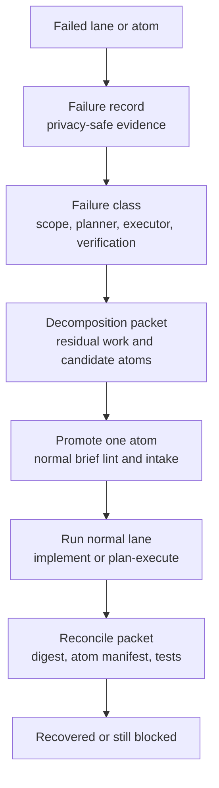

# Recovery and Decomposition

Recovery turns failed implementation runs into durable, reviewable follow-up
work instead of unbounded retries or manual splitting.

Long-form source: [design-decompose-on-failure.md](../design-decompose-on-failure.md)

## Target State

The plan-execute loop and the first lane-implement adapter are is specified.

Target surfaces include:

- failed `plan-execute` recovery records
- failed `harness lane implement` recovery records
- automatic decomposition packets from bounded lane/session evidence
- `harness recover inspect`
- `harness recover status`
- `harness recover decompose`
- `harness recover promote`
- `harness recover reconcile`
- read-only `recovery_inspect` and `recovery_status` through `harness tool`/MCP
- TUI `/recover-status`
- TUI `/product-status` recovery packet projection
- audit-watch recovery findings
- product-evidence and release-evidence recovery rollups
- sanitized ranker-learning evidence from valid reconciliation

Future extensions include write-capable TUI continuation/handoff actions and
additional non-plan-execute failure sources.

## Recovery Loop

The original failure remains immutable. Recovery adds linked artifacts and
validation evidence; it does not rewrite history.

## Failure Classes

| Class | Expected action |
| --- | --- |
| `scope_too_large` | Decompose into smaller atoms |
| `planner_blocked` | Retry once only when conditions changed; otherwise surface |
| `plan_missing` | Retry or decompose depending on evidence |
| `executor_edit_failed` | Diff QC, then decompose or repair |
| `verification_failed` | Decompose by failing test/package/symbol |
| `review_repair_failed` | Decompose remaining findings |
| `stale_context` | Refresh evidence, then retry or decompose |
| `budget_exhausted` | Decompose by output size and path ownership |
| `dirty_workspace` | Block until partial state is classified |
| `needs_human_answer` | Surface typed question |
| `unsafe_policy_block` | Surface blocker; do not decompose |

## Artifact Contract

| Artifact | Role |
| --- | --- |
| `failure.json` | Immutable, privacy-safe failure record for one failed run |
| `packet.json` | Candidate recovery atoms, residual work, required tests, evidence refs, next action |
| promoted brief | Normal gated atom brief generated from one recovery candidate |
| `reconciliation.json` | Validated completed/remaining atom manifest and required-test evidence |

Residual work cites scoped required-path, changed-path, failure, and
required-test evidence refs. It must not persist raw prompts, raw transcripts,
or file bodies.

## Acceptance Shape

- A failed run writes a privacy-safe failure record.
- The classifier emits one root failure class plus evidence tags.
- Decomposition packets list residual work, partial state, candidate atoms,
  required paths, forbidden paths, tests, and next valid action.
- Candidate atoms must pass normal brief lint, atom intake, scope, and product
  workflow gates before dispatch.
- Reconciliation closes a packet only after packet digest, atom manifest, and
  required-test evidence validation.
- CLI, TUI, product workflow, `harness tool`, and MCP expose the same read-only
  recovery status model.
- Product and release evidence exports include bounded metadata-only recovery
  rollups and treat open recovery as release-impact evidence.
- Write/promote/reconcile recovery actions stay out of the sidecar discovery
  profile until a dedicated write-authorization contract exists.

## Tool Parity

| Surface | Role |
| --- | --- |
| `plan-execute`, `implement`, `lane` | Source failure records, progress state, lane history, events, changed paths |
| `brief lint`, `atom intake`, `lane postflight` | Promotion gates for recovery atoms |
| `context_*`, discovery, language tools | Capability-backed residual-work evidence |
| workspace read/search/mutation/delegation tools | Bounded evidence for reads; mutation remains lane-owned authority |
| `git_status`, `git_diff`, verification commands | Partial-state and test-failure evidence |
| `harness_audit`, `audit watch`, evals | Recurring failure and recovery coverage |
| product workflow, product evidence, release evidence | Effort linkage and external review summaries |
| TUI, `harness tool`, MCP | Shared presenter/read-only status parity |

## North-Star Fit

- The harness owns failure classification, retry budgets, gate enforcement, and
  completion claims.
- The model may propose recovery atom content only inside a host-owned schema.
- Recovery packets describe capabilities and evidence gaps, not
  language-specific tool strategies.
- Same-scope retry requires changed conditions; otherwise the next action is
  decomposition or a human-visible blocker.

## Related Notes

- [[02 - Deterministic Evidence-Based Development]]
- [[04 - Runtime Lanes]]
- [[08 - Planning Packets and Handoff]]
- [[09 - Verification Readiness and Completion]]
- [[10 - Telemetry Audit Eval and Learning]]
- [[16 - Operational Commands and Evidence Products]]
- [[19 - CLI TUI and Operator Surface]]
- [[20 - Product Workflow and Behavioral Coverage]]
