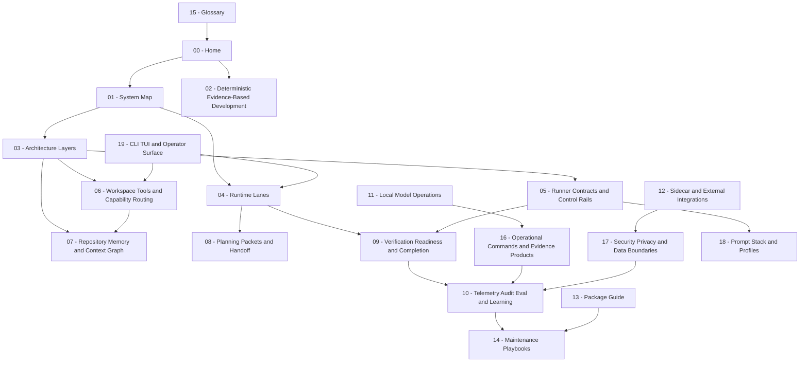

---
tags:
  - idiom
  - overview
---

# Idiom Documentation Base

Idiom is a local, evidence-first coding-agent harness. Its core thesis is that
teams will use coding agents more when the agent work is grounded in repository
memory, explicit contracts, deterministic gates, audit trails, and repeatable
verification.

The important split is simple:

- The model owns strategy.
- The harness owns contracts.

That split drives every major system in the repo. The model can choose how to
approach a task, but the harness constrains what counts as valid work: scoped
paths, permissions, typed artifacts, source evidence, verification, readiness,
loop limits, and auditability.

## Vault Map

## What To Read First

### 10-Minute Director Read

- [[01 - System Map]]
- [[02 - Deterministic Evidence-Based Development]]
- [[16 - Operational Commands and Evidence Products]]
- [[17 - Security Privacy and Data Boundaries]]

### Implementation Maintainer Read

- [[03 - Architecture Layers]]
- [[04 - Runtime Lanes]]
- [[05 - Runner Contracts and Control Rails]]
- [[06 - Workspace Tools and Capability Routing]]
- [[07 - Repository Memory and Context Graph]]
- [[13 - Package Guide]]
- [[14 - Maintenance Playbooks]]

### Agent Behavior Debugging Read

- [[02 - Deterministic Evidence-Based Development]]
- [[05 - Runner Contracts and Control Rails]]
- [[08 - Planning Packets and Handoff]]
- [[09 - Verification Readiness and Completion]]
- [[10 - Telemetry Audit Eval and Learning]]
- [[18 - Prompt Stack and Profiles]]

Read [[02 - Deterministic Evidence-Based Development]] first if you need to
understand how Idiom is meant to be worked on. It describes the repo's most
important engineering pattern: localize with evidence, change only after tests
or probes define behavior, verify after mutation, and feed outcomes back into
audit and eval loops.

Read [[01 - System Map]] if you need a fast architectural orientation.

Read [[14 - Maintenance Playbooks]] before changing prompts, runner behavior,
lane contracts, workspace tools, context memory, audit logic, or eval fixtures.

Read [[16 - Operational Commands and Evidence Products]] if you need to explain
the repo's operator-facing command surfaces. Read [[17 - Security Privacy and Data Boundaries]]
before discussing enterprise or regulated use.

## Full Note Index

- [[01 - System Map]]
- [[02 - Deterministic Evidence-Based Development]]
- [[03 - Architecture Layers]]
- [[04 - Runtime Lanes]]
- [[05 - Runner Contracts and Control Rails]]
- [[06 - Workspace Tools and Capability Routing]]
- [[07 - Repository Memory and Context Graph]]
- [[08 - Planning Packets and Handoff]]
- [[09 - Verification Readiness and Completion]]
- [[10 - Telemetry Audit Eval and Learning]]
- [[11 - Local Model Operations]]
- [[12 - Sidecar and External Integrations]]
- [[13 - Package Guide]]
- [[14 - Maintenance Playbooks]]
- [[15 - Glossary]]
- [[16 - Operational Commands and Evidence Products]]
- [[17 - Security Privacy and Data Boundaries]]
- [[18 - Prompt Stack and Profiles]]
- [[19 - CLI TUI and Operator Surface]]

## Core Sources

- [README.md](../../README.md) describes the user-facing CLI, TUI, local ops,
  lane, atom, queue, MCP, and release-evidence surfaces.
- [docs/idiom-strategic-thesis.md](../idiom-strategic-thesis.md) defines the
  product thesis and seven pillars.
- [docs/decisioning-north-star.md](../decisioning-north-star.md) defines the
  model-strategy versus harness-contract split.
- [docs/lane-architecture.md](../lane-architecture.md) explains lane execution.
- [docs/codebase-comprehension-memory-design.md](../codebase-comprehension-memory-design.md)
  explains repository memory.
- [docs/design-capability-oriented-tooling.md](../design-capability-oriented-tooling.md)
  explains capability routing.
