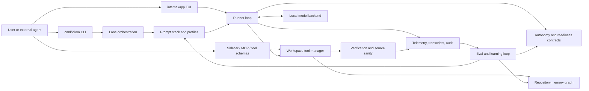
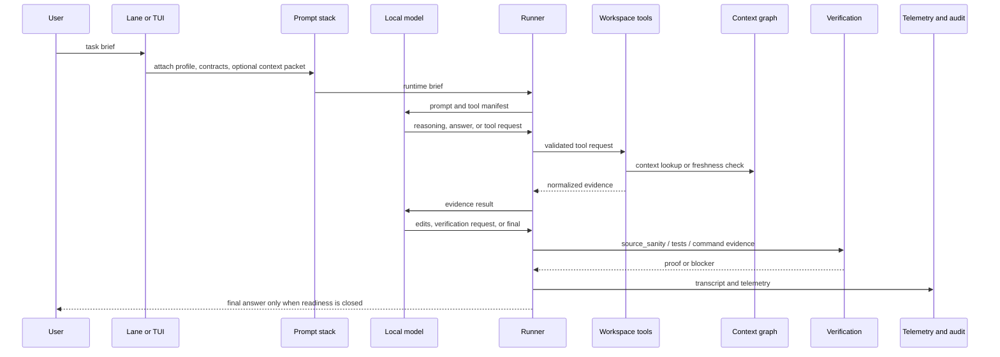

---
tags:
  - idiom
  - architecture
  - system-map
---

# System Map

Idiom is a local coding-agent harness around local models, workspace tools,
deterministic contracts, repository memory, verification, telemetry, audit, and
eval infrastructure.

The harness is not just a chat wrapper. It is the substrate that turns model
output into reviewable engineering work.

## North Star

> AI coding agents are becoming common, but teams do not yet trust their
> context, decisions, or outputs. Idiom sells the missing substrate: repo
> memory, freshness, contracts, audit, and evals.

The main architectural implication is that Idiom must make agent work
observable and enforceable without hardcoding the model's strategy.

## End-To-End Shape

## Major Systems

| System | Primary package or docs | Responsibility |
| --- | --- | --- |
| CLI and lanes | `cmd/idiom`, [[04 - Runtime Lanes]] | Commands, lane orchestration, sidecar entrypoints, plan-execute flow |
| TUI/session lifecycle | `internal/app` | Interactive local session management |
| Runner and contracts | `internal/agent`, [[05 - Runner Contracts and Control Rails]] | Model loop, tool calls, autonomy contracts, readiness, completion gates |
| Workspace tools | `internal/workspace`, [[06 - Workspace Tools and Capability Routing]] | Typed tool dispatch, permissions, source sanity, context tools, audit tools |
| Repository memory | `internal/comprehension`, `internal/discovery`, [[07 - Repository Memory and Context Graph]] | Persistent graph, context packets, freshness, trace packs |
| Planning/handoff | `cmd/idiom/plan_execute.go`, `internal/architect`, [[08 - Planning Packets and Handoff]] | Structured plans, architect packets, deterministic executor handoff |
| Verification/readiness | `internal/workspace/source_sanity.go`, `internal/agent/runner_task_ledger.go`, [[09 - Verification Readiness and Completion]] | Proof of behavior, source-aware checks, readiness closure |
| Telemetry/audit/eval | `internal/telemetry`, `internal/eval`, `harness_audit`, [[10 - Telemetry Audit Eval and Learning]] | Evidence trail, behavioral diagnostics, regressions, learning loop |
| Local model ops | `internal/backends`, `internal/llama`, [[11 - Local Model Operations]] | Model backend setup, queueing, degraded modes, local inference |
| Sidecar/integrations | `internal/mcp`, tool schema commands, [[12 - Sidecar and External Integrations]] | External agent/tool access, MCP, machine-readable capabilities |
| Operational evidence | queue, audit watch, ranker, product evidence, release evidence, [[16 - Operational Commands and Evidence Products]] | Operator commands and privacy-safe evidence products |
| Security/privacy posture | `internal/autonomy`, telemetry redaction, product evidence, [[17 - Security Privacy and Data Boundaries]] | Protected paths, redaction, metadata-only exports, local artifact boundaries |

## Authority Model

The model is allowed to decide:

- What evidence is relevant.
- Which design path to propose.
- Which tool capability it needs next.
- Whether it should propose an answer, edit, verification step, or blocker.

The harness decides:

- Whether a tool call is permitted.
- Whether an artifact is dispatchable.
- Whether paths are in scope.
- Whether verification is required.
- Whether completion claims are supported.
- Whether readiness is actually closed.
- Whether loops, budgets, and repeated low-value probes must stop.

This is explained in detail in [[02 - Deterministic Evidence-Based Development]]
and [[05 - Runner Contracts and Control Rails]].

## Data And Control Flow

## Repository-Owned State

Idiom keeps agent state outside normal source files unless a command explicitly
creates project artifacts:

- `.idiom/config.json` for local project configuration.
- `.idiom/comprehension/graph.sqlite` for the repository memory graph.
- `.idiom/comprehension/views/*.json` for exported context views.
- `.idiom/discovery` for discovery artifacts.
- `.idiom/logs/conversations/*.jsonl` and `logs/telemetry/*.jsonl` for behavior
  evidence and diagnostics.
- `prompts/` for static prompt layers and profiles.
- `docs/` for design intent and operator documentation.

## What Makes The System Deterministic

Idiom does not try to make model output deterministic. Instead, it makes the
surrounding development system deterministic:

- Tools have schemas.
- Lanes have explicit phases.
- Plans have typed artifacts.
- Workspace access has path roles and permission checks.
- Context packets have freshness and provenance.
- Readiness is computed from obligations and evidence.
- Verification is tied to risk and changed paths.
- Audit and evals replay observed behavior.

That distinction is the center of the architecture.

## Related Notes

- [[02 - Deterministic Evidence-Based Development]]
- [[03 - Architecture Layers]]
- [[05 - Runner Contracts and Control Rails]]
- [[09 - Verification Readiness and Completion]]
