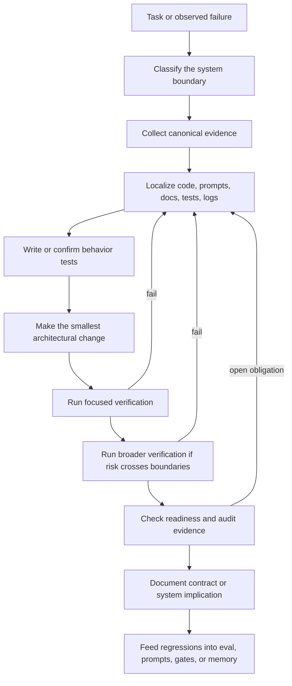
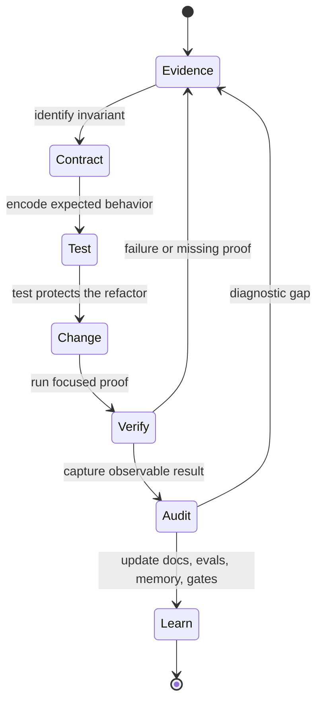
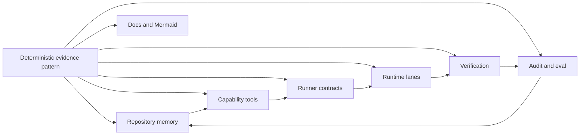

---
tags:
  - idiom
  - development-pattern
  - evidence
  - deterministic
---

# Deterministic Evidence-Based Development

This is the most important working pattern in the repo.

Idiom development should be deterministic around the model, not deterministic
inside the model. The model may explore, infer, and choose strategy. The
harness and maintainers must require concrete evidence before changing behavior
and concrete verification before claiming success.

## The Pattern

This means every non-trivial change should answer these questions:

- What behavior is being changed or preserved?
- What evidence proves the current behavior?
- Which contract, lane, prompt, tool, or package owns that behavior?
- What test or audit fixture fails before the fix or protects against
  regression?
- What verification proves the edit did not only satisfy patch hygiene?
- What telemetry or audit output would diagnose this class of issue next time?

## Sufficiency Rule

After the evidence is sufficient, answer or act. Continue gathering evidence
only when you can name both:

- One exact missing claim.
- One exact probe that would resolve that claim.

This prevents evidence gathering from becoming a default loop. It also keeps
redirects honest: a redirect should point at a concrete missing proof or open
obligation, not at a vague need to "look more."

## Deterministic Does Not Mean Over-Controlling The Model

The repo repeatedly warns against replacing model judgment with brittle harness
scripts. Idiom should avoid hard-picking the model's next step unless a real
invariant is at risk.

Prefer:

- Nudge over forced tool call.
- Redirect over immediate hard rejection.
- Bounded recovery over endless retry.
- Capability request over concrete backend name.
- Evidence envelope over raw file flood.
- Typed contract over prompt reminder.

Hard enforcement is appropriate for:

- Permissions.
- Protected paths.
- Tool protocol correctness.
- Required edit paths.
- Verification after writes.
- Completion readiness.
- Repeated low-value loops.
- Exhausted budgets.
- Workflow artifact state transitions.

See [[05 - Runner Contracts and Control Rails]] for the runtime mechanics.

## Evidence Classes

Idiom treats different evidence classes differently. They are not
interchangeable.

| Evidence class | Examples | What it proves | What it does not prove |
| --- | --- | --- | --- |
| Source evidence | Files, symbols, imports, call graph, context packet | The code shape and ownership boundary | Runtime behavior by itself |
| Test evidence | Unit tests, integration tests, focused package test | Behavioral contract under test conditions | Full production readiness |
| Command evidence | `go test`, `go vet`, `make build`, `source_sanity` | Toolchain, test, build, diagnostic, or syntax sanity checks passed | Correctness outside checked scope |
| Runtime evidence | Logs, traces, telemetry, harness audit | Observed behavior in an agent/session flow | Static source intent |
| Artifact evidence | Plans, atom reports, architect packets, phase evidence | Workflow state and handoff context | Source validity unless verified |
| Documentation evidence | Design docs, roadmap, north-star docs | Intended architecture and constraints | Implemented behavior unless source/test backs it |

When behavior and docs disagree, source, tests, and telemetry identify the
current system; docs identify desired intent or stale guidance to update.

## Before Refactoring

The user's original requirement for this cleanup effort was: behavior tests
first, then refactor, then verify again. In this repo that should be interpreted
as:

1. Localize the behavior with `context_pack` or a more specific discovery tool.
2. Read the canonical design docs for that subsystem.
3. Find existing tests that cover the behavior.
4. Add focused tests if the behavior is not already protected.
5. Make the refactor in the owning package.
6. Run the focused test package first.
7. Run broader tests if the change crosses package, prompt, lane, or tool
   boundaries.
8. Run source or harness audit checks when behavior affects agent contracts.
9. Document the new shape if it changes the architecture or operator model.

## What Counts As Complete

A change is complete only when the relevant readiness contract is closed.

For a code change this normally means:

- The intended files changed.
- No unrelated user edits were reverted.
- Behavior tests exist for the touched behavior.
- Focused tests pass.
- Broader tests pass when blast radius requires it.
- Source-aware verification is run when source behavior changed.
- Docs or Mermaid diagrams are updated when the architecture changed.
- Audit or telemetry can expose the same class of failure if it recurs.

For a docs-only change this normally means:

- The documentation is grounded in source files and canonical docs.
- Links are usable from the repo.
- Diagrams reflect actual package or workflow boundaries.
- `git diff --check` has no whitespace errors.

## The Golden Loop

## Anti-Patterns

The repo calls out several recurring traps:

- Adding another prompt reminder instead of encoding a typed contract.
- Treating `git diff --check` as proof for source behavior.
- Treating audit `all_clear` as sufficient without checking unresolved
  obligations, gate coverage, invalid events, or tool correlation findings.
- Letting a plan or packet imply write scope when it is only evidence.
- Hardcoding a recurring scenario into reusable instructions.
- Letting evidence tools prescribe strategy instead of reporting findings.
- Starting with broad grep loops when a context packet or language-aware tool
  would localize the change.
- Accepting placeholder edits or review passes that do not repair or block.

## Relationship To Repository Systems

The pattern is not a separate module. It is the operating discipline that keeps
the modules coherent.

## Practical Checklist

Use this checklist for meaningful repo work:

- Start with the primary rule set and the repo AGENTS instructions.
- Use `context_pack` for localization unless the task is a literal string
  search.
- Read subsystem docs before editing subsystem behavior.
- Find the owning package and tests before touching implementation.
- Add or strengthen behavior tests before refactoring.
- Prefer package-local changes and established patterns.
- Run the narrowest relevant tests first.
- Run broad verification when shared runtime behavior changes.
- Use harness audit for agent behavior changes.
- Update docs when the architecture, contract, or operator workflow changes.

## Related Notes

- [[05 - Runner Contracts and Control Rails]]
- [[07 - Repository Memory and Context Graph]]
- [[09 - Verification Readiness and Completion]]
- [[10 - Telemetry Audit Eval and Learning]]
