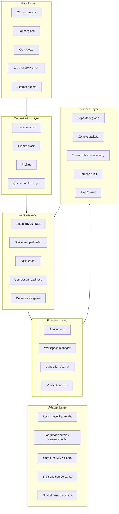
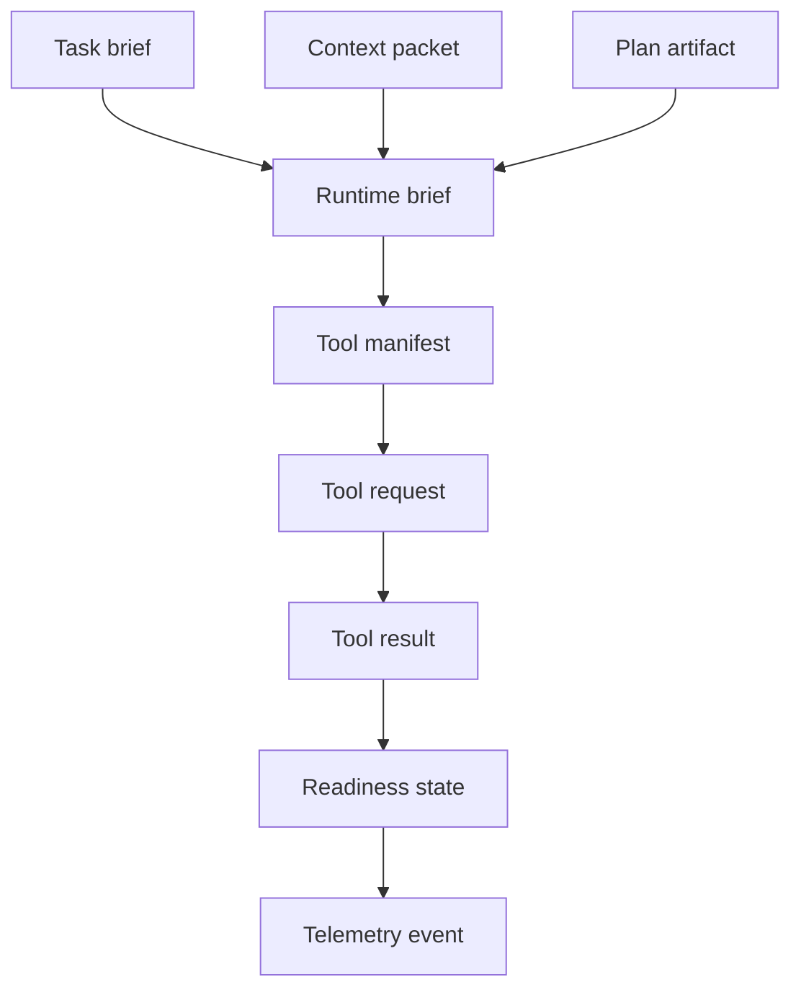

---
tags:
  - idiom
  - architecture
  - layers
---

# Architecture Layers

Idiom follows a contract-centered architecture. The outer surfaces accept user
tasks and external tool calls. The inner systems normalize those requests into
typed contracts, repository evidence, model interactions, tool execution,
verification, and audit records.

## Layer Diagram

## Dependency Rule

Higher-level orchestration should depend on contracts and capabilities, not on
specific low-level implementation details.

Examples:

- A lane should ask for a `context_pack`, not manually reconstruct the graph.
- The model should ask for a capability, not a language-server-specific adapter.
- Completion should depend on readiness state, not on phrasing in the final
  answer.
- Audit should read telemetry and structured events, not infer everything from
  prose.

## Package Ownership By Layer

| Layer | Packages | Ownership |
| --- | --- | --- |
| Surface | `cmd/idiom`, `internal/app`, inbound MCP in `cmd/idiom/mcp.go` | User commands, TUI lifecycle, external protocol surfaces |
| Orchestration | `cmd/idiom/lane.go`, `cmd/idiom/plan_execute.go`, `internal/promptstack`, `internal/projectartifacts` | Lane setup, plan-execute orchestration, prompt assembly, artifact workflow |
| Contract | `internal/agent`, `internal/autonomy`, `internal/frontier/workerruntime` | Runtime contracts, role profiles, tool profile rules |
| Execution | `internal/agent`, `internal/workspace`, `internal/runner` | Model loop, tool dispatch, process execution |
| Evidence | `internal/comprehension`, `internal/discovery`, `internal/telemetry`, `internal/eval`, `internal/transcript` | Context graph, discovery, logs, audit, evaluation |
| Adapters | `internal/backends`, `internal/autodetect`, `internal/llama`, `internal/semantic`, outbound MCP in `internal/mcp`, shell/git adapters in workspace | Local inference, host discovery, external clients, and environment-specific tool execution |

## Clean Boundary Expectations

The repo's architecture docs emphasize these constraints:

- Contract changes must state the invariant and the audit or eval proof.
- Memory changes must expose freshness, provenance, confidence, and uncertainty.
- Capability changes must preserve model strategy.
- Planning changes must keep packets as evidence envelopes.
- Local-model operations must surface readiness and degraded mode.
- Eval and audit changes must replay from logs or artifacts.
- Sidecar behavior must reuse existing schemas, permissions, telemetry,
  freshness, and audit paths.

## Why Boundaries Matter

Idiom's value depends on trust. Trust breaks when a subsystem silently takes
authority from another subsystem:

- A prompt that quietly becomes a contract is brittle.
- A tool result that tells the model what to do next can over-constrain
  strategy.
- A context packet that implies write scope can cause edits outside the user's
  real task.
- A verification command that only checks whitespace can falsely satisfy a code
  behavior obligation.
- A final answer that sounds complete while obligations remain open undermines
  auditability.

The architecture therefore keeps explicit ownership for evidence, strategy,
contracts, and verification.

## System Interfaces

These interfaces are more important than any individual prompt string. When a
behavior needs to be stable, encode it in the interface, gate, schema, event, or
test that owns the invariant.

## Related Notes

- [[01 - System Map]]
- [[04 - Runtime Lanes]]
- [[12 - Sidecar and External Integrations]]
- [[18 - Prompt Stack and Profiles]]
