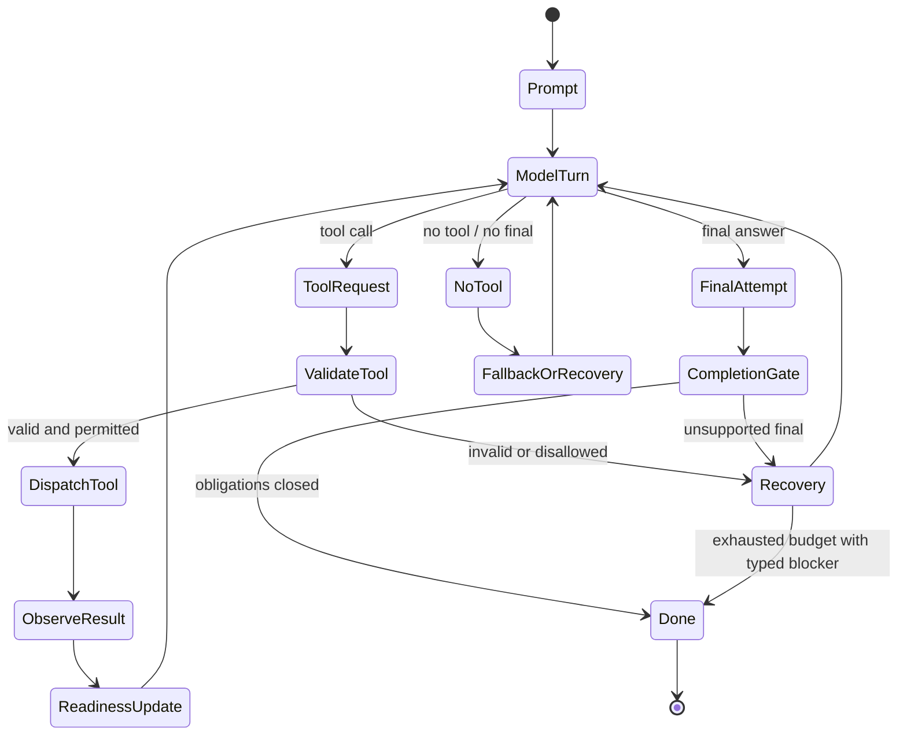
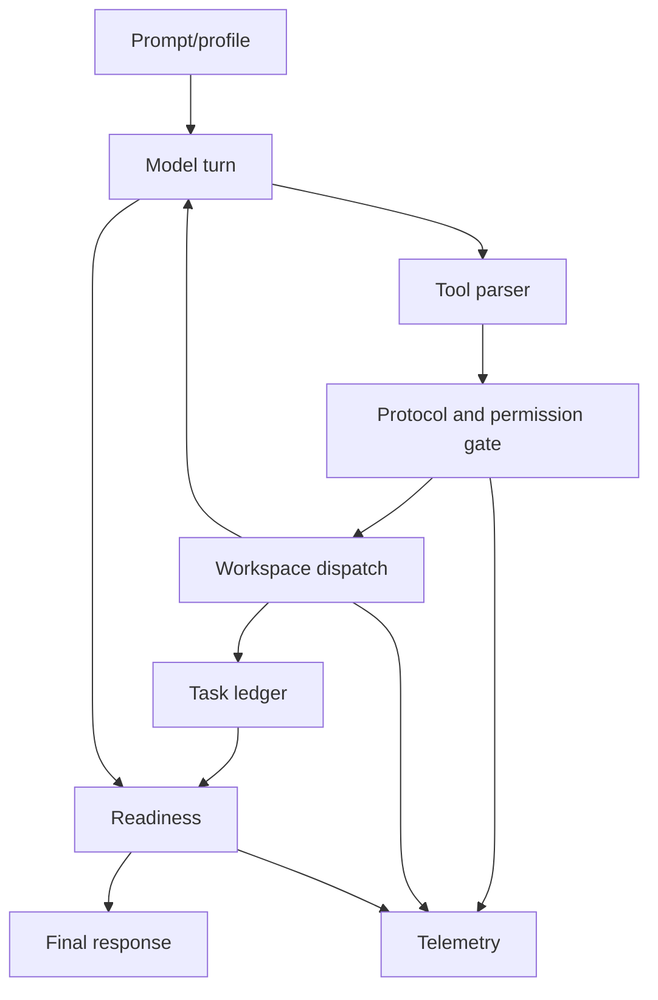

---
tags:
  - idiom
  - runner
  - contracts
  - control-rails
---

# Runner Contracts and Control Rails

The runner is the control surface between the model, the prompt stack, workspace
tools, completion readiness, telemetry, and final output.

The runner must let the model choose strategy while enforcing deterministic
runtime contracts.

## Runner Responsibilities

The runner owns:

- Sending runtime briefs and tool manifests to the model backend.
- Parsing model tool requests.
- Validating tool protocol and dispatching permitted tool calls.
- Feeding normalized tool results back to the model.
- Tracking side effects, obligations, and readiness.
- Redirecting repeated low-value exploration.
- Requiring verification after writes when risk demands it.
- Preventing unsupported final answers.
- Emitting transcript and telemetry records.

## Runtime Loop

## Autonomy Contract

The autonomy contract describes what the model may do and what the harness will
enforce. It is a structured runtime concept, not just prose in a prompt.

It typically includes:

- Tool capabilities and phase-specific tool profile.
- Path roles such as required edit paths, forbidden paths, protected paths, and
  evidence-only paths.
- Open obligations.
- Side-effect state.
- Verification expectations.
- Completion-readiness criteria.
- Loop and budget limits.

## Readiness

Readiness is harness-computed observable state. It should not depend on the
model saying "done" in a convincing way.

Readiness asks:

- Did the task require edits, an answer, verification, or a blocker?
- Were required paths changed or explicitly blocked?
- Were all required artifacts produced?
- Were claims backed by evidence?
- Was verification run after writes?
- Did the final answer address unresolved obligations?

See [[09 - Verification Readiness and Completion]] for the completion model.

## Redirects And Recovery

The runner can redirect the model when exploration becomes low value or
violates a contract. Redirects should be generic and evidence-based.

Examples:

- Repeated same-tool calls without new evidence.
- Broad file searches after a more specific context or symbol path is available.
- Required-path implementation gaps.
- Attempts to finalize with open obligations.
- Tool protocol errors.
- No-tools fallback cases.
- Evidence gathering that cannot name one missing claim and one resolving probe.

The redirect should identify the contract gap and the next bounded choice. It
should not encode a project-specific scenario into reusable behavior.

Redirects are recovery aids, not infinite loops. When the budget is exhausted
or the missing evidence cannot be safely obtained, the runner should produce a
typed blocker rather than keep the model cycling.

## Prompt Authority

Prompt files are important, but they should not be the only source of authority
for stable behavior.

Use prompts for:

- Explaining role expectations.
- Describing tool capabilities.
- Teaching the model how to interpret evidence.
- Stating lane-specific conventions.

Use code, schemas, tests, and gates for:

- Permission enforcement.
- Path roles.
- Workflow state transitions.
- Completion readiness.
- Verification requirements.
- Repeated-loop fuses.
- Tool protocol correctness.

## Runner Cross-Cutting Concerns

## Tests To Expect

Runner changes usually need tests for:

- Tool call parsing and invalid tool recovery.
- Readiness closure and unsupported final rejection.
- Task ledger state transitions.
- Redirect behavior for repeated discovery or read loops.
- Required-path or protected-path enforcement.
- Verification after write behavior.
- No-tools fallback behavior.

When changing runner behavior, add regression tests for the absence of bad
behavior, not only the presence of the desired happy path.

## Related Notes

- [[02 - Deterministic Evidence-Based Development]]
- [[09 - Verification Readiness and Completion]]
- [[18 - Prompt Stack and Profiles]]
- [[10 - Telemetry Audit Eval and Learning]]
