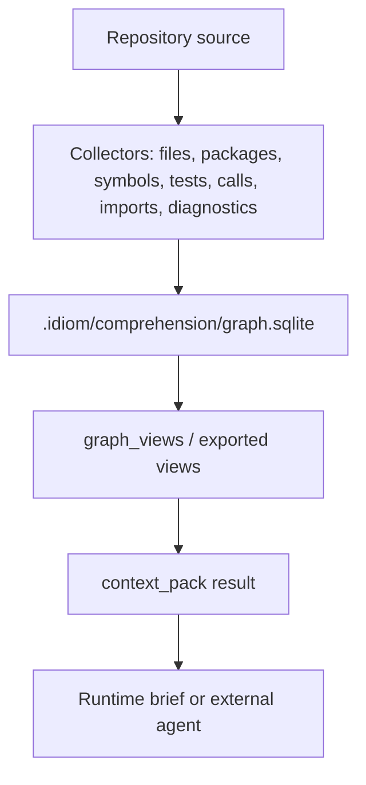
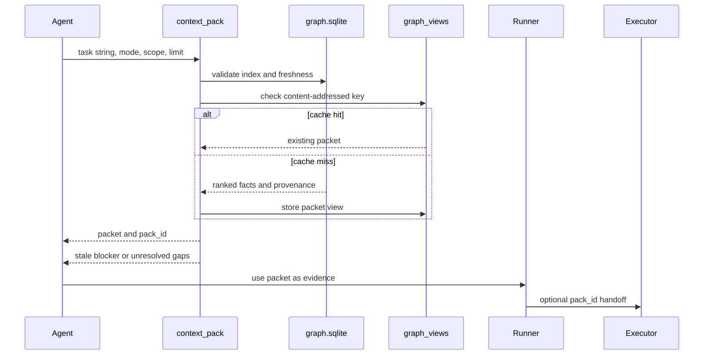

---
tags:
  - idiom
  - repository-memory
  - context-graph
---

# Repository Memory and Context Graph

Repository memory is one of Idiom's main differentiators. It exists so agents
do not rediscover the repo from scratch on every task and do not flood prompts
with raw files when a bounded evidence packet would be better.

The canonical design is in
[docs/codebase-comprehension-memory-design.md](../codebase-comprehension-memory-design.md).

## Core Principle

The memory system separates three concepts:

- Index: durable repository facts.
- View: bounded, queryable projections of those facts.
- Packet: task-specific evidence envelope.

## What The Graph Stores

The graph is expected to model:

- Files and directories.
- Packages or modules.
- Symbols.
- Imports and dependencies.
- Calls and references where available.
- Tests and test relationships.
- Diagnostics and collector coverage.
- Runtime traces attached by trace packs.
- Freshness and source fingerprints.
- Confidence and uncertainty.

The graph should expose what it knows and what it does not know.

## Context Tools

| Tool | Purpose |
| --- | --- |
| `context_pack` | Default localization tool for a task. Returns ranked candidate files, symbols, tests, provenance, and a `pack_id`. |
| `context_query` | Graph-shaped questions such as callers, tests covering a symbol, or dependency relationships. |
| `context_zoom` | Drill from a packet handle to a file, symbol, or repo-level detail. |
| `context_status` | Freshness, stale paths, collector coverage, backend availability. Can refresh bounded stale state. |
| `context_index` | Build or refresh the graph. |
| `context_impact` | Blast-radius and may-impact analysis. |
| `context_trace_pack` | Attach runtime evidence such as stack frames, test JSON, and coverage to a context packet. |

## Packet Lifecycle

## Current Graph Shape

The exact schema belongs in `internal/comprehension`, but the graph currently
centers on these concepts:

| Concept | Examples |
| --- | --- |
| Node kinds | files, packages, symbols, tests, diagnostics, runtime traces, external symbols |
| Edge kinds | defines, imports, calls, tests, references, dependency relationships |
| Confidence tiers | syntax, heuristic, collector-specific confidence, freshness-derived confidence |
| Storage | `.idiom/comprehension/graph.sqlite` |
| View cache | `graph_views` rows inside SQLite |
| Human-readable exports | `.idiom/comprehension/views/<pack_id>.json` |
| Collector coverage | Go, generic shell/file indexing, language-specific enrichment where available |

The SQLite graph is the source of truth. JSON view files are inspection mirrors.

## Cache Validity

Packet cache keys include graph identity, task string, mode, scope, required
tests, forbidden paths, runtime trace fingerprints, workspace state
fingerprints, and ranker/runtime fingerprints.

Cached packets are validated against:

- Current graph index.
- Referenced source fingerprints.
- Scoped freshness.
- Runtime trace manifest state.

A failed validation is a miss or recompute, not a served stale result.

## Ranker Learning

Repository memory also includes learned ranking signals. `context_pack` and
`context_impact` rank candidate files using graph/path signals plus
per-workspace ranker weights under `.idiom/ranker/weights.json`.

Learning events are recorded under `.idiom/ranker/learning_log.jsonl` from eval
groundedness outcomes, manual `idiom ranker` commands, and validated recovery
reconciliation outcomes. Recovery reconciliation writes
`source:"recovery_reconciliation"` no-op events for audit/ranker summaries and
does not mutate `.idiom/ranker/weights.json`. This makes ranking an inspectable
evidence-ordering mechanism, not a hidden model-strategy override.

Packet consumers should treat ranking scores and hub demotion as evidence
ordering, not proof that lower-ranked files are irrelevant.

## Freshness

Freshness is part of the evidence contract. A stale context result is still
useful only if it says that it is stale and gives the user a path to refresh or
verify.

Freshness checks are especially important when:

- The worktree changed after the graph was built.
- A packet is reused across lane phases.
- A plan-execute executor inherits a planner packet.
- Runtime traces are attached after tests.
- Language collectors are unavailable or incomplete.

## Discovery Hierarchy

For this repo, the expected discovery order is:

1. `context_pack` with a stable task string.
2. Language-aware tools for symbol-shaped questions.
3. `discovery_query` or graph-shaped tools for impact, runtime, fixture, or API
   questions.
4. `structural_search` for AST-aware patterns.
5. `rg` or direct reads for literal strings and single-known-file inspection.

This order prevents low-value grep loops and gives the model higher-signal
evidence earlier.

## Evidence Packet Versus Write Scope

A context packet is evidence. It is not automatically write permission.

This distinction matters in plan-execute and required-path workflows:

- Packet paths can show likely relevance.
- Required edit paths define expected mutation scope.
- Protected and forbidden paths still apply.
- The executor should not infer write scope only from evidence paths.

See [[08 - Planning Packets and Handoff]] and [[09 - Verification Readiness and Completion]].

## Maintenance Implications

Changes to repository memory should include:

- Tests for freshness and cache invalidation behavior.
- Clear provenance in packet output.
- Uncertainty reporting when collectors are partial.
- Telemetry showing cache hit/miss and backend coverage.
- Docs if the packet contract or operator workflow changes.

## Source Anchors

| Source | Why it matters |
| --- | --- |
| `internal/comprehension/graph.go` | Graph data model and index storage |
| `internal/comprehension/pack.go` | Context packet generation and ranker input |
| `internal/comprehension/views.go` | `graph_views` cache/export behavior |
| `internal/comprehension/freshness.go` | Freshness and read-through repair |
| `internal/comprehension/trace.go` | Runtime trace attachment |
| `.idiom/comprehension/graph.sqlite` | Local graph store |
| `.idiom/ranker/weights.json` | Learned ranking weights |

## Related Notes

- [[02 - Deterministic Evidence-Based Development]]
- [[06 - Workspace Tools and Capability Routing]]
- [[08 - Planning Packets and Handoff]]
- [[10 - Telemetry Audit Eval and Learning]]
