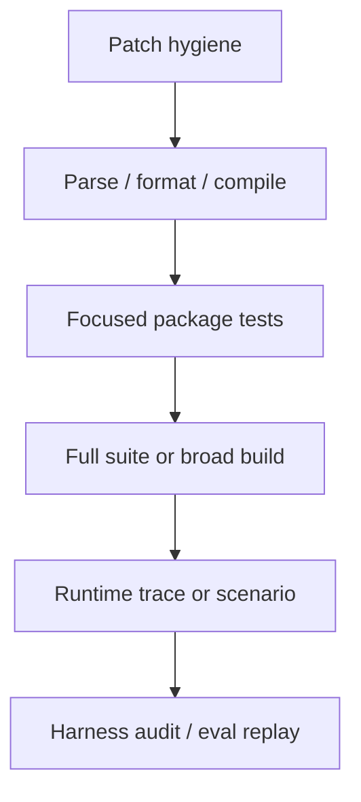
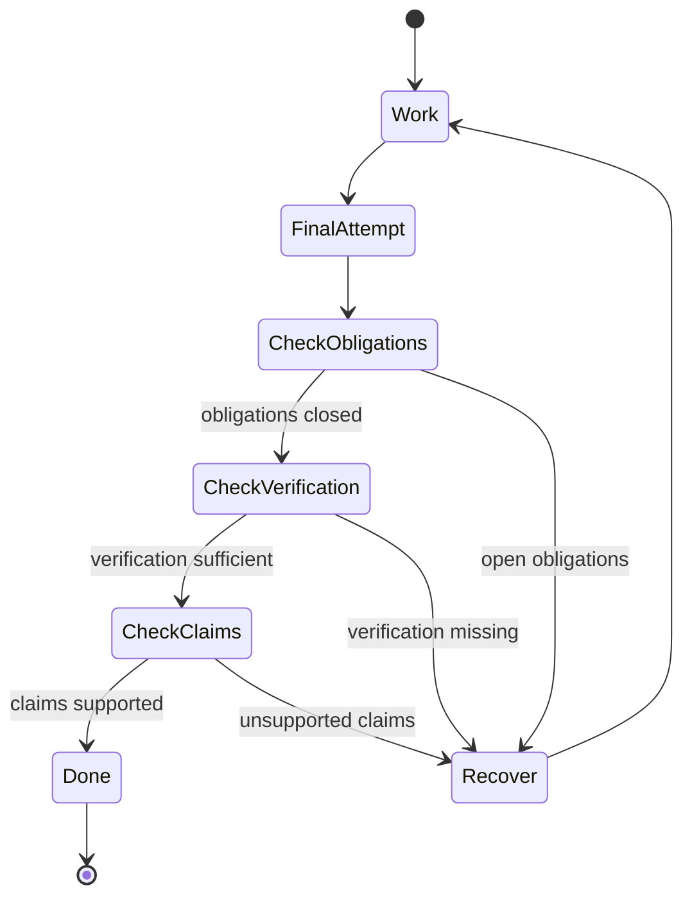

---
tags:
  - idiom
  - verification
  - readiness
  - completion
---

# Verification Readiness and Completion

Verification and readiness are the difference between "the model produced an
answer" and "the harness can support the claim that the work is done."

## Verification Principle

Verification must match the risk of the artifact.

`git diff --check` proves patch hygiene. It does not prove source correctness.
For source edits, Idiom expects source-aware verification such as focused tests,
builds, `source_sanity`, or a clear blocker explaining why verification could
not run.

A required verification command written in a brief or atom is an obligation, not
evidence. It becomes evidence only when the run records that the command
succeeded, such as a final answer line that cites the command and a pass,
success, `exit 0`, or `ok` result.

## Verification Ladder

Use the lowest rung that proves the claim, then climb when the blast radius
crosses shared behavior, prompt contracts, lane orchestration, tooling, routing,
or audit/eval logic.

## Readiness State

Readiness is computed from observable state:

- Task type.
- Required artifacts.
- Required edit paths.
- Actual file mutations.
- Open obligations.
- Evidence claims.
- Verification results.
- Tool failures or blockers.
- Final answer content.

The model can propose that it is done. The harness should decide whether that
proposal is supported.

## Completion Gate

## Verification By Change Type

| Change type | Minimum likely verification | Broader checks when |
| --- | --- | --- |
| Docs-only | Link/path sanity and `git diff --check` | Docs describe new behavior or release process |
| Package-local Go code | Focused `go test ./internal/<pkg>` | Shared contracts, exported API, runner/tooling behavior |
| CLI or entrypoint | Command smoke test, focused tests | Build wiring or flags change |
| Runner/control rails | Focused runner tests, behavior regressions | Any readiness, prompt, lane, or tool profile behavior changes |
| Workspace tools | Tool unit tests, schema/dispatch tests, source sanity | Permission, path role, or capability routing changes |
| Context memory | Context tool tests, freshness/cache checks | Packet contract, graph schema, ranking, or cache behavior changes |
| Eval/audit | Focused eval/audit fixture tests | Telemetry schemas or behavior classification changes |

Default repo verification for code changes is `go test ./...`; build wiring
changes should also run `make build` or `go build ./cmd/idiom`.

## System To Verification Matrix

| System changed | Focused verification | Broader verification |
| --- | --- | --- |
| Runner/control rails | `go test ./internal/agent` | `go test ./...`, `harness_audit` when behavior logs matter |
| Workspace tools | `go test ./internal/workspace` | Tool schema checks, sidecar smoke, `go test ./...` |
| Context memory | `go test ./internal/comprehension` | `context_status`, representative `context_pack`, `go test ./...` |
| Runtime lanes | `go test ./internal/lanecmd ./internal/planexecutecmd ./internal/implementcmd` with lane-focused tests | `go test ./internal/agent ./internal/workspace ./internal/lanecmd ./internal/planexecutecmd ./internal/implementcmd`, lane smoke where available |
| Audit/eval | `go test ./internal/eval ./cmd/idiom-eval ./cmd/idiom-swe-eval` | Representative suite, `harness_audit` |
| CLI/build wiring | focused command tests | `make build` or `go build ./cmd/idiom` |
| Docs-only | wiki-link/path checks, `git diff --check` | Broader tests only if docs accompany code behavior changes |

## Source Sanity

`source_sanity` is the harness route for source-aware checks. It should report:

- What files or packages were checked.
- What command or analyzer ran.
- Whether the result is proof, warning, or blocker.
- What remains unverified.

Current `source_sanity` should be understood as diagnostics or syntax sanity,
with generic checks as fallback. Focused tests and builds remain separate
verification evidence.

## Blockers Are Valid Terminal States

Completion does not always mean successful edits. A blocker is valid when:

- The harness can name the exact missing evidence or permission.
- The task cannot safely proceed without user input or environment change.
- The final answer does not pretend the requested work is complete.
- The blocker is recorded in a form audit can diagnose.

For design-doc atom dispatch, blocker-shaped answers are never atom completion.
Answers containing `<<QUESTION>>`, missing plan-artifact messages, planner
blockers, or required-path plan blockers leave the atom open.

## Design-Doc Atom Closeout

Design-doc atom closeout has an extra readiness layer because the atom doc is
also a local persisted work tracker.

An atom can be marked `completed` only when:

- The plan-execute answer is not a blocker.
- Required source edits or no-op source-satisfied evidence are present.
- Required verification commands are proven successful.
- Required design-doc test obligations have matching source or test evidence.

An atom can be marked `source-satisfied - do not dispatch` only when current
source already satisfies the target path and required test evidence is present.
The harness should not create whitespace or placeholder edits merely to satisfy
a write-shaped contract.

If verification commands remain unproven, the closeout should be a typed
`<<QUESTION>>` naming the pending commands. The atom doc should remain pending
so a later rerun can continue from the correct state.

## Documentation And Diagrams As Verification Aids

Mermaid diagrams are not proof by themselves, but they make contracts easier to
review. When architecture changes, update diagrams that explain:

- Runtime state transitions.
- Tool dispatch boundaries.
- Planning and handoff artifacts.
- Context graph flow.
- Audit/eval feedback loops.

## Related Notes

- [[02 - Deterministic Evidence-Based Development]]
- [[05 - Runner Contracts and Control Rails]]
- [[10 - Telemetry Audit Eval and Learning]]
- [[14 - Maintenance Playbooks]]
