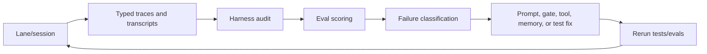
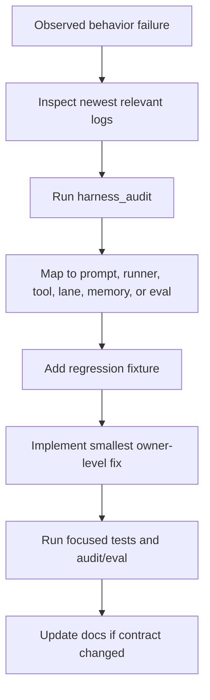

---
tags:
  - idiom
  - telemetry
  - audit
  - eval
  - learning-loop
---

# Telemetry Audit Eval and Learning

Telemetry, audit, and eval systems turn individual agent sessions into diagnosable and improvable behavior.

The goal is to make behavioral failures visible, replayable, and fixable.

## Evidence Flywheel

## Logged Evidence

Important evidence sources include:

- `.idiom/logs/conversations/*.jsonl`
- `logs/telemetry/*.jsonl`
- `.idiom/lane-history.jsonl`
- Lane stdout JSONL event streams.
- Harness audit output.
- Phase evidence from lanes.
- Tool request/result records.
- Completion gate records.
- Context packet identifiers.
- Eval result summaries.
- Ranker learning weights and learning log summaries.
- Audit-watch review packets.
- Product-evidence and release-evidence bundle identifiers.

For behavior bugs, start from logs and audit output before changing prompts or
control rails.

## Event Stream Map

| Stream | Contains | Does not necessarily contain |
| --- | --- | --- |
| Conversation logs | Prompt context, user/assistant/tool messages, tool requests/results, server/session events | Process-level command lifecycle |
| Telemetry logs | Process start/exit, command telemetry, redacted tool summaries, timing, audit/feedback context | Raw tool output or full prompt bodies |
| Lane stdout JSONL | Lane phase events intended for callers and scripts | All internal telemetry fields |
| `.idiom/lane-history.jsonl` | Compact lane diagnostics and history | Full transcript bodies |
| Phase evidence | Planner/executor/review proof for a specific lane run | General process telemetry |
| `graph_views` / context packet exports | Packet IDs, ranked evidence, freshness, provenance | Permission to edit those paths |
| Audit-watch packets | Debounced review packets from behavior triggers | Raw private transcript dumps by default |

Important correlation identifiers include `pack_id`, audit IDs, command IDs,
session IDs, sidecar metadata, lane phase IDs, and artifact IDs.

## Harness Audit

`harness_audit` is a diagnostic tool for the harness itself. It can surface:

- Tool surface and language coverage.
- Backend availability.
- Log behavior.
- Ranker learning state.
- Graph view cache state.
- Repeated-loop behavior.
- Malformed tool calls.
- Truncated searches.
- Completion and readiness issues.

Audit output should be treated as local diagnostic evidence. Before storing,
sharing, or committing audit artifacts, redact raw prompts, transcripts, log
excerpts, file bodies, secrets, and customer-identifying fields.

## Audit Is Not A Single Boolean

Do not treat an `all_clear` style summary as sufficient proof. Check:

- Gate coverage.
- Open obligation refs.
- Unresolved obligations.
- Invalid event warnings.
- Tool correlation findings.
- Sidecar correlation findings.
- Log freshness.
- Stale cache state.

## Eval System

`internal/eval` and the CLI eval commands support regression checks for agent
behavior. Evals should catch behavioral anti-patterns such as:

- Completion gate reopening discovery.
- Repeated low-value tool loops.
- Search truncation without follow-up strategy.
- Documentation wandering.
- Malformed edit args and retry loops.
- Incomplete implementation lifecycle.

## What To Do With A Behavioral Failure

## Ownership Of Fixes

| Failure shape | Likely owner |
| --- | --- |
| Tool schema invalid | `internal/workspace`, tool schema tests |
| Model sees wrong tools in phase | Lane orchestration, prompt profile, worker runtime catalog |
| Final answer with open obligations | Runner readiness/completion gate |
| Repeated low-value discovery | Runner redirects, eval detection, context tools |
| Stale packet or bad context | `internal/comprehension`, discovery tools, freshness checks |
| Behavior hidden in prose only | Typed contract, schema, gate, or telemetry |
| Audit cannot diagnose issue | Telemetry event schema or harness audit coverage |

## Learning Loop

The learning loop should improve the system in durable places:

- Ranking and packet quality.
- Capability routing.
- Prompt clarity.
- Gate and contract precision.
- Eval fixtures.
- Operator docs.
- Audit diagnostics.

Avoid one-off fixes that only handle the latest visible transcript while leaving
the class of failure unobservable.

## Ranker Learning

`context_pack` and `context_impact` rank candidate files with graph/path signals
plus per-workspace ranker weights under `.idiom/ranker/weights.json`.

Learning signals can come from:

- SWE/eval groundedness outcomes.
- Manual `idiom ranker boost` and `idiom ranker penalize` commands.
- Valid `idiom recover reconcile` outcomes, recorded as
  `source:"recovery_reconciliation"` no-op events with packet-quality,
  localization, completed/remaining atom, and verification metrics.
- Future verified edit, audit watch, and feedback promotion paths.

Every update should write a bounded event to
`.idiom/ranker/learning_log.jsonl`. `harness_audit` reports the merged learning
state so operators can see whether ranking is live, idle, or missing evidence.
Recovery reconciliation events are evidence-only and do not create or mutate
`.idiom/ranker/weights.json`.

Ranker learning is not a hidden strategy override. It changes evidence ordering
and should remain inspectable through packets, scores, learning logs, and audit
summaries.

## Related Notes

- [[07 - Repository Memory and Context Graph]]
- [[09 - Verification Readiness and Completion]]
- [[16 - Operational Commands and Evidence Products]]
- [[17 - Security Privacy and Data Boundaries]]
