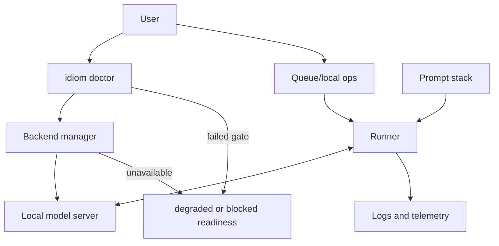

---
tags:
  - idiom
  - local-models
  - operations
---

# Local Model Operations

Idiom is designed for local coding-agent operation around models such as Qwen
served through local backends including llama.cpp, MLX, and Ollama-style
interfaces.

The model backend is important, but the trust story comes from the harness
around it: contracts, memory, tools, verification, telemetry, and evals.

## Local Ops Shape

## Operational Responsibilities

Local model operations include:

- Detecting available model backends.
- Starting or connecting to local inference servers.
- Managing role-aware backend profiles for planner, executor/coder, route
  classifier, summarizer, verifier/critic, and embedding/ranker roles*.
- Reporting readiness and degraded modes.
- Managing context budgets.
- Gating concurrent work through the local queue daemon.
- Keeping model weights, caches, and logs out of the target repo.
- Preserving privacy by default through local execution.
- Capturing enough telemetry for debugging without leaking sensitive content.

## Backend Independence

The harness should avoid binding strategic behavior to one backend. Backend
differences should be surfaced as capability or readiness differences:

- Model availability.
- Context length.
- Tool-call support.
- Streaming behavior.
- Performance constraints.
- Degraded mode warnings.

## Doctor And Backend Readiness

`idiom doctor` checks local prerequisites and readiness profiles for workflows
such as discovery, plan, implement, eval, and sidecar. Profiles report
`pass`, `degraded`, or `blocked` status, plus remedies.

Current readiness gates are partly report-only in the quickstart path. Treat a
doctor report as operator evidence and lane-start guidance, not as proof that a
later model run will succeed.

`*` marks roadmapped model roles.

Backend commands:

- `idiom backend start`
- `idiom backend stop`
- `idiom backend status`
- `idiom backend list`
- `idiom backend proxy`

## Prompt Stack

Prompt assembly should be explicit:

- Static baseline instructions.
- Project-specific instructions.
- Mode or profile instructions.
- Lane-specific contracts.
- Tool manifest.
- Runtime brief.
- Optional context packet.

Prompt layers should not duplicate ownership of invariants that belong in
schemas or gates.

## Queue And Batch Work

Queue/local ops surfaces let users run structured task flows without manually
driving every model turn. These flows still need:

- Scoped briefs.
- Tool profile controls.
- Artifacts and telemetry.
- Completion readiness.
- Verification or blockers.

The queue daemon is a per-user Unix-socket service. Lane entrypoints acquire a
lease when a daemon is reachable and proceed ungated when it is absent. This
keeps queue admission opportunistic rather than a hard dependency, while still
protecting scarce local GPU/Metal resources when configured.

Queue commands include:

- `idiom queue serve`
- `idiom queue run`
- `idiom queue status`
- `idiom queue ping`
- `idiom queue cancel`

## Degraded Mode

When a backend or capability is missing, Idiom should make that state explicit
instead of failing silently.

Examples:

- Language-aware backend unavailable.
- Context graph stale.
- Model server unreachable.
- Tool denied by phase profile.
- Verification command missing.

The right response is a typed blocker, fallback capability, or degraded-mode
notice, depending on the contract.

## Source Anchors

| Source | Why it matters |
| --- | --- |
| `cmd/idiom/doctor.go` | Host readiness and doctor command |
| `cmd/idiom/backend.go` | Backend command surface |
| `cmd/idiom/queue.go` | Queue command surface |
| `internal/backends` | Backend profiles, aliases, launcher, proxy |
| `internal/autodetect` | Host/model/backend discovery |
| `internal/runner` | Queue lease acquisition helpers |

## Related Notes

- [[16 - Operational Commands and Evidence Products]]
- [[18 - Prompt Stack and Profiles]]
- [[10 - Telemetry Audit Eval and Learning]]
