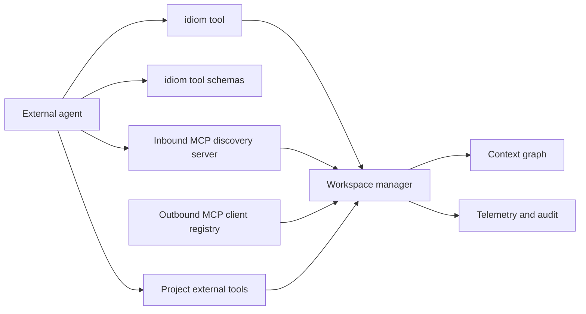

---
tags:
  - idiom
  - sidecar
  - mcp
  - integrations
---

# Sidecar and External Integrations

Idiom exposes repository-aware capabilities to external agents through CLI tool
commands, tool schemas, inbound MCP, outbound MCP client tools, and project
external tools.

The integration principle is reuse: external surfaces should share the same
schemas, permissions, freshness checks, telemetry, and audit paths as the local
runner.

## Integration Shape



## Why Sidecar Matters

External coding agents often lack durable repository context. Idiom can act as
the local substrate that gives those agents:

- Fresh context packets.
- Tool schemas.
- Workspace-safe operations.
- Capability discovery.
- Repository memory.
- Verification routes.
- Audit evidence.

This turns Idiom from a single chat surface into reusable agent infrastructure.

## CLI Tool Surface

The CLI tool surface uses:

```bash
idiom tool list
idiom tool help
idiom tool schemas
idiom tool <tool-name> --input '<json>'
```

The result envelope contains the tool name, summary, output, and error fields.
Exit code is 0 when the tool itself succeeds and 1 when the tool reports an
error.

## MCP Surfaces

There are two MCP-related boundaries:

- Inbound MCP server: `cmd/idiom mcp serve` exposes selected Idiom tools to
  external clients. Current inbound MCP requires stdio and is filtered toward
  discovery/context profile surfaces.
- Outbound MCP client registry: `internal/mcp` owns clients and registry
  behavior for calling configured external MCP tools, surfaced as
  `mcp:<server>/<tool>` style tools.

Do not collapse these into one ownership boundary when reviewing or changing
the code.

The MCP surface should mirror the same contract:

- Machine-readable schemas.
- Permission checks.
- Project config.
- Context freshness.
- Tool result normalization.
- Telemetry and audit correlation.

Avoid implementing a second, less-safe version of a tool just for external
clients.

## Current MCP Status And Limits

The inbound MCP server is experimental. Current docs describe support for stdio
requests such as `initialize`, `tools/list`, `tools/call`, `roots/list`,
`resources/list`, and metadata-only `resources/read`.

Current limitations include:

- Resource file bodies are not returned yet.
- Resource paths are root-clamped and protected locations are denied.
- Full resource/freshness parity remains later work.
- Tool exposure is filtered by profile, with discovery/context surfaces favored
  for MCP.
- Telemetry and permission behavior should be checked against the CLI sidecar
  path when changing MCP behavior.

## Project External Tools

Projects can define external tools under `.idiom/external_tools/<name>.json`.
These definitions include schema and safety metadata and are loaded by the
workspace external tool registry.

Treat project external tools as an integration boundary:

- They should go through the same permission and path-role checks.
- Their outputs should be normalized as evidence.
- Their schemas should be reviewable.
- Their side effects should be explicit.

## External Agent Guidance

External agents should:

- Start with `context_pack` for repo localization.
- Use stable task strings to reuse cache.
- Ask capabilities before falling back to broad file reads.
- Treat packets as evidence, not write scope.
- Use `context_status` when freshness matters.
- Use `harness_audit` for behavior diagnostics.
- Run source-aware verification after edits.

## Privacy And Redaction

Sidecar and audit surfaces should be careful with raw content:

- Do not publish raw transcripts by default.
- Redact secrets and customer-identifying data.
- Prefer aggregate counts, paths, command IDs, session IDs, and structured
  findings for shared diagnostics.
- Preserve enough evidence for reproduction without leaking sensitive text.

## Integration Checklist

When adding or changing an integration:

- Reuse existing workspace tools where possible.
- Add or update schemas.
- Enforce path and permission rules.
- Emit telemetry that can be correlated with runner/lane events.
- Document degraded modes.
- Add tests for protocol and permission behavior.

## Source Anchors

| Source | Why it matters |
| --- | --- |
| `cmd/idiom/mcp.go` | Inbound MCP server command |
| `internal/mcp/client.go` | Outbound MCP client behavior |
| `internal/mcp/registry.go` | Outbound MCP registry |
| `internal/workspace/tool_schema_export.go` | Tool schema export and MCP/profile filtering |
| `internal/workspace/external_tool.go` | Project external tool definitions |

## Related Notes

- [[06 - Workspace Tools and Capability Routing]]
- [[07 - Repository Memory and Context Graph]]
- [[17 - Security Privacy and Data Boundaries]]
- [[19 - CLI TUI and Operator Surface]]
