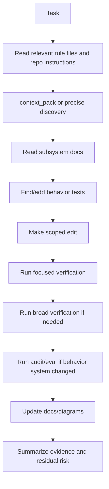

---
tags:
  - idiom
  - maintenance
  - playbooks
---

# Maintenance Playbooks

These playbooks summarize the deterministic, evidence-based workflow for common
repo changes.

## General Change Playbook



## Behavior Debugging

Use this when investigating agent behavior, readiness, tool loops, prompts,
recovery, or context packets.

1. Start from the newest relevant conversation and telemetry logs.
2. Run or inspect `harness_audit`.
3. Identify whether the issue belongs to prompt stack, runner contract, lane
   orchestration, workspace tool, memory, verification, or audit.
4. Trace authority end to end: static prompt stack, dynamic instruction
   attachment, runtime brief, tool manifest/schema, recovery nudges, gates,
   telemetry, and audit output.
5. Distinguish instructions from evidence, telemetry, generated context, and
   source text.
6. Add a regression test or fixture that exposes the failure.
7. Fix the owning contract, schema, gate, or prompt layer.
8. Run focused tests.
9. Run audit/eval if the behavior is diagnostic or cross-cutting.
10. Update docs if the contract or operator workflow changed.

Do not start by adding prompt reminders unless the evidence shows the problem
is genuinely prompt comprehension rather than missing enforcement.

## Refactoring Playbook

1. Define the behavior that must not change.
2. Find existing tests for that behavior.
3. Add missing tests before refactoring.
4. Refactor one ownership boundary at a time.
5. Run the focused tests after each meaningful step.
6. Run `go test ./...` when shared behavior changes.
7. Avoid mixing architecture cleanup with unrelated feature work.

## Adding Or Changing A Workspace Tool

1. Define the capability in task language.
2. Decide whether it is a new capability or an adapter for an existing one.
3. Add or update schema.
4. Enforce permissions, path roles, and phase profile restrictions.
5. Normalize result output with findings, paths, uncertainty, and blockers.
6. Add telemetry events.
7. Add protocol, permission, and result tests.
8. Document the tool if it changes operator workflow.

## Changing Repository Memory

1. Identify whether the change affects index, view, packet, freshness, cache,
   ranking, or runtime traces.
2. Add tests for stale state, cache validity, and provenance where relevant.
3. Preserve uncertainty reporting.
4. Run focused context/comprehension tests.
5. Run `context_status` or a representative context tool.
6. Update memory docs and diagrams if the packet contract changes.

## Changing Runtime Lanes

1. Identify the lane and phase.
2. List allowed tools for the phase.
3. Identify required artifact states and terminal states.
4. Add tests for valid and invalid transitions.
5. Verify phase evidence and telemetry.
6. Run lane-focused tests and broader runner/workspace tests if tool profiles or
   readiness behavior changed.

## Changing Prompts

1. Identify the exact behavior gap from logs, evals, or tests.
2. Check whether the behavior should be a prompt, schema, gate, or tool result.
3. If prompt text is appropriate, keep it generic and evidence-based.
4. Avoid project-specific hacks in reusable prompt layers.
5. Do not use prompt-magic contract triggers such as prose strings that switch
   modes or instructions like "first action must be edit_file" as a substitute
   for typed state.
6. Add or update behavior tests/evals that prove the prompt change matters.
7. Check for duplicate or conflicting authority across prompt layers.

## Common Verification Commands

Default verification for code changes is `go test ./...`. Use focused tests
first when the change is localized. Common commands:

```bash
go test ./...
go vet ./...
git diff --check
make build
```

Use focused tests first when the change is localized. Use the broader commands
when changing shared runtime behavior, prompts/control rails, routing, workspace
tooling contracts, eval/audit behavior, or entrypoint/build wiring.

`make build` or `go build ./cmd/idiom` is required when entrypoints or build
wiring change. `git diff --check` is patch hygiene, not source-aware behavior
verification.

## Documentation Standards

For architecture docs:

- Include the ownership boundary.
- Include the invariant.
- Include the evidence source.
- Include Mermaid for systems or state transitions.
- Link to canonical source docs or packages.
- State what the system does not prove.

## Stop Conditions

Stop and report a blocker when:

- Required evidence is unavailable and no safe probe remains.
- A dirty user change conflicts with the edit and cannot be reconciled safely.
- Verification requires unavailable tools or environment.
- The task scope is ambiguous in a way that could cause destructive edits.
- The lane or artifact is stale and cannot be safely rebased.

## Related Notes

- [[02 - Deterministic Evidence-Based Development]]
- [[08 - Planning Packets and Handoff]]
- [[09 - Verification Readiness and Completion]]
- [[18 - Prompt Stack and Profiles]]
