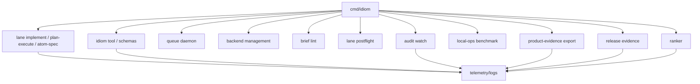

---
tags:
  - idiom
  - operations
  - evidence-products
  - commands
---

# Operational Commands and Evidence Products

Idiom has several operator-facing command surfaces in addition to the main TUI
and lane commands. They exist to make local agent work dispatchable,
inspectable, reproducible, and reviewable.

## Command Surface Map



## Queue

`idiom queue` gates concurrent work against per-pool caps so local model
backends do not crash or thrash under multiple simultaneous lanes.

Key commands:

- `idiom queue serve`
- `idiom queue run`
- `idiom queue status`
- `idiom queue ping`
- `idiom queue cancel`

Lane entrypoints acquire a lease when the daemon is reachable. If no daemon is
running, the lane proceeds without queue gating. That makes the queue a
readiness and capacity feature, not a required server dependency.

## Backend Commands

`idiom backend start|stop|status|list|proxy` manages local inference roles and
backend processes. Backend readiness belongs in local operations evidence and
should be reported as pass, degraded, or blocked rather than hidden in a failed
model call.

## Plan-Execute Progress State

Direct `idiom plan-execute` writes a durable progress state for each session
under `.idiom/plan-execute/sessions/<session-id>.json`. The state records the
schema version, session ID, prompt hash, prompt file, phase, status, required
and allowed edit paths, plan path, `pack_id`, changed paths, executor evidence,
source-sanity checks, and review-repair status.

When a saved progress state is `failed`, plan-execute also writes recovery
artifacts under `.idiom/recovery/<failure-id>/`: `failure.json` for the
classified failure record and `packet.json` for candidate recovery atoms.
Operators inspect or promote these artifacts through:

```bash
idiom recover inspect --session <session-id> --json
idiom recover decompose --session <session-id> --json
idiom recover status --packet .idiom/recovery/<failure-id>/packet.json --json
idiom recover promote --packet .idiom/recovery/<failure-id>/packet.json --atom recovery-001 --output briefs/recovery-001.md
idiom recover reconcile --packet .idiom/recovery/<failure-id>/packet.json --completed recovery-001 --json
```

Read-only recovery state is also sidecar-visible:

```bash
idiom tool recovery_inspect --profile discovery --input '{"session_id":"<session-id>"}'
idiom tool recovery_status --profile discovery --input '{"packet_path":".idiom/recovery/<failure-id>/packet.json"}'
```

`recovery_decompose` writes local `.idiom/recovery` artifacts, so it is exposed
only through the default tool profile and rejects output paths that leave the
workspace or traverse symlinked directories. CLI `recover decompose --output`
also rejects protected paths such as `.git`, `logs`, `.env`, and
`config.json`, plus recovery control artifacts such as `failure.json` and
`reconciliation.json`. `recovery_promote` and `recovery_reconcile` remain
CLI-only.

Product workflow status can surface recovery packets when durable
`workflow_state.json` includes `artifact_paths.recovery_packet`. The shared
operator status view exposes recovery packet status, gates, required tests,
product links, blockers, reconciliation counts, and a runnable
`idiom recover status --packet ...` hint. While a recovery packet is open,
normal workflow continuation actions are not dispatchable. A reconciliation
artifact closes the blocker only when its packet digest, completed/remaining
atom manifest, and required-test command results validate against the current
packet.

Product and release evidence exports also scan local `.idiom/recovery`
artifacts. They report metadata-only recovery counts, failure classes, next
actions, reconciliation counts, open/recovered/blocked packet counts,
release-impact status, and blockers. Open packets make recovery visible as
partial release-impact evidence; malformed, missing, or stale recovery artifacts
block the export without loading raw prompts, transcripts, or file bodies.

Relevant JSON events include:

- `idiom.plan_execute.resume_state_saved`
- `idiom.plan_execute.resume_state_loaded`
- `idiom.plan_execute.writer_route_decision`
- `idiom.plan_execute.required_edit_paths_resolved`
- `idiom.plan_execute.recovery_failure_record_written`
- `idiom.plan_execute.recovery_decomposition_packet_written`
- `idiom.plan_execute.recovery_failure_record_failed`
- `idiom.plan_execute.recovery_decomposition_packet_failed`

`idiom plan-execute --resume <session-id>` is intentionally strict. It fails if
the progress file does not exist, if the supplied prompt or prompt file does not
match the saved prompt hash, or if the saved phase/status is not
review-resumable. This prevents an operator typo from silently starting a fresh
run and losing the state needed to review or repair prior work.

## Brief Lint

`idiom brief lint <brief.md>` runs deterministic pre-dispatch checks on
implementation briefs. It catches:

- Multi-purpose or under-scoped briefs.
- Prompt-magic contract triggers.
- Unsafe content fences.
- Missing verified-current-state sections.
- Missing exact anchors for required edit paths.
- Plan-execute edit-shape gaps.

Brief lint exists because vague briefs cause expensive local-model loops. It
does not replace runtime contracts; it rejects or warns before dispatch.

## Lane Postflight

`idiom lane postflight --diff <patch>` is a QC surface for returned diffs. It
is part of the review loop around lanes and should remain tied to source-aware
verification when code behavior changes.

## Audit Watch

`idiom audit watch` polls telemetry and conversation JSONL streams, debounces
high-signal trigger events, runs behavior audits, and writes review packets
under `.idiom/audits/watch`.

Useful triggers include:

- Completed implement processes.
- Completion-gate records.
- High-risk stop reasons.
- Malformed tool input.
- Stale-context reports.
- Recovery failure-record and decomposition-packet events.
- `harness_feedback` events.

Audit watch is a local monitoring loop. It should emit deterministic review
packets, not raw prompt or transcript dumps. When recovery events trigger a
review, the packet includes a bounded `recovery` summary with failure classes,
candidate atom counts, next valid actions, sessions, and artifact paths.

## Product Evidence Export

`idiom product-evidence export` writes a local go/no-go report for product
review. It reports contracts, IDs, hashes, counts, statuses, class coverage,
redaction status, limitations, recovery rollups, and release-gate linkage.

It should not include:

- Prompt bodies.
- Chat transcript bodies.
- File bodies.
- Secrets or credentials.
- Private absolute paths.
- Private repo URLs.
- Partner or customer identifiers.
- Unredacted telemetry paths.

## Release Evidence

`idiom release evidence` creates a release evidence bundle. It compares
baseline/current command artifacts and summarizes validation, audit/security,
local-ops, benchmark, sidecar integration, product-evidence export, and client
classification coverage.

Release evidence should cite bounded IDs, hashes, relative paths, statuses, and
blockers rather than raw private content.

## Ranker Commands

`idiom ranker` is the manual control surface for context ranking learning.

Commands include:

- `idiom ranker boost`
- `idiom ranker penalize`
- `idiom ranker show`
- `idiom ranker reset`

Manual ranker changes write to the same learning log as eval-triggered updates
so audit can distinguish source, reason, and effect.

## Evidence Product Rule

Operational evidence products should answer:

- What ran?
- What changed?
- What was verified?
- What remains blocked?
- What evidence IDs, hashes, counts, and statuses support the result?
- Which private content was deliberately excluded?

They should not tell the model or reviewer what strategy to choose next except
where a typed invariant blocks progress.

## TUI And Prompt Dispatch Evidence

TUI/prompt implementation dispatch is observable through debug logs and the
materialized atom docs it writes. Important evidence paths include:

- `.idiom/atoms/<title>/atom-NNN.md` for generated atom briefs and local
  persisted closeout status.
- `.idiom/refine/<title>/accepted.md` for refined dispatchable briefs.
- `logs/conversations/*.jsonl` for `dispatch_atomize`, `dispatch_refine`, and
  `dispatch_source_satisfied` messages.
- `logs/telemetry/*.jsonl` for command/process lifecycle evidence.

The local persisted atom status is the operator-facing state for "what remains
to do" when the same design doc is run again. Closed atoms should be skipped;
pending atoms should be refined, preflighted, and dispatched; blockers should
remain visible instead of being marked complete.

## Product Workflow Effort Evidence

The product workflow stores each design doc or product effort as one effort
folder under a status bucket. The current durable PRD/ADR/brief workflow effort
is under `docs/product-workflows/efforts/closed/prd-adr-brief-workflow/`, while
its workflow state and effort index preserve the prior `started` path as
history:

- `.idiom/product/efforts/unstarted/<effort-id>/...`
- `.idiom/product/efforts/started/<effort-id>/...`
- `.idiom/product/efforts/closed/<effort-id>/...`

Accepted artifacts can be promoted to matching durable folders under
`docs/product-workflows/efforts/<status>/<effort-id>/...`. Effort indexes should
map stable effort IDs to their current status folder and prior paths. Evidence
products should cite effort IDs, status buckets, relative paths, hashes, and
promotion status rather than relying on the current folder path as identity.

## Related Notes

- [[10 - Telemetry Audit Eval and Learning]]
- [[11 - Local Model Operations]]
- [[17 - Security Privacy and Data Boundaries]]
- [[19 - CLI TUI and Operator Surface]]
