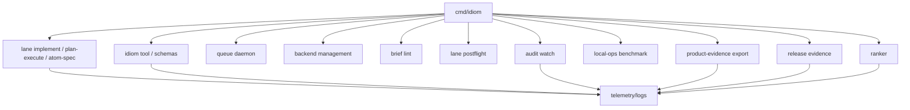

---
tags:
  - idiom
  - operations
  - evidence-products
  - commands
---

# Operational Commands and Evidence Products

Idiom has several operator-facing command surfaces in addition to the main TUI
and lane commands. They exist to make local agent work dispatchable,
inspectable, reproducible, and reviewable.

## Command Surface Map

## Queue

`idiom queue` gates concurrent work against per-pool caps so local model
backends do not crash or thrash under multiple simultaneous lanes.

Key commands:

- `idiom queue serve`
- `idiom queue run`
- `idiom queue status`
- `idiom queue ping`
- `idiom queue cancel`

Lane entrypoints acquire a lease when the daemon is reachable. If no daemon is
running, the lane proceeds without queue gating. That makes the queue a
readiness and capacity feature, not a required server dependency.

## Backend Commands

`idiom backend start|stop|status|list|proxy` manages local inference roles and
backend processes. Backend readiness belongs in local operations evidence and
should be reported as pass, degraded, or blocked rather than hidden in a failed
model call.

## Brief Lint

`idiom brief lint <brief.md>` runs deterministic pre-dispatch checks on
implementation briefs. It catches:

- Multi-purpose or under-scoped briefs.
- Prompt-magic contract triggers.
- Unsafe content fences.
- Missing verified-current-state sections.
- Missing exact anchors for required edit paths.
- Plan-execute edit-shape gaps.

Brief lint exists because vague briefs cause expensive local-model loops. It
does not replace runtime contracts; it rejects or warns before dispatch.

## Lane Postflight

`idiom lane postflight --diff <patch>` is a QC surface for returned diffs. It
is part of the review loop around lanes and should remain tied to source-aware
verification when code behavior changes.

## Audit Watch

`idiom audit watch` polls telemetry and conversation JSONL streams, debounces
high-signal trigger events, runs behavior audits, and writes review packets
under `.idiom/audits/watch`.

Useful triggers include:

- Completed implement processes.
- Completion-gate records.
- High-risk stop reasons.
- Malformed tool input.
- Stale-context reports.
- `harness_feedback` events.

Audit watch is a local monitoring loop. It should emit deterministic review
packets, not raw prompt or transcript dumps.

## Product Evidence Export

`idiom product-evidence export` writes a local go/no-go report for product
review. It reports contracts, IDs, hashes, counts, statuses, class coverage,
redaction status, limitations, and release-gate linkage.

It should not include:

- Prompt bodies.
- Chat transcript bodies.
- File bodies.
- Secrets or credentials.
- Private absolute paths.
- Private repo URLs.
- Partner or customer identifiers.
- Unredacted telemetry paths.

## Release Evidence

`idiom release evidence` creates a release evidence bundle. It compares
baseline/current command artifacts and summarizes validation, audit/security,
local-ops, benchmark, sidecar integration, product-evidence export, and client
classification coverage.

Release evidence should cite bounded IDs, hashes, relative paths, statuses, and
blockers rather than raw private content.

## Ranker Commands

`idiom ranker` is the manual control surface for context ranking learning.

Commands include:

- `idiom ranker boost`
- `idiom ranker penalize`
- `idiom ranker show`
- `idiom ranker reset`

Manual ranker changes write to the same learning log as eval-triggered updates
so audit can distinguish source, reason, and effect.

## Evidence Product Rule

Operational evidence products should answer:

- What ran?
- What changed?
- What was verified?
- What remains blocked?
- What evidence IDs, hashes, counts, and statuses support the result?
- Which private content was deliberately excluded?

They should not tell the model or reviewer what strategy to choose next except
where a typed invariant blocks progress.

## Related Notes

- [[10 - Telemetry Audit Eval and Learning]]
- [[11 - Local Model Operations]]
- [[17 - Security Privacy and Data Boundaries]]
- [[19 - CLI TUI and Operator Surface]]
