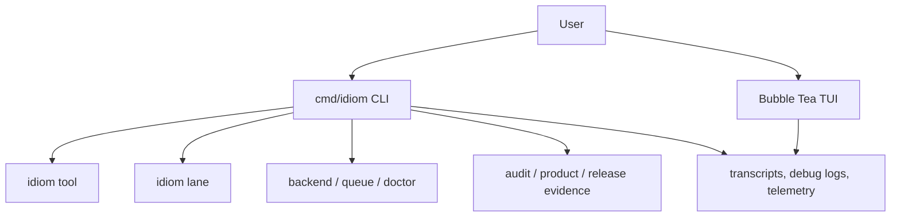

---
tags:
  - idiom
  - cli
  - tui
  - operator
---

# CLI TUI and Operator Surface

Idiom exposes both an interactive TUI and structured CLI commands. The TUI is
for live local sessions. The CLI is for repeatable lanes, tools, evidence
exports, sidecar use, and automation.

## Current State

The actively maintained repeatable path is the CLI: `idiom lane`, direct
`idiom plan-execute`, sidecar `idiom tool`, and evidence/audit commands. These
surfaces emit structured events and are the right fit for automation,
regression repros, and externally orchestrated runs.

The TUI remains an interactive operator surface, not a separate workflow engine.
Interactive sends call the same `RunPromptOnce` path used by prompt-mode CLI
runs, so current prompt routing, writer-route decisions, debug logs, and
implementation dispatch behavior are shared. The TUI should still be treated as
less automation-friendly than the CLI because it is optimized for live local
sessions.

When `chat.implementation_dispatch` is `plan_execute`, the session is in build
mode, and writes are enabled, implementation-like TUI or prompt-mode turns can
route referenced design docs through plan-execute instead of asking the model to
free-form implement the document. That dispatch path resolves the referenced
markdown, preflights it, refines or atomizes when needed, and then executes
dispatchable atoms through plan-execute.

This is pre-dispatch decomposition. Idiom does not yet have the separate
post-failure workflow described in [[23 - Decompose On Failure PROPOSAL]], which
would turn a failed run into a durable failure record, classified failure shape,
smaller recovery atoms, and reconciliation back to the original failed atom.

## Operator Surface Map

## Main CLI Families

| Command family | Purpose |
| --- | --- |
| `idiom doctor` | Host and workflow readiness evidence |
| `idiom lane` | Structured lane execution |
| `idiom plan-execute` | Direct planner/executor orchestration with durable progress state |
| `idiom tool` | Sidecar/tool invocation and schemas |
| `idiom backend` | Local backend process/profile operations |
| `idiom queue` | Concurrency leases for local model resources |
| `idiom atom` | Atom/spec intake and classification |
| `idiom brief lint` | Pre-dispatch brief linting |
| `idiom lane postflight` | Diff QC after lane output |
| `idiom local-ops benchmark` | Activation and local readiness evidence |
| `idiom product-evidence export` | Product go/no-go evidence |
| `idiom release evidence` | Release evidence bundle |
| `idiom audit watch` | Local behavior monitoring and review packets |
| `idiom ranker` | Ranker learning inspection and manual adjustment |
| `idiom mcp serve` | Experimental inbound MCP stdio server |

## TUI Controls

Common controls include:

- `Ctrl+S`: save transcript.
- `Ctrl+T`: cycle panel tabs.
- `/help`: show slash commands.
- `/debuglog [mode redacted|full]`: show or change debug log mode.
- `/trace [compact|detail]`: compact or detailed visible tool trace.
- `/profile list|add|remove`: manage active profiles.
- `/resume [id]`: resume a prior session by ID or open the session picker.

The default debug mode is redacted. Full mode is for local deep debugging and
can retain sensitive content.

## TUI Design-Doc Dispatch

The TUI can now handle a prompt such as "start implementing docs/plan.md" as a
first-class workflow when implementation dispatch is enabled:

1. Resolve the referenced markdown file unambiguously.
2. Run deterministic preflight through atom intake and brief lint.
3. Refine non-dispatchable briefs when refine can produce a lint-clean accepted
   brief.
4. Atomize broad design docs into `.idiom/atoms/<title>/atom-NNN.md`.
5. Add current-state anchors for existing files and mark missing-path atoms as
   `NEW FILE`.
6. Dispatch each non-terminal atom through plan-execute.
7. Mark atom docs complete or source-satisfied only when the answer is not a
   blocker and verification obligations are proven.
8. Skip atom docs whose status is already terminal.

Terminal atom statuses include `completed`, `complete`, `accepted`, `closed`,
`source-satisfied`, `source satisfied`, and any status containing
`do not dispatch`.

This is deliberately a harness-owned workflow. The model still owns strategy
inside the planner/executor phases, but document resolution, atom materializing,
terminal-state detection, source-satisfied classification, and closeout writes
belong to the TUI/prompt harness path.

## Product Workflow UX Contract

For the partially implemented PRD/ADR/TDD product workflow, the TUI is still a
target presenter over the same application use cases as the CLI. The CLI has a
shared operator status view model, effort browsing, and status migration; the
TUI continuation/handoff fixtures remain open delivery work. A TUI action such
as capture, start, continue, promote, dispatch, or close should resolve a stable
effort ID, render the shared status view model, advance exactly one valid
action, reconcile state from artifacts and evidence, and then render the next
valid action.

Efforts should be browsable by coarse status folders:

- `.idiom/product/efforts/unstarted/<effort-id>/...`
- `.idiom/product/efforts/started/<effort-id>/...`
- `.idiom/product/efforts/closed/<effort-id>/...`

Accepted effort artifacts may be promoted to matching durable folders under
`docs/product-workflows/efforts/<status>/<effort-id>/...`. The effort ID, not the
current folder path, is the stable identity. Status migration should update the
effort index and move the whole effort folder so reviewers can browse by status
without scattering one design doc's artifacts.

The TUI should not infer progress from transcript text. It should read
`workflow_state.json`, the effort index, lane history, plan-execute progress
state, atom tracker docs, telemetry, and evidence export IDs through application
adapters. If those sources disagree, the user should see a reconciliation
blocker rather than a dispatch button.

The first-run UX promise should be conservative: a happy-path fixture should work
from capture through status browsing and close, while real incomplete work should
fail closed with a typed blocker and one clear next action. The TUI should not
promise flawless autonomous completion for arbitrary complex features on the
first try.

## Resume And Session State

Generic prompt `--resume` replays prior user/assistant messages into a new
run's history. Workspace plan, workflow, and task-memory state can resume from
their own persisted stores. Do not assume resuming the transcript alone
recreates every workspace artifact or lane state.

Direct `idiom plan-execute --resume <session-id>` is stricter. It loads the
progress file at `.idiom/plan-execute/sessions/<session-id>.json`, verifies the
prompt hash against the supplied prompt or prompt file, and resumes only
review-resumable state. Missing progress state is a hard error rather than a
silent fresh run.

## Command Telemetry

CLI commands emit local telemetry under `logs/telemetry` unless disabled.
Telemetry records command names, timing, redacted arguments, output sizes,
errors, and structured context fields. It should not persist raw tool output by
default.

## Source Anchors

| Source | Why it matters |
| --- | --- |
| `cmd/idiom/main.go` | Main CLI routing and telemetry naming |
| `cmd/idiom/lane.go` | Lane command surface |
| `cmd/idiom/plan_execute.go` | Direct plan-execute orchestration and resume-state handling |
| `cmd/idiom/mcp.go` | Inbound MCP command |
| `internal/app/model_state.go` | Slash command handling |
| `internal/app/implementation_dispatch.go` | TUI/prompt design-doc dispatch, atomization, source-satisfied closeout |
| `internal/app/lifecycle.go` | TUI lifecycle, transcripts, debug logs |
| `internal/planexecute/progress.go` | Durable plan-execute progress state schema |
| `internal/transcript` | Transcript and debug log records |

## Related Notes

- [[04 - Runtime Lanes]]
- [[08 - Planning Packets and Handoff]]
- [[09 - Verification Readiness and Completion]]
- [[12 - Sidecar and External Integrations]]
- [[14 - Maintenance Playbooks]]
- [[16 - Operational Commands and Evidence Products]]
- [[18 - Prompt Stack and Profiles]]
