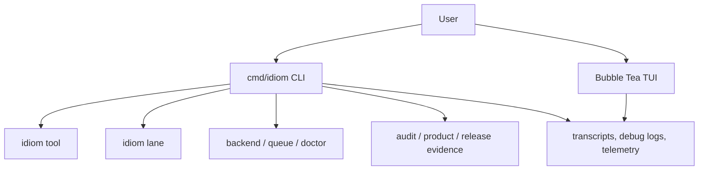

---
tags:
  - idiom
  - cli
  - tui
  - operator
---

# CLI TUI and Operator Surface

Idiom exposes both an interactive TUI and structured CLI commands. The TUI is
for live local sessions. The CLI is for repeatable lanes, tools, evidence
exports, sidecar use, and automation.

## Operator Surface Map

## Main CLI Families

| Command family | Purpose |
| --- | --- |
| `idiom doctor` | Host and workflow readiness evidence |
| `idiom lane` | Structured lane execution |
| `idiom tool` | Sidecar/tool invocation and schemas |
| `idiom backend` | Local backend process/profile operations |
| `idiom queue` | Concurrency leases for local model resources |
| `idiom atom` | Atom/spec intake and classification |
| `idiom brief lint` | Pre-dispatch brief linting |
| `idiom lane postflight` | Diff QC after lane output |
| `idiom local-ops benchmark` | Activation and local readiness evidence |
| `idiom product-evidence export` | Product go/no-go evidence |
| `idiom release evidence` | Release evidence bundle |
| `idiom audit watch` | Local behavior monitoring and review packets |
| `idiom ranker` | Ranker learning inspection and manual adjustment |
| `idiom mcp serve` | Experimental inbound MCP stdio server |

## TUI Controls

Common controls include:

- `Ctrl+S`: save transcript.
- `Ctrl+T`: cycle panel tabs.
- `/help`: show slash commands.
- `/debuglog [mode redacted|full]`: show or change debug log mode.
- `/trace [compact|detail]`: compact or detailed visible tool trace.
- `/profile list|add|remove`: manage active profiles.
- `/resume [id]`: resume a prior session by ID or open the session picker.

The default debug mode is redacted. Full mode is for local deep debugging and
can retain sensitive content.

## Resume And Session State

`--resume` replays prior user/assistant messages into a new run's history.
Workspace plan, workflow, and task-memory state can resume from their own
persisted stores. Do not assume resuming the transcript alone recreates every
workspace artifact or lane state.

## Command Telemetry

CLI commands emit local telemetry under `logs/telemetry` unless disabled.
Telemetry records command names, timing, redacted arguments, output sizes,
errors, and structured context fields. It should not persist raw tool output by
default.

## Source Anchors

| Source | Why it matters |
| --- | --- |
| `cmd/idiom/main.go` | Main CLI routing and telemetry naming |
| `cmd/idiom/lane.go` | Lane command surface |
| `cmd/idiom/plan_execute.go` | Plan-execute orchestration |
| `cmd/idiom/mcp.go` | Inbound MCP command |
| `internal/app/model_state.go` | Slash command handling |
| `internal/app/lifecycle.go` | TUI lifecycle, transcripts, debug logs |
| `internal/transcript` | Transcript and debug log records |

## Related Notes

- [[04 - Runtime Lanes]]
- [[12 - Sidecar and External Integrations]]
- [[16 - Operational Commands and Evidence Products]]
- [[18 - Prompt Stack and Profiles]]
