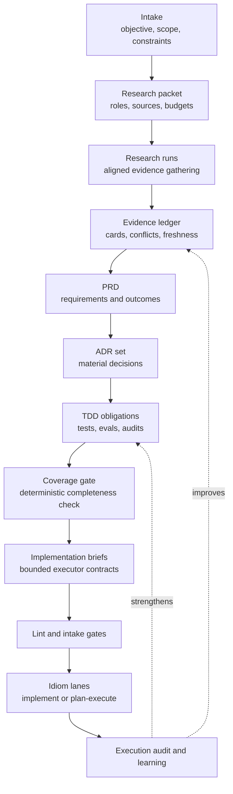
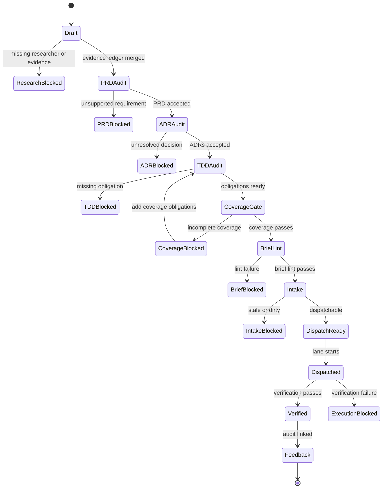

# PROPOSAL: PRD to ADR to Brief Research Workflow

> **Status: PROPOSAL** — This is an upstream artifact pipeline design that has
> not yet been implemented. It depends on the seven pillar designs and should be
> built incrementally alongside them.
>
> Source: [design-prd-adr-brief-research-workflow.md](../design-prd-adr-brief-research-workflow.md)

## What This Proposes

A first-class product-decision pipeline that turns aligned research evidence into
traceable PRDs, ADRs, TDD obligations, and dispatch-ready Idiom implementation
briefs.

```text
research evidence -> PRD -> ADR set -> TDD obligations -> Idiom brief
```

## Why

Implementation briefs are the practical entrypoint for Idiom lanes, but
high-quality briefs require upstream work that is not currently represented as a
durable workflow: evidence gathering, architectural decisions, test design, and
conflict resolution all happen ad hoc instead of through auditable artifacts.

The brief should be a bounded executor contract, not a miniature product process.

## The Lifecycle



## TODO: Core Concepts

- [ ] **Researcher model**: bounded model passes configured with alignment,
  scope, evidence sources, and output contracts
- [ ] **Evidence cards**: structured findings with source handles, confidence,
  freshness, uncertainty, and conflicts
- [ ] **PRD**: product requirements with traceable evidence references
- [ ] **ADR**: architecture decision records for material technical/product
  choices
- [ ] **TDD obligation plan**: test obligations derived before implementation
- [ ] **Coverage gate**: deterministic completeness check between TDD and brief
  generation (see [[21 - Behavioral TDD Coverage PROPOSAL]])
- [ ] **Brief**: the executable Idiom entrypoint consumed by `implement` or
  `plan-execute`

## TODO: Researcher Roles

| Role | Alignment | Primary Question |
| --- | --- | --- |
| `north_star` | strategy/contract fit | Does this strengthen Idiom's substrate? |
| `product` | user value and workflow fit | What user problem does this solve? |
| `technical` | architecture and implementation risk | What contracts, boundaries, migration are needed? |
| `tdd_eval` | behavior and verification | What failure modes exist at the contract boundary? |
| `domain:<name>` | project-specific domain lens | Which domain invariants and traps apply? |

## TODO: Artifact Schemas

### PRD

Location: `.idiom/product/<task-id>/prd.md`

Required sections: problem statement, user persona, goals/non-goals, current
behavior and evidence, desired behavior, functional/non-functional requirements,
success metrics, TDD obligations summary, dependencies, risks, open questions,
evidence appendix.

Each requirement includes: stable ID, evidence references, owner alignment,
priority, measurable outcome, testability status.

### ADR

Location: `.idiom/product/<task-id>/adrs/ADR-0001-title.md`

Fields: ADR ID, status (proposed/accepted/superseded/rejected), context,
decision, alternatives, evidence, consequences, compatibility, TDD obligations,
rollback plan, open questions.

### TDD Obligation Ledger

Location: `.idiom/product/<task-id>/tdd.json`

15 obligation types including the 7 coverage types defined in
[[21 - Behavioral TDD Coverage PROPOSAL]].

### Brief

Location: `.idiom/product/<task-id>/briefs/<atom-id>.md`

Uses existing `idiom brief lint` sections plus ADR decision references and TDD
obligation IDs.

## TODO: Dispatch Readiness Gates



| Gate | Blocks On |
| --- | --- |
| research coverage | missing researcher or unresolved conflict |
| PRD audit | unsupported requirement or hidden blocker |
| ADR audit | missing decision or weak alternatives |
| TDD audit | high-priority requirement without test obligation |
| coverage gate | incomplete behavioral coverage |
| brief lint | malformed brief or vague anchors |
| atom intake | complete, source-satisfied, stale, dirty, invalid scope |
| lane contract | permission, protected path, verification, readiness |

## TODO: Implementation Phases

- [ ] **Phase 0**: Manual workflow and design fixtures using current tools
- [ ] **Phase 1**: Artifact schemas and deterministic linters
- [ ] **Phase 2**: Research profiles with role-specific model passes
- [ ] **Phase 3**: PRD and ADR generation with audits
- [ ] **Phase 4**: TDD planner, coverage gate, and brief generator
- [ ] **Phase 5**: Execution feedback loop linking outcomes to obligations
- [ ] **Phase 6**: Sidecar and external agent use

## Open Questions

1. Should commands live under `idiom product`, `idiom architect`, or `idiom design`?
2. Minimum PRD schema without ceremony?
3. Which ADR decisions require human approval by default?
4. Should research profiles support parallel subagents?
5. How should accepted PRDs/ADRs be reused without bloating packets?
6. Coverage gate tiering by ADR blast radius?
7. Minimum mutation score threshold and should it vary by obligation type?

## Related Notes

- [[01 - System Map]]
- [[02 - Deterministic Evidence-Based Development]]
- [[05 - Runner Contracts and Control Rails]]
- [[08 - Planning Packets and Handoff]]
- [[09 - Verification Readiness and Completion]]
- [[21 - Behavioral TDD Coverage PROPOSAL]]
- [[22 - Product Workflow ROADMAP]]
