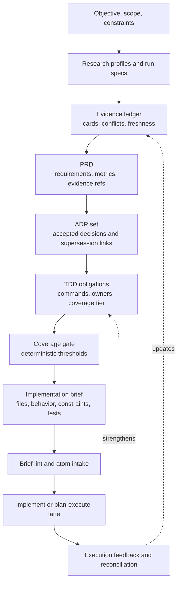
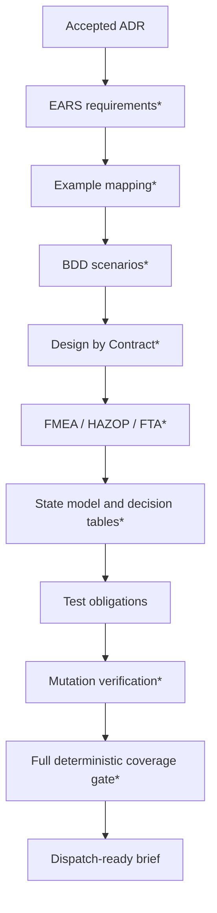
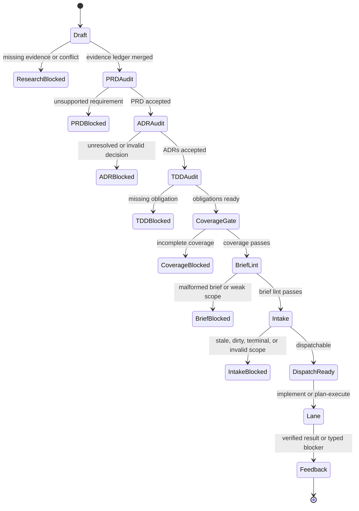

# Product Workflow and Behavioral Coverage

This note is the current Obsidian summary for Idiom's upstream product workflow:
research evidence -> PRD -> ADR -> TDD obligations -> dispatch-ready brief.

It replaces the earlier proposal and roadmap split. The underlying design docs
remain the canonical long-form references:

- [design-prd-adr-brief-research-workflow.md](../design-prd-adr-brief-research-workflow.md)
- [design-tdd-coverage.md](../design-tdd-coverage.md)

## Current State

The workflow has deterministic headless CLI surfaces and durable fixtures. The
closed effort folder under
`docs/product-workflows/efforts/closed/prd-adr-brief-workflow/` is a status
bucket, not a claim that every target design* is complete.

Implemented surfaces include:

- `idiom product lint`
- `idiom product audit`
- `idiom product status`
- `idiom product efforts`
- `idiom product status-migration`
- `idiom product research`
- `idiom product prd --render-prompt`
- `idiom product adr --render-prompt`
- `idiom product tdd --plan-obligations`
- `idiom product tdd --evaluate-coverage`
- `idiom product brief --render`
- `idiom product feedback`

The shipped path is intentionally conservative. Product commands render,
validate, link, and summarize artifacts; they do not turn arbitrary product
intent into write authority by themselves. Dispatch still belongs to Idiom lanes
and their runtime contracts.

`*` marks roadmapped coverage, TUI, sidecar, or telemetry behavior.

## Product Pipeline

The main principle is that a brief is the executable handoff, not the whole
product process. Research, requirement shaping, architecture decisions, and test
obligations live upstream so lane execution receives bounded facts instead of a
free-form product conversation.

## What The Harness Owns

| Stage | Harness-owned contract |
| --- | --- |
| Research | Profile shape, planned run specs, output schema, evidence merge, conflict handling |
| PRD | Parser, required metadata, evidence and TDD references, acceptance fields |
| ADR | Parser, Nygard-format structure, PRD/evidence/TDD links, supersession validation |
| TDD | Obligation ledger schema, deterministic obligation plan, command ownership |
| Coverage | Tiered gate evaluation and blocker reporting |
| Brief | Deterministic brief generation, required sections, files, tests, stop rules |
| Dispatch | Brief lint, atom intake, required edit paths, lane contracts |
| Feedback | Privacy-safe execution references, reconciliation, product metrics, ranker-learning evidence |

The model may draft PRD/ADR prose, synthesize examples, or propose risk ratings
when asked by an operator. Every generated artifact must re-enter deterministic
parse, audit, acceptance, coverage, and dispatch gates before it affects work.

## Behavioral Coverage

The target behavioral coverage design* is broader than the current shipped
gate. The long-form target* remains in
[design-tdd-coverage.md](../design-tdd-coverage.md).

Current implementation is narrower:

- TDD obligation types and ledger parsing exist.
- Deterministic TDD obligation synthesis from accepted PRD/ADR artifacts exists.
- A tiered coverage evaluator exists for current product-workflow fixtures.
- Brief generation blocks on coverage-gate blockers.

Remaining target work* includes EARS parsing*, example mapping*, BDD
validation*, contract schemas*, FMEA/HAZOP/FTA templates*, state-machine
checks*, decision table enumeration*, property-based obligations*, mutation
score calculation*, and the full nine-stage coverage gate*.

## Open Work*

High-signal remaining work*:

- Reuse product lint/audit traceability, acceptance, and supersession authority*
  inside the coverage gate, or run those validators as blocking preconditions.
- Harden status-migration apply temp-path writes against symlink surprises.*
- Add the durable two-ADR supersession fixture* and encode the
  index-vs-markdown divergence authority rule.
- Complete TUI continuation/handoff fixtures* for product workflow actions.
- Expose read-only product workflow status through `idiom tool` and MCP.*
- Add `tdd_eval` research profiles* with FMEA/HAZOP sources.
- Add runtime telemetry events* for research, evidence-card, PRD, ADR, TDD,
  coverage-gate, and dispatch-blocked transitions where durable reports are not
  enough.

## Operator Model*

`*` means this is the target operator model; shipped CLI status and read-only
TUI presenters cover only the implemented subset.

The TUI should present this workflow through shared product status and recovery
view models. It should not infer progress from chat transcript text. If
workflow state, artifacts, lane history, plan-execute progress, or recovery
packets disagree, the right result is a reconciliation blocker.

## Related Notes

- [[01 - System Map]]
- [[02 - Deterministic Evidence-Based Development]]
- [[04 - Runtime Lanes]]
- [[08 - Planning Packets and Handoff]]
- [[09 - Verification Readiness and Completion]]
- [[16 - Operational Commands and Evidence Products]]
- [[19 - CLI TUI and Operator Surface]]
- [[21 - Recovery and Decomposition]]
